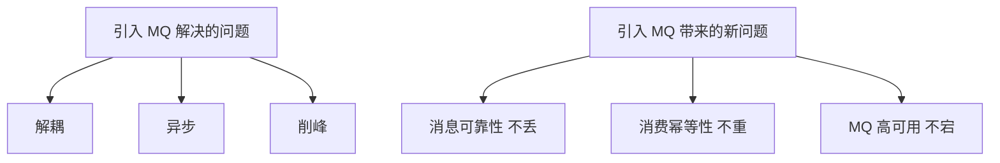

# MQ 为什么是中高级程序员绕不开的技能

Message Queue，中文叫消息队列，是分布式系统里一种常见的通信手段。RabbitMQ 是众多 MQ 产品里表现比较优秀的一款。这门技术有两个标签：重要，且复杂。重要在于它能帮企业解决很多真实痛点；复杂在于引入它之后又会带来一堆新问题，需要开发者自己兜住。理解这两点，才知道后面两天课到底在学什么。

## 先给结论

- MQ 是分布式系统之间异步通信的中间件，能把「直接调用」变成「发消息、再消费」，解耦、削峰、异步是它的核心价值。
- 引入 MQ 不是免费的：消息可靠性、消费幂等性、MQ 自身高可用，都是引入后才冒出来的新课题，也是面试高频考点。
- 如今 MQ 已经是中高级开发的必备技能，面试中常被追问「怎么保证消息不丢、不重、不堆积」。
- 课程用两天覆盖：第一天打基础（概念、入门程序、工作模式、Spring 整合），第二天啃高级（结合实际企业问题与面试题）。

## 一、重要在哪

企业系统越做越复杂，服务之间硬耦合调用会让整个链路脆弱又难以扩展。MQ 的价值就体现在几类典型场景：

**第一，解耦。** A 系统原来要直接调 B、C、D，任何一方的接口变动都牵动 A。引入 MQ 后，A 只管把消息发出去，谁关心谁去消费，A 不再依赖具体下游。

**第二，异步。** 原来串行同步等待的操作，改成发消息后立刻返回，耗时操作由消费者慢慢处理，用户侧响应更快。

**第三，削峰。** 突发流量先堆进队列，后端按自己节奏消费，避免瞬时洪峰冲垮数据库。

拿一个订单场景把三者串起来会更直观：用户下单后，主流程只写订单库并发一条「下单成功」的消息；扣优惠券、发短信、更新推荐列表这些动作分别由各自的消费者处理，任何一个下游挂了都不影响下单本身。大促瞬间涌入的订单先进队列，消费端按数据库能承受的速度慢慢消化，各环节独立扩容，这正是解耦、异步、削峰在同一个场景里的合力。

正因为能解决这些实打实的问题，MQ 才成为企业开发的标配。

## 二、复杂在哪

引入 MQ 等于在系统里加了一个关键的第三方组件，它本身要可用，消息还要「送得到、不重复、不丢失」。课程里反复强调要会答的几个问题，正是复杂度所在：



图上左边是收益，右边是代价。能同时把左右都说清楚，才算是真正掌握了 MQ。

## 三、为什么和面试强相关

面试官几乎必问 MQ，而且往往这样切入：「你会用 MQ 吗，在哪些场景用过？」多数人能答上场景，但被接着问「你怎么保证消息可靠性、幂等性、高可用」时，七成以上会卡壳。所以这门课不只教怎么用，更会结合实际企业开发和面试常问，把高级部分讲透。学完两天内容，无论工作里排障还是面试里对答，都能稳住。

## 四、两天的学习路线

课程安排很明确，先把基础打牢，再上高级：

```mermaid
flowchart LR
    subgraph 第一天 基础
        D1["MQ 基本概念"]
        D2["RabbitMQ 入门程序"]
        D3["RabbitMQ 工作模式"]
        D4["Spring 整合 RabbitMQ"]
    end
    subgraph 第二天 高级
        G1["可靠性 / 幂等性"]
        G2["高可用"]
        G3["企业实战问题"]
    end
    第一天 基础 --> 第二天 高级
```

图上基础部分让你能跑起来、会写代码，高级部分让你在真实项目和面试里扛得住。

## 五、动手前先把环境准备好

虽然是概念课，但后面马上要写入门程序，提前把 RabbitMQ 跑起来能省不少时间。下面用容器方式启动一个本地 RabbitMQ（含管理界面），属于示例环境命令：

```bash
# 启动 RabbitMQ 容器，映射 AMQP 5672 与管理界面 15672
docker run -d --name rabbitmq \
  -p 5672:5672 -p 15672:15672 \
  rabbitmq:3.12-management
```

启动后访问 `http://localhost:15672`，默认账号密码都是 `guest`，就能进管理后台看到队列和连接。这是后续所有示例的运行前提。

一个最精简的生产者发消息骨架（示例，后续入门课会展开），用来感受「发」这件事长什么样：

```java
// 示例：最小化的 RabbitMQ 生产者骨架，仅示意 API 形态
public class ProducerDemo {
    public void send() {
        // 1. 建立连接、创建通道
        // 2. 声明队列
        // 3. 通过 channel.basicPublish 发送消息
        // 真实代码见后续入门程序章节，此处仅展示调用顺序
    }
}
```

## 常见误区

- **以为 MQ 只是个队列**：它更是一套可靠性机制，忽略持久化、确认机制，消息丢了很难排查。
- **只学怎么发消息，不问怎么不丢不重**：面试和工作里真正难的都在可靠性、幂等性、高可用，不能止步于「能跑」。
- **认为引入 MQ 一定提升性能**：异步削峰是收益，但多了一次网络跳转和中间件依赖，设计不当反而增加延迟和故障点。
- **把 MQ 当数据库用**：消息中间件不适合做长期存储，未消费消息堆积过多会撑爆内存或磁盘。

## 面试可能被问到的问题

1. 面试官追问：「MQ 能帮企业解决哪些问题？」
   答：主要是解耦、异步和削峰。解耦让服务不直接依赖下游，异步让主流程快速返回，削峰让突发流量先进队列再由后端按节奏消费，避免冲垮系统。

2. 面试官追问：「引入 MQ 会带来什么新问题？」
   答：消息可靠性（不丢失）、消费幂等性（不重复处理）、MQ 自身高可用（不宕机）以及消息堆积治理，这些都是引入后才需要解决的课题。

3. 面试官追问：「为什么 MQ 是面试高频考点？」
   答：因为它既要求会用，又要求能讲清可靠性、幂等、高可用等机制，能区分出开发者是只写过 demo 还是真正在生产踩过坑。

4. 面试官追问：「RabbitMQ 在众多 MQ 里是什么定位？」
   答：RabbitMQ 是基于 AMQP 协议、生态成熟、功能完整的消息中间件，易用性和可靠性均衡，适合大多数企业级异步通信场景，是入门和实战都常用的选择。

## 配套资料

- 本课为概念导入，无配套源码包，文中 `docker run` 与生产者骨架均为按本课写法补全的示例；后续入门程序见课程 RabbitMQ 第一天代码工程（`materials/code/01` 下 `3.RabbitMQ` 相关资料，如有则在对应章节补充）
