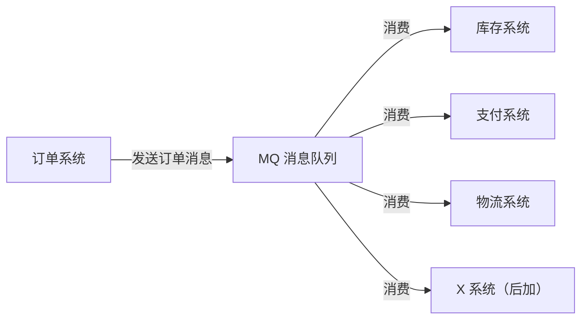
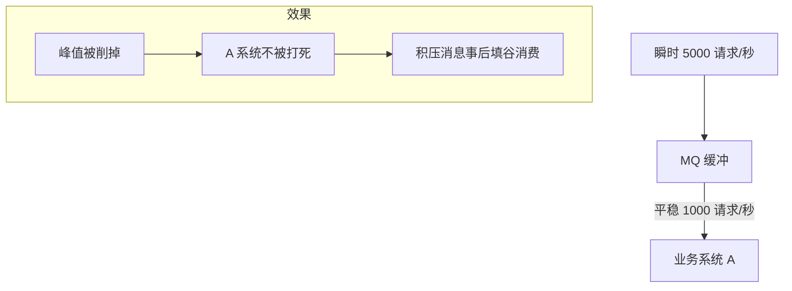
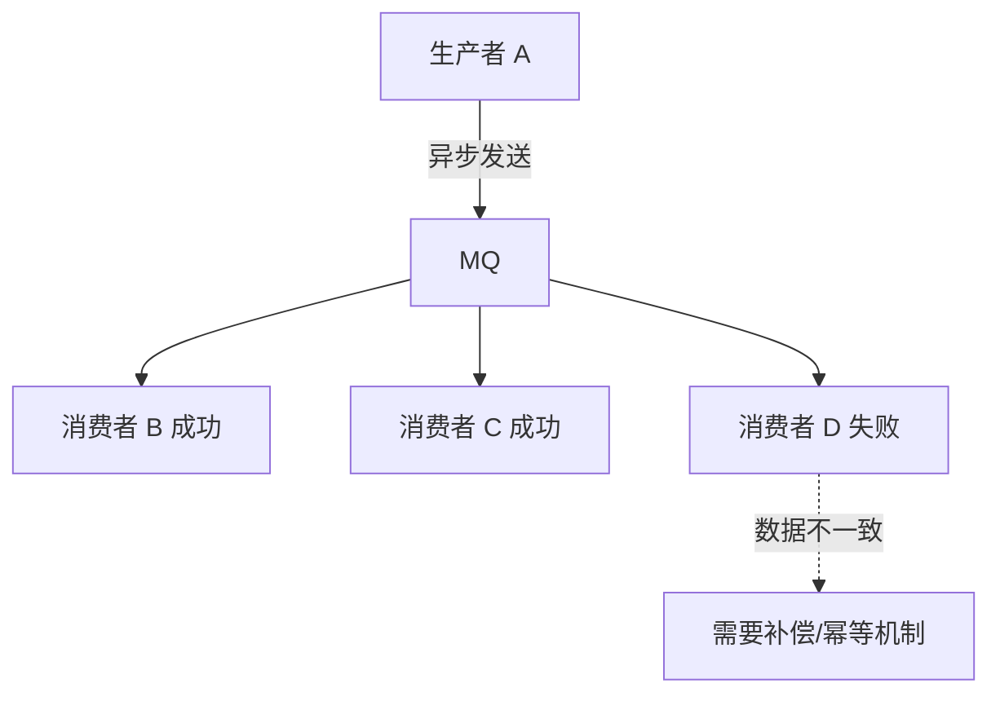

# 引入消息队列到底值不值：把 MQ 的优势与劣势一次讲清

下单接口慢到接近一秒，库存系统一挂整条链路就报错，运营加个需求你就得改一遍订单代码。这是微服务拆开之后，系统之间直接用远程调用串起来的典型痛点。消息队列（Message Queue，下文简称 MQ）被引入，正是为了把这种「你必须马上等我干完」的强耦合，变成「你只管把消息丢进来」的弱依赖。但 MQ 不是银弹，它自己也会带来新的麻烦。这篇把优势和劣势摆在一起讲，帮你判断到底该不该上 MQ。

## 先给结论

- MQ 的三个核心优势是应用解耦、异步提速、削峰填谷，分别对应「容错性/可维护性」「响应速度/吞吐量」「抗突发流量」。
- MQ 的三个核心劣势是系统可用性降低、系统复杂度提高、数据一致性更难保证，这些都是引入新依赖必然付出的代价。
- 是否使用 MQ 有三个前提：生产者不需要从消费者处获得反馈、业务能容忍短暂的不一致、引入 MQ 的收益要大于维护它的成本。
- 能用直接远程调用满足需求的简单场景，不要为了「显得高级」而引入 MQ。

## 一、三个优势：解耦、提速、削峰

**第一，应用解耦解决的是容错性和可维护性问题。** 设想一个订单系统，下单时要调用库存、支付、物流三个系统。如果用同步远程调用把它们串起来，三个系统就和订单系统绑死了。库存系统宕机，订单系统整条链路走不通，用户看到的是「下单失败」，这就是容错性低。更麻烦的是可维护性：产品经理想在下单链路里再加一个 X 系统，订单开发只能改代码、重新部署，链路每变一次就改一次。

引入 MQ 之后，订单系统只把一条订单消息发给 MQ 就返回成功，库存、支付、物流各自从 MQ 取消息消费。库存系统挂了，订单系统不受影响，等它恢复后再从 MQ 把积压的消息取走即可，数据最终一致。产品经理要加 X 系统，只需要让 X 系统去 MQ 订阅这条消息，订单系统一行代码都不用改。

图里最关键的一点是：订单系统只和 MQ 打交道，下游系统增删都不影响它，耦合被截断在 MQ 这一层。

**第二，异步提速解决的是响应速度和吞吐量问题。** 不引入 MQ 时，订单系统自己写库约 20 毫秒，再同步调用库存、支付、物流各 300 毫秒，用户要等 920 毫秒才能看到结果。920 毫秒对互联网产品来说已经偏慢，用户体验会明显下降。

引入 MQ 后，订单系统写库 20 毫秒，把消息发到 MQ 约 5 毫秒，立刻返回「下单成功」。剩下的库存、支付、物流处理由它们异步慢慢消费，用户只等 25 毫秒。系统吞吐量也从「每秒约 1 个请求」提升到「每秒约 40 个请求」，因为原来阻塞在调用链上的时间被释放了。

**第三，削峰填谷解决的是抗突发流量问题。** 假设系统 A 平时每秒最多处理 1000 个请求，搞一个「一元秒杀」活动，瞬间涌入每秒 5000 个请求，A 系统直接被打死。在 A 系统前放一层 MQ，所有请求先落到 MQ，MQ 可以轻松承接 5000 的瞬时流量，A 系统仍然按自己每秒 1000 的速度平稳消费。高峰过后，MQ 里积压的消息会被 A 系统慢慢消费完，这就是「填谷」。

图里体现的核心价值：MQ 像一个水库，把洪峰蓄起来，下游按自己的节奏放水。

## 二、三个劣势：代价同样真实

**第一，系统可用性降低。** 原来只有 A、B 两个子系统，只要两者正常，整个分布式系统就正常。引入 MQ 后，你还要额外保证 MQ 本身正常。外部依赖越多，整体稳定性越差，MQ 一旦宕机就会直接影响业务。如何让 MQ 高可用，成了设计上的关键点。

**第二，系统复杂度提高。** 原来是同步远程调用，逻辑是直来直去的。现在消息经过 MQ 异步流转，你得额外考虑一堆问题：消息会不会被重复消费？消息丢了怎么办？消息的顺序怎么保证？这些在直接调用时代几乎不用操心，引入 MQ 后都成了必须设计的部分。

**第三，数据一致性更难保证。** 订单系统发消息给 B、C、D 三个系统，如果 B、C 处理成功，D 处理失败，数据就不一致了。如何让多个消费者的处理结果最终一致，是真实生产环境里的高频难题，也是面试常被追问的点。

图里展示了一个典型的一致性危机：部分消费者失败，没有任何一方能自动回滚全部。

## 三、什么时候才该用 MQ

满足下面三个条件，MQ 才值得引入：

**第一，生产者不需要从消费者处获得反馈。** 如果 A 调用 B 之后，必须拿着 B 的返回结果再去调 C，那就不能用 MQ 做异步，因为异步意味着「发完就走、不等结果」。下单场景之所以能用 MQ，正是因为「消息一发完就给用户反馈成功」，并不等下游真正执行完。

**第二，业务容许短暂的不一致性。** 下单后立刻告诉用户成功，但此时库存、支付、物流可能还没执行完，数据短暂是不一致的。只要最终能一致，并且业务能容忍这个窗口，MQ 才适用。

**第三，收益超过成本。** 解耦、提速、削峰带来的好处，要大于引入并维护 MQ 的代价。一个极简的内部功能硬上 MQ，反而增加复杂度，得不偿失。

## 常见误区

- **认为 MQ 能解决所有通信问题**：需要同步拿到返回值的场景，MQ 反而让事情变复杂，该用远程调用就用远程调用。
- **忽略 MQ 自身的高可用**：把 MQ 当成永远在线的组件，结果 MQ 宕机拖垮全链路。生产环境必须考虑镜像队列、集群等保障手段。
- **忽视消息重复与丢失**：以为消息发出去就万无一失，没有设计消费端的幂等和投递确认，上线后数据错乱。
- **把短暂不一致当成 bug 恐慌**：没理解 MQ 的异步本质，看到「下单成功但库存还没扣」就当作系统故障，其实这是预期内的中间状态。

## 面试可能被问到的问题

1. 面试官追问：「MQ 能带来哪些核心优势？」
   答：主要是应用解耦、异步提速、削峰填谷。解耦让上下游系统互不影响、可独立演进；异步让生产者发完消息即可返回，提升响应速度和系统吞吐量；削峰填谷用 MQ 缓冲瞬时高并发，保护下游系统不被打垮。

2. 面试官追问：「引入 MQ 会带来什么代价？」
   答：一是系统可用性降低，多了一个必须保证高可用的外部依赖；二是系统复杂度提高，要处理消息重复、丢失、顺序等问题；三是数据一致性更难保证，多消费者部分失败会导致不一致，需要补偿或幂等机制。

3. 面试官追问：「什么场景不适合用 MQ？」
   答：当生产者必须同步拿到消费者的返回结果再去执行后续逻辑时，MQ 的异步特性不适用；或者业务无法容忍任何不一致；又或者系统很简单，引入 MQ 的成本高于收益时，都不适合用 MQ。

4. 面试官追问：「削峰填谷具体是怎么实现的？」
   答：在突发流量和下游系统之间加一层 MQ，所有请求先写入 MQ，下游按自己固定的处理能力（如每秒 1000 个）匀速消费。瞬时高峰被 MQ 吸收，不会直接冲击下游，高峰过后积压消息再被逐步消费完，即填谷。

5. 面试官追问：「为什么说 MQ 会降低系统可用性？」
   答：因为整个分布式系统原先只依赖少数几个子系统，引入 MQ 后，MQ 本身成为关键路径上的一环。只要 MQ 宕机，即便业务系统都正常，消息也无法流转，业务照样受影响，所以外部依赖越多整体可用性越难保障。

## 配套资料

- 本课无配套源码包（materials/code 下未提供 MQ 相关工程），正文示意图均为按课程讲解还原，并未引用真实工程代码。
- 延伸阅读可参考 RabbitMQ、RocketMQ 等官方文档中关于「何时使用消息队列」的章节。
