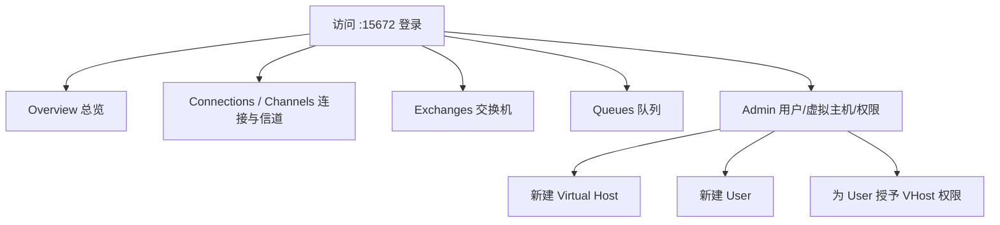
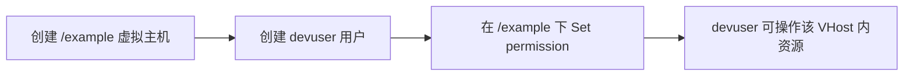

# 不用敲命令也能管消息：RabbitMQ 管理控制台怎么用

装好 RabbitMQ 之后，如果只能通过命令行看状态，排查问题会非常痛苦。RabbitMQ 自带一个 Web 管理控制台（rabbitmq_management 插件），几乎所有日常操作，建用户、建虚拟主机、看队列堆积、查绑定关系，都能在浏览器里点完。这篇带你把控制台的主要区域和关键操作过一遍。

## 先给结论

- 管理控制台走 15672 端口，启用插件命令是 `rabbitmq-plugins enable rabbitmq_management`，默认账号 `guest` / `guest`。
- 控制台核心页签有 Overview、Connections、Channels、Exchanges、Queues、Admin，分别对应总览、连接、信道、交换机、队列、后台管理。
- 实际工作中要先建虚拟主机（Virtual Host），再建用户，最后给用户授予该虚拟主机的权限，三者顺序不能乱。
- 控制台能直观看到队列里的消息数、绑定关系、端口信息，是排查「消息没收到」「队列没建出来」的第一现场。

## 一、登录后先看哪些区域

启用插件并访问 `http://<服务器IP>:15672` 后，用 `guest` / `guest` 登录（远程访问需先在配置中放开 `loopback_users` 并重启）。首页右上角显示当前登录用户、节点名和 Erlang 版本等基本信息。

顶部一排页签是日常操作的全部入口：

- **Overview（概览）**：集群总览，包含连接数、信道数、交换机数、队列数、消息总数，以及节点内存、磁盘容量等。
- **Connections（连接）**：当前所有客户端 TCP 连接，没有客户端连上来时这里为 0。
- **Channels（信道）**：连接内部的信道，连接为 0 时自然也没有信道。
- **Exchanges（交换机）**：列出所有交换机，系统默认的 `amq.*` 系列之外，你自建的交换机也会出现在这里。
- **Queues（队列）**：列出所有队列和每条队列里的消息数，是排查消费问题最常看的页。
- **Admin（管理）**：管理用户、虚拟主机、策略、权限。



图里点明了一条主线：登录后先总览，再到 Admin 完成「虚拟主机 → 用户 → 授权」的初始化，平时排查问题则主要看 Exchanges 和 Queues。

每个页签里还有细节值得点开看：Queues 页点进某个队列，能看到 Ready 与 Unacked 两类消息数，前者是待消费的，后者是已投递给消费者但尚未确认的，两者相加才是队列的真实积压量；Exchanges 页点进交换机，能看到它和哪些队列建立了绑定、绑定时用的路由键是什么。熟悉这几个位置，后面调工作模式时能省下大量命令行操作。

## 二、创建用户与虚拟主机

**第一，先建虚拟主机。** 在 Admin 页切到 Virtual Hosts，新建一个虚拟主机，例如命名为 `/example`。它相当于一个逻辑隔离空间，里面只放你这个业务的交换机和队列。

**第二，再建用户并授权。** 在 Admin 的 Users 里新建用户 `devuser`，Tag 设为 `administrator`。新建后该用户尚未绑定任何虚拟主机，需要回到虚拟主机详情页，在 Permissions 区域把 `devuser` 加进来并 Set permission，这样该用户才有权限操作 `/example` 内的资源。反之，查看虚拟主机详情时也能看到它被绑定到了哪个用户。



图里强调授权这一步容易被漏掉：用户建完不授权，连队列都看不到。

**第三，用新用户登录验证。** 退出 `guest`，用 `devuser` 重新登录，右上角显示当前用户已切换，说明账号体系配置成功。

## 三、关键端口与配置导出

在 Overview 页面底部可以看到端口信息，记住三组：

- 5672：AMQP 客户端连接端口，写代码用它。
- 25672：集群通信端口。
- 15672：管理控制台端口。

控制台还提供 Import / Export definitions 功能，能把当前所有交换机、队列、绑定、用户权限导出成一个 JSON 文件。做环境迁移时，先在原环境导出，再在新环境导入，配置即可一键复现，非常省事。

日常观察消息变化时，可以用 Overview 页右上角的自动刷新开关把刷新间隔调小，消息数的涨落一眼可见。另有一条纪律要守住：不要在控制台里随手删除队列或清空消息，尤其是不确定归属时，误删绑定关系的恢复成本很高，生产环境更要给控制台账号分好权限。

如果需要自定义服务端配置（如配置文件路径），可以把安装目录下的 `rabbitmq.config.example` 复制到 `/etc/rabbitmq/rabbitmq.config`，修改后重启服务生效：

```bash
cp /usr/share/doc/rabbitmq-server-*/rabbitmq.config.example \
   /etc/rabbitmq/rabbitmq.config
service rabbitmq-server restart
```

## 常见误区

- **建完用户不授权**：用户创建了却访问不了虚拟主机，九九归一是漏了 Set permission 这一步。
- **远程用 guest 登录**：默认 guest 只允许本机，远程访问必须新建用户并放开限制，否则一直登录失败。
- **只盯 Queues 不看 Connections**：消息没消费，有时是因为客户端根本没连上来，先去 Connections 确认连接存在。
- **忘记导出配置做迁移**：手动重建几十个队列和绑定极易出错，应优先用 Import / Export definitions。

## 面试可能被问到的问题

1. 面试官追问：「RabbitMQ 管理控制台默认端口和账号是什么？」
   答：管理控制台端口是 15672，启用插件命令是 `rabbitmq-plugins enable rabbitmq_management`，默认账号 `guest` / `guest`，但 guest 默认仅限本机登录，远程需新建用户。

2. 面试官追问：「新建用户后为什么还是看不到队列？」
   答：大概率是没给用户授予虚拟主机的权限。用户和虚拟主机是两个独立概念，必须在虚拟主机或用户的权限页执行 Set permission，用户才能看到并操作该空间内的交换机和队列。

3. 面试官追问：「控制台里 Connections 为 0 说明什么？」
   答：说明当前没有客户端通过 5672 与服务端建立 TCP 连接，自然也不会有 Channel。排查消费问题时若连接数为 0，先确认客户端代码是否成功连上服务端。

4. 面试官追问：「RabbitMQ 配置文件一般放哪，怎么生效？」
   答：通常放在 `/etc/rabbitmq/rabbitmq.config`，可由安装目录下的 example 文件复制而来。修改后需要重启服务（`service rabbitmq-server restart`）才能生效。

5. 面试官追问：「怎么做 RabbitMQ 环境迁移？」
   答：利用控制台的 Import / Export definitions，把源环境的交换机、队列、绑定、用户权限导出为 JSON，再在目标环境导入即可，避免手工重建。

## 配套资料

- 本课无配套源码包（materials/code 下未提供 RabbitMQ 工程），正文操作均按课程控制台演示步骤还原，未引用真实工程代码。
- 可结合 RabbitMQ 官网「Management Plugin」文档对照各页签含义。
