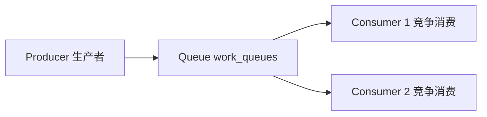
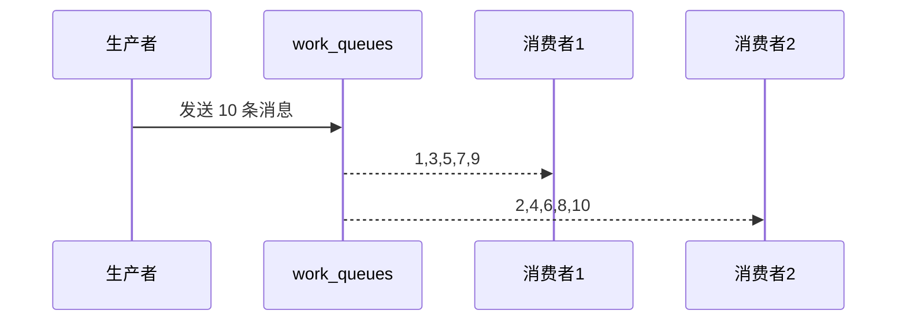
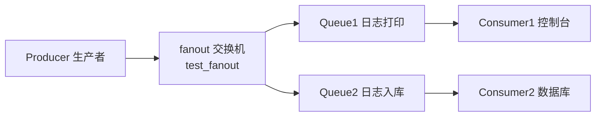
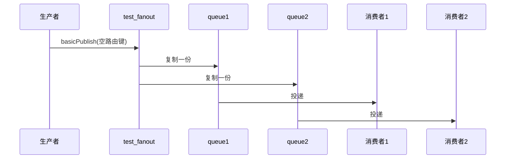
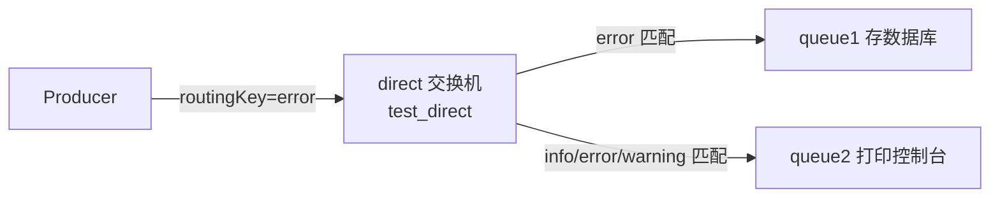
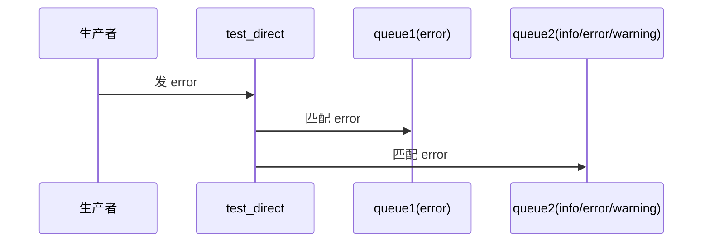
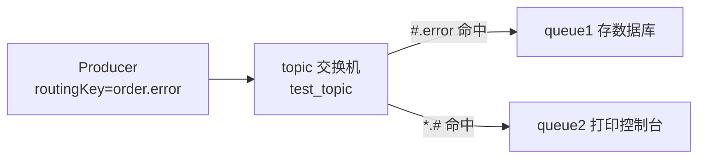
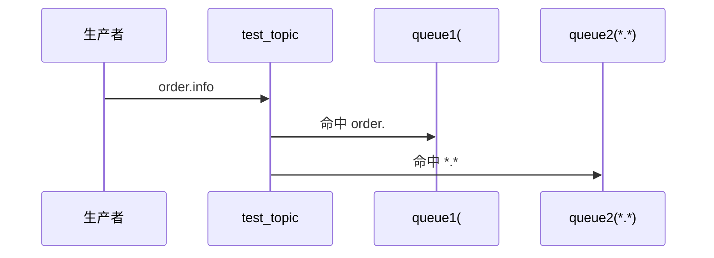
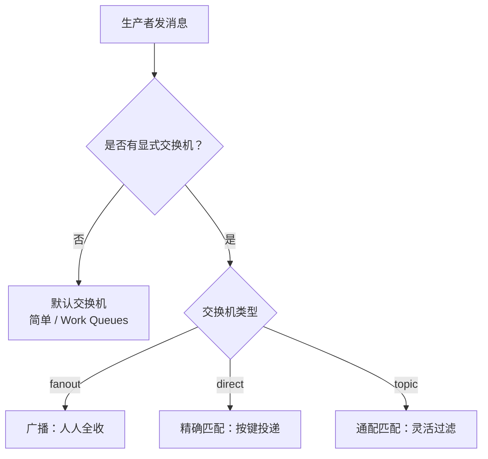
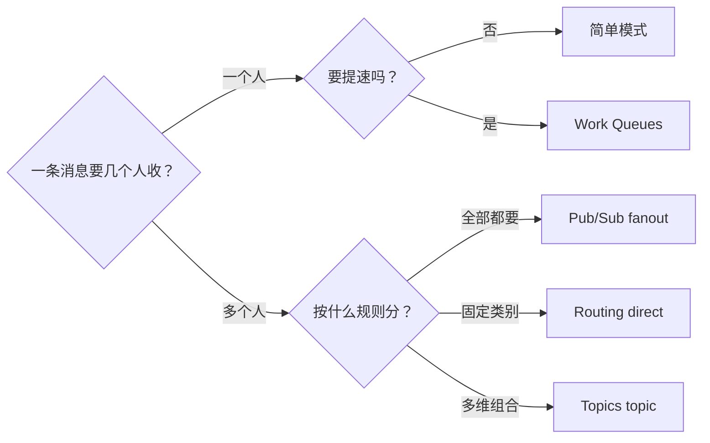

# RabbitMQ工作模式五讲：从 Work Queues 竞争消费到 Topics 通配路由的演进与选型

## 先给结论

RabbitMQ 的五种工作模式不是并列的五件事，而是同一套「生产者、交换机、队列、消费者」骨架上的不同路由策略。全系列五讲沿着投递语义的演进推进：消息从被一个消费者抢走，到复制给所有绑定的队列，再到按 routing key 精确投递、按通配符灵活匹配，收尾用一张对照表把选型钉死。
Work Queues 打头：多个消费者竞争同一个队列，轮询分发天然负载均衡，处理能力随消费者数量线性扩展。Pub/Sub 引入真正的 fanout 交换机，一条日志可以同时打印和存库，每个消费者各听各的队列、各拿完整副本。Routing 用 direct 交换机按级别精准投递，error 进库、info 只打印，互不打扰。Topics 用 topic 交换机加 `*` 与 `#` 通配符，把「既要按级别、又要按系统」的组合条件一次表达到位。
总结一讲把五种模式与交换机类型对应起来：简单模式与 Work Queues 用默认交换机，Pub/Sub 用 fanout，Routing 用 direct，Topics 用 topic；投递语义分竞争消费与广播、匹配消费两类，RPC 属于请求应答，不在解耦主线内。选型时先问消息该被几个人拿，再问按什么规则路由，答案就出来了。
五讲依次是：
- Work Queues：一个队列被多人抢、轮询分发与适用场景。
- Pub/Sub 生产者与消费者：fanout 广播、queueBind 绑定与完整副本。
- Routing：direct 精确匹配 routing key 与一个队列多个绑定。
- Topics：通配符规则、点分段路由键与广播加匹配的最灵活形态。
- 总结：五种模式对照、演进逻辑与怎么选。

## 第1部分：一个队列被两人抢：Work Queues 工作队列模式

简单模式是一个生产者对应一个消费者，消息没人分担。现实里，发消息的速度往往远快于单个消费者处理速度，比如一秒进来 1000 条，单个消费者只能处理 500 条。Work Queues（工作队列）模式的做法是：多个消费者监听同一个队列，消息被它们竞争消费，处理能力随消费者数量线性扩展。这篇把这种模式写通。

### 一、模式长什么样

和简单模式相比，Work Queues 只是把消费者从一个变成多个，且都盯着同一个队列：



图里最关键的一点：C1 和 C2 是竞争关系，不是广播关系。一条消息要么被 C1 拿到，要么被 C2 拿到，不可能两个都拿到。

### 二、生产者：一次发多条

生产者代码和简单模式基本相同，只是用循环多发几条，并且队列名改成 `work_queues`：

```java
package com.example.producer;

import com.rabbitmq.client.Channel;
import com.rabbitmq.client.Connection;
import com.rabbitmq.client.ConnectionFactory;

public class Producer_WorkQueues {
    public static void main(String[] args) throws Exception {
        ConnectionFactory factory = new ConnectionFactory();
        factory.setHost("localhost");
        factory.setPort(5672);
        factory.setVirtualHost("/");
        factory.setUsername("guest");
        factory.setPassword("guest");
        Connection connection = factory.newConnection();
        Channel channel = connection.createChannel();

        // 声明队列（默认交换机，路由键即队列名）
        channel.queueDeclare("work_queues", true, false, false, null);

        for (int i = 1; i <= 10; i++) {
            String body = "hello RabbitMQ---" + i;
            channel.basicPublish("", "work_queues", null, body.getBytes());
        }
        channel.close();
        connection.close();
    }
}
```

循环发出 10 条带编号的消息后，队列里会堆积 10 条 Ready 消息，等待消费者来取。

发完先别急着开消费者，去控制台 Queues 页点开 `work_queues`，Ready 数量应为 10，用 Get Message 还能手动取一条看内容。确认消息都进队之后，再启动消费者观察消息数从 10 归零，对理解「队列缓冲」这件事非常有帮助。

### 三、消费者：复制一份监听同一队列

两个消费者代码完全一样，都监听 `work_queues`。实际项目里通常是把同一份消费者程序部署在两台机器（或两个进程）上：

```java
package com.example.consumer;

import com.rabbitmq.client.*;
import java.io.IOException;

public class Consumer_WorkQueues1 {
    public static void main(String[] args) throws Exception {
        ConnectionFactory factory = new ConnectionFactory();
        factory.setHost("localhost");
        factory.setPort(5672);
        factory.setVirtualHost("/");
        factory.setUsername("guest");
        factory.setPassword("guest");
        Connection connection = factory.newConnection();
        Channel channel = connection.createChannel();
        channel.queueDeclare("work_queues", true, false, false, null);

        Consumer consumer = new DefaultConsumer(channel) {
            @Override
            public void handleDelivery(String consumerTag, Envelope envelope,
                                       AMQP.BasicProperties properties, byte[] body) {
                System.out.println("body:" + new String(body));
            }
        };
        channel.basicConsume("work_queues", true, consumer);
    }
}
```

把上面的类再复制一份命名为 `Consumer_WorkQueues2`，内容一字不改，单独启动。两个进程都连上同一个队列后，管理控制台里该队列的 Consumers 数量会显示 2。

这种「同一份消费者代码部署多份」的做法，就是生产环境扩容消费能力的标准姿势：任务堆积时加机器、加实例，处理能力立刻翻倍，生产者代码一行不用动。理解了这一点，Work Queues 的价值就不止是一种语法模式，而是一套横向扩容方案。

### 四、竞争消费的实际效果

先启动两个消费者，再运行生产者发送 10 条消息。控制台会看到：一个消费者打印 1、3、5、7、9，另一个打印 2、4、6、8、10，两人各自分担一半。这就是轮询分发带来的负载均衡，压力被平摊而不是压在一个消费者身上。



图里展示：10 条消息被两个消费者交替拿走，谁处理完下一条才轮到谁，不会重复。

**第一，竞争而非复制是本质区别。** Pub/Sub 模式下每个消费者都有自己的队列、都能收到全量消息；Work Queues 下大家共用一个队列，只有一个人能收到某条消息。把这两种模式混淆，是新手最常犯的概念错误。

**第二，轮询是默认分发策略。** 默认情况下 RabbitMQ 按顺序把消息依次分给各个消费者，不关心谁忙谁闲。若某个消费者处理慢，它也会按序拿到等量消息，可能造成忙闲不均。带权分发（能者多劳）需要配合 prefetch 和手动确认，属于后续高级内容。

## 第2部分：一条日志两处消费：Pub/Sub 发布订阅与 fanout 交换机

从 Work Queues 开始，一条消息只能被一个消费者拿走。但很多业务需要「一份数据多处使用」，比如同一条日志，既要打印到控制台，又要存进数据库。Pub/Sub（发布订阅）模式引入了一个真正的交换机，用 fanout 类型把消息广播给所有绑定的队列，每个消费者各听各的队列，都能拿到完整的一份。这篇把生产者和消费者两端写通。

### 一、模式结构

生产者把消息发给 fanout 交换机，交换机复制后投递到所有绑定队列，每个队列对应一个消费者：



图里最关键的一点：X 到 Q1、Q2 是「复制分发」，所以 C1 和 C2 收到的是同一条消息的两份副本，而非一人一半。

把日志场景换成通知场景同样成立：支付成功后，要通知积分系统加积分、通知短信系统发消息、通知数据分析系统做埋点。用 fanout 把「支付成功」广播出去，三方各建队列各管各的，支付服务不需要知道有几方订阅，未来再加一方也只是新增一个绑定，生产者代码不用动。

### 二、生产者：声明交换机、队列并绑定

和简单模式相比，多了「声明交换机」和「绑定队列」两步，且发送时第一个参数要填交换机名：

```java
package com.example.producer;

import com.rabbitmq.client.BuiltinExchangeType;
import com.rabbitmq.client.Channel;
import com.rabbitmq.client.Connection;
import com.rabbitmq.client.ConnectionFactory;

public class Producer_PubSub {
    public static void main(String[] args) throws Exception {
        ConnectionFactory factory = new ConnectionFactory();
        factory.setHost("localhost");
        factory.setPort(5672);
        factory.setVirtualHost("/");
        factory.setUsername("guest");
        factory.setPassword("guest");
        Connection connection = factory.newConnection();
        Channel channel = connection.createChannel();

        // 1. 声明 fanout 类型交换机
        String exchangeName = "test_fanout";
        channel.exchangeDeclare(exchangeName, BuiltinExchangeType.FANOUT, true, false, false, null);

        // 2. 声明两个队列
        String queue1Name = "test_fanout_queue1";
        String queue2Name = "test_fanout_queue2";
        channel.queueDeclare(queue1Name, true, false, false, null);
        channel.queueDeclare(queue2Name, true, false, false, null);

        // 3. 绑定队列到交换机（fanout 路由键为空）
        channel.queueBind(queue1Name, exchangeName, "");
        channel.queueBind(queue2Name, exchangeName, "");

        // 4. 发送消息
        String body = "日志信息：张三调用了 findAll 方法...日志级别：info...";
        channel.basicPublish(exchangeName, "", null, body.getBytes());

        channel.close();
        connection.close();
    }
}
```

**第一，exchangeDeclare 的六个参数。** 依次是：交换机名称、类型（用 `BuiltinExchangeType.FANOUT` 枚举，比写字符串不易错）、是否持久化、是否自动删除、是否内部使用（一般 false）、附加参数（无则 null）。

**第二，fanout 的路由键固定为空。** 因为广播类型不需要匹配规则，绑定和发送时 routingKey 都传空字符串。即便你写了路由键，fanout 也会无视它，照样广播给所有队列。

还有一个值得留意的工程习惯：生产者代码里把交换机、队列、绑定一次性声明齐全，是保证「只跑生产者也能独立工作」的写法。声明操作是幂等的，重复声明会被自动忽略；这也意味着消费者侧同样可以声明自己的队列并完成绑定，两端声明互不冲突，谁先跑谁先建，最后结构一致。

### 三、消费者：监听各自的队列

消费者代码和之前几乎一样，区别只是监听的是 `test_fanout_queue1` 或 `test_fanout_queue2`，不再需要自己声明交换机。下面是两个消费者，处理逻辑不同：

```java
package com.example.consumer;

import com.rabbitmq.client.*;
import java.io.IOException;

public class Consumer_PubSub1 {
    public static void main(String[] args) throws Exception {
        ConnectionFactory factory = new ConnectionFactory();
        factory.setHost("localhost");
        factory.setPort(5672);
        factory.setVirtualHost("/");
        factory.setUsername("guest");
        factory.setPassword("guest");
        Connection connection = factory.newConnection();
        Channel channel = connection.createChannel();

        Consumer consumer = new DefaultConsumer(channel) {
            @Override
            public void handleDelivery(String consumerTag, Envelope envelope,
                                       AMQP.BasicProperties properties, byte[] body) {
                System.out.println("将日志打印到控制台：" + new String(body));
            }
        };
        channel.basicConsume("test_fanout_queue1", true, consumer);
    }
}
```

```java
package com.example.consumer;

import com.rabbitmq.client.*;
import java.io.IOException;

public class Consumer_PubSub2 {
    public static void main(String[] args) throws Exception {
        ConnectionFactory factory = new ConnectionFactory();
        factory.setHost("localhost");
        factory.setPort(5672);
        factory.setVirtualHost("/");
        factory.setUsername("guest");
        factory.setPassword("guest");
        Connection connection = factory.newConnection();
        Channel channel = connection.createChannel();

        Consumer consumer = new DefaultConsumer(channel) {
            @Override
            public void handleDelivery(String consumerTag, Envelope envelope,
                                       AMQP.BasicProperties properties, byte[] body) {
                System.out.println("将日志保存到数据库：" + new String(body));
            }
        };
        channel.basicConsume("test_fanout_queue2", true, consumer);
    }
}
```

先运行生产者（它会把交换机、两个队列、绑定关系都创建好，并放入一条消息），再分别启动两个消费者，会看到控制台打印一份、数据库模拟保存一份，两者拿到的是同一条消息。



图里清楚展示：一条消息在交换机处被复制成两份，分别进入两个队列，因此两个消费者都收到完整内容。

在这个结构上新增订阅方非常轻：新建一个队列绑到同一个 fanout 交换机，再起一个消费者即可。历史消息不会补发，但从绑定生效那一刻起，新队列就能收到后续的广播。生产者始终只管把消息发到交换机，这种「发布方不变、订阅方可扩」的扩展方式，正是发布订阅模式被广泛使用的原因。

## 第3部分：按级别精准投递：Routing 路由模式与 direct 交换机

Pub/Sub 把消息无差别广播给所有人，但有些消息不是谁都该收。比如一条 info 级别的日志打印到控制台就行，一条 error 级别的日志才需要存库。如果统统广播，数据库会被无关日志撑爆。Routing（路由）模式用 direct 类型交换机，靠 routing key 的精确匹配，让消息只进该进的队列。这篇把这种模式写通。

### 一、模式结构

生产者发消息给 direct 交换机，并携带一个 routing key；队列在绑定时也指定 routing key，只有键一致才接收：



图里体现：发 error 时两个队列都收到；发 info 时只有 queue2 收到，queue1 收不到。这就是「按需路由」。

和 fanout 相比，direct 的价值在于省掉了下游的无效处理。广播模式下，存库消费者会收到海量 info 日志再自行过滤，带宽和磁盘都被无意义消耗；direct 让交换机在路由阶段就把消息分对，下游只处理自己关心的类别，这也是它在真实项目里更常见的原因。

### 二、需求拆解

设定一个日志系统：queue1 负责把 error 级别日志存数据库，queue2 负责把 info、error、warning 级别日志打印到控制台。也就是说，error 是两边都关心的，info 和 warning 只给控制台。

这个设定贴近真实运维：error 级别日志量小但价值高，需要长期落库供事后排查，所以存库队列单独盯着它；控制台打印是开发调试用的，各级别都想看一眼，于是三种键都绑上。拆需求时先列清楚「谁关心什么」，再翻译成绑定关系，配置就不容易乱。

### 三、生产者：绑定带 routing key，发送带 routing key

```java
package com.example.producer;

import com.rabbitmq.client.BuiltinExchangeType;
import com.rabbitmq.client.Channel;
import com.rabbitmq.client.Connection;
import com.rabbitmq.client.ConnectionFactory;

public class Producer_Routing {
    public static void main(String[] args) throws Exception {
        ConnectionFactory factory = new ConnectionFactory();
        factory.setHost("localhost");
        factory.setPort(5672);
        factory.setVirtualHost("/");
        factory.setUsername("guest");
        factory.setPassword("guest");
        Connection connection = factory.newConnection();
        Channel channel = connection.createChannel();

        String exchangeName = "test_direct";
        // 声明 direct 类型交换机
        channel.exchangeDeclare(exchangeName, BuiltinExchangeType.DIRECT, true, false, false, null);

        String queue1Name = "test_direct_queue1";
        String queue2Name = "test_direct_queue2";
        channel.queueDeclare(queue1Name, true, false, false, null);
        channel.queueDeclare(queue2Name, true, false, false, null);

        // 绑定：queue1 只关心 error；queue2 关心 info/error/warning
        channel.queueBind(queue1Name, exchangeName, "error");
        channel.queueBind(queue2Name, exchangeName, "info");
        channel.queueBind(queue2Name, exchangeName, "error");
        channel.queueBind(queue2Name, exchangeName, "warning");

        // 发送一条 error 级别日志
        String body = "日志信息：张三调用了 delete 方法...日志级别：error...";
        channel.basicPublish(exchangeName, "error", null, body.getBytes());

        channel.close();
        connection.close();
    }
}
```

**第一，绑定时的 routing key 是「接收规则」。** queue1 绑了 `error`，表示「我只收 routing key 为 error 的消息」；queue2 绑了 info、error、warning 三个键，表示三种级别都收。

**第二，发送时的 routing key 是「投递标签」。** `basicPublish(exchangeName, "error", ...)` 表示这条消息打了 error 标签。交换机会把它同时投给所有绑了 error 的队列，于是 queue1 和 queue2 都收到。若改成发 `info`，则只有 queue2 收到。

路由键的命名建议在项目一开始就统一定义，比如固定用日志级别、业务事件名这类语义明确的枚举值，避免各服务各写一套。键是大小写敏感的精确匹配字符串，`Error` 和 `error` 是两个不同的键，提前约定命名规范能省掉大量排查时间。

和默认交换机做个对照能加深理解：默认交换机其实是 direct 的特例，每个队列天生绑定了以自己名字为路由键的规则。显式 direct 把绑定权交还给开发者，想收什么键自己声明，这才有了按类别分流的自由。

### 四、消费者：各自监听自己的队列

```java
package com.example.consumer;

import com.rabbitmq.client.*;
import java.io.IOException;

public class Consumer_Routing1 {
    public static void main(String[] args) throws Exception {
        ConnectionFactory factory = new ConnectionFactory();
        factory.setHost("localhost");
        factory.setPort(5672);
        factory.setVirtualHost("/");
        factory.setUsername("guest");
        factory.setPassword("guest");
        Connection connection = factory.newConnection();
        Channel channel = connection.createChannel();

        Consumer consumer = new DefaultConsumer(channel) {
            @Override
            public void handleDelivery(String consumerTag, Envelope envelope,
                                       AMQP.BasicProperties properties, byte[] body) {
                System.out.println("将日志存入数据库：" + new String(body));
            }
        };
        channel.basicConsume("test_direct_queue1", true, consumer);
    }
}
```

```java
package com.example.consumer;

import com.rabbitmq.client.*;
import java.io.IOException;

public class Consumer_Routing2 {
    public static void main(String[] args) throws Exception {
        ConnectionFactory factory = new ConnectionFactory();
        factory.setHost("localhost");
        factory.setPort(5672);
        factory.setVirtualHost("/");
        factory.setUsername("guest");
        factory.setPassword("guest");
        Connection connection = factory.newConnection();
        Channel channel = connection.createChannel();

        Consumer consumer = new DefaultConsumer(channel) {
            @Override
            public void handleDelivery(String consumerTag, Envelope envelope,
                                       AMQP.BasicProperties properties, byte[] body) {
                System.out.println("将日志打印到控制台：" + new String(body));
            }
        };
        channel.basicConsume("test_direct_queue2", true, consumer);
    }
}
```

发 error 时两个消费者都收到；改发 info 时只有打印控制台的消费者收到，存数据库的消费者安静如初。管理控制台的 Exchanges 页点开 `test_direct`，能看到它绑了两个队列、各自的 routing key 一目了然。



图里说明：发 error 时两个队列的绑定规则都命中，因此都收到；若发 info 则只命中 queue2。

想验证绑定关系，控制台比代码更直观：Exchanges 页点开 `test_direct`，绑定表里每个队列对应哪些键一目了然，还能在页面上直接向交换机发一条指定 routing key 的测试消息。绑定关系有变化时（比如某个队列不再关心 warning），在该页解除绑定即可，即时生效，无需改代码重启。

## 第4部分：用通配符兜底复杂路由：Topics 主题模式

Routing 模式能按级别精确投递，但它只能写死一个键。真实需求往往更复杂：既想收所有 error 级别日志，又想收订单系统全部日志，不管什么级别。这种「既要按级别、又要按系统」的组合条件，direct 写不动。Topics（主题）模式用 topic 交换机加通配符，让绑定规则灵活到几乎任意组合。这篇把这种模式写通。

### 一、通配符怎么理解

routing key 由点分隔的若干单词组成，绑定规则里可以用通配符占位：

- `*`：恰好一个单词。例如 `*.orange.*` 能匹配 `a.orange.b`，但不匹配 `a.orange.b.c`。
- `#`：零个或多个单词。例如 `usa.#` 能匹配 `usa.news`、`usa.sport.news`，甚至单独的 `usa`。



图里：发 `order.error` 时，`#.error` 匹配（error 前是任意词），`*.#` 也匹配（一个点分两段），所以两个队列都收到。

理解通配符的关键，是把 routing key 看成「用点切分的单词序列」：`*` 占住一个位置，`#` 吞掉任意多段。设计键名时尽量让每一段承载独立维度，比如第一段是系统名、第二段是日志级别，后续想按哪个维度过滤，就把通配符落在对应位置，规则的可读性也高。

### 二、需求拆解

设定目标：所有 error 级别日志存数据库（queue1）；订单系统（order）的所有日志也存数据库（queue1）；其余所有日志打印到控制台（queue2）。于是绑定规则为：

- queue1 绑定 `#.error`（任意系统的 error）和 `order.#`（订单系统的任意级别）。
- queue2 绑定 `*.*`（任意两段，兜底接收其他日志）。

把需求翻译成绑定规则有个小技巧：先把「必须收全」的条件列出来（所有 error、order 全部），各写成一条绑定；再用一条尽量宽的规则兜住剩余流量。规则之间有重叠也没关系，同一条消息命中同一队列的多条规则时，该队列也只会收到一份，不会重复。

### 三、生产者：topic 交换机与通配绑定

```java
package com.example.producer;

import com.rabbitmq.client.BuiltinExchangeType;
import com.rabbitmq.client.Channel;
import com.rabbitmq.client.Connection;
import com.rabbitmq.client.ConnectionFactory;

public class Producer_Topics {
    public static void main(String[] args) throws Exception {
        ConnectionFactory factory = new ConnectionFactory();
        factory.setHost("localhost");
        factory.setPort(5672);
        factory.setVirtualHost("/");
        factory.setUsername("guest");
        factory.setPassword("guest");
        Connection connection = factory.newConnection();
        Channel channel = connection.createChannel();

        String exchangeName = "test_topic";
        // 声明 topic 类型交换机
        channel.exchangeDeclare(exchangeName, BuiltinExchangeType.TOPIC, true, false, false, null);

        String queue1Name = "test_topic_queue1";
        String queue2Name = "test_topic_queue2";
        channel.queueDeclare(queue1Name, true, false, false, null);
        channel.queueDeclare(queue2Name, true, false, false, null);

        // 绑定：queue1 收所有 error + 所有 order 系统日志
        channel.queueBind(queue1Name, exchangeName, "#.error");
        channel.queueBind(queue1Name, exchangeName, "order.#");
        // 绑定：queue2 兜底收任意两段日志
        channel.queueBind(queue2Name, exchangeName, "*.*");

        // 发送一条订单系统的 info 日志
        String body = "日志信息：张三调用了 findAll 方法...日志级别：info...";
        channel.basicPublish(exchangeName, "order.info", null, body.getBytes());

        channel.close();
        connection.close();
    }
}
```

**第一，交换机类型必须改成 TOPIC。** 这是新手最容易漏的一步：复制 Routing 代码时忘了把 `DIRECT` 改成 `TOPIC`，结果通配符被当成普通字符串，匹配全部失败。

**第二，routing key 的单词数量决定匹配范围。** `order.info` 是两个单词，`*.#` 能匹配（第一段是任意词、后面任意），`#.error` 不匹配（结尾不是 error），`order.#` 匹配（以 order 开头）。所以发 `order.info` 时，queue1（命中 `order.#`）和 queue2（命中 `*.*`）都收到。

还有一条容易被忽略的规则：绑定时 `#` 可以单独作为整条绑定键，此时 topic 交换机的行为退化为广播，接收所有消息。排查「明明绑了却没收全」时，先把绑定键逐段拆开数段数，多数问题出在键的段数与通配符个数对不上。

### 四、消费者与匹配验证

两个消费者分别监听 `test_topic_queue1` 和 `test_topic_queue2`，代码结构和前面一致，只是队列名不同，此处不再赘述。

改变发送时的 routing key 可以验证通配威力：

- 发 `goods.info`：只命中 queue2 的 `*.*`，queue1 收不到（既不是 error 也不是 order 开头）。
- 发 `goods.error`：命中 queue1 的 `#.error` 和 queue2 的 `*.*`，两个都收到。
- 发 `order.error`：同时命中 queue1 的两条规则，也命中 queue2，两个都收到。



图里展示一条 `order.info` 如何被两条通配规则同时命中。

动手验证推荐用控制台：在 Exchanges 页点开 `test_topic`，用 Publish message 手动发一条指定 routing key 的消息，立刻能看到哪些队列亮起消息数。多换几个键试几轮（如 `a.error`、`a.b.error`、`order.info`），`*` 与 `#` 的差别就能记得很牢，比背规则高效得多。

## 第5部分：五种工作模式一图收尾：什么时候用哪一个

学完五种工作模式，最容易犯的毛病是「学一个忘一个」。其实它们不是并列的五件事，而是同一套「生产者 → 交换机 → 队列 → 消费者」骨架上的不同路由策略。把模式和交换机类型对应起来，再记住每种的投递语义，就能在选型时一眼定位。这篇做个整体收口。

### 一、五种模式对照

| 模式 | 交换机类型 | 路由键 | 投递语义 | 典型场景 |
| :--- | :--- | :--- | :--- | :--- |
| 简单模式 | 默认（无显式） | 队列名 | 一对一，一人拿 | 最基础收发 |
| Work Queues | 默认（无显式） | 队列名 | 竞争消费，轮询分担 | 任务重、需提速 |
| Pub/Sub | fanout | 空 | 广播，人人全收 | 日志分发、事件通知 |
| Routing | direct | 精确相等 | 按键精准投递 | 按类别分流 |
| Topics | topic | 通配符 | 按通配规则投递 | 多维度组合过滤 |



图里把选型决策画成一条路：先判断是否要显式交换机，再按匹配方式选 fanout / direct / topic。

对照表之外，从代码增量看演进也很直观：简单模式到 Work Queues 只改了消费者数量；Work Queues 到 Pub/Sub 多了声明交换机与绑定；Pub/Sub 到 Routing 只改类型和路由键；Routing 到 Topics 只把绑定键换成通配符。每一步都是增量修改，复习时按这条增量链走一遍，五种模式自然连成整体。

### 二、从简单到 Topics 的演进逻辑

**简单模式**是原点：一个生产者、一个队列、一个消费者，没有交换机概念（实际走默认交换机），一条消息只给一个人。

**Work Queues** 在简单模式上加了「多个消费者监听同一队列」，靠竞争消费提升处理能力，代码几乎不动。它仍是默认交换机、路由键即队列名。

**Pub/Sub** 第一次引入真正的交换机（fanout）。核心变化是「每个消费者有独立队列并绑定到交换机」，消息被复制广播，人人全收。对应的声明代码：

```java
channel.exchangeDeclare("test_fanout", BuiltinExchangeType.FANOUT, true, false, false, null);
channel.queueBind(queueName, "test_fanout", "");
```

**Routing** 把 fanout 换成 direct，引入 routing key 精确匹配。队列绑定时指定关心的键，发送时也带键，相等才投递。声明代码变为：

```java
channel.exchangeDeclare("test_direct", BuiltinExchangeType.DIRECT, true, false, false, null);
channel.queueBind(queueName, "test_direct", "error");
```

**Topics** 在 direct 基础上允许绑定规则用通配符 `*`（一个单词）和 `#`（零个或多个单词），实现多维度灵活过滤，是功能最强、实际最常用的一类。

真实项目里这几种模式经常混用：核心业务用 direct 保证精准送达，日志与埋点走 fanout 广播，运营类的多维消息用 topic。骨架一致还意味着封装出统一的收发工具类之后，切换模式只是换个交换机类型和路由键，维护成本很低。

### 三、交换机类型枚举

四种内置交换机类型在 `BuiltinExchangeType` 枚举里一目了然，写代码时直接用枚举比拼字符串更稳妥：

```java
package com.rabbitmq.client;

public enum BuiltinExchangeType {
    DIRECT,   // 定向，routing key 精确匹配
    FANOUT,   // 广播，忽略 routing key
    TOPIC,    // 主题，routing key 通配匹配
    HEADERS   // 头匹配，按消息头属性匹配，较少使用
}
```

除了上面四种，RabbitMQ 还支持 HEADERS 类型，它不靠路由键而靠消息头属性匹配，使用场景少，本次未展开。另外还有插件体系提供的自定义交换机类型（例如延迟交换机），属于进阶话题，入门阶段把内置四种记牢就够用，遇到特殊需求再回头查。

### 四、怎么选



图里把「一人还是多人」「多人时按什么规则」两个问题，直接映射到具体模式，选型不再靠猜。

选型时还有一个好习惯：先用最简单的模式把业务跑通，等出现明确的多消费者或多维度需求时再升级。RabbitMQ 的声明操作是幂等的，从默认交换机迁移到显式交换机只需改发送与绑定两端，迁移成本可控，不必一开始就上最复杂的结构。

## 常见误区

- **以为多个消费者会重复消费同一条消息**：Work Queues 是竞争关系，一条消息只会被一个消费者拿到，不会重复。
- **把 Work Queues 当 Pub/Sub 用**：想让多个系统都收到同一消息，应该用 fanout 交换机，而不是共用一个队列。
- **认为消费者越多越快而无上限**：消费者增加能提升吞吐，但受队列单点和 MQ 本身性能约束，不是线性无限扩展。
- **忽略忙闲不均**：默认轮询不分能力，慢消费者会积压，需要 prefetch 控制来做能者多劳。
- **以为 fanout 也走路由键匹配**：fanout 完全无视路由键，绑定和发送都传空字符串，写了也白写。
- **把 Pub/Sub 当成 Work Queues**：前者每个消费者全收，后者一条消息只被一人拿，需求是「广播」还是「分工」要想清楚。
- **消费者漏绑队列**：只声明交换机忘绑队列，消息发出去无处可去就被丢弃（无消费者、无队列时）。
- **交换机类型写错**：本想广播却写成 direct，消息不会按预期分发，必须确认是 `BuiltinExchangeType.FANOUT`。
- **以为消费者也要声明交换机**：交换机在 Broker 侧全局存在，声明一次即可。消费者只需声明自己的队列并绑定到已有交换机，重复声明相同参数也无害。
- **发送时忘了指定 routing key**：direct 模式下 routing key 为空会匹配不到任何队列，消息被丢弃。
- **以为 direct 也支持模糊匹配**：direct 是精确相等匹配，不支持通配符，模糊需求要交给 topic 模式。
- **混淆绑定时和发送时的 routing key 含义**：绑定时的键是「我接收什么」，发送时的键是「这条消息是什么」，两者相等才投递。
- **一个队列想收多种级别却只绑一个键**：需要在 queueBind 里多次绑定不同键，绑一次只收一种。
- **忘记把交换机类型改成 TOPIC**：沿用 direct 时通配符不生效，消息按字面匹配，全部丢失。
- **搞混 * 和 # 的语义**：`*` 只能替一个词，多词场景要用 `#`，否则匹配范围比预期小。
- **routing key 不用点分隔**：topic 模式依赖点来切分单词，写成 `order_error` 这种下划线形式会导致通配符失效。
- **认为 topic 比 direct 慢很多**：通配匹配开销极小，灵活性的代价可忽略，实际项目中 topic 最常用。
- **键的段数没有约定**：`*.*` 只能匹配恰好两段的键，哪天某个服务发出三段键，这条规则就漏了。键的段数要在团队里约定死，或用 `#` 结尾兜底。
- **担心命中多条规则会重复投递**：同一队列命中几条绑定键都只收一份，消息不会在同一队列里重复入队，不必刻意设计互斥的绑定规则。
- **以为五种模式是完全不同的技术**：它们共用同一套骨架，只是交换机类型和路由键规则不同，本质是路由策略的演进。
- **把广播和竞争消费搞反**：Pub/Sub 人人全收，Work Queues 一人一半，需求搞错模式就选错。
- **该用 topic 却硬写多个 direct 绑定**：多维过滤用 topic 通配符更简洁，堆 direct 绑定会让配置膨胀难以维护。
- **忽略默认交换机也是交换机**：简单模式看似没交换机，实际走内置默认交换机，路由键等于队列名这一规则不能忘。

## 面试可能被问到的问题

1. 面试官追问：「Work Queues 和简单模式代码上有什么区别？」
   答：队列声明和收发代码几乎一致，核心区别是启动多个消费者监听同一个队列。MQ 会按轮询把消息分给不同消费者，实现竞争消费和负载均衡，不需要改队列定义。

2. 面试官追问：「多个消费者监听同一队列，消息会被重复消费吗？」
   答：不会。它们是竞争关系，一条消息只会被其中一个消费者成功取走并从队列移除，其他消费者拿不到同一条。

3. 面试官追问：「Work Queues 的默认分发方式是什么？」
   答：默认是轮询（round-robin），MQ 按顺序把消息依次分给各个消费者，不管谁处理快慢。若要实现能者多劳，需要配合 prefetchCount 和手动确认。

4. 面试官追问：「什么场景适合用 Work Queues？」
   答：任务重或任务多、单个消费者处理不过来的场景，如短信发送、邮件推送、音视频转码。多部署几个消费者即可横向提升处理能力。

5. 面试官追问：「Work Queues 和 Pub/Sub 模式的根本区别？」
   答：Work Queues 多个消费者共用一个队列，消息竞争消费、每人一条；Pub/Sub 每个消费者有独立队列并绑定到 fanout 交换机，消息广播、人人全收。

6. 面试官追问：「fanout 交换机的特点是什么？」
   答：fanout 是广播类型，收到消息后会复制并发送给所有绑定到它的队列，完全忽略路由键。绑定和发送时 routingKey 传空字符串即可。

7. 面试官追问：「Pub/Sub 和 Work Queues 的本质区别？」
   答：Pub/Sub 用 fanout 交换机，每个消费者有独立队列，一条消息被复制后人人全收；Work Queues 多个消费者共用一个队列，一条消息只被一人竞争拿走。

8. 面试官追问：「exchangeDeclare 的 durable 参数有什么意义？」
   答：durable 为 true 表示交换机持久化，MQ 重启后交换机依然存在。配合队列持久化和消息持久化，才能在重启后恢复路由结构。

9. 面试官追问：「队列和交换机靠什么关联？」
   答：靠 `queueBind` 绑定，参数为队列名、交换机名、路由键。fanout 模式下路由键为空；direct/topic 模式下路由键才参与匹配。

10. 面试官追问：「为什么 Pub/Sub 适合日志场景？」
   答：一条日志往往要被多个系统处理（展示、存储、告警），fanout 的广播特性让每个订阅方都拿到完整日志，互不干扰，扩展新订阅者只需加一个队列绑定。

11. 面试官追问：「direct 交换机怎么决定消息去哪个队列？」
   答：靠 routing key 精确匹配。队列在绑定时指定自己关心的 routing key，消息发送时也带 routing key，两者完全一致消息才进入该队列，一个队列可绑多个键。

12. 面试官追问：「direct 和 fanout 的区别？」
   答：fanout 无视路由键、广播给所有绑定队列；direct 要求 routing key 精确相等才投递，实现按需选择性接收。

13. 面试官追问：「发送消息时 routing key 写错会怎样？」
   答：direct 模式下没有队列绑定该 routing key 时，消息匹配不到任何队列，会被直接丢弃（无死信配置时）。

14. 面试官追问：「一个队列如何同时接收 error 和 info？」
   答：对该队列执行多次 `queueBind`，分别绑定 error 和 info 两个 routing key，交换机就会把这两种消息都投递给它。

15. 面试官追问：「Routing 模式适合什么业务？」
   答：适合需要按类别选择性处理的场景，如日志按级别分流、订单按类型分发给不同处理系统，只让关心的消费者收到对应消息。

16. 面试官追问：「Routing 和 Topics 模式是什么关系？」
   答：两者结构相同，都靠 routing key 匹配投递，差别在匹配规则：direct 是精确相等，topic 支持通配符（`*` 匹配一段、`#` 匹配零或多段），Routing 可以看作 Topic 匹配规则下的严格特例。

17. 面试官追问：「topic 模式里 * 和 # 的区别？」
   答：`*` 匹配恰好一个单词，`#` 匹配零个或多个单词。例如 `*.error` 只匹配「任意词.error」两段；`#.error` 能匹配「a.error」「a.b.error」等多段。

18. 面试官追问：「Topics 模式相比 Routing 强在哪？」
   答：Routing 的 direct 只能精确相等匹配，Topics 支持通配符，能表达「某系统全部」「某级别全部」这类组合条件，兼具广播和精确匹配能力，规则更灵活。

19. 面试官追问：「发 order.info 会被哪些队列收到，如果 queue1 绑了 #.error 和 order.#，queue2 绑了 *.*？」
   答：queue1 命中 `order.#`，queue2 命中 `*.*`，两个都收到。它既满足订单系统全收，也满足兜底两段匹配。

20. 面试官追问：「topic 交换机的 routing key 有什么格式要求？」
   答：通常用点分隔的若干单词组成，如 `system.level`。通配符只在绑定规则里使用，发送时的 routing key 是具体值，不参与通配。

21. 面试官追问：「什么时候该用 topic 而不是 direct？」
   答：当路由条件涉及多个维度、或需要「某一类全部」这种模糊匹配时用 topic；若只是单一固定键的精确分发，direct 更直观简单。

22. 面试官追问：「RabbitMQ 的五种工作模式分别用什么交换机？」
   答：简单模式和 Work Queues 用默认交换机（无显式声明）；Pub/Sub 用 fanout；Routing 用 direct；Topics 用 topic。RPC 是第六种，不在常用五类内。

23. 面试官追问：「direct 和 topic 怎么选？」
   答：路由条件是单一固定键、无需模糊时用 direct；条件涉及多维度或需要「某类全部」这类通配时用 topic，更灵活。

24. 面试官追问：「为什么默认交换机下 routing key 要等于队列名？」
   答：默认交换机内置的绑定规则是「路由键即队列名」，发送时把 routing key 设为队列名，消息才能正确进入对应队列。

25. 面试官追问：「HEADERS 交换机了解吗？」
   答：HEADERS 不依赖路由键，而是根据消息头（headers）中的属性进行匹配，性能略低且配置繁琐，实际中使用较少，常见场景仍由 direct/topic/fanout 覆盖。

## 配套资料

- 本课无配套源码包（materials/code 下未提供 RabbitMQ 工程），正文代码为按课程写法补全的可运行示例，包名统一使用 `com.example`。
- 进阶可查阅 RabbitMQ 官方教程「Work Queues」一节，了解 prefetch 与手动确认的公平分发做法。
- 可对照 RabbitMQ 官方教程「Publish/Subscribe」一节理解 fanout 与绑定关系。
- 可对照 RabbitMQ 官方教程「Routing」一节理解 direct 与多重绑定。
- 可对照 RabbitMQ 官方教程「Topics」一节理解通配符匹配规则。
- 本课无配套源码包（materials/code 下未提供 RabbitMQ 工程），正文对照表、枚举与选型图均按课程讲解整理，未引用真实工程代码。
- 可对照 RabbitMQ 官方教程首页的六种模式图示回顾整体结构。
