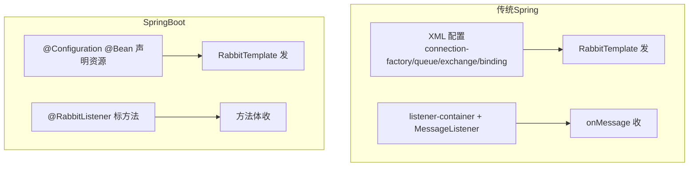
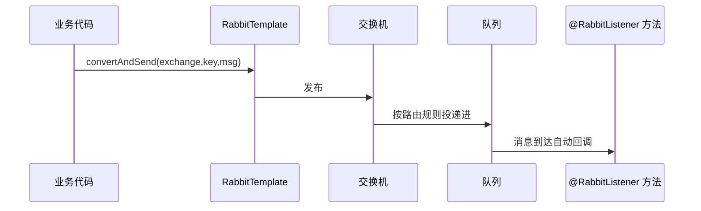

# 从原生客户端到两三行发消息：Spring 与 Spring Boot 整合 RabbitMQ 两套写法

前面用原生 amqp-client 写收发，每一步都要手动建工厂、开信道、声明队列，代码量大且模板化。Spring 体系把这件事收敛成了「配好连接工厂和交换机队列，注入一个 `RabbitTemplate` 发消息；或者写个监听器类收消息」。整合方式分两套：传统 Spring 用 XML 命名空间配置，Spring Boot 用自动配置加 `@Bean` / `@RabbitListener` 注解。这篇把两套都写通，并讲清各自配置项的含义。

## 先给结论

- 传统 Spring 整合靠 `spring-rabbit` 提供的 `rabbit:` 命名空间：在 XML 里声明连接工厂、队列、交换机和绑定，业务代码只注入 `RabbitTemplate` 调 `convertAndSend`。
- 消费者在传统 Spring 里写一个实现 `MessageListener` 的类，配进 `listener-container`，消息一来自动回调 `onMessage`。
- Spring Boot 整合只需引入 `spring-boot-starter-amqp`，在 `application.yml` 配连接信息，用 `@Configuration` 里的 `@Bean` 声明交换机/队列/绑定，发消息注入 `RabbitTemplate`，收消息用 `@RabbitListener` 标方法。
- 两套的本质相同：都把连接、信道、声明等样板代码交给框架，你只关心「发什么」和「收到后做什么」。

## 一、两套整合的整体关系



图里说明：传统 Spring 把资源声明放在 XML，Spring Boot 放在 Java 配置类；发送端都靠 `RabbitTemplate`，接收端分别用 `MessageListener` 和 `@RabbitListener`。

## 二、传统 Spring 整合（XML 方式）

### 2.1 引入依赖

```xml
<dependencies>
    <dependency>
        <groupId>org.springframework</groupId>
        <artifactId>spring-context</artifactId>
        <version>5.1.7.RELEASE</version>
    </dependency>
    <dependency>
        <groupId>org.springframework.amqp</groupId>
        <artifactId>spring-rabbit</artifactId>
        <version>2.1.8.RELEASE</version>
    </dependency>
    <dependency>
        <groupId>org.junit</groupId>
        <artifactId>junit</artifactId>
        <version>4.12</version>
    </dependency>
    <dependency>
        <groupId>org.springframework.test</groupId>
        <artifactId>spring-test</artifactId>
        <version>5.1.7.RELEASE</version>
    </dependency>
</dependencies>
```

### 2.2 抽取连接信息

把 host、port、用户名、密码、虚拟主机抽到 `properties/rabbitmq.properties`，方便环境间切换：

```properties
rabbitmq.host=localhost
rabbitmq.port=5672
rabbitmq.username=guest
rabbitmq.password=guest
rabbitmq.virtual-host=/
```

### 2.3 核心 XML 配置

`spring-rabbitmq-producer.xml` 里用 `rabbit:` 命名空间一次性声明连接工厂、队列、交换机和绑定：

```xml
<?xml version="1.0" encoding="UTF-8"?>
<beans xmlns="http://www.springframework.org/schema/beans"
       xmlns:xsi="http://www.w3.org/2001/XMLSchema-instance"
       xmlns:context="http://www.springframework.org/schema/context"
       xmlns:rabbit="http://www.springframework.org/schema/rabbit"
       xsi:schemaLocation="
        http://www.springframework.org/schema/beans
        http://www.springframework.org/schema/beans/spring-beans.xsd
        http://www.springframework.org/schema/context
        http://www.springframework.org/schema/context/spring-context.xsd
        http://www.springframework.org/schema/rabbit
        http://www.springframework.org/schema/rabbit/spring-rabbit.xsd">

    <context:property-placeholder location="classpath:properties/rabbitmq.properties"/>

    <rabbit:connection-factory id="connectionFactory"
                               host="${rabbitmq.host}"
                               port="${rabbitmq.port}"
                               username="${rabbitmq.username}"
                               password="${rabbitmq.password}"
                               virtual-host="${rabbitmq.virtual-host}"/>

    <!-- 简单模式队列 -->
    <rabbit:queue id="spring_queue" name="spring_queue" auto-declare="true"/>

    <!-- fanout 交换机及其绑定 -->
    <rabbit:fanout-exchange id="spring_fanout_exchange"
                            name="spring_fanout_exchange" auto-declare="true">
        <rabbit:binding queue="spring_fanout_queue_1"/>
        <rabbit:binding queue="spring_fanout_queue_2"/>
    </rabbit:fanout-exchange>

    <!-- topic 交换机及其通配绑定 -->
    <rabbit:topic-exchange id="spring_topic_exchange"
                           name="spring_topic_exchange" auto-declare="true">
        <rabbit:binding queue="spring_topic_queue_star" pattern="spring_topic_queue_star"/>
        <rabbit:binding queue="spring_topic_queue_well" pattern="spring_topic_queue_well"/>
    </rabbit:topic-exchange>

    <rabbit:template id="rabbitTemplate" connection-factory="connectionFactory"/>
</beans>
```

**第一，命名空间是关键。** `rabbit:` 前缀来自 Spring 整合 RabbitMQ 提供的约束文件，它把原本要写一堆 `<bean>` 的样板配置简化成声明式标签。若不用命名空间，也能用普通 bean 标签，但会繁琐很多。

**第二，常用属性要记牢。** `auto-declare="true"` 表示资源不存在时自动创建；队列上的 `durable` 控制持久化，`exclusive` 控制是否独占，`auto-delete` 控制无消费者时是否自动删除。交换机标签同理，也有持久化、自动删除、是否内部使用等属性。

**第三，绑定标签因类型而异。** fanout 绑定只需给队列名（路由键固定为空）；direct 绑定要写 `key` 属性做精确匹配；topic 绑定要写 `pattern` 属性做通配。标签名一样，但内部的约束不同，写错属性会直接报错。

### 2.4 生产者代码

配置就绪后，业务代码量骤减，只需注入 `RabbitTemplate` 调 `convertAndSend`：

```java
package com.example.producer;

import org.junit.Test;
import org.junit.runner.RunWith;
import org.springframework.amqp.rabbit.core.RabbitTemplate;
import org.springframework.beans.factory.annotation.Autowired;
import org.springframework.test.context.ContextConfiguration;
import org.springframework.test.context.junit4.SpringRunner;

@RunWith(SpringRunner.class)
@ContextConfiguration(locations = "classpath:spring-rabbitmq-producer.xml")
public class ProducerTest {

    @Autowired
    private RabbitTemplate rabbitTemplate;

    @Test
    public void testHelloWorld() {
        // 简单模式：routingKey 即队列名
        rabbitTemplate.convertAndSend("spring_queue", "hello world");
    }

    @Test
    public void testFanout() {
        // 发布订阅：指定交换机，路由键为空
        rabbitTemplate.convertAndSend("spring_fanout_exchange", "", "fanout message");
    }

    @Test
    public void testTopic() {
        // 主题模式：路由键按通配规则匹配
        rabbitTemplate.convertAndSend("spring_topic_exchange", "order.info", "topic message");
    }
}
```

`convertAndSend` 会自动把对象序列化成消息体，简单模式传队列名、复杂模式传交换机名加路由键，无需再碰 `Channel`。

### 2.5 消费者代码（XML 方式）

消费者更简单：写一个实现 `MessageListener` 的类，在 XML 里注册进 `listener-container` 并指定监听的队列：

```java
package com.example.consumer;

import org.springframework.amqp.core.Message;
import org.springframework.amqp.core.MessageListener;

public class SpringQueueListener implements MessageListener {
    @Override
    public void onMessage(Message message) {
        System.out.println("收到消息：" + new String(message.getBody()));
    }
}
```

```xml
<bean id="springQueueListener" class="com.example.consumer.SpringQueueListener"/>

<rabbit:listener-container connection-factory="connectionFactory">
    <rabbit:listener ref="springQueueListener" queue-names="spring_queue"/>
</rabbit:listener-container>
```

`listener-container` 是监听器容器，负责建连、拉消息、回调 `onMessage`。消息一进 `spring_queue`，`onMessage` 就被框架自动触发。

## 三、Spring Boot 整合（自动配置方式）

### 3.1 依赖与配置

```xml
<dependencies>
    <dependency>
        <groupId>org.springframework.boot</groupId>
        <artifactId>spring-boot-starter</artifactId>
        <version>2.1.4.RELEASE</version>
    </dependency>
    <dependency>
        <groupId>org.springframework.boot</groupId>
        <artifactId>spring-boot-starter-amqp</artifactId>
        <version>2.1.4.RELEASE</version>
    </dependency>
    <dependency>
        <groupId>org.springframework.boot</groupId>
        <artifactId>spring-boot-starter-test</artifactId>
        <version>2.1.4.RELEASE</version>
        <scope>test</scope>
    </dependency>
</dependencies>
```

`application.yml` 只配连接信息，Spring Boot 据此自动装配 `ConnectionFactory`：

```yaml
spring:
  rabbitmq:
    host: localhost
    port: 5672
    username: guest
    password: guest
    virtual-host: /
```

### 3.2 用 @Bean 声明资源

交换机、队列、绑定关系用配置类以编码方式声明，比 XML 更贴近 Java 开发者习惯：

```java
package com.example.config;

import org.springframework.amqp.core.*;
import org.springframework.context.annotation.Bean;
import org.springframework.context.annotation.Configuration;

@Configuration
public class RabbitMQConfig {

    public static final String EXCHANGE_NAME = "boot_topic_exchange";
    public static final String QUEUE_NAME = "boot_queue";

    @Bean
    public TopicExchange bootExchange() {
        return ExchangeBuilder.topicExchange(EXCHANGE_NAME).durable(true).build();
    }

    @Bean
    public Queue bootQueue() {
        return QueueBuilder.durable(QUEUE_NAME).build();
    }

    @Bean
    public Binding binding() {
        return BindingBuilder.bind(bootQueue())
                .to(bootExchange())
                .with("boot.#");
    }
}
```

**第一，ExchangeBuilder 提供四种类型。** `topicExchange`、`directExchange`、`fanoutExchange`、`headersExchange` 一目了然，本例用 topic。

**第二，绑定用 BindingBuilder 链式表达。** `bind(队列).to(交换机).with(路由键)`，topic 模式路由键可写通配符 `boot.#`，表示 boot 开头任意级别都进该队列。

### 3.3 生产者代码

```java
package com.example.producer;

import com.example.config.RabbitMQConfig;
import org.junit.Test;
import org.junit.runner.RunWith;
import org.springframework.amqp.rabbit.core.RabbitTemplate;
import org.springframework.beans.factory.annotation.Autowired;
import org.springframework.boot.test.context.SpringBootTest;
import org.springframework.test.context.junit4.SpringRunner;

@RunWith(SpringRunner.class)
@SpringBootTest
public class ProducerTest {

    @Autowired
    private RabbitTemplate rabbitTemplate;

    @Test
    public void testSend() {
        rabbitTemplate.convertAndSend(
                RabbitMQConfig.EXCHANGE_NAME, "boot.info", "boot mq hello");
    }
}
```

### 3.4 消费者用 @RabbitListener

Spring Boot 下接收端不再写 `MessageListener`，直接在方法上标 `@RabbitListener` 指定队列，消息体作为参数传入：

```java
package com.example.consumer;

import org.springframework.amqp.core.Message;
import org.springframework.amqp.rabbit.annotation.RabbitListener;
import org.springframework.stereotype.Component;

@Component
public class RabbitMQListener {

    @RabbitListener(queues = "boot_queue")
    public void listen(Message message) {
        System.out.println("收到消息：" + new String(message.getBody()));
    }
}
```

启动应用后，只要 `boot_queue` 里有消息，标注的方法就被自动调用。相比 XML 方式的 `listener-container`，`@RabbitListener` 把「容器 + 监听器」合并成一个注解，更简洁。



图里展示 Spring Boot 整合下，从发送到接收的完整自动链路：你只写了 `convertAndSend` 和监听方法，中间全部由框架托管。

## 四、两套写法怎么选

传统 XML 方式适合已经重度使用 XML 配置、需要声明式集中管理资源的老 Spring 项目；Spring Boot 方式适合新项目，注解和 Java 配置更直观，自动配置省去大量样板。两者底层都是 Spring AMQP，资源模型（交换机、队列、绑定）完全通用，熟练一套很容易迁移到另一套。

## 常见误区

- **忘了给 RabbitTemplate 加 @Autowired**：注入为空会抛空指针，这是 Spring Boot 整合时最高频的低级错误。
- **topic 绑定路由键写成固定值却想收全部**：应该用 `boot.#` 这类通配符，写死 `boot.info` 就只能收这一条。
- **XML 里 binding 标签属性用错**：fanout 不能写 key，topic 不能写 key 要写 pattern，direct 才用 key，混用会直接报找不到属性。
- **消费者用 MessageListener 却没放进 listener-container**：类写好了但没注册容器，消息永远不会被回调。
- **认为 Spring Boot 不需要声明队列**：自动配置只建连接工厂，交换机/队列/绑定仍需你用 @Bean 或注解声明，否则消息无家可归。

## 面试可能被问到的问题

1. 面试官追问：「Spring 整合 RabbitMQ 发送消息核心用哪个类？」
   答：用 `RabbitTemplate`，调用 `convertAndSend` 方法。简单模式传队列名，fanout/direct/topic 模式传交换机名加路由键，框架负责序列化与信道管理，业务代码极简。

2. 面试官追问：「传统 Spring 和 Spring Boot 整合 RabbitMQ 的主要区别？」
   答：传统 Spring 用 `rabbit:` 命名空间在 XML 中声明连接工厂、队列、交换机、绑定，消费者实现 `MessageListener` 并配进 `listener-container`；Spring Boot 引入 `spring-boot-starter-amqp`，连接信息写 `application.yml`，资源用 `@Configuration` 的 `@Bean` 声明，消费者用 `@RabbitListener` 标注方法。底层都是 Spring AMQP。

3. 面试官追问：「@RabbitListener 是怎么工作的？」
   答：它底层等价于一个监听器容器，Spring 会为标注了 `@RabbitListener` 的 Bean 方法创建容器，自动从指定队列拉消息，反序列化后调用该方法，无需手写 `MessageListener` 和容器配置。

4. 面试官追问：「XML 里 fanout、direct、topic 的绑定标签有何不同？」
   答：fanout 绑定只用队列名（路由键为空）；direct 绑定用 `key` 做精确匹配；topic 绑定用 `pattern` 配通配符。标签虽同属 rabbit 命名空间，但各自约束不同，属性写错会校验失败。

5. 面试官追问：「Spring Boot 整合时队列需要手动声明吗？」
   答：需要。自动配置只帮你建好连接工厂，交换机、队列、绑定关系仍要通过 `@Bean` 用 `ExchangeBuilder` / `QueueBuilder` / `BindingBuilder` 声明，否则消息因无队列可投而被丢弃。

6. 面试官追问：「为什么用 Spring 整合后代码量大幅减少？」
   答：因为连接工厂、信道管理、资源声明、消息序列化、监听器容器等样板逻辑都被 Spring AMQP 封装了，你只需注入 `RabbitTemplate` 发消息、写监听器收消息，关注点回到业务逻辑本身。

## 配套资料

- 本课无配套源码包（materials/code 下未提供 RabbitMQ 工程），正文 XML、YAML、Java 配置与监听代码均为按课程写法补全的可运行示例，包名统一使用 `com.example`。
- 可对照 Spring AMQP 官方文档「Reference」中 `RabbitTemplate`、`@RabbitListener`、`ExchangeBuilder` 等章节深入学习。
