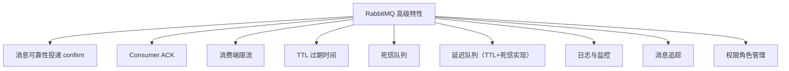
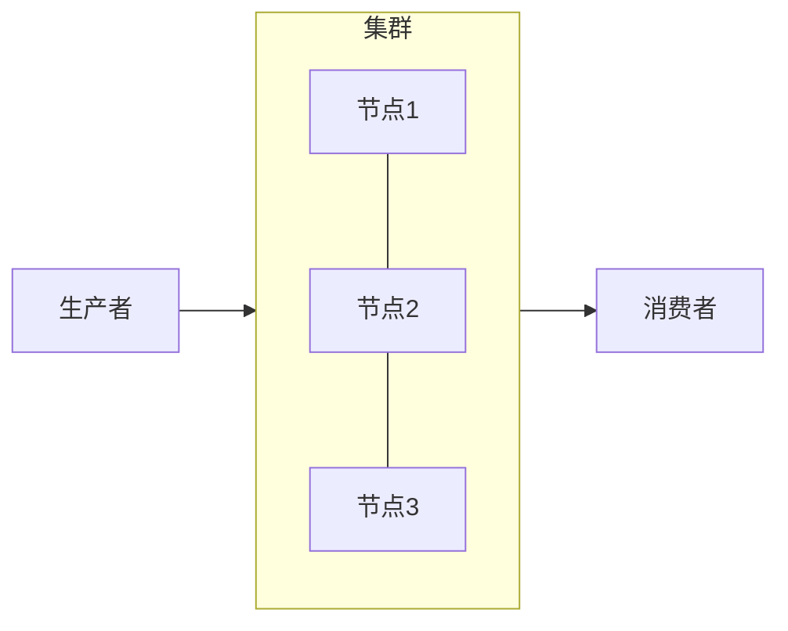

# 第二天学什么：RabbitMQ 高级特性、应用问题与集群

第一天我们把 RabbitMQ 的架构、安装、五种工作模式、Spring 整合全部跑通，已经能用它收发消息。但生产环境会立刻甩出更尖锐的问题：消息发出去真的到了吗？消费者崩了消息丢了吗？海量消息怎么削峰限流？服务挂了怎么高可用？第二天的内容就是围绕这些「能上线」的问题展开，分三块：高级特性、应用问题、集群搭建。

## 先给结论

- 第二天分三条主线：高级特性、应用问题、集群搭建。
- 高级特性覆盖消息可靠性投递（confirm）、Consumer ACK、消费端限流、TTL、死信队列、延迟队列、日志监控、消息追踪、管理功能。
- 应用问题重点讲两件：消息可靠性保障的兜底处理、消息幂等性（重复消费）处理。
- 集群搭建会一步步做出高可用集群，让单点故障不再拖垮全链路。

## 一、高级特性清单

前一天我们只关心「能不能发、能不能收」，高级特性关心的是「可不可靠、稳不稳、好不好管」：



图里把十大高级点归到一个体系下，其中延迟队列不是独立功能，而是用 TTL 加死信队列组合实现，这是 RabbitMQ 里一个很巧妙的技巧。

**第一，可靠性投递与 Consumer ACK 是两端确认。** 可靠性投递保证「生产者 → Broker」这条链路消息不丢（靠 confirm 机制）；Consumer ACK 保证「Broker → 消费者」这条链路消息不丢（消费者处理完才确认）。两者一起构成端到端可靠。

**第二，限流、TTL、死信是运维三件套。** 限流控制消费者处理速率，避免被突发压垮；TTL 给消息设置过期时间；死信队列收留那些过期或被拒绝的消息，便于后续排查和重投。

**第三，日志监控与追踪便于排障。** 官方文档的 Protocol Extensions 里专门有 Consumer Acknowledgements and Publisher Confirms 章节，生产环境排查消息丢失时几乎是必读材料。

## 二、应用问题：兜底与幂等

高级特性介绍了「如何尽量保证可靠投递」的 API，但万一还是失败了怎么办？这部分讲两个主流问题：

**消息可靠性保障的兜底。** confirm 机制只能告诉你「投没投成功」，投失败时要怎么补偿（如记录失败消息、定时重投、落库对账），各公司方案不同，课程会讲主流做法而非唯一标准。

**消息幂等性处理。** 由于网络重试、消费者重启等原因，同一条消息可能被消费多次。如何让「消费两次」和「消费一次」结果一致（比如扣款不重复扣），是分布式系统里的经典难题，需要结合业务设计幂等键。

## 三、集群搭建

最后一块是集群：从无到有搭出一个高可用 RabbitMQ 集群。第一天我们只有单机，Broker 一挂全链路停摆；集群通过多节点镜像队列，让单个节点故障不影响整体服务，是真正上生产的最后一步。



图里展示多节点互联后，任一一节点宕机，生产消费仍能通过其余节点进行，可用性显著提升。

## 四、给第一天的收尾建议

第二天内容多且深，建议先把第一天的五种模式练熟，尤其理解交换机、队列、绑定、路由键这套模型，因为高级特性（confirm、死信、延迟）全部建立在这个模型之上。学第二天时重点不是背 API，而是建立「消息在什么环节可能丢、怎么兜底」的工程直觉。

开启高级特性时，Spring Boot 里常通过配置打开生产者确认，例如：

```yaml
spring:
  rabbitmq:
    host: localhost
    port: 5672
    publisher-confirm-type: correlated
    publisher-returns: true
```

这段配置开启后，生产者发送的消息会得到 Broker 的确认回执和路由失败返回，是可靠性投递的开关。消费端手动确认则通常在监听方法上通过 `channel.basicAck` 完成：

```java
@RabbitListener(queues = "boot_queue")
public void listen(Message message, Channel channel,
                   @Header(AmqpHeaders.DELIVERY_TAG) long tag) throws IOException {
    try {
        System.out.println("处理消息：" + new String(message.getBody()));
        channel.basicAck(tag, false); // 处理成功再确认
    } catch (Exception e) {
        channel.basicNack(tag, false, true); // 失败退回到队列
    }
}
```

上面两段代码是第二天要深入展开的内容预告，先建立印象即可。

## 常见误区

- **以为第一天跑通就能上生产**：缺了 confirm、ACK、集群，消息丢失和单点故障风险极高。
- **把延迟队列当成内置功能**：RabbitMQ 没有直接的延迟队列，必须靠 TTL 加死信队列组合实现。
- **忽视幂等设计**：认为「消息不会重复」，结果重试机制导致重复扣款、重复发券。
- **只学 API 不建立工程直觉**：高级特性重点在「何时丢、怎么兜底」，而非记住几个方法名。

## 面试可能被问到的问题

1. 面试官追问：「RabbitMQ 怎么保证消息不丢？」
   答：分两端：生产端用 publisher confirm 确认消息到达 Broker，开启 returns 感知路由失败；消费端用手动 ACK，处理成功才确认，失败则 NACK 重回队列。再配合队列和消息持久化，基本覆盖主要丢失场景。

2. 面试官追问：「什么是死信队列，什么消息会进死信？」
   答：死信队列专门接收无法被正常消费的消息。消息变为死信的常见原因：消息 TTL 过期、队列满被拒绝、消费者 NACK 且不重回队列。它用于隔离异常消息便于排查。

3. 面试官追问：「RabbitMQ 的延迟队列怎么实现？」
   答：RabbitMQ 没有原生延迟队列，通常用「消息设 TTL + 死信交换机」实现：消息在普通队列到期后被投递到死信交换机，再路由到真正消费队列，从而达到延迟效果。

4. 面试官追问：「消息幂等性一般怎么处理？」
   答：核心是唯一标识加去重：给每条消息一个业务幂等键（如订单号），消费前先查是否已处理，已处理则跳过；或利用数据库唯一约束、Redis 标记防止重复执行。

5. 面试官追问：「为什么要搭建 RabbitMQ 集群？」
   答：单节点是单点故障，挂掉则全链路停摆。集群多节点互为备份（配合镜像队列），任一节点宕机其余节点仍能提供服务，提升整体可用性，是上生产的必要步骤。

## 配套资料

- 本课无配套源码包（materials/code 下未提供 RabbitMQ 工程），正文 YAML、Java 片段与结构图均按课程第二天概览讲解补全，未引用真实工程代码。
- 可提前查阅 RabbitMQ 官网「Consumer Acknowledgements and Publisher Confirms」与「RabbitMQ Cluster」文档，为第二天打底。
