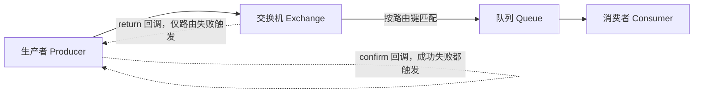
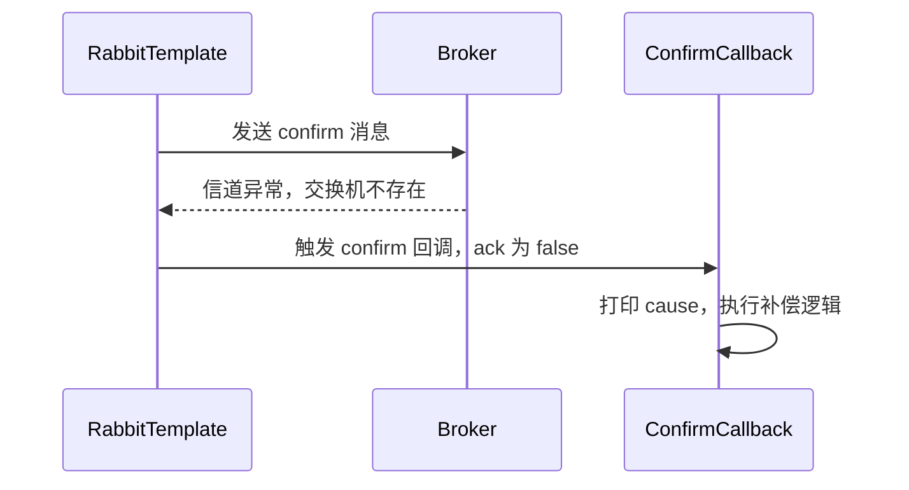

# 消息发出去就没影了怎么办：用 confirm 确认模式盯住生产者到交换机这一段

`rabbitTemplate.convertAndSend` 一行代码执行完，没有任何返回值，也没有异常。交换机名字写错了、Broker 连接断了、虚拟主机填错了，代码照样往下跑，日志里干干净净。等到业务方来问「那条订单消息怎么没消费到」，你才发现它根本没进 RabbitMQ。

生产端对消息命运一无所知，这是最难受的地方。RabbitMQ 给出的第一个解法是 confirm 确认模式：让 Broker 在收到消息后主动回一个回调，告诉你这条消息到底到没到交换机。

## 先给结论

- confirm 模式只管**生产者到交换机**这一段，交换机有没有收到消息，它说了算；消息有没有进队列，它不管，那是 return 模式的事。
- 开启方式是在连接工厂上加 `publisher-confirms="true"`，默认值是 false，不开就收不到任何回调。
- 回调要在 `RabbitTemplate` 上设置 `setConfirmCallback`，实现 `confirm(CorrelationData correlationData, boolean ack, String cause)`。
- **回调无论成功失败都会执行**，区别只在 `ack` 是 true 还是 false；`ack` 为 false 时 `cause` 里带着失败原因。
- 失败之后怎么处理（重发、落库、告警），confirm 模式本身不负责，它只把「失败了」这件事告诉你。

## 一、先看清消息投递的完整路径

一条消息从代码里发出去到最后被业务处理，中间要过四站。先记住这条链路，才能分清 confirm 和 return 各自守的是哪一段：



**第一，交换机是收消息的第一站。** 生产者从不直接把消息写进队列，而是发给交换机，交换机再按路由键和绑定关系把消息投到队列里。所以「消息丢了」其实有两种丢法：没到交换机，或者到了交换机却没路由进任何队列。

**第二，两段风险要分别用两个回调来兜。** 生产者到交换机用 confirm 确认，交换机到队列用 return 回退。两者不是二选一，而是拼起来才覆盖完整链路。confirm 模式负责前一段。

## 二、开启确认模式：一个属性

确认模式默认关闭，第一步是在连接工厂上把它打开。课程工程里的生产端 XML 配成这样（包名与主机信息已做中性化处理）：

```xml
<?xml version="1.0" encoding="UTF-8"?>
<beans xmlns="http://www.springframework.org/schema/beans"
       xmlns:xsi="http://www.w3.org/2001/XMLSchema-instance"
       xmlns:context="http://www.springframework.org/schema/context"
       xmlns:rabbit="http://www.springframework.org/schema/rabbit"
       xsi:schemaLocation="
        http://www.springframework.org/schema/beans
        http://www.springframework.org/schema/beans/spring-beans.xsd
        http://www.springframework.org/schema/context
        http://www.springframework.org/schema/context/spring-context.xsd
        http://www.springframework.org/schema/rabbit
        http://www.springframework.org/schema/rabbit/spring-rabbit.xsd">

    <context:property-placeholder location="classpath:rabbitmq.properties"/>

    <!-- 关键属性 publisher-confirms，开启生产者确认 -->
    <rabbit:connection-factory id="connectionFactory"
                               host="${rabbitmq.host}"
                               port="5672"
                               username="guest"
                               password="guest"
                               virtual-host="/"
                               publisher-confirms="true"/>

    <rabbit:admin connection-factory="connectionFactory"/>
    <rabbit:template id="rabbitTemplate" connection-factory="connectionFactory"/>

    <!-- 消息的可靠投递：生产端，先声明队列与交换机 -->
    <rabbit:queue id="test_queue_confirm" name="test_queue_confirm"/>
    <rabbit:direct-exchange name="test_exchange_confirm">
        <rabbit:binding queue="test_queue_confirm" key="confirm"/>
    </rabbit:direct-exchange>
</beans>
```

`publisher-confirms` 是加在 `connection-factory` 上的，不是加在 `rabbitTemplate` 上的。这一点经常配错：确认能力本质上由信道（Channel）提供，信道又由连接工厂创建，所以开关必须落在工厂上。`rabbit:admin` 的作用是让 XML 里声明的队列和交换机在 Broker 上自动创建出来，省去手动在管理后台点一遍。

## 三、设置回调并发送消息

开关打开之后，在测试类里注入 `RabbitTemplate`，设置回调，然后发一条消息：

```java
package com.example.test;

import org.junit.Test;
import org.junit.runner.RunWith;
import org.springframework.amqp.rabbit.core.RabbitTemplate;
import org.springframework.amqp.rabbit.support.CorrelationData;
import org.springframework.beans.factory.annotation.Autowired;
import org.springframework.test.context.ContextConfiguration;
import org.springframework.test.context.junit4.SpringJUnit4ClassRunner;

@RunWith(SpringJUnit4ClassRunner.class)
@ContextConfiguration(locations = "classpath:spring-rabbitmq-producer.xml")
public class ProducerTest {

    @Autowired
    private RabbitTemplate rabbitTemplate;

    @Test
    public void testConfirm() {
        // 第二步：定义确认回调
        rabbitTemplate.setConfirmCallback(new RabbitTemplate.ConfirmCallback() {
            @Override
            public void confirm(CorrelationData correlationData, boolean ack, String cause) {
                System.out.println("confirm 方法被执行了.....");
                if (ack) {
                    // 交换机成功收到消息，cause 为 null
                    System.out.println("接收成功消息" + cause);
                } else {
                    // 交换机没收到，cause 里是失败原因
                    System.out.println("接收失败消息" + cause);
                    // 这里做补偿：重发、落库、告警
                }
            }
        });

        // 第三步：发送消息
        rabbitTemplate.convertAndSend("test_exchange_confirm", "confirm", "message confirm....");
    }
}
```

`confirm` 方法的三个参数值得逐个说清楚：

**第一，`correlationData` 是消息的相关信息。** 它对应发送时传入的 `CorrelationData` 对象，你可以在里面塞一个业务 id，回调触发时再取出来，就能把回调和具体某条消息对上。用 `convertAndSend(exchange, routingKey, message, correlationData)` 这个重载传进去。不传的话这个值就是 null，并发发送多条消息时会分不清哪条失败了。

**第二，`ack` 是成败标志。** true 表示交换机成功收到，false 表示没收到，比如交换机不存在、Broker 宕机、权限不足。判断只认这一个布尔值。

**第三，`cause` 是失败原因。** `ack` 为 true 时它是 null，`ack` 为 false 时才有内容。

## 四、验证一次失败：把交换机名字写错

把发送时的交换机名改成 `test_exchange_confirm111`，一个 Broker 上不存在的名字，再跑一次，控制台会输出类似这样的失败原因：

```text
confirm 方法被执行了.....
接收失败消息Channel shutdown: channel error; protocol method:
#method<channel.close> reply-code=404, reply-text=NOT_FOUND -
no exchange 'test_exchange_confirm111' in vhost '/', class-id=60, method-id=40
```

关键在 `no exchange ... in vhost '/'` 这一句：Broker 明确告诉你，当前虚拟主机里不存在这个交换机。整个回调链路是通的，先打印「confirm 方法被执行了」，再走 else 分支打印失败原因，说明「回调无论成败都会执行」这件事成立。

站在 Broker 的角度看，这次交互的时序是这样的：



图里需要注意回执方向：正常情况是 Broker 主动回一个 `basic.ack`，异常场景则由客户端感知到信道关闭后转化为 `ack=false` 的回调。无论哪条路径，`confirm` 方法都只被调用一次。

## 常见误区

- **只写了 `setConfirmCallback` 却忘了开 `publisher-confirms`**：回调永远不执行，或者 Spring 直接提示连接工厂未开启确认。开关在连接工厂上，不在模板上。
- **以为 confirm 成功就等于消息进了队列**：confirm 只保证到交换机。交换机收到但路由键匹配不上任何队列时，`ack` 依然是 true，消息却被丢弃。这一段要靠 return 模式。
- **不传 `CorrelationData`**：高并发下多条消息的回调混在一起，无法定位是哪一条失败，也就没法精准重发。
- **在回调里直接递归重发**：`confirm` 回调运行在 RabbitMQ 的 I/O 线程里，在里面做同步重发会阻塞信道，正确做法是把失败消息丢进本地重试队列或落库后由定时任务补偿。
- **每次发送前都 `setConfirmCallback`**：`RabbitTemplate` 是单例 Bean，回调设置一次即可，重复设置只会把上一个覆盖掉。

## 面试可能被问到的问题

1. 面试官追问：「confirm 模式解决的是哪一段的可靠性问题？」
   答：解决生产者到交换机这一段。生产者发消息后，RabbitMQ 会通过 `confirm` 回调告知交换机是否收到，`ack` 为 true 表示收到，false 表示未收到并附带 `cause` 失败原因。交换机到队列那一段不归它管，需要配合 return 模式。

2. 面试官追问：「confirm 回调是成功才触发，还是失败才触发？」
   答：两种情况都触发。这是它和 return 模式最大的区别，return 回调只在路由失败时执行。confirm 回调无论成败都会被调用，业务代码需要在方法里判断 `ack` 的值再分别处理。

3. 面试官追问：「开启确认模式需要改哪两个地方？」
   答：第一，在 `CachingConnectionFactory` 上开启确认，XML 里对应 `rabbit:connection-factory` 的 `publisher-confirms="true"`，默认是 false。第二，在 `RabbitTemplate` 上调用 `setConfirmCallback` 注册回调实现。两步缺一不可。

4. 面试官追问：「`confirm` 方法的三个参数分别是什么含义？」
   答：`correlationData` 是发送消息时传入的关联数据，可携带业务 id 用于定位消息；`ack` 是布尔值，表示交换机是否成功收到；`cause` 是失败原因，成功时为 null。

5. 面试官追问：「confirm 和事务机制都能保证消息发送可靠，为什么更推荐 confirm？」
   答：事务（`txSelect`、`txCommit`、`txRollback`）是同步阻塞的，每条消息都要等待 Broker 的事务响应，吞吐量会下降一个数量级。confirm 是异步回调，生产者发完就继续往下走，Broker 处理完后回调通知，性能损耗小得多。

6. 面试官追问：「消息确认失败后一般怎么补偿？」
   答：常见做法是结合本地消息表：发送前把消息落库并标记状态，confirm 回调里根据 `CorrelationData` 中的业务 id 把状态改为已确认，失败的由定时任务扫描重发并限制重试次数，超过阈值转人工或告警。

## 配套资料

- 本课无随堂代码包，示例代码见正文。文中 XML 的 `publisher-confirms`、`rabbit:direct-exchange` 声明，以及 `ProducerTest` 中 `setConfirmCallback` 与 `convertAndSend` 的写法，均按课程演示代码还原，包名统一使用 `com.example`。
- 同系列下一篇 0074 讲交换机到队列那一段的 return 回退模式，两篇合起来才是完整的生产端可靠投递方案。
