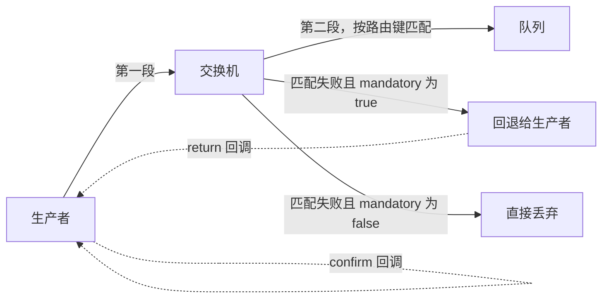

# 交换机收到了消息却没进队列：用 return 回退模式兜住路由失败

上一篇把 confirm 模式配好之后，控制台打出「接收成功消息」，看起来万无一失。可你打开管理后台一看，队列里空空如也：`ack` 明明是 true，消息却不见了。

原因很简单，confirm 只保证消息到了交换机，交换机按路由键找不到匹配的队列时，默认动作是**直接丢弃**，而这个过程对生产者是完全静默的。路由键写错、绑定关系被改、队列被删，都会造成这种「发送成功但消息凭空消失」的结果。return 回退模式就是为这一段准备的。

## 先给结论

- return 模式守的是**交换机到队列**这一段，只有路由失败时才触发回调，成功时不触发。
- 它比 confirm 多一步：除了开启 `publisher-returns="true"` 和设置 `ReturnCallback`，还必须设置 `mandatory=true`，否则交换机默认丢弃消息，回调永远不会执行。
- 回调方法是 `returnedMessage(Message message, int replyCode, String replyText, String exchange, String routingKey)`，五个参数分别给出消息本体、错误码、错误描述、交换机名和路由键。
- 路由失败的错误码是 312，错误描述是 `NO_ROUTE`，看到这两个值基本可以确定是路由键或绑定关系的问题。
- confirm 和 return 要一起用：前者管「有没有到交换机」，后者管「有没有进队列」。

## 一、为什么还要再配一个回调

消息投递链路拆成两段看，两段的失败原因完全不同：



**第一，confirm 管不到交换机后面的事。** 交换机只要成功收下消息，就会给生产者回 `ack=true`。至于这条消息有没有队列可去，交换机在默认策略下并不关心，也不会上报。

**第二，mandatory 是这段链路的真正开关。** 这个参数决定交换机在路由失败时的行为：为 false 时静默丢弃，为 true 时把消息原路退回给生产者。RabbitMQ 的默认值是 false，所以不设置它就是丢消息。

## 二、三步配置，一步都不能少

### 2.1 XML 里开启回退模式

```xml
<rabbit:connection-factory id="connectionFactory"
                           host="${rabbitmq.host}"
                           port="5672"
                           username="guest"
                           password="guest"
                           virtual-host="/"
                           publisher-confirms="true"
                           publisher-returns="true"/>

<!-- mandatory 也可以在模板上声明，效果与代码里 setMandatory 一致 -->
<rabbit:template id="rabbitTemplate"
                 connection-factory="connectionFactory"
                 mandatory="true"/>

<rabbit:queue id="test_queue_confirm" name="test_queue_confirm"/>
<rabbit:direct-exchange name="test_exchange_confirm">
    <rabbit:binding queue="test_queue_confirm" key="confirm"/>
</rabbit:direct-exchange>
```

`publisher-returns` 和上一篇的 `publisher-confirms` 一样挂在连接工厂上，默认都是 false。

### 2.2 代码里设置回调与 mandatory

```java
package com.example.test;

import org.junit.Test;
import org.junit.runner.RunWith;
import org.springframework.amqp.core.Message;
import org.springframework.amqp.rabbit.core.RabbitTemplate;
import org.springframework.beans.factory.annotation.Autowired;
import org.springframework.test.context.ContextConfiguration;
import org.springframework.test.context.junit4.SpringJUnit4ClassRunner;

@RunWith(SpringJUnit4ClassRunner.class)
@ContextConfiguration(locations = "classpath:spring-rabbitmq-producer.xml")
public class ProducerTest {

    @Autowired
    private RabbitTemplate rabbitTemplate;

    @Test
    public void testReturn() {
        // 第三步：设置交换机处理失败消息的模式，不设则默认丢弃
        rabbitTemplate.setMandatory(true);

        // 第二步：设置回退回调
        rabbitTemplate.setReturnCallback(new RabbitTemplate.ReturnCallback() {
            @Override
            public void returnedMessage(Message message, int replyCode, String replyText,
                                        String exchange, String routingKey) {
                System.out.println("return 执行了.....");
                System.out.println("message: " + new String(message.getBody()));
                System.out.println("replyCode: " + replyCode);
                System.out.println("replyText: " + replyText);
                System.out.println("exchange: " + exchange);
                System.out.println("routingKey: " + routingKey);
                // 这里做补偿：改投备用队列、落库重试、告警
            }
        });

        // 路由键故意写错，交换机收得到，但匹配不上任何队列
        rabbitTemplate.convertAndSend("test_exchange_confirm", "confirm111", "message confirm....");
    }
}
```

这段代码里最容易漏的就是 `setMandatory(true)`。少了它，交换机收到消息、路由失败、丢弃，一气呵成，控制台干干净净，你会误以为消息已经进了队列。

### 2.3 五个参数分别是什么

**第一，`message` 是被退回的消息本体。** 调用 `message.getBody()` 拿到字节数组，转字符串就是发送时的内容，你可以直接拿它改投到别的交换机。

**第二，`replyCode` 是错误码。** 路由失败固定是 312。

**第三，`replyText` 是错误描述。** 路由失败时是 `NO_ROUTE`，含义是没有匹配的路由。

**第四和第五，`exchange` 与 `routingKey` 定位出问题的位置。** 哪个交换机、用哪个路由键没投出去，一目了然，排查绑定关系时非常有用。

## 三、跑一次看真实输出

把路由键写成 `confirm111`（绑定用的是 `confirm`），运行测试方法，控制台输出大致是这样：

```text
return 执行了.....
message: message confirm....
replyCode: 312
replyText: NO_ROUTE
exchange: test_exchange_confirm
routingKey: confirm111
```

`312` 加 `NO_ROUTE` 是路由失败的标志组合。对照着去看交换机上的绑定关系，一眼就能看出是路由键写错还是绑定被删了。

把 `setMandatory(true)` 注释掉再跑一次，`return 执行了` 这一行就消失了，消息被交换机静默丢弃。这个对比实验是理解 mandatory 最直观的方式。

## 四、confirm 与 return 的分工

| 对比项 | confirm 确认模式 | return 回退模式 |
|---|---|---|
| 监控的链路 | 生产者到交换机 | 交换机到队列 |
| 触发条件 | 成功失败都触发 | 仅路由失败时触发 |
| 开启方式 | `publisher-confirms="true"` | `publisher-returns="true"` 加 `mandatory=true` |
| 回调接口 | `RabbitTemplate.ConfirmCallback` | `RabbitTemplate.ReturnCallback` |
| 关键参数 | `ack` 布尔值、`cause` 原因 | `replyCode`、`replyText`、`routingKey` |

两个回调合起来，生产端才算把整条链路看全了。还有一个备选方案是事务机制，`channel.txSelect()` 开事务、发送成功后 `txCommit()` 提交、失败则 `txRollback()` 回滚，同样能保证消息送达，但事务是同步阻塞的，每次发送都要等 Broker 的事务响应，吞吐量会掉一个数量级，实际项目里基本不选它。

## 常见误区

- **只配 `publisher-returns` 就以为万事大吉**：漏掉 `mandatory=true`，交换机照样丢弃消息，回调一次都不会执行。这是本课程最高频的踩坑点。
- **以为 return 回调成功失败都会执行**：它和 confirm 不同，只有失败才回调。看不到任何输出就说明消息已经被正常路由进队列了。
- **把路由键写错当成交换机不存在**：交换机不存在时触发的是 confirm 的 `ack=false`，错误的路由键触发的才是 return。看错误码就能区分，前者是 404，后者是 312。
- **在回调里重新投递到同一个交换机**：会造成无限循环。正确做法是改投到兜底队列，或者落库后由定时任务按次数限制重试。
- **只用 confirm 不用 return**：这是最常见的配置缺失，表面上一切正常，实际上路由失败的消息全在静默丢失。

## 面试可能被问到的问题

1. 面试官追问：「return 模式的配置需要哪几步？」
   答：三步。第一，在连接工厂上设置 `publisher-returns="true"` 开启回退模式；第二，在 `RabbitTemplate` 上调用 `setReturnCallback` 注册回调；第三，设置 `mandatory=true`，让交换机在路由失败时把消息退回而不是丢弃。第三步最容易被漏掉。

2. 面试官追问：「mandatory 参数的作用是什么？」
   答：它决定交换机在消息无法路由到任何队列时的行为。为 true 时消息被退回给生产者，触发 return 回调；为 false 时消息被直接丢弃，生产者毫无感知。RabbitMQ 默认是 false。

3. 面试官追问：「confirm 和 return 有什么本质区别？」
   答：监控的链路不同，confirm 管生产者到交换机，成功失败都会回调；return 管交换机到队列，只在路由失败时回调。生产端要保证完整可靠投递，两个回调必须同时配置。

4. 面试官追问：「`returnedMessage` 的五个参数分别怎么用？」
   答：`message` 是被退回的消息对象，可取 body 重新投递；`replyCode` 是错误码，路由失败为 312；`replyText` 是错误描述，路由失败为 `NO_ROUTE`；`exchange` 和 `routingKey` 指出失败的交换机与路由键，用于排查绑定关系。

5. 面试官追问：「消息发送成功但队列里没有，可能是什么原因？」
   答：最常见的是路由键与绑定关系不匹配，交换机收下消息后丢弃。此时 confirm 回调的 `ack` 仍是 true，只有配上 return 模式并把 mandatory 设为 true 才能发现。其次是交换机或队列声明未生效、虚拟主机不一致。

6. 面试官追问：「除了 confirm 和 return，还有别的可靠投递手段吗？」
   答：还有事务机制，通过 `txSelect`、`txCommit`、`txRollback` 保证发送成功，但它同步阻塞，性能差，一般不用。此外消费端还有 Consumer Ack 确认机制，交换机、队列、消息都可以设置持久化，Broker 侧则靠集群做高可用。

## 配套资料

- 本课无随堂代码包，示例代码见正文。文中 `publisher-returns`、`mandatory` 配置与 `setReturnCallback` 回调写法均按课程演示代码还原，包名统一使用 `com.example`。
- 上一讲 0073 讲生产者到交换机的 confirm 确认模式，本讲补上交换机到队列这一段，两者配合才是完整的生产端可靠投递。
