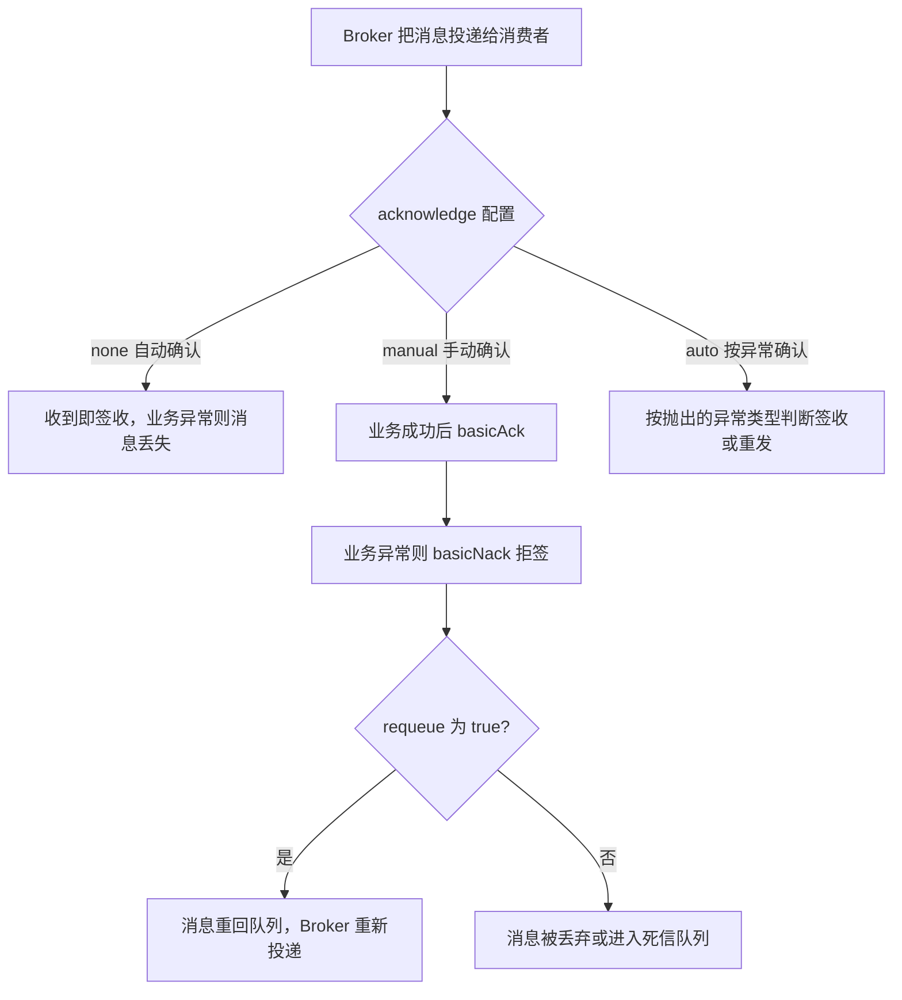
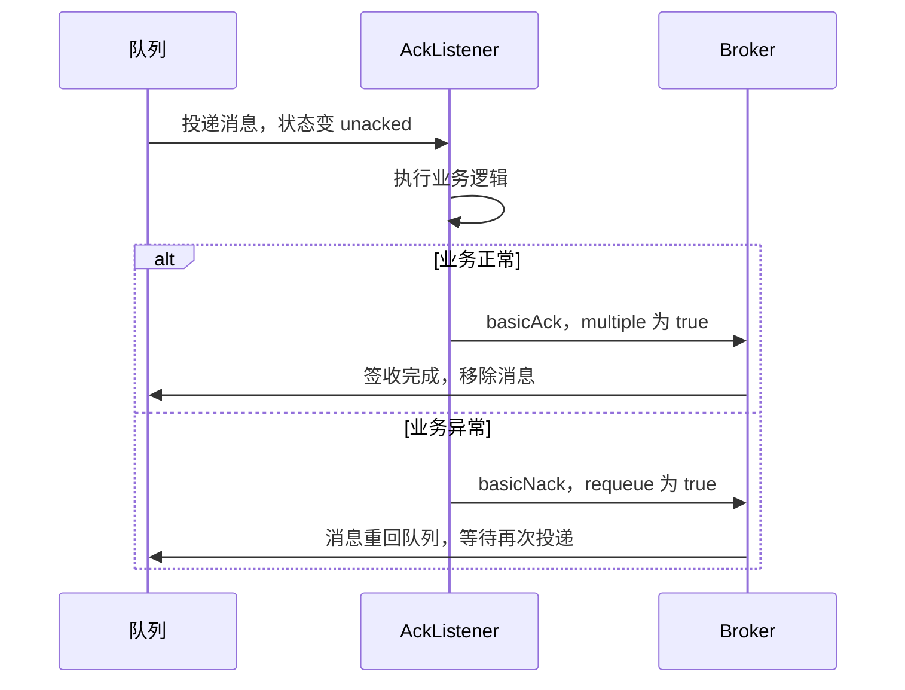

# 消息收到了但业务崩了：Consumer Ack 手动签收把消费端的可靠性补上

生产端的 confirm 和 return 配好之后，消息稳稳进了队列。可消费端还有一道坎：监听器 `onMessage` 一进来就抛出 `NullPointerException`，业务没跑完，消息却已经在队列里消失了。查日志时连原始报文都找不回来。

问题出在默认的确认策略上。RabbitMQ 的消费端有一个确认机制，叫 Consumer Ack，其中 Ack 是 Acknowledge 的缩写，表示消费者收到消息后的确认方式。默认的自动确认只要消息一投递到消费者就认为成功，业务成不成它不管。这篇把它改成手动签收，并讲清签收失败时怎么让消息重回队列。

## 先给结论

- RabbitMQ 提供三种确认方式：`acknowledge="none"` 自动确认、`acknowledge="manual"` 手动确认、`acknowledge="auto"` 按异常类型确认。第三种使用麻烦，实际项目基本不用。
- 自动确认的风险是消息一收到就签收，业务处理抛异常时消息已经被移出缓存，等于丢失。
- 手动确认要在监听器容器上加 `acknowledge="manual"`，并让监听器实现 `ChannelAwareMessageListener`，才能拿到 `Channel` 去签收。
- 业务成功调用 `channel.basicAck(deliveryTag, multiple)`；业务失败在 catch 里调用 `channel.basicNack(deliveryTag, multiple, requeue)`，`requeue` 为 true 时消息重回队列，Broker 会重新投递。
- 消息可靠性是整套工程：生产端 confirm、生产端 return、消费端 Ack、交换机队列消息三者持久化、Broker 集群高可用。

## 一、三种确认方式的分水岭



**第一，自动确认是默认行为，也是最容易丢消息的。** 消费者一收到消息，客户端就自动回一个签收，Broker 随即把消息从缓存中移除。此时业务代码才开始执行，一旦抛异常，这条消息就彻底没了，因为它已经不在 Broker 上了。

**第二，手动确认把签收时机推迟到业务之后。** 收到消息先不吭声，等业务逻辑正常跑完，再显式调用 `basicAck` 告诉 Broker 这条我处理完了。业务抛异常就走 catch，调用 `basicNack` 拒签，并可以要求 Broker 重新发一次。

**第三，按异常确认基本不用看。** 它需要你针对不同类型的异常分别声明是签收、重发还是拒绝，配置繁琐且可读性差，课程和工程里都不采用。

## 二、消费端的配置

监听器类用包扫描的方式注册进 Spring 容器，避免每个监听器都写一个 `<bean>` 标签：

```xml
<context:component-scan base-package="com.example.listener"/>

<rabbit:listener-container connection-factory="connectionFactory"
                           acknowledge="manual">
    <rabbit:listener ref="ackListener" queue-names="test_queue_confirm"/>
</rabbit:listener-container>
```

`acknowledge` 属性就写在 `listener-container` 上，可选值正是 `none`、`manual`、`auto` 三个。`ref` 指向监听器 Bean 的名字，由 `@Component` 注解默认生成，类名为 `AckListener` 时 Bean 名是 `ackListener`。

## 三、监听器改成 ChannelAwareMessageListener

普通的 `MessageListener` 只有一个 `Message` 参数，拿不到 `Channel`，自然无法签收。它的子接口 `ChannelAwareMessageListener` 把 `Channel` 也传了进来，手动签收必须实现这个接口：

```java
package com.example.listener;

import com.rabbitmq.client.Channel;
import org.springframework.amqp.core.Message;
import org.springframework.amqp.rabbit.listener.api.ChannelAwareMessageListener;
import org.springframework.stereotype.Component;

@Component
public class AckListener implements ChannelAwareMessageListener {

    @Override
    public void onMessage(Message message, Channel channel) throws Exception {
        // deliveryTag 是 Broker 给这条消息的投递标签，签收时要用它定位
        long deliveryTag = message.getMessageProperties().getDeliveryTag();

        try {
            // 1. 接收并转换消息
            System.out.println("接收消息：" + new String(message.getBody()));

            // 2. 处理业务逻辑，这里用一行输出代表
            System.out.println("处理业务逻辑");
            // int i = 3 / 0;  放开这行即可模拟业务异常

            // 3. 业务处理成功，手动签收
            channel.basicAck(deliveryTag, true);
        } catch (Exception e) {
            // 4. 业务处理失败，拒绝签收，第三个参数为 true 表示重回队列
            channel.basicNack(deliveryTag, true, true);
        }
    }
}
```

**第一，`deliveryTag` 从消息属性里取。** 它是 Broker 为每次投递生成的单调递增标识，签收时用它指明是哪一条消息，取值方式是 `message.getMessageProperties().getDeliveryTag()`。

**第二，`basicAck` 的第二个参数 `multiple` 控制批量。** 为 true 表示连这条消息之前的所有未确认消息一起签收，为 false 只签收当前这一条。批量签收能减少网络往返，但要确认前面的消息确实都处理完了。

**第三，`basicNack` 的第三个参数 `requeue` 决定消息去向。** 为 true 时消息重新回到队列，Broker 会再次投递给消费者；为 false 时消息被丢弃，有死信交换机的话则进死信队列。

还有一个早期方法 `channel.basicReject(deliveryTag, requeue)`，它只能单条处理，没有 `multiple` 参数，功能被 `basicNack` 覆盖，了解即可，新代码统一用 `basicNack`。

## 四、看一次完整的失败重投

把 `int i = 3 / 0` 放开，启动消费者，再从生产端发一条消息，控制台会反复打印「接收消息」和「处理业务逻辑」，每打印一轮就跳进 catch 拒签一次。

```text
接收消息：message confirm....
处理业务逻辑
接收消息：message confirm....
处理业务逻辑
接收消息：message confirm....
```

此时打开管理后台，队列里的消息状态是 `unacked`，即已投递但未被签收。消费者一拒签并且 `requeue=true`，消息就回到队列重新投递，于是不停循环。这既是手动签收的价值所在，也是它的风险点：如果异常是必现的（比如代码里写死的除零），这个循环会一直刷屏。

把除零那行注释掉再启动一次，消息被 `basicAck` 签收，队列清空，循环结束。整个交互过程如下：



图里 `unacked` 这个中间状态是排查消费端问题的关键：队列里长期堆积 `unacked` 消息，说明消费者既没签收也没拒签，通常是手动模式下漏写了 `basicAck`，或者业务线程被阻塞住了。

## 五、把消息可靠性拼成一张全景图

消费端 Ack 是最后一块拼图，加上前面两篇，完整的可靠性方案是这样的：

```text
生产端 confirm  →  保证消息到达交换机
生产端 return   →  保证消息从交换机路由进队列
交换机/队列/消息持久化  →  保证 Broker 重启后资源与消息还在
消费端 Consumer Ack  →  保证消息被业务正确处理
Broker 集群      →  保证中间件本身高可用
```

前三项靠生产端配置和声明时的 `durable` 属性，第四项就是消费端的手动签收，第五项靠镜像队列或集群部署。任何一环缺失，消息都有可能在对应环节消失。

## 常见误区

- **以为自动确认会等业务跑完**：自动确认在消息投递到消费者的瞬间就完成了，业务异常时消息已从 Broker 移除，无法找回。
- **实现了 `MessageListener` 却想手动签收**：这个接口的 `onMessage` 只有 `Message` 参数，根本没有 `Channel`。要改用 `ChannelAwareMessageListener`。
- **手动模式下漏写 `basicAck`**：消息一直处于 `unacked`，连接断开后会被 Broker 重新投递，造成重复消费。
- **`requeue=true` 配上必现异常**：消息被无限重投，日志刷屏、CPU 打满。正确做法是限制重试次数，超过后 `requeue=false` 让它进死信队列。
- **把 `acknowledge` 配错值**：写成 `auto` 期待的是手动签收，实际走的是按异常类型判定，行为完全不符合预期。

## 面试可能被问到的问题

1. 面试官追问：「Consumer Ack 有哪几种确认方式？」
   答：三种。`acknowledge="none"` 是自动确认，消息一被消费者接收就自动签收并从缓存移除；`acknowledge="manual"` 是手动确认，业务处理成功后调用 `channel.basicAck` 签收；`acknowledge="auto"` 是按抛出的异常类型决定签收还是重发，配置繁琐，实际很少使用。

2. 面试官追问：「自动确认为什么会丢消息？」
   答：因为签收动作发生在消息投递的瞬间，而不是业务处理完成之后。消费者收到消息后业务代码抛出异常，Broker 上的消息早已被移除，这条消息既没被处理也不会被重投，等同于丢失。改成手动确认后，异常时调用 `basicNack` 并把 `requeue` 设为 true，消息会重回队列。

3. 面试官追问：「手动签收为什么要实现 ChannelAwareMessageListener？」
   答：签收动作是 `Channel` 上的方法，普通 `MessageListener` 的 `onMessage` 只传入 `Message`，拿不到 `Channel`。`ChannelAwareMessageListener` 在方法参数里同时给出 `Message` 和 `Channel`，才能调用 `basicAck` 与 `basicNack`。

4. 面试官追问：「`basicNack` 的三个参数分别是什么意思？」
   答：第一个 `deliveryTag` 是消息投递标签，从 `message.getMessageProperties().getDeliveryTag()` 取得，用于定位消息；第二个 `multiple` 表示是否批量处理该标签之前的消息；第三个 `requeue` 表示拒签后消息是否重回队列，为 true 时 Broker 会重新投递，为 false 时丢弃或转死信队列。

5. 面试官追问：「`basicNack` 和 `basicReject` 有什么区别？」
   答：`basicReject` 是早期 API，只有 `deliveryTag` 和 `requeue` 两个参数，只能单条拒签；`basicNack` 多了 `multiple` 参数，支持批量拒签，功能覆盖前者，新代码统一使用 `basicNack`。

6. 面试官追问：「队列里堆积大量 unacked 消息，一般是什么原因？」
   答：说明消息已投递给消费者但既没签收也没拒签。常见原因是手动确认模式下漏写了 `basicAck`，比如业务分支提前 return 跳过了签收代码；也可能是消费线程被慢查询或死锁阻塞，来不及处理。可以结合消费者日志和线程堆栈定位。

## 配套资料

- 本课无随堂代码包，示例代码见正文。文中 `listener-container` 的 `acknowledge="manual"` 配置、`AckListener` 中 `basicAck` 与 `basicNack` 的写法均按课程演示代码还原，包名统一使用 `com.example`。
- 生产端两篇 0073 与 0074 分别对应 confirm 确认模式和 return 回退模式，与消费端 Ack 合起来构成完整的消息可靠性方案。
