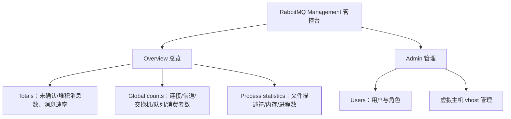
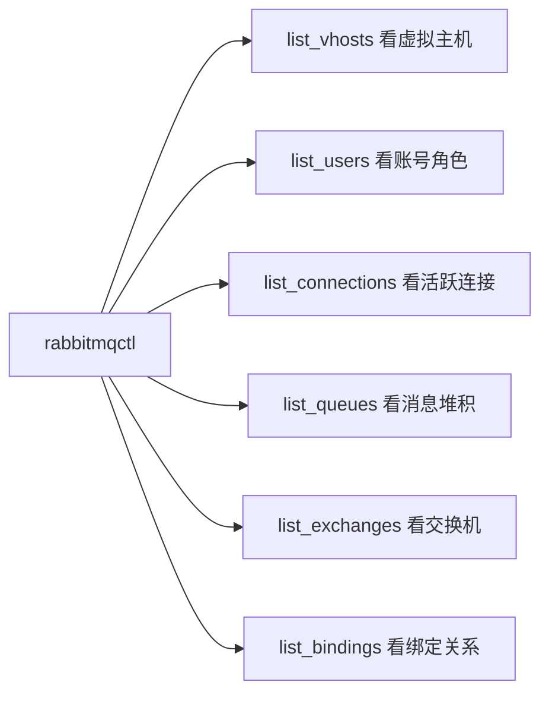

# 运维视角看 RabbitMQ：日志文件、Web 管控台与 rabbitmqctl 三条排查路径

消息发了却没被消费、连接莫名其妙断开、内存快被打满却说不清卡在哪。这类问题发生时，光靠业务日志往往查不出根因，因为瓶颈在消息中间件本身。RabbitMQ 提供了三套互补的可观测手段：落盘的运行日志、图形化的 Web 管控台、以及命令行工具 rabbitmqctl。这篇把这三块讲清楚，让你在出问题时知道该去哪看。

## 先给结论

- RabbitMQ 的运行日志默认在 `/var/log/rabbitmq/rabbit@<主机名>.log`，记录了连接建立、关闭、信道异常等所有客户端与服务端交互的流水。
- Web 管控台（Management 插件）能以图表形式看到消息堆积量、消费速率、连接数、内存、文件描述符等实时指标，绿色接近红色就是要告警的前兆。
- `rabbitmqctl` 是命令行总入口，常用子命令有 `list_vhosts`、`list_users`、`list_connections`、`list_queues`，不依赖浏览器就能远程排查。
- 三套手段定位的层次不同：日志看「发生了什么异常」，管控台看「现在资源紧不紧张」，命令行看「配置和连接对不对」。
- 日志和监控是运维兜底能力，不要求写得有多深，但出问题时要知道从哪下手。

## 一、日志文件：从流水账里找异常

RabbitMQ 把运行日志统一写在固定目录下，文件名带主机名，格式是 `rabbit@<主机名>.log`。先进入目录，再按主机名找到对应文件。

```bash
cd /var/log/rabbitmq
ls
# 一般会看到多个以 .log 结尾的文件，重点看 rabbit@<你的主机名>.log
cat rabbit@super.log
```

日志内容是典型的流水账，把客户端和服务器每一次交互都记下来：哪台机器（IP 加端口）通过哪个连接工厂建立了连接、哪个连接被接受（accepting）、哪个连接被关闭（closing）。比如下面这条记录了一个客户端从某 IP 连到 5672 端口并建立了连接：

```text
=INFO REPORT====
connection <0.1234.0> from 192.168.1.10:54321 to 192.168.1.20:5672
has a client provider with name rabbit_connection_factory
accepting a connection
```

一旦出问题，日志里会出现 `ERROR REPORT`，最常见的就是信道异常，例如声明队列时发现参数冲突：

```text
=ERROR REPORT====
channel exception
operation queue.declare caused a channel exception
```

这段信息的价值在于：它告诉你异常发生在哪一个操作（这里是 `queue.declare`）、因什么而起（信道异常）。当你改了队列参数却启动报错，第一反应应该是翻这个日志，而不是去猜代码。正常启动时间、关闭时间、连接建立时间都能在日志里排出来，用来判断「服务到底有没有按预期起来」。

## 二、Web 管控台：实时指标一眼看清

Management 插件提供的 Web 界面是日常监控最顺手的工具。它把运行态拆成几个板块，重点看这几处。



总览页的 `Totals` 区给出队列里还有多少条消息没被消费、当前的消息收发速率；`Global counts` 给出连接数、信道数、交换机数、队列数、消费者数的全局计数。某个队列消息数一路上涨而消费者数不变，基本可以判断消费者挂了或者处理太慢。

`Process statistics` 区更关键，它把文件描述符、Socket 描述符、Erlang 进程数、内存的使用量和上限并排展示。比如 Socket 连接数当前用了 1 个、上限 829 个，当绿色的使用条逐渐逼近红色上限时，就说明连接快被耗尽，要提前排查连接泄漏。管控台还能在 `Admin` 页管理用户、虚拟主机，并可以把用户和虚拟主机做绑定，这些都是图形化就能完成的操作。

## 三、rabbitmqctl：不用浏览器也能排查

命令行工具 `rabbitmqctl` 适合在没有图形界面的服务器上操作，或者写进脚本做自动化巡检。它的基本用法带节点、超时、静默三个可选参数：

```bash
# 查看帮助，列出所有子命令
rabbitmqctl help

# 可选参数：-n 指定节点，-t 指定超时（毫秒），-q 静默输出
rabbitmqctl [-n <node>] [-t <timeout>] [-q] <command>
```

不知道有哪些虚拟主机，用 `list_vhosts`，默认节点是 `rabbit@<本机主机名>`：

```bash
rabbitmqctl list_vhosts
# 输出形如：
# Listing vhosts ...
# /
# /demo
```

查看有哪些用户及其角色，用 `list_users`。一个干净的环境通常有一个 `guest` 超级管理员，外加你自建的管理账号：

```bash
rabbitmqctl list_users
# 输出形如：
# Listing users ...
# guest   [administrator]
# admin   [administrator]
```

怀疑连接泄漏或想确认当前谁连着，用 `list_connections`。它能列出每个连接对应的用户和客户端 IP，服务端看到的 IP 往往就是应用所在机器：

```bash
rabbitmqctl list_connections
# 输出形如：
# Listing connections ...
# guest   192.168.1.10    running
```

队列、交换机、绑定也有对应的 `list_queues`、`list_exchanges`、`list_bindings`，它们都接受一个可选的虚拟主机参数，默认是 `/`，排查指定租户的数据时加上 vhost 即可。



这张图把常用子命令归了类：左边是「配置对不对」（vhost、用户），右边是「现在状态怎么样」（连接、队列、交换机、绑定）。线上排障时先确认配置，再看实时状态，思路会清晰很多。

## 常见误区

- **把日志路径记成应用目录**：RabbitMQ 日志在 `/var/log/rabbitmq/` 而不在你的工程里，服务器上排障要先 `cd` 到这个目录再按主机名找文件。
- **只盯堆积消息数忽略了资源上限**：消息没堆积不代表健康，文件描述符、内存、Socket 连接数逼近上限同样会导致新连接建不起来，管控台里绿色条变红就要提前处理。
- **把 `guest` 用户用于生产远程连接**：`guest` 默认只允许在本机（localhost）连接，远程访问会失败，生产环境要新建专属账号并绑定虚拟主机。
- **命令行不知道默认节点**：不给 `-n` 时节点默认是 `rabbit@<本机主机名>`，在主机名和预期不一致的环境里查不到数据，要显式指定节点。

## 面试可能被问到的问题

1. 面试官追问：「RabbitMQ 的运行日志默认在哪？」
   答：默认在 `/var/log/rabbitmq/` 目录下，文件名是 `rabbit@<主机名>.log`，里面记录了连接建立、关闭、信道异常等客户端与服务端交互的流水，出现 `ERROR REPORT` 时要优先翻它定位操作级异常。

2. 面试官追问：「怎么快速判断 RabbitMQ 是不是快扛不住了？」
   答：看 Management 管控台的 Process statistics 板块，关注文件描述符、Socket 描述符、Erlang 进程数和内存的使用量与上限。绿色使用条逼近红色上限，说明资源即将耗尽，常见的是连接泄漏导致 Socket 数打满。

3. 面试官追问：「rabbitmqctl 有哪些常用排查命令？」
   答：常用 `list_vhosts` 看虚拟主机、`list_users` 看账号角色、`list_connections` 看活跃连接及来源 IP、`list_queues` 看消息堆积、`list_exchanges` 和 `list_bindings` 看拓扑。它们都支持指定 vhost 参数，默认是 `/`。

4. 面试官追问：「消息堆积了但消费者数正常，可能是什么原因？」
   答：可能是消费者处理慢或 ack 不及时，导致已投递但未确认的消息（unacknowledged）越来越多；也可能是 prefetch 设置过大占住了信道。先在管控台看 Global counts 的消费者数和消息速率，再结合 `list_queues` 的 messages_unacknowledged 指标判断。

5. 面试官追问：「Web 管控台和 rabbitmqctl 分别适合什么场景？」
   答：管控台适合人在现场用浏览器看实时图表和做用户、vhost 的图形化管理；rabbitmqctl 适合无图形界面的服务器或写进脚本做自动化巡检，不依赖浏览器就能拿到配置和连接状态。

## 配套资料

- 本课无独立配套源码包（阶段一 `materials/code/01` 仅含 Spring Boot、Spring Cloud、k8s 工程）。正文日志路径、管控台指标与 `rabbitmqctl` 子命令均依据本课屏幕实录还原，命令示例为按该写法整理的可执行片段。
