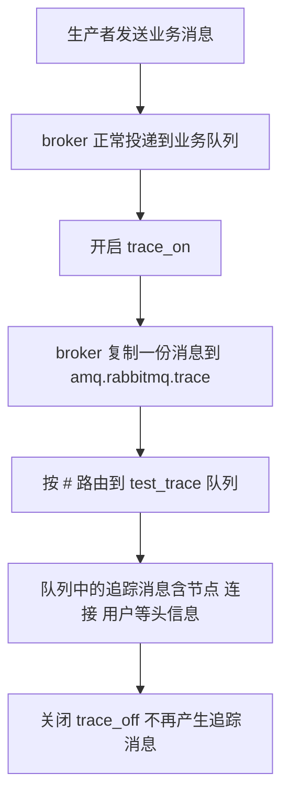
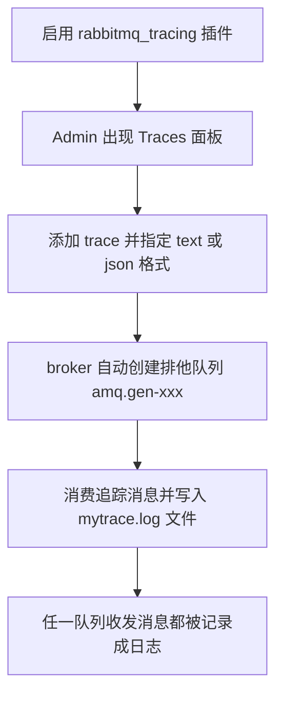

# 给 RabbitMQ 装一个「黑匣子」：用 Firehose 与 rabbitmq_tracing 追踪每一条消息

消息发出去了，消费者却说没收到；或者某条消息中途丢失，排查时只能对着空荡荡的队列干瞪眼。使用任何消息中间件都难免遇到这类问题，网络抖动、broker 重启、客户端异常都可能让消息在某一环脱钩。RabbitMQ 提供了两种消息追踪手段，相当于给整个投递链路装上黑匣子，把每条消息从生产到消费的全过程记录下来，帮开发和运维定位问题到底出在哪一段。

## 先给结论

- RabbitMQ 提供两种消息追踪方式：Firehose（命令行开关）和 rabbitmq_tracing 插件（图形化面板），二者底层都依赖同一个内部交换机 `amq.rabbitmq.trace`。
- Firehose 开启后，broker 会把每一条被生产或消费的消息再复制一份，投递到一个 topic 类型的内部交换机，由你绑定的队列接收，这条内部消息几乎不会丢失。
- rabbitmq_tracing 插件在管理控制台增加了 Traces 面板，把追踪日志落盘成文件，支持 `text` 和 `json` 两种格式，查看更方便。
- 两种追踪都会让每条消息额外写文件并复制一份，broker 吞吐明显下降。它们只适合排障，生产环境要慎用，定位完立即关掉。

## 一、为什么需要消息追踪

任何中间件产品在实际运行中都可能出现消息丢失、未被消费等异常，而这些异常很多时候来自网络问题。作为开发或运维，必须有一套合理的追踪机制，记录消息的投递和消费过程，才能协助定位。没有追踪能力时，消息一旦「消失」就无从查起；有了追踪，每条消息的来龙去脉都有据可查。

## 二、Firehose：命令行级别的追踪

Firehose 的原理很直接。开启之后，broker 内部始终存在一个名为 `amq.rabbitmq.trace` 的交换机，它是 topic 类型、已持久化、且标记为 internal（仅供内部使用，不接收客户端直接发来的消息），默认没有绑定任何队列。当你开启 Firehose 后，每一条被生产或消费的消息，broker 都会再帮你发一份到这个交换机；这条内部消息基本不会丢，而你原本发出的那条消息是否丢失则另说。

开启和关闭的命令很简单：

```bash
rabbitmqctl trace_on      # 开启 Firehose 追踪
rabbitmqctl trace_off     # 关闭 Firehose 追踪
```

使用步骤通常如下：

**第一，创建一个普通队列用于接收追踪消息。** 例如 `test_trace`，名字随意。

**第二，把这个队列绑定到内部交换机。** 绑定的 routing key 用 `#`，含义是匹配所有消息。这样交换机会监听到所有消息，无论是生产端发出的还是消费端接收的，都会被复制一份投递到 `test_trace`。

**第三，开启 `trace_on` 再发消息。** 此时队列里会多出一条由 `amq.rabbitmq.trace` 交换机投递、带有详细头信息的消息。这条消息不是你发的，它的头里记录了 routing key、是否持久化、节点、虚拟机、连接、channel、用户等关键信息，足以支撑事后分析。



图里最关键的一环是「复制」：你的业务消息照常走，broker 在内部额外发一份到追踪交换机，两者互不影响。关闭 `trace_off` 之后就收不到内部消息了。

## 三、rabbitmq_tracing 插件：图形化追踪

Firehose 偏命令行，查看不够直观。RabbitMQ 管控台还提供了一种插件机制，能以图形化方式查看追踪日志。

先查看插件列表，确认 `rabbitmq_tracing` 是否已启用（默认未启用），再启用它：

```bash
rabbitmq-plugins list                    # 列出所有插件，带 e 的是已启用
rabbitmq-plugins enable rabbitmq_tracing # 启用追踪插件
```

启用之后刷新管理控制台，Admin 标签页会多出一个 Traces 面板。在这个面板里添加一条 trace，需要填写几个参数：

**第一，Name。** 例如 `mytrace`，作为日志文件的标识。

**第二，Format。** 有两种。`text` 格式下 payload 是明文，方便人直接阅读；`json` 格式下 payload 经过 base64 编码，方便程序解析。

**第三，Max payload bytes。** 不填表示记录消息体的全部内容；如果填 `10`，则只取前 10 个字节。

**第四，Pattern。** 这是过滤规则。`#` 表示接收所有消息（无论发送还是消费）；`publish.#` 只看发送；`deliver.#` 只看消费。一般排查两边都想看时填 `#`。

添加完成后，面板里会出现对应的日志文件（如 `mytrace.log`）。此后不管往哪个队列发消息，日志文件里都会记录一行，内容包括 node、connection、虚拟机、user、channel 以及真正的 payload 数据。即使某条业务消息收不到，这条日志信息通常也能看到，据此可以判断是发送失败还是消费失败。



插件方式相比手动绑定 Firehose，省去了自己创建队列和绑定的步骤，还额外提供了落盘日志文件，因此用得更多。但要注意，它同样会拉低性能。

## 四、两种方式的取舍与性能代价

Firehose 足够轻量，一条命令就能开，适合快速验证。rabbitmq_tracing 图形化、日志落盘、查看方便，在实际排障中更常用。但二者本质上都会：每收发一条消息就额外写一次文件，并且复制一条内部消息，broker 的整体性能因此明显下滑。

因此这类追踪功能只应在开发、测试阶段随意开启，或者生产环境真正出现消息丢失问题时临时开启，定位完问题立即关闭。长期在生产环境开着追踪，等于主动给系统挖了一个性能坑。

## 常见误区

- **以为开启追踪不影响性能**：实测每条消息都会额外写文件并复制，吞吐显著下降，生产常开是大忌。
- **关掉之后还去查内部消息**：执行 `trace_off` 或禁用插件后，内部消息不再产生，再去队列里找追踪消息自然是空的。
- **Pattern 配错**：只想看消费侧日志却填了 `#`，或者只想看发送侧却填了 `deliver.#`，导致日志范围不对，干扰判断。
- **把追踪消息当业务消息消费**：`amq.rabbitmq.trace` 投递的是内部副本，业务消费者不应去消费它，否则会重复处理。

## 面试可能被问到的问题

1. 面试官追问：「RabbitMQ 的消息追踪有哪几种方式？」
   答：主要有两种，Firehose 通过 `rabbitmqctl trace_on/off` 命令行开关，依赖内部交换机 `amq.rabbitmq.trace` 复制消息；rabbitmq_tracing 是管理控制台插件，提供 Traces 面板并把追踪日志落盘成文件，支持 text 与 json 两种格式。

2. 面试官追问：「amq.rabbitmq.trace 这个交换机是什么类型，为什么普通队列要绑定它？」
   答：它是 topic 类型、internal 的内部交换机。开启 Firehose 后，broker 会把每条收发消息复制一份发到这里，把业务队列用 routing key `#` 绑定到它，就能收到所有消息的追踪副本，用于排查。

3. 面试官追问：「rabbitmq_tracing 的 text 和 json 格式有什么区别？」
   答：text 格式的 payload 是明文，适合人直接阅读；json 格式把 payload 做了 base64 编码，结构规整，适合程序解析。另外 Max payload bytes 可以控制记录的消息体长度。

4. 面试官追问：「为什么生产环境不建议长期开启消息追踪？」
   答：开启追踪后，每一条生产或消费的消息都会被额外写文件并复制一份到内部交换机，broker 的 I/O 和吞吐压力明显上升，会影响正常业务性能，所以只在排障时临时开启。

5. 面试官追问：「Firehose 和 rabbitmq_tracing 的底层关系是怎样的？」
   答：rabbitmq_tracing 插件本质上也是在 Firehose 机制之上做的封装，它自动创建排他队列并消费 `amq.rabbitmq.trace` 的消息，再写入日志文件，省去了手动绑定队列的步骤。

## 配套资料

- 本课无配套源码包（`materials/code` 下未提供 RabbitMQ 工程）。文中 `amq.rabbitmq.trace` 内部交换机名、`trace_on/trace_off`、`rabbitmq-plugins` 命令均来自课程实录。
- 以下为按课程思路补全的标准示例，演示如何用 Spring AMQP 发送一条会被追踪复制的业务消息：

```java
package com.example.mq;

import org.springframework.amqp.rabbit.core.RabbitTemplate;
import org.springframework.stereotype.Component;

@Component
public class OrderProducer {

    private final RabbitTemplate rabbitTemplate;

    public OrderProducer(RabbitTemplate rabbitTemplate) {
        this.rabbitTemplate = rabbitTemplate;
    }

    // 发送一笔订单消息，开启 Firehose 后 broker 会复制一份到 amq.rabbitmq.trace
    public void sendOrder(Long orderId) {
        rabbitTemplate.convertAndSend("order.exchange", "order.create", orderId);
    }
}
```
