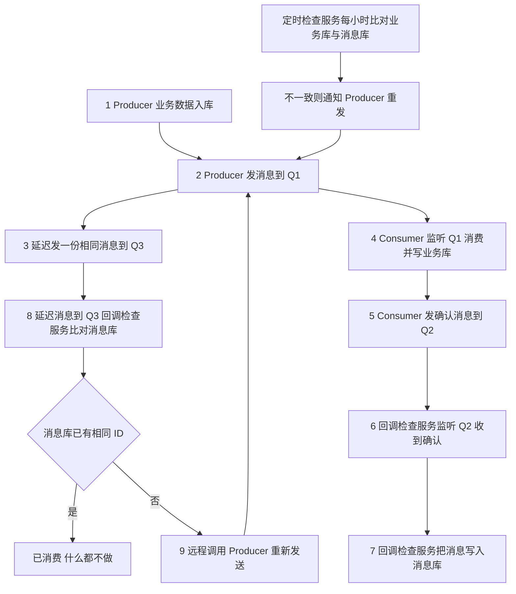

# 消息怎么确保不丢：用消息补偿机制兜住那 1% 的发送失败

消息可靠性的目标，是确保业务数据一旦入库，对应的消息就一定能发送到 broker、并被消费者成功处理。百分百不丢在理论上做不到，但做到 99.999% 是可行的。靠什么？靠消息补偿机制，而不是单纯依赖发送时的成功回调。这一篇只讲思路与架构，不写具体工程代码，先把这个流传很广的补偿方案彻底讲透。

## 先给结论

- 消息的可靠性保障靠「补偿机制」，而非单次发送的成功与否。
- 核心流程是：业务数据入库，发送消息，延迟再发一份到另一个队列，消费端处理完后回一条确认消息，回调检查服务比对，定时检查服务兜底。
- 体系里有三类独立应用：Producer、Consumer、回调检查服务，外加一个定时检查服务；还有三套数据库：Producer 的业务库、Consumer 的业务库、专门用于记录消息的消息库。
- 任意一环失败，都会被延迟消息或定时任务重新拉起，消息最终一定会被补偿消费，不会永久丢失。

## 一、为什么单靠发送确认不够

设想最朴素的写法：Producer 先把业务数据写进自己的数据库，然后调用客户端发送消息到队列，只要发送接口返回成功就认为万事大吉。这种做法在绝大部分时候没问题，但网络闪断、broker 抖动、客户端超时都可能让「数据库写成功了，消息却没真正发出去」。此时 Consumer 永远收不到这条消息，两边的数据就此不一致，而且没有任何机制能发现它丢了。

要兜底，就必须引入额外的确认与复查手段，这正是补偿机制要解决的。

## 二、补偿机制的全流程

下图把整个补偿链路画出来，包含 MQ broker（内部有 Q1、Q2、Q3 三个队列）、Producer、Consumer、回调检查服务、定时检查服务，以及三套数据库。流程编号为 1 到 9。



关键路径解读：正常情况走 1、2、4、5、6、7，消息被消费并留下确认记录；异常情况由 3 的延迟消息和 8、9 的重新发送兜住；连延迟消息也失败时，还有定时检查服务这最后一道防线。

逐步拆解这九步：

**第一，Producer 先把自己的业务数据入库。** 这是源头，数据先落库才有后续一切。

**第二，Producer 发送消息到 Q1。** Consumer 监听 Q1，拿到消息后处理自己的业务并写入 Consumer 业务库。这一步和平时写消息队列没有区别。

**第三，Producer 延迟再发一份「相同」消息到 Q3。** 注意两份消息内容完全一样，只是落在不同队列：一个在 Q1 被正常消费，一个在 Q3 等着被检查。延迟两三分钟或三五分钟再发，给正常消费留出时间。

**第四到第七，消费端回确认。** Consumer 成功消费 Q1 的消息后，会转换角色变成生产端，往 Q2 发一条确认消息。回调检查服务监听 Q2，收到确认后只做一件事：把这条消息的 ID 写入消息库（MD）。

**第八，延迟消息抵达 Q3 后做比对。** 回调检查服务也监听 Q3，拿到那条延迟消息后，去消息库里查是否已有相同 ID 的记录。如果有，说明 Consumer 早已成功消费，这条延迟消息直接丢弃，什么都不做；如果没有，说明 Consumer 消费失败，立即通过远程调用通知 Producer 重新发送，流程回到第二步再来一遍。

**第九，定时检查服务兜底。** 万一延迟消息本身也发送失败，上面的比对就不会触发。于是再加一个定时检查服务，每隔一小时比对 Producer 业务库和消息库：两边数据应该一致，如果发现业务库里多了数据（说明消息没发出去或没被记录），就通知 Producer 把多出来的那条数据重新发消息。

## 三、为什么这套机制能兜住

它有两层保障。第一层是延迟消息加比对：即便正常发送失败，延迟那份也能在几分钟后重新触发检查；第二层是定时检查：即便延迟消息也失败，定时任务周期性比对两个库，照样能把漏掉的数据捞出来重发。两层叠加之后，只要 Producer 业务库里有数据，消息迟早会被补偿消费，不会永久丢失。这也是很多高并发企业实际采用的方案。

## 四、示例实现（按课程思路补全）

由于本课只讲架构思路，下面给出 Producer 与回调检查服务的关键逻辑示例，帮助理解落地形态。这是标准写法的补全示例，并非课程原始工程代码。

```java
package com.example.mq;

import org.springframework.amqp.rabbit.core.RabbitTemplate;
import org.springframework.stereotype.Component;

@Component
public class ReliableProducer {

    private final RabbitTemplate rabbitTemplate;

    public ReliableProducer(RabbitTemplate rabbitTemplate) {
        this.rabbitTemplate = rabbitTemplate;
    }

    // 业务入库后发送消息，并延迟再发一份到 Q3 用于补偿检查
    public void publishWithCompensation(String businessId, Object payload) {
        rabbitTemplate.convertAndSend("biz.exchange", "biz.route", payload);
        // 延迟消息投递到补偿队列 Q3，内容与原消息一致
        rabbitTemplate.convertAndSend("compensate.exchange", "compensate.route", payload);
    }
}
```

回调检查服务监听 Q2（确认）与 Q3（延迟）两类消息，核心是比较消息库是否已存在该 ID：

```java
package com.example.mq;

import org.springframework.amqp.rabbit.annotation.RabbitListener;
import org.springframework.stereotype.Component;

@Component
public class CallbackCheckService {

    // 监听到消费端回的确认，写入消息库
    @RabbitListener(queues = "q2_confirm")
    public void onConfirm(String messageId) {
        messageRepository.saveIfAbsent(messageId);
    }

    // 监听到延迟消息，比对消息库，缺失则通知 Producer 重发
    @RabbitListener(queues = "q3_delay")
    public void onDelay(String messageId) {
        if (!messageRepository.exists(messageId)) {
            producerClient.resend(messageId);
        }
    }
}
```

## 常见误区

- **只发一次就认为成功**：Producer 业务库写成功但消息没真正发出去时，Consumer 永远收不到，数据就此不一致，必须靠补偿。
- **把延迟消息当唯一保障**：延迟消息本身也可能发送失败，必须有定时检查服务做最后兜底。
- **确认消息和消费消息混在同一个队列**：二者职责不同，确认消息应单独走 Q2，否则会和消费逻辑耦合，难以区分。
- **消息库和 MQ 状态混为一谈**：消息库记录的是「是否已被消费确认」，是补偿判定的唯一真相来源，不能靠 broker 里的堆积状态来判断。

## 面试可能被问到的问题

1. 面试官追问：「如何保障 RabbitMQ 消息不丢失？」
   答：单靠发送成功回调不够，通常采用消息补偿机制。业务数据先入库，发送消息的同时延迟再发一份到补偿队列，消费端处理完回确认消息，回调检查服务把消息 ID 写入消息库；延迟消息到达后比对消息库，缺失则通知重发，再用定时任务比对业务库与消息库兜底。

2. 面试官追问：「为什么需要延迟消息和定时检查两道保障？」
   答：延迟消息可能在正常发送失败时补上缺口，但它自身也可能发送失败；定时检查服务周期性比对业务库和消息库，能捞出入库了却始终没消息痕迹的数据，是最后一道防线，两层叠加才能逼近不丢。

3. 面试官追问：「消息库在整个方案里起什么作用？」
   答：消息库记录「哪些消息已被消费确认」，是补偿判定是否重发的唯一真相来源。回调检查服务收到延迟消息后，只要消息库里已有对应 ID，就说明消费成功，不再重复处理。

4. 面试官追问：「Producer 和 Consumer 各自的业务库为什么要分开？」
   答：二者属于不同应用、各自维护自己的数据，分开存储符合服务边界；补偿机制只关心两边的「数据是否最终一致」，不强耦合彼此的库结构。

5. 面试官追问：「这种方案会不会导致消息重复消费？」
   答：会。补偿重发本就会产生重复消息，因此消费端必须保证幂等，这正是消息幂等性保障要解决的问题，通常与本方案配合使用。

## 配套资料

- 本课无配套源码包（`materials/code` 下未提供 RabbitMQ 工程）。文中补偿架构、Q1/Q2/Q3 队列分工、消息库比对逻辑均来自课程实录。
- 文中 Java 代码为按课程思路补全的标准示例，用于说明 Producer 与回调检查服务的落地形态。
