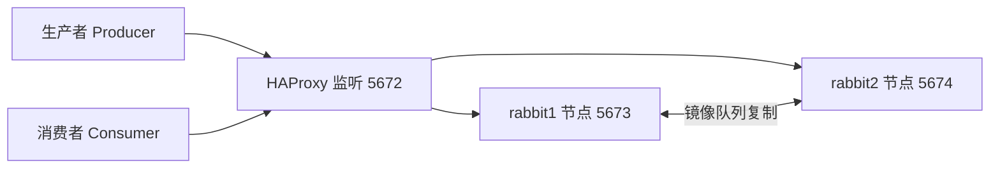

# RabbitMQ 集群搭好了却照样丢消息：镜像队列到底补上了哪一块

一台 RabbitMQ 跑得好好的，某天宿主机重启或者 Erlang 节点崩掉，订单消息发不出去、库存消息消费不了，整条链路瞬间断供。消息中间件在架构里的位置太靠中间了，它一停，上下游一起瘫痪，所以生产环境几乎不可能只留单节点。

顺着这个诉求自然会想到多开几个节点组成集群。但不少人在管控台上看到两个节点都亮起来就以为万事大吉，直到杀掉主节点才发现队列里的消息取不出来。这一篇讲的就是这个缺口从哪来，以及怎么用镜像队列补上。

## 先给结论

- 默认集群只在全节点复制元数据：交换机、绑定、用户、权限、vhost 每个节点都看得到，队列里的消息只落在创建它的那个节点上。
- 想让队列内容也复制到每个节点，必须叠加镜像队列策略，`ha-mode` 设为 `all` 是最省事的写法。
- 镜像队列建立在普通集群之上，先有集群才有镜像，顺序不能反。
- 单机多实例属于伪集群，靠端口区分节点，真实环境换成不同 IP 即可，命令完全一致。
- 加入集群前必须走 `stop_app` → `reset` → `start_app`，带着残留数据 join 容易失败。
- 默认端口 5672 要空出来留给 HAProxy 当统一入口，客户端不该感知任何一个节点的端口。

## 一、目标架构是什么样的

期望形态是外面套一层 HAProxy 做反向代理，生产端和消费端只连 HAProxy，由它把请求转发到后端任意一个 RabbitMQ 节点；节点之间再把队列内容互相同步，某个节点宕机后其余节点照样能读写。



图里说的是两件事：HAProxy 解决「客户端连谁」，镜像队列解决「数据存在谁那儿」。这两个问题互相独立，只解决前者不解决后者，节点挂起来照样取不到消息。这一篇先把后者讲透。

## 二、单机多实例：一台虚拟机跑两个节点

课程环境受限于机器性能，采用单机多实例部署，也就是常说的伪集群：同一台 Linux 上起多个 Erlang 节点，用 `RABBITMQ_NODE_PORT` 区分 AMQP 端口，用 `RABBITMQ_NODENAME` 区分节点名。两个节点和 N 个节点的效果没有区别，能看清楚现象就够了。

动手前先把系统服务停掉，避免端口冲突：

```bash
service rabbitmq-server stop

# 节点一：AMQP 端口 5673，管理控制台用默认的 15672
RABBITMQ_NODE_PORT=5673 RABBITMQ_NODENAME=rabbit1 rabbitmq-server start

# 节点二：AMQP 端口 5674，管理控制台端口错开到 15674
RABBITMQ_NODE_PORT=5674 RABBITMQ_NODENAME=rabbit2 rabbitmq-server start
```

这是前台启动方式，光标会停住不动，需要继续敲命令就另开一个终端会话，`Ctrl+C` 即结束进程。日志里出现 `Starting broker... Completed with 0 plugins.` 说明节点起来了。

浏览器分别访问两个管控台，用默认的 `guest` 账号登录，页面顶部会显示各自的名字，形如 `rabbit1@<主机名>` 和 `rabbit2@<主机名>`。此刻它们只是两个互不相干的独立节点，还算不上集群。

## 三、把独立节点合成一个集群

加入集群的动作必须在应用停止的状态下做，还要先把节点上残留的数据重置掉，否则新节点带着旧状态去 join，往往会失败或者留下不一致状态。以 `rabbit1` 作为主节点：

```bash
rabbitmqctl -n rabbit1 stop_app
rabbitmqctl -n rabbit1 reset
rabbitmqctl -n rabbit1 start_app
```

第二个节点多一步 `join_cluster`，参数是目标节点名，格式是「节点名@主机名」，主机名必须换成自己机器的实际名字：

```bash
rabbitmqctl -n rabbit2 stop_app
rabbitmqctl -n rabbit2 reset
rabbitmqctl -n rabbit2 join_cluster rabbit1@super
rabbitmqctl -n rabbit2 start_app
```

不报错即代表加入成功，再用下面这条命令复核：

```bash
rabbitmqctl cluster_status
```

刷新任意一个管控台，Overview 页会同时列出两个节点，集群就算成立了。顺手记几个常用的集群管理命令：`rabbitmqctl change_cluster_node_type disc|ram` 改节点类型，`rabbitmqctl forget_cluster_node` 把节点踢出集群，`rabbitmqctl set_cluster_name` 重设集群名称。

## 四、默认集群的真实缺口

做个实验就能看得很清楚。在 `rabbit1` 上新建队列 `aa`，发一条消息进去，两个管控台都能看到它，看上去像已经同步了。接着把主节点停掉，也就是在它那个终端里按 `Ctrl+C`。

`rabbit1` 的管控台直接打不开了。切到 `rabbit2` 的管控台，队列列表里 `aa` 还在，点进去 Get messages 却拿不到数据。原因很直白：元数据复制到了每一个节点，队列自身以及堆积在队列里的消息只存在于创建它的那个节点，进程没了数据就跟着不可访问。

所以默认集群解决的是「元数据不丢」和「分摊节点压力」，并不等于队列高可用。为了让这份空洞变得不那么抽象，这里给出客户端视角的消息写入方式（按本课思路补全的示例，非课程源码）：

```java
package com.example.mq;

import com.rabbitmq.client.Channel;
import com.rabbitmq.client.Connection;
import com.rabbitmq.client.ConnectionFactory;

public class ClusterProducer {

    public static void main(String[] args) throws Exception {
        ConnectionFactory factory = new ConnectionFactory();
        factory.setHost("192.168.1.10");
        factory.setPort(5673);
        factory.setUsername("guest");
        factory.setPassword("guest");

        try (Connection connection = factory.newConnection();
             Channel channel = connection.createChannel()) {
            channel.queueDeclare("aa", true, false, false, null);
            channel.basicPublish("", "aa", null, "hello RabbitMQ".getBytes());
        }
    }
}
```

端口写死 5673 这件事本身就埋了雷，这个问题留到最后再说。

## 五、镜像队列：一条 policy 铺平数据

镜像队列（Mirrored Queue）就是在普通集群之上再加一条同步策略。入口是 Admin 标签页的 Policies，也可以直接敲命令：

```bash
rabbitmqctl set_policy my_ha "^" '{"ha-mode":"all"}'
```

三个参数依次是策略名、匹配队列名的正则、策略定义。正则写 `^` 表示匹配所有队列，注意这里是脱字符而不是井号，`#` 是 topic 交换机里 binding key 的通配符，放在策略里不生效。策略定义里常用的键有三个：

| 键 | 含义 |
|---|---|
| `ha-mode` | `all` 复制到所有节点，`exactly` 指定副本数，`nodes` 指定具体节点 |
| `ha-params` | 配合 `exactly` 填数字，配合 `nodes` 填节点名列表 |
| `ha-sync-mode` | `automatic` 新节点加入时自动同步，默认 `manual` 需手动触发 |

在管控台上填也一样：Pattern 填 `^`，Apply to 选 Queues，Definition 里加一行 `ha-mode` 值为 `all`。

策略生效后回到 Queues 页，队列名后面会多出 `+1` 这样的角标，悬停提示是 synchronized mirrors，意思是这条队列已经同步到了另外 1 个节点。三节点集群就是 `+2`，五节点就是 `+4`，加几代表同步到了几个镜像。

再验一次：在 `rabbit2` 上建队列 `bb`，发一条持久化消息进去（发布时 Delivery mode 选 Persistent），然后把 `rabbit1` 关掉。此时 `rabbit1` 页面虽然访问不了，但 `rabbit2` 里 `bb` 仍在，Get messages 依旧能取出那条消息。数据在两个节点各存了一份，这才叫可用。

## 六、还剩一块拼图

集群内部的数据安全有了，可代码里到底该写哪个地址？写 5673，这个节点挂了就发不出去；写 5674，同理。业务需要一个统一入口，能自动把流量路由到活着的节点上，这事交给 HAProxy，下一篇接着搭。

## 常见误区

- **以为 join 完集群就等于高可用**：默认集群不复制队列内容，必须再配镜像策略，两者缺一不可。
- **Pattern 写成 `#`**：策略用的是正则，`#` 匹配不到任何队列，结果策略形同虚设，改成 `^` 或写具体前缀如 `^order\.`。
- **不 reset 直接 join**：残留的元数据会造成加入失败或状态不一致，`stop_app` 之后一定跟上 `reset`。
- **把 `ha-mode: all` 当成万能解**：节点越多写放大越重，网络和磁盘开销随副本数线性增长，集群规模大时应当用 `exactly` 控制副本数。

## 面试可能被问到的问题

1. 面试官追问：「RabbitMQ 默认集群到底同步了哪些东西？」
   答：同步的是元数据，包括交换机、绑定关系、用户、权限、vhost，任意节点都能看到同一份定义。队列自身和堆积的消息只保存在创建它的那个节点上，所以说默认集群不等于队列高可用。

2. 面试官追问：「镜像队列怎么配，有哪些 ha-mode？」
   答：先搭好普通集群，再用 `rabbitmqctl set_policy 名称 "正则" '{"ha-mode":"all"}'` 或管控台 Policies 页面加策略。`all` 复制到全部节点，`exactly` 配合 `ha-params` 指定副本数，`nodes` 指定具体节点列表。

3. 面试官追问：「为什么 Pattern 要用 ^ 而不是 #？」
   答：`^` 是正则的行首锚点，能匹配所有队列名。`#` 是 topic 交换机 binding key 的通配符，在 policy 里没有通配含义，写进去策略不命中，镜像就不会生效。

4. 面试官追问：「队列名后面的 +1 是什么含义？」
   答：表示这条队列已经完成同步的镜像副本数，两节点集群通常是 +1，三节点集群是 +2，本质上等于「已同步镜像数」，也就是节点数减一。

5. 面试官追问：「为什么要专门留出 5672 端口？」
   答：5672 是 RabbitMQ 默认 AMQP 端口，多实例部署时节点用了 5673、5674，把 5672 留给 HAProxy 监听，客户端统一连它，由 HAProxy 转发到存活节点，业务代码不用感知节点地址。

6. 面试官追问：「镜像队列能解决网络分区吗？」
   答：不能。分区后两个半区可能各自选出新的 master，恢复时后写的一侧数据会被丢弃。生产环境通常需要配合 `ha-sync-mode: automatic`、合适的 `ha-promote-on-shutdown` 策略以及 `pause-minority` 或 `autoheal` 这类分区处理策略一起用。

## 配套资料

- 本课为命令行实操，课程源码包中没有对应的 RabbitMQ 工程，文中集群命令与策略命令均取自课堂实录（`join_cluster`、`cluster_status`、`set_policy` 等）。
- 客户端侧的 RabbitMQ 连接配置可参考同阶段笔记：`materials/code/01/2.springcloud/2.springcloud/day02/笔记/Spring Cloud 第二天课堂笔记.md`（含 `rabbitmq` 的 host、port、username、password 真实配置项）
