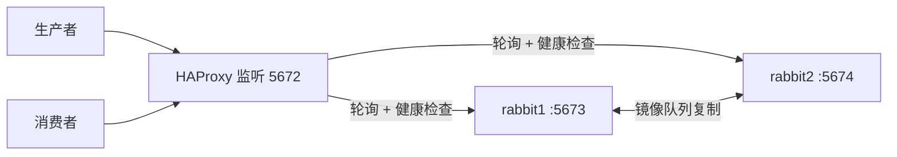

# 给 RabbitMQ 集群挡一层 HAProxy：客户端再也不用挑节点

集群搭好了，镜像队列也配上了，队列数据在两个节点各存一份。可真正写代码的时候还是卡住：连接工厂里的 host 和 port 到底填哪个？
填 `rabbit1` 的 5673，它挂了就发不出去；填 `rabbit2` 的 5674，同样会在那个节点故障时断供。
期望的形态是代码里只有一个 IP 和端口，由中间层把流量送到活着的节点上去，HAProxy 承担的就是这个角色。

它是一款用 C 写的高性能负载均衡和反向代理软件，支持 TCP 层转发，正好契合 AMQP 这种长连接协议。

## 先给结论

- 客户端只连 HAProxy 的监听端口，不再直连任何一个 RabbitMQ 节点，业务代码感知不到后端节点变化。
- `listen` 段里用 `server` 声明后端节点，`check` 开启健康检查，节点宕机后自动被摘除，无需改代码。
- 对外端口沿用默认的 5672，后端节点跑在 5673 和 5674，端口职责清晰。
- 课程采用源码编译方式安装，安装目录 `/usr/local/haproxy`，配置文件 `/etc/haproxy/haproxy.cfg`。
- HAProxy 自带 stats 监控页，浏览器打开就能看到每个后端节点的存活状态和流量。

## 一、HAProxy 在整个链路里的位置

入口统一之后，链路变成三段：生产者和消费者只认 HAProxy，HAProxy 按负载策略挑一个健康节点转发，节点之间再由镜像队列保持数据同步。



图里最关键的是 HAProxy 到每个节点都挂着健康检查。这正是故障自动绕开的前提：演示时把 5673 那个节点掐掉，
代码一行没改，消息依然发出去了，因为 HAProxy 已经把流量转到了 5674。

## 二、源码编译安装

HAProxy 是 C 写的，需要先装编译环境。gcc、vim、wget 这些依赖机器上通常已有，缺了再装也不迟。
课程资料包里提供了 `haproxy-1.6.5.tar.gz`，省去联网下载的麻烦：

```bash
# 安装编译依赖
yum install gcc vim wget

# 上传源码包后解压到 /usr/local
tar -zxvf haproxy-1.6.5.tar.gz -C /usr/local

# 编译并安装：TARGET 指定内核代号，PREFIX 指定安装目录
cd /usr/local/haproxy-1.6.5
make TARGET=linux2611 PREFIX=/usr/local/haproxy
make install PREFIX=/usr/local/haproxy

# 创建配置目录
mkdir /etc/haproxy

# 创建运行账号，避免用 root 跑
groupadd -r -g 149 haproxy
useradd -r -s /sbin/nologin -u 149 haproxy
```

编译阶段是一堆 `.c` 文件的活儿，耗时会长一些，耐心等它跑完。装完之后可执行文件落在 `/usr/local/haproxy/sbin/haproxy`。

## 三、配置文件 haproxy.cfg

配置主体是三大块：`global` 管全局，`defaults` 管默认继承，`listen` 才是真正要动手改的地方。

```conf
#logging options
global
    log 127.0.0.1 local0 info
    maxconn 5120
    chroot /usr/local/haproxy
    uid 99
    gid 99
    daemon
    quiet
    nbproc 20
    pidfile /var/run/haproxy.pid

defaults
    log global
    mode tcp
    option tcplog
    retries 3
    option redispatch
    timeout connect 5000ms
    timeout client 30000ms
    timeout server 30000ms
```

`global` 里的 `chroot` 把进程根目录锁死在安装目录，`daemon` 表示后台运行，`pidfile` 方便查进程。这段基本不用动。

真正要写的是两个 `listen` 段：

```conf
listen rabbitmq_cluster
    bind 0.0.0.0:5672
    mode tcp
    option tcplog
    balance roundrobin
    server node1 127.0.0.1:5673 check inter 5000 rise 2 fall 2
    server node2 127.0.0.1:5674 check inter 5000 rise 2 fall 2

listen stats
    bind 172.16.98.133:8100
    mode http
    option httplog
    stats enable
    stats uri /rabbitmq-stats
    stats refresh 5s
```

**第一，`bind 0.0.0.0:5672` 是给客户端用的统一入口。** 生产端和消费端配的就是这个端口，后端节点真实的 5673、5674 被完全屏蔽掉。

**第二，`balance roundrobin` 表示轮询分发。** 注释掉它换成 `balance source` 可以改成按来源 IP 哈希，适合希望同一客户端固定落到一个节点的场景。

**第三，`check inter 5000 rise 2 fall 2` 是健康检查参数。** 每 5000 毫秒探一次，连续 2 次成功判定为存活，连续 2 次失败就把它摘掉，故障节点不再接流量。

**第四，`server` 后面的地址写本机还是别的机器，取决于部署形态。** 单机多实例部署下 HAProxy 和两个节点在同一台机器，写 `127.0.0.1` 即可；真正的分布式集群换成对应机器的 IP。

## 四、启动与验证

用 `-f` 指定配置文件启动，没有任何报错输出通常就表示起来了：

```bash
# 启动
/usr/local/haproxy/sbin/haproxy -f /etc/haproxy/haproxy.cfg

# 查看进程
ps -ef | grep haproxy
```

浏览器打开 `http://172.16.98.133:8100/rabbitmq-stats`，能看到 node1 和 node2 两个后端的状态块，行是绿色的说明健康检查通过。
路径里的 IP、端口、uri 都可以按自己环境改。

演示验证的过程是这样的：先把 5673 节点停掉，它的管控台随之不可访问，接着用不改任何代码的生产者再发一次消息，
依然发送成功，队列里消息数从 1 变成 2。把 5673 重新拉起后，镜像同步会把落后的消息补齐，监控页也恢复正常。

## 五、客户端侧要改的两行

原生客户端只需要把 host 和 port 指向 HAProxy：

```java
package com.example.mq;

import com.rabbitmq.client.Channel;
import com.rabbitmq.client.Connection;
import com.rabbitmq.client.ConnectionFactory;

public class HaProducer {

    public static void main(String[] args) throws Exception {
        ConnectionFactory factory = new ConnectionFactory();
        // 注意：host 和 port 指向 HAProxy，不再是某个 RabbitMQ 节点
        factory.setHost("172.16.98.133");
        factory.setPort(5672);
        factory.setUsername("guest");
        factory.setPassword("guest");

        try (Connection connection = factory.newConnection();
             Channel channel = connection.createChannel()) {
            channel.queueDeclare("hello_world", true, false, false, null);
            channel.basicPublish("", "hello_world", null, "hello RabbitMQ".getBytes());
            System.out.println("send ok");
        }
    }
}
```

换成 Spring Boot 工程时，这两行变成配置文件里的四行，写法在同阶段的课程笔记中就有完整示例：

```yaml
spring:
  # 这里的地址同样填 HAProxy 的地址与端口
  rabbitmq:
    host: 172.16.98.133
    port: 5672
    username: guest
    password: guest
```

## 常见误区

- **先编辑配置文件后建目录**：直接在 vim 里保存 `/etc/haproxy/haproxy.cfg` 会报 `Can't open file for writing`，因为 `/etc/haproxy` 还不存在。`mkdir` 必须走在编辑前面。
- **配了 HAProxy 却还在代码里写节点端口**：`setPort(5673)` 这种写法等于绕过了负载均衡，节点一挂立即失联。
- **把健康检查参数理解反**：`rise` 是恢复判定次数，`fall` 是剔除判定次数，配置太激进会导致正常节点被误摘。
- **忽略 HAProxy 自身是单点**：它现在扛着全部入口流量，生产环境需要再叠一层 keepalived 之类的高可用方案，用虚拟 IP 做主备漂移。

## 面试可能被问到的问题

1. 面试官追问：「为什么 RabbitMQ 集群前面要加 HAProxy？」
   答：集群有多个节点，客户端写死任一节点地址都会在该节点故障时失效。HAProxy 对外暴露统一端口并做健康检查，
   自动把流量送到存活节点，客户端代码完全不用感知后端拓扑。

2. 面试官追问：「roundrobin 和 source 两种调度策略怎么选？」
   答：roundrobin 是轮询，流量均分，适合无状态、连接较短的场景；source 按源 IP 哈希，同一客户端固定落到同一节点，适合需要会话保持的场景。RabbitMQ 客户端一般是长连接，两种都能用，按业务 sticky 需求决定。

3. 面试官追问：「健康检查是怎么判定节点存活的？」
   答：`server` 行末尾的 `check inter 5000 rise 2 fall 2` 表示每 5 秒探测一次，连续 2 次成功标记可用，连续 2 次失败则从转发列表剔除，恢复后重新纳入。

4. 面试官追问：「HAProxy 为什么要编译安装而不是 yum 直接装？」
   答：源码编译可以指定 `TARGET` 适配内核版本、用 `PREFIX` 控制安装路径，也方便固定版本便于复现。代价是需要 gcc 等编译依赖，且编译耗时较长。

5. 面试官追问：「加上 HAProxy 之后还有单点隐患吗？」
   答：有，HAProxy 自身成了新的单点。通常会部署两个 HAProxy 实例，再配 keepalived 提供虚拟 IP，主实例故障时 VIP 漂到备实例，消除这一层单点。

6. 面试官追问：「HAProxy 是四层代理还是七层代理？」
   答：两种都支持。`listen` 段里 `mode tcp` 走四层，按 IP 和端口转发，AMQP 这类二进制协议用它；`mode http` 走七层，可以解析 HTTP 语义，stats 监控页用的就是这种模式。

## 配套资料

- 本课为运维实操，课程源码包中没有对应的 HAProxy 工程，文中安装命令与 `haproxy.cfg` 配置取自课堂实录。
- 客户端侧的 RabbitMQ 连接配置出自真实课程笔记：`materials/code/01/2.springcloud/2.springcloud/day02/笔记/Spring Cloud 第二天课堂笔记.md`
- 文中 Java 生产者为按本课讲法补全的示例，用于说明连接地址的改动点，非课程原始工程文件。
