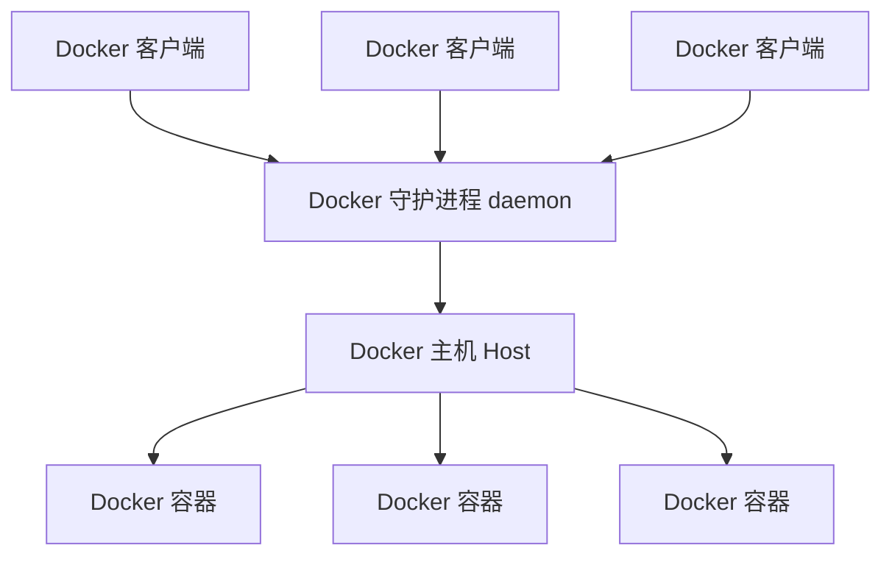
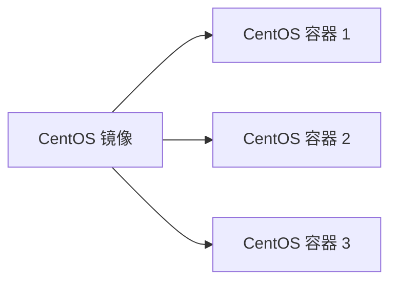

# 先搞懂 Docker 到底由哪几块拼成：客户端、守护进程、镜像、容器与注册中心

第一次接触 Docker 的人，最容易把它当成一个「装应用的黑盒子」：敲一条命令，应用就跑起来了。一旦某个环节报错，往往连问题出在哪一层都说不清。Docker 之所以好用，是因为它把「镜像、容器、守护进程、注册中心」几件事分得很清楚。这一篇先把这几个组件和它们之间的关系讲透，后面所有命令都是在操作这几样东西。

## 先给结论

- Docker 是 CS（客户端/服务端）架构：你在终端敲的命令是客户端，真正干活的是后台的守护进程（daemon）。
- 镜像是一组文件的集合，是容器的「模板」；容器是镜像运行起来之后的实例，一个镜像可以同时跑出多个容器。
- 镜像与容器的关系，相当于「类」与「对象」：用同一个模板可以创建多个互相独立运行的实例。
- 注册中心（Registry）是存放镜像的仓库，分公有（如 Docker Hub）和私有两种，日常拉取镜像就是从这里下载。
- 安装 Docker 的那台机器叫宿主机（Host），守护进程、镜像和容器都运行在宿主机上。

## 一、服务器与客户端：命令只是「遥控器」

Docker 跑起来之后，系统里实际存在两个角色。一个是 Docker 客户端（Client），也就是你在终端里输入的 `docker` 命令本身；另一个是 Docker 守护进程（Docker daemon），它才是真正的服务端，负责创建、运行、管理容器。

客户端和守护进程可以位于同一台机器，也可以分开：守护进程跑在服务器 A 上，你坐在机器 B 上通过客户端远程连过去执行命令，这在生产环境里很常见。下面这张图把这种关系画出来：



图里最关键的一点是：你敲的命令并不直接操作容器，而是先发给守护进程，由守护进程去调度容器。理解这一点，后面遇到「命令卡住」「连接被拒绝」这类问题，你才知道该去查客户端还是查守护进程。

`docker version` 这条命令能直接看到客户端和服务端的版本信息，是验证「两端都在正常工作」最快的方式：

```bash
docker version
# Client:
#  Version:           18.06.1-ce
#  API version:       1.38
# Server:
#  Engine:
#   Version:          18.06.1-ce
```

如果只打出 Client 而没有 Server，说明守护进程没启动，而不是命令写错了。

## 二、镜像与容器：模板和实例

镜像（Image）是构建容器的一组逻辑文件集合，可以理解为「一个容器的模板」。比如你拉取一个 CentOS 镜像，它本身不会跑起来，只是一个静态的文件包；用这个镜像去「运行」，才得到一个真正在工作的容器。

教师讲解时用的一个类比非常贴切：镜像相当于类，容器相当于对象。一个 `CentOS` 镜像可以通过 `docker run` 同时跑出三个 `CentOS` 容器，这三个容器各自独立、装了相同的软件，但彼此互不影响。



和传统的虚拟机镜像不同，传统虚拟机的镜像直接对应一块磁盘文件，一个镜像基本上就对应一台机器；而 Docker 的镜像可以被多次实例化出多个容器。这一层区别，决定了 Docker 比传统虚拟机轻量得多。

## 三、注册中心：镜像的「应用商店」

注册中心（Registry）是集中存放镜像的地方，分两种：

**第一，公有注册中心。** 最典型的是 Docker Hub（网址 `https://hub.docker.com/`），它和代码托管平台类似，任何人都能注册账号，把本地构建好的镜像上传上去，也能从上面下载别人做好的镜像。日常学习里绝大多数镜像都来自这里。

**第二，私有注册中心。** 企业内网出于安全和访问速度考虑，会在自己服务器上搭一个私有的 Registry，只对内提供镜像的拉取和推送。课程里提到的镜像加速器（如 ustc 镜像），本质就是把对 Docker Hub 的访问中转到一个国内的镜像站点，加速下载。

`docker info` 这条命令能查看当前守护进程连接到的注册中心、镜像加速器等信息：

```bash
docker info
# Registry: https://index.docker.io/v1/
# Registry Mirrors:
#  https://docker.mirrors.ustc.edu.cn
```

后面要下载镜像时，命令里的镜像名其实就是「注册中心里的仓库名」，理解了注册中心，才知道 `docker pull` 到底是从哪里把文件拉下来的。

## 常见误区

- **把镜像和容器混为一谈**：以为「下了镜像就能用」。镜像是静态模板，必须 `docker run` 之后才变成运行中的容器，命令操作的对象也始终是容器。
- **以为 `docker` 命令自己执行了创建/启动**：命令只是客户端，真正干活的是守护进程。守护进程没启动，所有命令都会报连接错误。
- **认为一个镜像只能跑一个容器**：镜像像类，可以多次实例化，一个镜像同时跑出多个容器是常态，不是特例。
- **忽视注册中心的存在**：拉取镜像慢就以为是网络差，没意识到是没配置国内镜像加速器，直连 Docker Hub 导致下载缓慢。

## 面试可能被问到的问题

1. 面试官追问：「Docker 是 CS 架构吗？客户端和服务端分别是什么？」
   答：是。Docker 采用客户端/服务端架构，客户端就是我们敲的 `docker` 命令，服务端是后台的 Docker 守护进程（daemon），由守护进程负责实际创建和管理容器。两者可以同机也可以跨机。

2. 面试官追问：「镜像和容器是什么关系？」
   答：镜像是一组文件的集合，是容器的静态模板；容器是镜像运行后产生的实例。二者相当于编程语言里「类」与「对象」的关系，一个镜像可以实例化出多个互相独立的容器。

3. 面试官追问：「Docker Hub 是什么？`
   答：它是 Docker 官方的公有注册中心，作用是集中存放和分发镜像。用户可以注册账号上传自己构建的镜像，也能搜索并下载别人公开的镜像。它还提供官方镜像（带 OFFICIAL 标记）以区分社区镜像。

4. 面试官追问：「为什么生产环境要搭私有 Registry？`
   答：出于安全和访问速度考虑。私有 Registry 部署在企业内网，镜像不上传公网，避免敏感代码外泄；同时内网拉取速度远快于直连 Docker Hub，也方便做统一的版本管控。

5. 面试官追问：「`docker version` 只显示 Client 没有 Server 说明什么？`
   答：说明 Docker 守护进程没有启动，客户端连不上服务端。这不是命令写错，而是服务本身没跑起来，需要先启动守护进程（如 `systemctl start docker`）再执行命令。

## 配套资料

- 本课为 Docker 概念入门，阶段一 `materials/code/01/` 下无对应的 Docker 源码工程，文中命令均取自课程录屏实录（merged.md 画面线），包括 `docker version` 与 `docker info` 的真实输出。
- 后续阶段（如阶段十 `materials/code/10/sailing/sailing/src/main/docker/docker-compose.yml`）有真实 `docker-compose.yml` 工程，可在学完这部分内容后再对照阅读。
