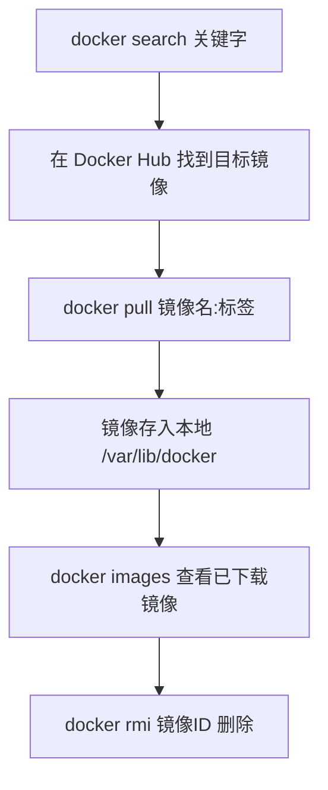

# 镜像的四个核心命令：查看、搜索、拉取与删除

学会了装 Docker、启服务，下一步就是和镜像打交道。镜像存在宿主机本地，也能从 Docker Hub 拉下来。这一篇把日常最高频的四个镜像命令讲清楚：`images` 看本地有什么、`search` 去仓库找、`pull` 下载到本地、`rmi` 删掉不用的。掌握这四个，镜像是可控的。

## 先给结论

- `docker images` 列出本地已有镜像，列头依次是仓库名、标签、镜像 ID、创建时间、大小。
- `docker search 关键字` 在 Docker Hub 上搜镜像，按 NAME、STARS、OFFICIAL 判断哪个值得下。
- `docker pull 镜像名:标签` 把镜像拉到本地，不写标签默认拉 `latest`（最新版）。
- `docker rmi 镜像ID` 删除镜像，删全部用 `docker rmi $(docker images -q)`，按 ID 删最稳妥。
- 镜像默认存放在宿主机的 `/var/lib/docker` 目录下，删镜像不影响容器（除非容器在跑且依赖它）。

## 一、查看本地镜像：docker images

`docker images` 列出当前宿主机上已经存在的镜像。课程环境为了让你断网也能练，提前预置了几个镜像（centos、redis、nginx 等），所以一装好就能看到列表。刚纯净安装时这条命令是空的，这很正常。

```bash
docker images
# REPOSITORY   TAG       IMAGE ID       CREATED       SIZE
# centos       7         2e4d0f4aaf6f   9 days ago    44MB
# redis        latest    5eef Spencer   3 weeks ago   98MB
```

各列含义：

- `REPOSITORY`：镜像名称，也就是仓库名。
- `TAG`：标签，用来区分同一名字下的不同版本，常作为版本号。同名镜像靠 TAG 区分。
- `IMAGE ID`：镜像唯一标识，删除时指定它最准确。
- `CREATED`：镜像的创建时间。
- `SIZE`：镜像占用空间。

这些镜像实际都躺在宿主机的 `/var/lib/docker` 目录里，是分层存储的文件集合。

看 SIZE 列时别把它当成精确的磁盘占用：镜像是分层的，多个镜像可能共享同一批底层镜像层，`docker images` 显示的是逻辑大小。这也解释了为什么拉一个新镜像往往只下载很小一部分，公共的底层早就存在于本地了。

## 二、搜索镜像：docker search

`docker search` 搜的是互联网上的镜像，而不是本地。比如要找一个名字里带 `centos` 的镜像：

```bash
docker search centos
# NAME      DESCRIPTION                     STARS     OFFICIAL   AUTOMATED
# centos    The official build of CentOS.   4635      [OK]
```

搜索结果各列含义：

- `NAME`：仓库名称。
- `DESCRIPTION`：镜像描述，告诉你这镜像里装了什么。
- `STARS`：用户评价数，相当于「点赞」，越多越受欢迎。
- `OFFICIAL`：是否官方提供，`[OK]` 表示官方镜像，可信度更高。
- `AUTOMATED`：是否由 Docker Hub 自动构建流程创建。

日常选镜像，优先看 `OFFICIAL` 为 OK 且 `STARS` 高的，质量和安全性更有保障。

## 三、拉取镜像：docker pull

`docker pull 镜像名:标签` 从注册中心把镜像下载到本地。不写标签时默认拉 `latest`：

```bash
# 拉取指定版本
docker pull centos:7

# 不写标签，默认拉 latest（最新版）
docker pull centos
```

拉取过程会在终端打印下载进度，完成后再次 `docker images` 就能看到它出现在本地列表里。课程里演示过拉 `centos` 和 `zookeeper`，拉完列表里就多了对应记录。

留意 pull 的进度输出：它按层并行下载，每层有自己的进度条，已存在的层会直接显示 Already exists。这种按层缓存的设计让升级镜像的代价很小，比如换个标签往往只下载有变化的层，其余直接复用本地已有的层。

整个镜像操作的生命周期可以这样串起来：



图里最实用的一条链路是「搜到 → 拉下 → 看到 → 删掉」，四个命令正好构成镜像的完整管理闭环。

## 四、删除镜像：docker rmi

删除镜像既可以用名称，也可以用 ID，但更推荐用 ID，因为名称加错标签容易误删别的版本：

```bash
# 按镜像 ID 删除（推荐）
docker rmi 2e4d0f4aaf6f

# 按名称:标签 删除
docker rmi centos:7

# 删除全部本地镜像
docker rmi $(docker images -q)
```

上面这条 `$(docker images -q)` 是先执行 `docker images -q` 得到所有镜像 ID 的列表，再把它作为 `rmi` 的参数批量删除。注意这里用的是反引号形式命令替换（键盘左上角 Esc 下方那个键），不是普通单引号。这条命令会把本地镜像清空，课程里不现场演示，因为删光了后面的练习还得重新下载，很费时间。

如果镜像正被某个容器使用，`rmi` 会拒绝删除并列出容器 ID；确认不再需要时，先删容器再删镜像。另外要慎用 `rmi -f` 强删，它会把被依赖的镜像硬删掉，遗留的容器记录会处于异常状态，非必要不使用。

## 常见误区

- **以为 `search` 是搜本地**：`docker search` 永远查的是 Docker Hub 远程仓库，本地有没有得用 `docker images` 看。
- **`pull` 不写标签就以为是某个固定版本**：不写标签默认拉 `latest`，可能和你预期的大版本不一致，生产环境务必显式写 `:7` 这类标签。
- **用名称删镜像导致误删**：同名多标签时按名称删可能删错，删前用 `docker images` 确认 ID，按 ID 删最安全。
- **删镜像前没管容器**：有容器正基于该镜像运行或未清理时，删镜像可能报错，先处理相关容器。
- **看到一串 Deleted 就以为是报错**：删除镜像时逐层出现 Untagged 与 Deleted 属于正常输出，那是在解除标签并清理共享层，不是异常。

## 面试可能被问到的问题

1. 面试官追问：「`docker images` 各列分别表示什么？`
   答：REPOSITORY 是镜像名，TAG 是版本标签，IMAGE ID 是唯一标识，CREATED 是创建时间，SIZE 是占用大小。同名镜像靠 TAG 区分不同版本。

2. 面试官追问：「`docker pull` 不写标签会拉哪个版本？`
   答：默认拉 `latest`，即仓库里标记为最新的版本。生产环境为避免版本漂移，应显式指定标签如 `centos:7`，保证环境一致。

3. 面试官追问：「删除镜像用名称还是 ID 更好？`
   答：用 ID 更稳妥。同名镜像可能有多个 TAG，按名称删容易误删；ID 唯一，先 `docker images` 查到目标 ID 再 `docker rmi ID` 最准确。

4. 面试官追问：「怎么一次性删除所有本地镜像？`
   答：用 `docker rmi $(docker images -q)`，其中 `docker images -q` 只输出所有镜像 ID，整条命令把这批 ID 作为 `rmi` 的参数批量删除。

5. 面试官追问：「`docker search` 结果里 OFFICIAL 和 STARS 有什么用？`
   答：OFFICIAL 标记是否为官方镜像，可信度更高；STARS 是用户点赞数，反映受欢迎程度。选镜像时优先官方且 STARS 高的，质量和安全性更有保障。

## 配套资料

- 本课为 Docker 镜像命令入门，阶段一 `materials/code/01/` 下无对应的 Docker 源码工程，文中 `docker images` / `search` / `pull` / `rmi` 命令及示例输出均取自课程录屏实录（merged.md 画面线），已还原 ASR 误写（如 `破破` 还原为 `pull`、`RMIDocker` 还原为 `rmi`、`森头S` 还原为 `centos`）。
