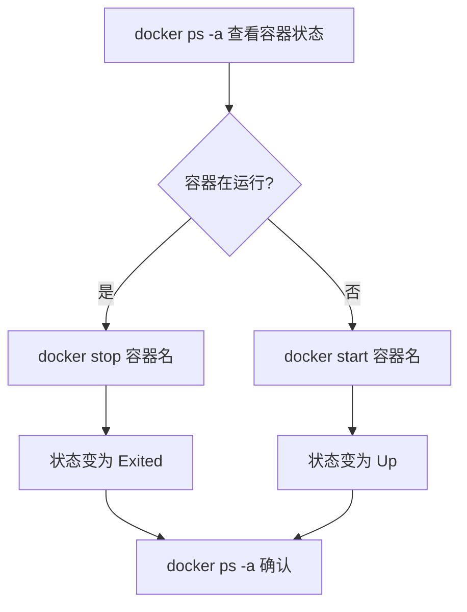

# 容器的停止、启动与文件拷贝：把容器关掉再拉起来，文件怎么在宿主机和容器之间搬运

跑起来一个容器之后，真正日常打交道的是三件事：怎么把它停下、怎么再启动、怎么把文件在宿主机和容器之间搬来搬去。前两个是容器的开关机，后一个是调试和装软件时绕不开的动作。这篇讲的就是这三组命令，以及它们各自最容易踩的坑。

## 先给结论

- 停止容器用 `docker stop 容器名或容器ID`，启动用 `docker start 容器名或容器ID`，名称和 ID 都能用，二选一即可。
- 停止是优雅退出，比启动慢一点，因为容器里的进程要先收到信号再收尾。
- 文件搬运用 `docker cp`，它支持双向：从宿主机拷进容器，也从容器拷到宿主机，语法只是把源和目标对调。
- `docker cp` 拷的是某一时刻的快照，源和目标并不会自动同步，改了一边另一边不会变。
- 进容器用 `docker exec -it 容器名 /bin/bash`，验证文件是否真的进去了，退出来用 `exit`。

## 一、停止与启动：容器的开关机

容器创建出来之后，状态无非两种：运行中（`Up`）和已退出（`Exited`）。`docker ps` 只列正在运行的，`docker ps -a` 把所有的都列出来，包括已经停掉的。先看一眼现状再动手，是排查的第一步。

```bash
# 列出正在运行的容器
docker ps

# 列出全部容器（含已停止的）
docker ps -a
```

停和起是一对反向操作，参数形态完全一样，都是「命令 + 容器名或 ID」：

```bash
# 停止容器，名称和 ID 都可以
docker stop mycentos2
docker stop 74294a69b021

# 启动一个已经停止的容器
docker start mycentos2
docker start 74294a69b021
```

**第一，stop 比 start 慢是合理的。** 停止时 Docker 先给容器里的主进程发 `SIGTERM`，等它优雅收尾，超时（默认 10 秒）后才发 `SIGKILL` 强杀。所以 `docker ps -a` 里会看到 `Exited (137)` 这样的退出码，137 正是「SIGTERM/SIGKILL 终止」的意思。启动只是把进程重新拉起来，自然快得多。

**第二，名称和 ID 是等价的标识符。** 记不住那一长串 ID，就给容器起个好记的名字（比如 `mycentos2`），后面所有命令都用名字，省心也便于脚本化。

停掉再启动的完整过程，可以看成下面这条链路：



图里最关键的一点是：stop 之后容器并没有被删除，只是进程退出了，数据还在，随时可以 start 回来。这和「删除容器」是完全不同的操作，下一篇单独讲。

## 二、文件拷贝：docker cp 双向搬运

`docker cp` 解决的是「把东西弄进容器」和「把东西从容器弄出来」两类需求。装软件要先把安装包传进去，排查问题要把日志拷出来，都是它。语法只有两个位置，源在前、目标在后：

```bash
# 从宿主机拷到容器：宿主机文件 目标容器:容器内目录
docker cp anaconda-ks.cfg mycentos2:/usr/local

# 从容器拷到宿主机：容器名:容器内文件 目标路径（可改名）
docker cp mycentos2:/usr/local/anaconda-ks.cfg ./anaconda-ks-2.cfg
```

**第一，方向靠参数顺序决定。** 冒号 `:` 是分隔符，左边是「容器名：路径」，右边是纯路径。把源和目标的位置对调，就从「拷进」变成「拷出」，不必记两条命令。

**第二，拷贝是快照不是同步。** 这一点和后面要讲的目录挂载（`-v`）有本质区别。`docker cp` 执行的那一刻把文件复制过去，之后你在宿主机或容器里改了任意一边，另一边都不会跟着变。它适合一次性传递，不适合需要持续共享的配置目录。

## 三、进容器验证文件是否到位

拷完之后怎么确认真的进去了？进容器里看一眼最直接。`docker exec -it 容器名 /bin/bash` 会开一个交互式终端，`-i` 保持标准输入打开，`-t` 分配一个伪终端，组合起来才能像 SSH 那样操作。

```bash
# 进入容器
docker exec -it mycentos2 /bin/bash

# 容器内部：切到拷贝目标目录并查看
cd /usr/local
ls
# 看到 anaconda-ks.cfg 说明拷贝成功

# 退出容器
exit
```

验证发现文件在，说明 `docker cp` 那条命令的源、目标、冒号写法都对。看不到，多半是冒号前后写反了，或者目标目录路径拼错。

宿主机和容器之间的文件流动关系可以这么看：


箭头方向完全由命令里源和目标的先后位置决定，工具本身不分「上传」还是「下载」。

## 常见误区

- **以为 stop 等于删除**：stop 只是停进程，容器还在，`docker ps -a` 能看到。要彻底清除得用 `docker rm`，那是另一回事。
- **用 `docker attach` 当 `exec` 用**：`attach` 连的是容器主进程，退出时容易把容器也带停；进去做运维操作应该用 `docker exec -it ... /bin/bash`。
- **把 `docker cp` 当同步工具**：改了一边另一边不变，长期共享配置请用目录挂载，不要靠反复 cp。
- **冒号写成了路径分隔符**：`docker cp` 里 `容器名:路径` 的冒号绝对不能写成 `/` 或 `\`，否则 Docker 会把它当成纯路径去解析而报错。

## 面试可能被问到的问题

1. 面试官追问：「`docker stop` 和 `docker kill` 有什么区别？」
   答：stop 先发 `SIGTERM` 让进程优雅退出，超时后再发 `SIGKILL`，默认宽限期 10 秒；kill 直接发 `SIGKILL` 强杀，不给进程收尾机会。生产环境优先 stop，避免数据没刷盘就中断。

2. 面试官追问：「容器停止后数据还在吗？」
   答：在。stop 只是终止进程，容器的可写层和配置都保留，`docker start` 就能恢复。只有 `docker rm` 删除容器，可写层的数据才会随之消失。

3. 面试官追问：「`docker cp` 和目录挂载（`-v`）应该怎么选？」
   答：cp 是一次性快照拷贝，适合临时传文件、取日志；挂载是宿主机目录和容器目录实时映射，一边改两边都变，适合配置文件、持久化数据这类需要持续共享的场景。

4. 面试官追问：「`docker exec` 和 `docker attach` 有什么不同？」
   答：exec 是在容器内新开一个进程（如新的 bash），退出不影响容器主进程；attach 连接的是已有的主进程，从中退出常会把容器一并停掉。日常排障用 exec 更安全。

5. 面试官追问：「`docker ps -a` 里的 Exited（137）是什么含义？」
   答：137 等于 128 加 9，表示进程是被 `SIGKILL`（信号 9）终止的。常见于 `docker stop` 超时后的强制杀死，或手动 `docker kill`，通常不算异常，但频繁出现要排查进程为何不能正常退出。

## 配套资料

- 本课为 Docker 命令行操作课，课程资料包中没有对应的 Java 工程或部署脚本，正文命令均来自课程实录（已还原术语：宿主机、拷贝、`anaconda-ks.cfg` 等）。
- 可对照复习的容器基础命令见同章节前序课程关于「创建容器与查看容器」的内容。
