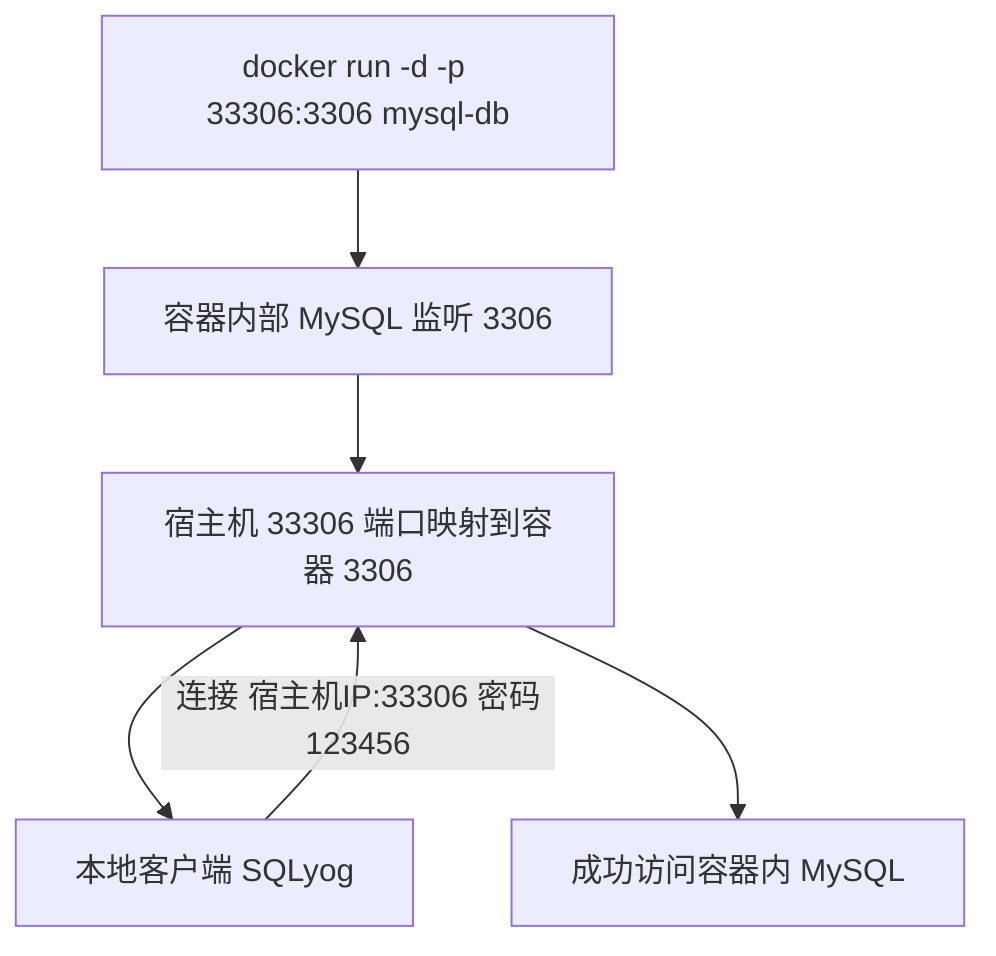

# 用 Docker 部署 MySQL：一条命令拉起数据库，端口映射后本地客户端直连

> 🔒 安全提示：文中示例的口令/密钥均为课程教学环境演示口径，生产环境的安全要求见《安全与合规须知》。

在微服务环境里，MySQL 这类中间件最麻烦的是安装和初始化：版本、依赖、配置文件，稍有不慎就花掉半天。用 Docker 部署，把镜像拉下来、一条 `docker run` 带好端口映射和密码，数据库就起来了，本地用 SQLyog 这类客户端填宿主机的 IP 和映射端口就能连。这篇把这条链路拆开讲。

## 先给结论

- 部署 MySQL 核心就是一条 `docker run`：`-d` 后台运行、`--name` 命名、`-p` 做端口映射、`-e` 传 root 密码。
- 端口映射把容器的 3306 映射到宿主机的某个端口（课程用 33306），客户端连的是宿主机 IP + 映射端口，而不是直接连容器 IP。
- root 密码通过环境变量 `MYSQL_ROOT_PASSWORD` 注入，无需进容器手动改密。
- 连不上的第一排查点：宿主机防火墙是否放行映射端口、密码和端口是否和 run 时一致。
- 容器删除后数据会丢，要持久化得把数据目录用 `-v` 挂出来，这篇先讲通部署，持久化留到进阶。

## 一、拉取镜像：版本要钉死

课程用的是基于 CentOS 7 的 MySQL 5.7 镜像，标好版本号再去拉，避免默认 `latest` 漂到不兼容的大版本：

```bash
docker pull centos/mysql-57-centos7
```

**第一，镜像名带版本标签是好习惯。** `mysql-57-centos7` 明确是 5.7 分支，生产环境尤其要钉死小版本，否则某天 `latest` 升级到 8.x，SQL 语法和行为差异足以让应用连不上或跑错。

## 二、创建容器：run 的四个关键参数

一条命令同时完成「后台运行、命名、端口映射、设密码」：

```bash
docker run -d \
  --name=mysql-db \
  -p 33306:3306 \
  -e MYSQL_ROOT_PASSWORD=123456 \
  centos/mysql-57-centos7
```

逐个拆开看：

**第一，`-d` 让容器在后台跑。** 数据库是长期服务，不需要占着当前终端，后台运行后终端立刻归还给你。

**第二，`-p 33306:3306` 是「宿主机端口：容器端口」。** 33306 是宿主机对外开放的口子，3306 是容器里 MySQL 自己监听的口子。客户端访问宿主机 33306，流量就被转发进容器的 3306。端口映射是外部能摸到容器服务的唯一通道，没映射就只能在宿主机本机连。

**第三，`-e MYSQL_ROOT_PASSWORD=123456` 注入初始密码。** 镜像的启动脚本会读这个环境变量，自动给 root 设好密码，省去进容器手动 `ALTER USER` 的步骤。密码只是示例，真实环境务必换成强密码并通过密钥管理，不要写死在命令里。

**第四，最后的镜像是 `centos/mysql-57-centos7`**，要和第一步 pull 的保持一致，否则 Docker 会再去拉一个没设过版本的镜像。

创建完用 `docker ps` 确认，`PORTS` 那一列会显示 `0.0.0.0:33306->3306/tcp`，说明映射生效、容器已起来。

部署与访问的链路长这样：



图里最关键的一环是「端口映射」：客户端从不直连容器 IP，而是连宿主机 IP 加映射端口，由 Docker 把流量转发进容器。这也是为什么老师填的连接信息是宿主机 `192.168.184.141`、端口 `33306`，而不是容器内部地址。

## 三、连接与验证：用客户端建库建表

容器起来后，用本地 MySQL 客户端（如 SQLyog）新建连接，参数如下：

- 主机地址：宿主机 IP（课程环境为 `192.168.184.141`）
- 端口：`33306`（注意不是 3306）
- 用户名：`root`
- 密码：`123456`

测试连接显示成功后，执行一段建库建表的 SQL，刷新即可看到库表出现在连接里，证明容器里的 MySQL 确实可用：

```sql
-- 设置兼容的 SQL 模式
SET SQL_MODE='STRICT_TRANS_TABLES,NO_ZERO_IN_DATE,NO_ZERO_DATE,ERROR_FOR_DIVISION_BY_ZERO,NO_ENGINE_SUBSTITUTION';

-- 创建示例数据库
CREATE DATABASE IF NOT EXISTS demo_db DEFAULT CHARACTER SET utf8mb4;

-- 建一张示例表
USE demo_db;
CREATE TABLE IF NOT EXISTS user (
    id   BIGINT PRIMARY KEY AUTO_INCREMENT,
    name VARCHAR(50) NOT NULL,
    created_at DATETIME DEFAULT CURRENT_TIMESTAMP
) ENGINE=InnoDB DEFAULT CHARSET=utf8mb4;
```

**第一，连的是宿主机不是容器。** 因为做了端口映射，所有访问都走宿主机 IP + 映射端口，客户端完全不需要知道容器内部 IP。这也是 Docker 部署中间件的标准姿势。

**第二，想进容器里用命令行也行。** 起一个交互终端，直接 `mysql` 客户端登录：

```bash
docker exec -it mysql-db /bin/bash
mysql -u root -p
# 输入密码 123456 即可进入 MySQL 命令行
```

## 常见误区

- **客户端连 3306 却连不上**：那是容器内部端口，外部要连映射出来的 33306，端口填错是最常见的连不上原因。
- **密码没设或设错**：漏了 `MYSQL_ROOT_PASSWORD`，部分 MySQL 镜像会拒绝启动或 root 无密码，连接直接失败。
- **用 `latest` 镜像**：版本漂移到 8.x 后，默认认证插件和 5.7 不同，老客户端容易报认证错误，版本要钉死。
- **容器一删数据全没**：没挂载数据目录时，容器可写层随 `docker rm` 一起消失，重要数据务必用 `-v` 把 `/var/lib/mysql` 挂到宿主机。

## 面试可能被问到的问题

1. 面试官追问：「Docker 部署 MySQL 时 `-p 33306:3306` 这两个端口各代表什么？」
   答：冒号左边 33306 是宿主机对外开放的端口，右边 3306 是容器里 MySQL 监听的端口。外部客户端连接宿主机 IP 加 33306，Docker 把流量转发进容器的 3306，从而实现从宿主机访问容器内服务。

2. 面试官追问：「`MYSQL_ROOT_PASSWORD` 环境变量起什么作用？」
   答：MySQL 官方镜像的启动脚本会读取这个环境变量，在首次启动时自动为 root 用户设置指定密码，免去手动进容器改密的步骤。生产环境应通过密钥管理注入，不要明文写死。

3. 面试官追问：「为什么本地客户端要连宿主机 IP 而不是容器 IP？」
   答：容器 IP 在自定义网络内，宿主机外部不一定可达；端口映射把容器服务暴露到宿主机端口，客户端统一连宿主机 IP 加映射端口，由 Docker 转发，既稳定又不依赖容器内部网络细节。

4. 面试官追问：「Docker 跑 MySQL，容器删了数据会丢吗？」
   答：默认会丢。容器可写层随容器删除而消失，持久化必须把数据目录（如 `/var/lib/mysql`）通过 `-v` 挂载到宿主机或卷上，删除重建容器时重新挂回即可保留数据。

5. 面试官追问：「MySQL 容器连不上，一般会先排查哪几点？」
   答：依次看：run 时 `-p` 端口映射是否生效（`docker ps` 的 PORTS 列）、客户端填的是不是宿主机 IP 加映射端口、密码与环境变量是否一致、宿主机防火墙是否放行该端口。

6. 面试官追问：「为什么部署 MySQL 最好指定具体版本标签而不是 latest？」
   答：latest 会随时间漂移，MySQL 5.7 到 8.x 在默认认证插件、SQL 模式、系统表上都有差异，可能导致应用连接或脚本执行异常。钉死版本能保证环境可复现、行为可控。

## 配套资料

- 本课为 Docker 部署中间件实操课，课程资料包中没有对应的 Java 工程，正文命令与连接参数均来自课程实录（已还原术语：宿主机、SQLyog、端口映射等；容器名 `tensquare_mysql` 按规范改为中性名 `mysql-db`）。
- 持久化数据目录挂载（`-v`）可结合同章节「目录挂载」一节进一步实践。
