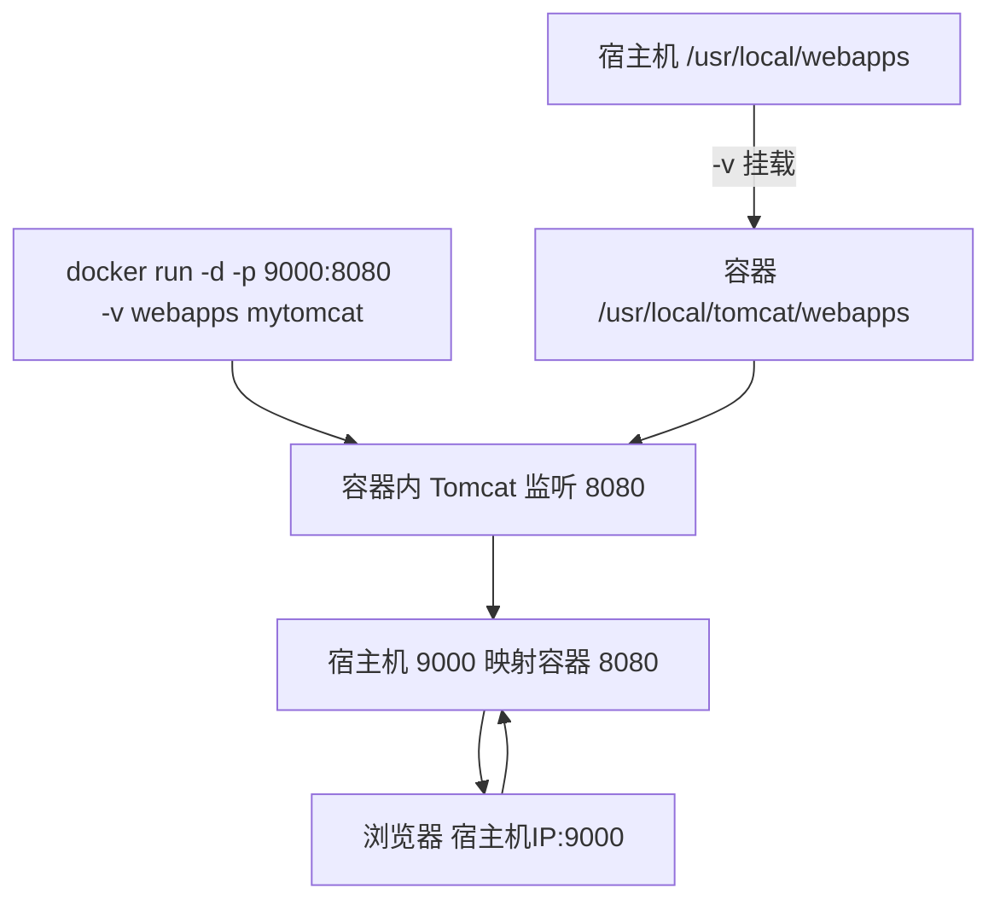
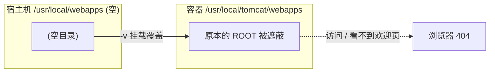

# 用 Docker 部署 Tomcat：端口映射加目录挂载，把 Web 应用丢进去就能跑

Tomcat 这种 Servlet 容器，传统装法是下压缩包、改环境变量、配 `CATALINA_HOME`，再手动起。用 Docker 部署，拉个镜像、一条 `docker run` 把端口和 `webapps` 目录挂出来，应用往挂载目录一放，浏览器就能访问。这篇把部署过程和那个最容易让人误以为「部署失败」的坑一起讲清楚。

## 先给结论

- 部署 Tomcat 同样是 `-d` 后台运行、`--name` 命名、`-p` 端口映射、`-v` 挂载 `webapps` 目录。
- 端口映射把容器 8080 映射到宿主机某个端口（课程用 9000），外部通过宿主机 IP + 9000 访问。
- 把宿主机空目录挂到 `webapps` 上，会遮蔽容器里原有的 ROOT 应用，直接访问 `/` 会 404，这不是部署失败，是挂载遮蔽。
- 部署自己的应用，就是把 war 或解压后的目录放进挂载的 `webapps`，Tomcat 会自动热部署。
- 镜像 `tomcat:7-jre7` 表示 Tomcat 7、内置 JRE 7，版本要按应用兼容情况选。

## 一、拉取镜像：Tomcat 和 JRE 版本一起定

课程用的是 Tomcat 7 配 JRE 7 的镜像，标签把两个版本都标出来了：

```bash
docker pull tomcat:7-jre7
```

**第一，标签含义要看懂。** `7-jre7` 中前一个 7 是 Tomcat 自身版本，后一个 jre7 是镜像里内置的 JRE 版本。选镜像时要和应用要求的 JRE 大版本对齐，JRE 8 的应用别用 jre7 的镜像，否则 `UnsupportedClassVersionError`。

## 二、创建容器：端口映射与 webapps 挂载

一条命令同时完成暴露端口和挂出应用目录：

```bash
docker run -d \
  --name=mytomcat \
  -p 9000:8080 \
  -v /usr/local/webapps:/usr/local/tomcat/webapps \
  tomcat:7-jre7
```

逐个拆开：

**第一，`-p 9000:8080` 是「宿主机：容器」。** 宿主机开 9000，转发到容器的 8080（Tomcat 默认端口）。浏览器访问 `http://宿主机IP:9000` 就能打到容器里的 Tomcat。

**第二，`-v /usr/local/webapps:/usr/local/tomcat/webapps` 把应用目录挂出来。** 这样要部署应用时，不用进容器，直接在宿主机的 `/usr/local/webapps` 里放 war 或目录，Tomcat 的 `webapps` 实时同步，应用自动上线。挂载目录不存在时 Docker 会自动创建。

容器起来后，`docker ps` 的 `PORTS` 列会显示 `0.0.0.0:9000->8080/tcp`，说明映射已生效。

部署与访问关系如下：



图里两条线要分开理解：访问走端口映射，应用文件走目录挂载，两者共同决定了「能不能访问」和「访问到什么应用」。

## 三、那个 404 不是失败：挂载遮蔽原应用

刚挂好空目录、浏览器敲 `http://192.168.184.141:9000`，很多人会看到 404 或者空白页，第一反应是「Tomcat 没起来」。其实容器好好的，问题出在挂载：

`/usr/local/webapps` 在宿主机上原本是空目录，挂到容器的 `webapps` 后，容器里原本自带的 `ROOT`（欢迎页）被这个空目录盖住了，所以 `/` 下什么都没有。这正好印证了目录挂载「实时映射、且会遮蔽原目录」的特性。



箭头说明：空目录盖住了原有 ROOT，于是根路径返回 404。只要往挂载目录里放一个真实应用，路径就有内容了。

## 四、部署一个真实应用：以 CAS 为例

课程里部署的是耶鲁大学开源的单点登录系统 CAS（`cas.war`）。做法就是把 war 放进挂载目录，Tomcat 会自动解压并热部署：

```bash
# 把 cas.war 上传/移动到宿主机挂载目录
mv cas.war /usr/local/webapps/

# 稍等 Tomcat 自动解压，进入容器确认
docker exec -it mytomcat /bin/bash
ls /usr/local/tomcat/webapps
# 看到 cas 目录即解压完成
```

解压完成后访问 `http://192.168.184.141:9000/cas`，就能看到 CAS 的登录页。如果解压还没完成就急着刷，会暂时 404，等几秒再试即可。

**第一，挂载让部署变得很轻。** 不用进容器、不用重启 Tomcat，文件落到宿主机目录，容器里立刻同步，这正是中间件部署偏爱目录挂载的原因。

**第二，war 和热部署依赖 Tomcat 默认配置。** `tomcat:7-jre7` 默认开启 `unpackWARs` 和 `autoDeploy`，所以丢 war 进去会自动解压上线。若你用的镜像关了这两项，就需要手动解压或重启。

## 常见误区

- **把挂载空目录后的 404 当成部署失败**：其实是挂载遮蔽了容器原有的 ROOT 应用，往 `webapps` 放真实应用即可，Tomcat 本身是正常的。
- **访问 8080 却连不上**：8080 是容器内端口，外部要走映射出来的 9000，端口填错就超时。
- **war 丢进去立刻 404**：Tomcat 还在解压，等几秒刷新，不是配置错了。
- **用错 JRE 版本的镜像**：JRE 8 编译的应用跑在 jre7 镜像上会直接启动失败，镜像标签要和应用的 JRE 大版本匹配。

## 面试可能被问到的问题

1. 面试官追问：「Docker 部署 Tomcat 时 `-p 9000:8080` 和 `-v webapps` 分别解决什么问题？」
   答：`-p` 做端口映射，把容器 8080 暴露到宿主机 9000，解决外部如何访问的问题；`-v` 把容器 `webapps` 挂到宿主机目录，解决应用如何便捷部署、持久化的问题。两者一个管访问、一个管内容。

2. 面试官追问：「挂载空目录后访问 Tomcat 根路径 404，是什么原因？」
   答：宿主机的空目录挂到了容器的 `webapps`，把容器里自带的 ROOT 欢迎页遮蔽了，根路径因此没有内容。这不是 Tomcat 故障，往挂载目录放入真实应用（如 war）后路径就有内容了。

3. 面试官追问：「为什么把 war 放进 webapps 就能自动部署？」
   答：Tomcat 默认开启 `unpackWARs` 和 `autoDeploy`，检测到 `webapps` 下新增 war 会自动解压并按目录名作为上下文路径上线。配合 Docker 目录挂载，宿主机放入 war 容器里立刻生效。

4. 面试官追问：「Tomcat 镜像标签 `7-jre7` 是什么意思，怎么选？」
   答：前一个 7 是 Tomcat 版本，后一个 jre7 是镜像内置的 JRE 版本。要根据应用编译时所依赖的 JRE 大版本来选，应用用 JRE 8 就应选 jre8 系列镜像，避免类版本不兼容。

5. 面试官追问：「Tomcat 容器里部署的应用，容器删了还在吗？」
   答：如果 `webapps` 挂载到了宿主机或数据卷，应用文件在挂载层，容器删除不影响；若没挂载，应用随容器可写层一起消失。生产环境务必挂载出来。

6. 面试官追问：「`docker run` 里 `--name=mytomcat` 有什么用？」
   答：给容器起一个固定可读的名字，后续 `docker stop/start/exec/rm` 都用名字引用，不必记一长串容器 ID，也便于脚本和编排里稳定寻址。

## 配套资料

- 本课为 Docker 部署中间件实操课，课程资料包中没有对应的 Java 工程，正文命令与部署过程均来自课程实录（已还原术语：宿主机、目录挂载、CAS 单点登录等）。
- 目录挂载遮蔽原目录的现象可结合同章节「目录挂载」一节对照理解；MySQL 部署见本批次前一篇。
