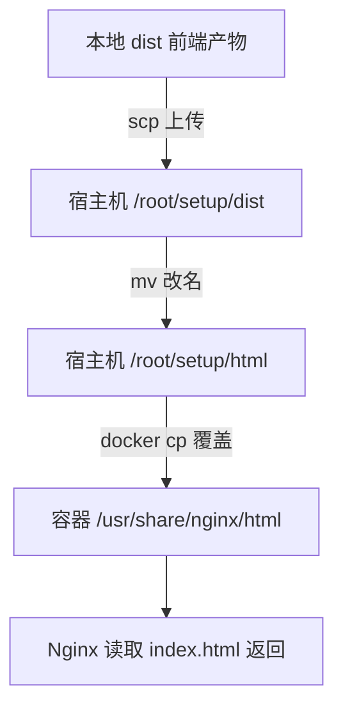

# 用 Docker 部署 Nginx：一条命令起服务，再把静态站点拷进容器

物理机上装 Nginx，要配 yum 源、装依赖、调配置文件，换台机器重来一遍，装出来的版本还不一定一样。更频繁的麻烦在后面：前端静态页面改一行，你得重新上传、备份、替换目录，操作能不能复现全靠手速。

换成 Docker 之后，部署动作被压成一条 `docker run`：镜像里已经把 Nginx 连同它的配置、页面目录一起打包好了，容器一启动服务就在。下面把这条命令背后的细节拆开讲清楚，包括容器里那份配置该怎么读、静态站点怎么进容器，以及课程里刻意没做的那件事。

## 先给结论

- 起服务就一条命令：`docker run -d --name=mynginx -p 80:80 nginx`，`-d` 后台运行，`-p` 做宿主机端口到容器端口的映射。
- 课程这一步刻意没有做目录挂载，静态页面靠 `docker cp` 拷进容器，拿到的是一次性快照。
- 容器内的配置入口是 `/etc/nginx/nginx.conf`，它用 `include /etc/nginx/conf.d/*.conf` 把站点配置拆出去，页面根目录由 `conf.d/default.conf` 的 `root` 指定。
- 页面根目录默认在 `/usr/share/nginx/html`，里面原本只有 `index.html` 和 `50x.html` 两个文件。
- 排查问题的通用入口是 `docker exec -it mynginx /bin/bash`，配置文件只存在于容器内部。

## 一、容器化的 Nginx 和 yum 安装差在哪

物理机装 Nginx，装出来的是「一个进程加上一堆散在 `/etc`、`/usr/share` 里的文件」，和机器绑死。容器里装 Nginx，装出来的是「镜像提供的只读文件系统加容器可写层」，镜像在哪台机器上跑，目录结构和行为都一致。

**第一，部署动作从「安装」变成了「启动」。** 课程环境已经把镜像准备好了，`docker pull nginx` 这步可以跳过；本地没有镜像时 `docker run` 会自己先找再拉。

**第二，端口不映射就访问不到。** 容器有独立的网络命名空间，Nginx 监听的是容器内部的 80 端口，宿主机外面看不见，必须用 `-p` 把两者接起来。

## 二、创建容器：端口映射是前提

```bash
# 镜像没有的话先拉一份
docker pull nginx

# 后台启动 Nginx 容器，宿主机 80 映射到容器 80
docker run -d --name=mynginx -p 80:80 nginx

# 确认容器真的起来了
docker ps
```

端口映射的格式是 `宿主机端口:容器端口`。课件 PPT 截图里出现过 `-p 8080:8080` 的写法，语义一样，只是取值不同；要注意容器内 Nginx 监听的是 80，宿主机侧端口可以随意换，比如换成 8080，容器侧必须写 80，否则流量会被转发到一个没人监听的端口上。

浏览器访问宿主机 80，出现 Nginx 欢迎页，就说明容器起来了、端口通了。这一步只验证了两件事，页面内容还是镜像自带的。

## 三、读懂容器里那份配置

页面该往哪儿放不能靠猜，进容器看一眼最可靠：

```bash
docker exec -it mynginx /bin/bash
```

主配置长这样，取自课程实录的容器内 `nginx.conf`：

```conf
user  nginx;
worker_processes  1;

error_log  /var/log/nginx/error.log  warn;
pid        /var/run/nginx.pid;

events {
    worker_connections  1024;
}

http {
    include       /etc/nginx/mime.types;
    default_type  application/octet-stream;

    log_format  main  '$remote_addr - $remote_user [$time_local] "$request" '
                      '$status $body_bytes_sent "$http_referer" '
                      '"$http_user_agent" "$http_x_forwarded_for"';

    access_log  /var/log/nginx/access.log  main;

    sendfile        on;
    keepalive_timeout  65;

    # 站点配置全部拆到 conf.d 目录，这里统一引入
    include /etc/nginx/conf.d/*.conf;
}
```

站点配置放在 `conf.d/default.conf` 里，它决定页面从哪来：

```conf
# 把 500、502、503、504 错误页统一指向静态页面
error_page   500 502 503 504  /50x.html;
location = /50x.html {
    root   /usr/share/nginx/html;
}

# PHP 脚本交给 FastCGI 处理
location ~ \.php$ {
    fastcgi_pass   127.0.0.1:9000;
    fastcgi_index  index.php;
    fastcgi_param  SCRIPT_FILENAME /scripts$fastcgi_script_name;
    include        fastcgi_params;
}
```

**第一，`include /etc/nginx/conf.d/*.conf` 是读懂 Nginx 配置的钥匙。** 主配置只放进程数、日志、mime 这些公共项，每个站点单独写一个 `.conf`，改站点不必动主文件，这就是配置模块化。

**第二，`root` 决定页面从哪来。** `conf.d/default.conf` 里写着 `root /usr/share/nginx/html`，欢迎页 `index.html` 和错误页 `50x.html` 都在这个目录下。

请求从宿主机进来到页面返回，路径是这样的：


最关键的一环是 `root` 指向的那个目录：请求进来之后 Nginx 最终是去这里取文件，往容器里放什么，页面就显示什么。

## 四、把静态站点拷进容器

课程的做法分三步：先把前端产物传到宿主机，再把目录改名成 `html`，然后整体拷进容器覆盖原目录。

```bash
# 宿主机上：把前端产物目录传到服务器
scp -r ./dist root@192.168.184.141:/root/setup/

# 改名，和容器里的目录名对齐
cd /root/setup
mv dist html

# 拷进容器，覆盖原来的 html 目录
docker cp html mynginx:/usr/share/nginx

# 进容器验证：能看到自己的 index.html 就成了
docker exec -it mynginx ls /usr/share/nginx/html
```

发布流程画出来是这样：



拷完刷新浏览器，欢迎页就换成了自己的站点。

**更稳的做法是创建容器时就挂载目录。** `docker cp` 拷进去的是某一时刻的快照，宿主机再改不会同步；用 `-v` 之后，改动立刻在容器内生效：

```bash
docker run -d --name=mynginx -p 80:80 \
  -v /root/setup/dist:/usr/share/nginx/html nginx
```

`-v 宿主机目录:容器目录` 是双向映射，冒号左边在宿主机，右边在容器里。挂载会遮蔽容器原有的 `html` 目录，原来的欢迎页随之消失，这是预期行为而不是故障。改了配置想热加载，在容器内执行 `nginx -s reload` 即可，不必重启容器。

## 五、Nginx 的另一面：反向代理

前面这套只用了 Nginx 最基础的能力：托管静态文件。课程项目里的 Nginx 配置还承担了反向代理的活儿，下面这段摘自课程真实配置，`location` 按路径前缀分流：

```conf
server {
    listen       80;
    server_name  localhost;

    location /user/ {
        client_max_body_size   300m;
        proxy_connect_timeout  300s;
        proxy_read_timeout     300s;
        proxy_pass   http://127.0.0.1:18080;
    }

    location / {
        proxy_pass   http://127.0.0.1:18081;
    }
}
```

后端有多个实例时，用 `upstream` 统一挂载，课程采集系统的负载均衡就是这么配的：

```conf
upstream logsServer {
    server 172.16.0.161:12100;
    server 172.16.0.162:12100;
    server 172.16.0.163:12100;
}

server {
    listen  1210;
    location / {
        proxy_pass http://logsServer;
        proxy_set_header X-Real-IP $remote_addr;
        proxy_set_header X-Forwarded-For $proxy_add_x_forwarded_for;
        proxy_set_header Host $host;
    }
}
```

静态托管和反向代理用的是同一套 `location` 语法，区别只在一个用 `root` 一个用 `proxy_pass`。

## 常见误区

- **宿主机端口被占用**：`-p 80:80` 要求宿主机 80 空闲，被占用会直接报端口冲突，换一个宿主机端口即可。
- **改了宿主机文件却没生效**：用 `docker cp` 部署时，容器里放的是拷贝进去的副本，宿主机再改不会同步，要么重新拷，要么一开始就改用 `-v` 挂载。
- **到宿主机上找 Nginx 配置文件**：配置只存在于容器内部，用 `docker exec -it` 进去看，或者从 `nginx.conf` 顺着 `include` 摸到 `conf.d/default.conf`。
- **`docker cp` 目标路径写成 `html`**：源目录和目标目录同名时会多出一层，变成 `html/html`，页面还是旧的，目标写成 `/usr/share/nginx` 才是整体替换。
- **`-v` 挂载后看不到欢迎页**：挂载遮蔽了容器原有的 `html` 目录，属于预期行为，把站点文件放进宿主机目录即可。

## 面试可能被问到的问题

1. 面试官追问：「用 Docker 部署 Nginx，`-p 80:80` 里的两个端口分别代表什么？」
   答：格式是 `宿主机端口:容器端口`。前半部分是外部访问宿主机用的端口，后半部分是容器内服务实际监听的端口。两者可以不同，`-p 8080:80` 表示外面访问 8080、流量转发到容器的 80。Nginx 容器内监听 80，所以容器侧不能写错。

2. 面试官追问：「`docker cp` 和 `-v` 挂载，部署静态站点怎么选？」
   答：`docker cp` 是一次性快照，宿主机后续改动不会同步，适合交付一次就完的场景；`-v` 是持续双向映射，改宿主机文件容器内立刻生效，适合频繁更新，也把页面内容和容器本身解耦了。

3. 面试官追问：「容器里的 Nginx 页面根目录在哪，怎么确认？」
   答：默认在 `/usr/share/nginx/html`，由 `conf.d/default.conf` 里的 `root` 指定。最可靠的确认方式是 `docker exec -it mynginx /bin/bash` 进容器，读 `/etc/nginx/nginx.conf` 找到 `include` 指向的 `conf.d` 目录，再看站点配置中的 `root`。

4. 面试官追问：「`nginx.conf` 和 `conf.d` 下的配置是什么关系？」
   答：`nginx.conf` 是主配置，`http` 块里用 `include /etc/nginx/conf.d/*.conf` 把站点配置拆出去，一个站点一个文件。好处是配置模块化，新增站点不用改主文件，也能单独备份复用。

5. 面试官追问：「为什么容器里的 Nginx 必须做端口映射才能访问？」
   答：容器有独立的网络命名空间，Nginx 监听的是容器内部的 80 端口，宿主机网络栈默认访问不到。端口映射在宿主机上开一个端口并把流量转发到容器端口，外部请求才进得来。

6. 面试官追问：「改了 Nginx 配置一定要重启容器吗？」
   答：不需要。在容器内执行 `nginx -s reload` 可以热加载，新 worker 处理新请求，老 worker 处理完手上的连接再退出。只有改端口映射、挂载目录这类容器级参数时，才必须删掉容器重新 `docker run`。

## 配套资料

- 真实 Nginx 配置：`materials/code/07/day11 探花交友-我的中心/day11/代码/nginx.conf`（文中 `location` 与 `proxy_pass` 片段摘自此文件）
- Nginx 负载均衡配置（`upstream` 写法）：`materials/docs/04/采集系统部署使用说明.md`
- 容器化 Nginx 的资源清单可对照阅读：`materials/code/01/6.k8s-基础/k8s-基础/资料/nginx-rc.yaml`、`materials/code/01/6.k8s-基础/k8s-基础/资料/nginx-svc.yaml`
- 本课无独立源码工程，`docker run`、`docker cp`、`scp` 等命令与容器内配置均取自课程实录，术语已还原为标准写法
