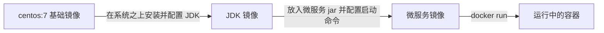

# 七条常用指令读懂 Dockerfile：从基础镜像到 WORKDIR 的工作方式

手工造镜像的流程你已经走过一遍：起一个容器，往里面拷文件、改配置，满意之后 `docker commit` 存成新镜像。这套动作做一次没问题，问题在于它不可复用：你做完了，同事还得照着同样的步骤再做一个，步骤一多必然出错，最后团队每个人手里的镜像都不完全一样。Dockerfile 就是用来终结这种手工劳动的脚本方案，而学它，核心就是学那几条常用命令。

## 先给结论

- Dockerfile 是由一系列命令和参数构成的脚本，作用是基于一个基础镜像自动构建一个新镜像。
- 基础镜像指操作系统级镜像（如 CentOS、Ubuntu），JDK 镜像基于 CentOS 构建，微服务镜像再基于 JDK 镜像，层层叠加。
- 常用指令就七条：`FROM` 定地基、`MAINTAINER` 写署名、`ENV` 设环境变量、`RUN` 执行命令、`ADD` 拷贝并解压、`COPY` 只拷贝、`WORKDIR` 定工作目录。
- `ADD` 与 `COPY` 的唯一区别：源文件是压缩包时 `ADD` 会自动解压，`COPY` 原样拷贝。
- `MAINTAINER` 是纯描述信息，省略不影响镜像构建；`FROM` 指定的镜像本地不存在时，构建过程会先自动下载。

## 一、什么是 Dockerfile，基础镜像又是什么

把 Dockerfile 理解成「镜像的菜谱」：你要什么底子、装什么软件、放什么文件、启动时执行什么命令，全部写成一格格的步骤。Docker 拿到菜谱后按顺序执行，一个新镜像就自动生成了。

菜谱里第一个绕不开的词是**基础镜像**。任何镜像都不可能凭空造出来，它的最底层一定是一个操作系统级镜像，最常见的两类是 CentOS 和 Ubuntu。在这层系统之上，装一个 JDK，就得到一个 JDK 镜像；再在 JDK 镜像之上放入自己写的微服务并跑起来，就得到微服务镜像。它们是叠罗汉的关系：



这张图在讲镜像的层叠关系：链条的起点永远是操作系统级镜像，上层镜像把下层镜像当作自己的地基。反过来推也成立，构建一个微服务镜像时，`FROM` 写的往往就是那个现成的 JDK 镜像。还要注意一点：`FROM` 指定的镜像如果本地不存在，Docker 不会报错罢工，而是在构建开始时先去仓库把这个基础镜像下载下来。

## 二、七条常用命令，一条一个用途

课程给出的常用命令表格只有七行，每一行对应一类动作：

| 指令 | 写法 | 作用 |
|---|---|---|
| `FROM` | `FROM 镜像名:标签` | 指定基础镜像，必须是第一条指令 |
| `MAINTAINER` | `MAINTAINER 名称` | 声明镜像创建者，可省略 |
| `ENV` | `ENV key value` | 设置环境变量，可写多条 |
| `RUN` | `RUN 命令` | 构建时执行命令，常用来建目录、装软件 |
| `ADD` | `ADD 源 目标` | 拷贝文件进镜像，压缩包自动解压 |
| `COPY` | `COPY 源 目标` | 只拷贝，不解压 |
| `WORKDIR` | `WORKDIR 路径` | 设置当前工作目录 |

放在一个典型的 JDK 镜像脚本里，这些指令长这样（示例为按课程写法补全）：

```dockerfile
# 1. 指定基础镜像：本地没有时，构建过程会先自动拉取
FROM centos:7

# 2. 声明镜像创建者：纯版权声明，不写不影响构建
MAINTAINER example-team

# 3. 设置环境变量：可连续写多条
ENV JAVA_HOME /usr/local/java/jdk1.8.0_171
ENV PATH $JAVA_HOME/bin:$PATH

# 4. 执行命令：最常见的就是创建目录
RUN mkdir -p /usr/local/java

# 5. 拷贝 JDK 压缩包进镜像：源是 .tar.gz 时自动解压
ADD jdk-8u171-linux-x64.tar.gz /usr/local/java/

# 6. 只拷贝不解压：适合配置文件、普通 jar 包
COPY app.jar /usr/local/app/

# 7. 设置当前工作目录
WORKDIR /usr/local
```

**第一，`FROM` 是地基，标签用冒号写。** `FROM centos:7` 里的冒号写法就是「镜像名：标签」，镜像有标签就把标签带上，不写默认取 `latest`。前提是这个镜像要真实存在，不存在则进入构建时先下载。

**第二，`ENV` 可以成组出现。** 做 JDK 镜像必然要配 `JAVA_HOME`、`PATH` 这些环境变量，一条 `ENV` 配一个键值对，需要几个就写几条，这与 `FROM`、`MAINTAINER` 一般只写一条不同。

**第三，`RUN` 与 `ADD` 分工明确。** `RUN` 负责在构建过程中执行系统命令，比如 `mkdir -p /usr/local/java` 建一个目录；`ADD` 负责把宿主机的文件送进镜像，写法是 `ADD 源目录/文件 目标目录/文件`。

## 三、ADD 与 COPY 的取舍，以及 WORKDIR 的两个作用

`ADD` 和 `COPY` 语法几乎一样，取舍只看一件事：源文件是不是压缩包。放 JDK 的 `.tar.gz` 进镜像，用 `ADD` 一行搞定拷贝加解压；如果你不想让它自作主张解压，或者拷的只是普通文件、配置文件，就用 `COPY`。反过来说，用 `COPY` 放压缩包，容器里得到的就是一坨没解压的文件，还得自己补一条 `RUN tar` 去解。

`WORKDIR` 容易被当成一条普通的 mkdir，它实际上管两件事：

**第一，它是后续指令的路径基准。** `WORKDIR /usr/local` 之后，再写 `RUN mkdir app`，创建出来的就是 `/usr/local/app`，所有相对路径都基于这个目录解析。

**第二，它决定登录容器后的默认位置。** 用这个镜像跑起容器再 `exec` 进去，提示符一开始就停在 `/usr/local`，不用每次手动 `cd`。

最后回到开头的问题：为什么一定要用脚本而不用手工 commit？把两种方式摆在一起看就清楚了：

| 对比点 | 手工 commit 方式 | Dockerfile 方式 |
|---|---|---|
| 操作形态 | 起容器、拷文件、改配置、提交，逐步手工 | 一份脚本，一条 `docker build` 自动完成 |
| 出错概率 | 步骤一多极易出错 | 步骤固化在脚本里，重复执行不走样 |
| 团队协作 | 一个人做完，其他人重做一遍 | 谁拿到脚本都能构建出完全一致的镜像 |
| 移交成本 | 过程靠口头描述 | 开发把脚本给测试、测试给运维，无缝移植 |

环境一致性就是 Dockerfile 的最大价值：构建动作不再依赖某个人的记忆和手感，而是依赖一份可以进版本库的文本文件。

## 常见误区

- **以为 `FROM` 的镜像名写错会立刻报错**：构建时会先尝试去仓库下载，名字确实不存在才失败，症状像网络问题，实际是镜像名拼错。
- **用 `COPY` 放压缩包还指望自动解压**：`COPY` 原样拷贝，容器里只会多一个 `.tar.gz` 文件；要解压就用 `ADD`，或自己补 `RUN tar`。
- **把 `MAINTAINER` 当必填项**：它只是创建者声明，省略不影响镜像生成，纠结格式纯属浪费时间。
- **把 `WORKDIR` 当一次性建目录命令**：它改变的是「之后所有指令的相对路径基准」和「登录容器后的默认目录」，放在脚本里的位置很关键。

## 面试可能被问到的问题

1. 面试官追问：「Dockerfile 是什么？和 docker commit 造镜像比好在哪？」
   答：Dockerfile 是由一系列命令和参数构成的脚本，作用是基于基础镜像自动构建新镜像。`commit` 是手工操作后提交快照，过程黑盒、不可复现；Dockerfile 把步骤固化成文本，可版本化、可复用，任何团队成员执行同一段脚本得到的镜像完全一致。

2. 面试官追问：「基础镜像指什么？`FROM` 的镜像本地没有怎么办？」
   答：基础镜像是操作系统级镜像，如 CentOS、Ubuntu，一切上层镜像都以它为地基。`FROM` 指定的镜像本地不存在时，Docker 会在构建开始时自动去仓库下载，下载不到才会失败。

3. 面试官追问：「ADD 和 COPY 有什么区别，怎么选？」
   答：两者都把宿主机文件拷进镜像。区别是源文件为本地压缩包时 `ADD` 会自动解压，`COPY` 不会。放 JDK 这类 `.tar.gz` 用 `ADD` 省一步；拷普通文件或明确不想解压时用 `COPY`，语义更清晰。

4. 面试官追问：「`ENV` 设置的环境变量，容器运行时还能读到吗？」
   答：能。`ENV` 写进镜像的配置里，构建期生效，容器启动后进程同样能读到，这也是 JDK 镜像里配 `JAVA_HOME`、`PATH` 的标准做法。`ENV` 可以写多条，逐条声明即可。

5. 面试官追问：「`WORKDIR` 到底影响什么？」
   答：两层影响。构建层面，它之后的所有指令中相对路径都以它为基准；运行层面，基于该镜像启动并进入容器时，默认就落在 `WORKDIR` 指定的目录里，省去手动 cd。

6. 面试官追问：「MAINTAINER 这类元信息指令省略了会怎样？」
   答：没有影响。`MAINTAINER` 只是版权与署名声明，属于描述性信息，Docker 不依赖它做任何构建决策，省略后镜像照常生成，实践中更多用 `LABEL` 承担这类元数据。

## 配套资料

- 本课无配套源码工程（`materials/code/01` 下没有 Docker 相关工程），文中 Dockerfile 示例为按本课写法补全，指令清单与讲解口径取自课程实录，可在装好 Docker 的 CentOS 7 环境直接复现。
- 完整的 JDK 8 镜像构建实操见本阶段姊妹篇 `0103-Dockerfile构建jdk1.8镜像.md`，构建出的镜像会在后续微服务部署中作为基础镜像使用。
