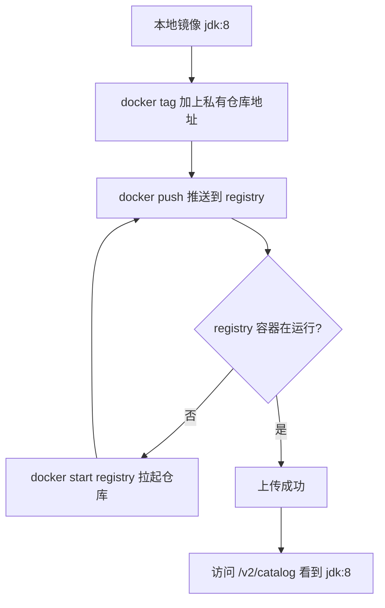

# 把镜像推上私有仓库：tag 打标签与 push 上传的两步法

私有仓库搭好之后，把本地镜像传上去其实只有两步：先打标签，再推送。这俩步骤的「坑」不在命令本身，而在时机，经常是刚重启完 Docker 服务，registry 容器其实是停的，直接 `push` 会被拒绝。完整链路如下，包括被打断时怎么把仓库重新拉起来。

## 先给结论

- 上传镜像第一步永远是 `docker tag`：给本地镜像加一个「带私有仓库地址」的新标签，它和原镜像共用同一个镜像 ID，只是多了个引用。
- 第二步 `docker push 私有仓库地址/镜像名` 才是真正传输数据。
- `push` 报连接拒绝，多半是因为 Docker 服务重启后 registry 容器被停了，先 `docker ps -a` 看状态，再 `docker start registry`。
- 上传成功后访问 `http://IP:5000/v2/catalog`，列表里会出现刚推上去的镜像名。
- 另一台机器想拉取，必须也装 Docker、也配 `daemon.json` 信任该地址并重启，然后 `docker pull 私有仓库地址/镜像名`。

## 一、为什么上传前必须先 tag

Docker 的 `push` 不是「把当前镜像随便丢给某个仓库」，而是「把某个完整名字的镜像推到它名字里指定的仓库」。镜像全名格式是 `仓库地址/仓库名:标签`，只有当名字里带了私有仓库地址，Docker 才知道该往哪推。

**第一，tag 本质只是加了个别名。** 执行 `docker tag` 后 `docker images` 会多一行，但它和原镜像的 IMAGE ID 完全一致，不占额外空间，纯粹是为了让推送目标明确。

**第二，名字里必须含私有仓库地址和端口。** 漏掉 `192.168.184.141:5000` 这一段，Docker 会把它当成往默认公有仓库推，自然推不进你的内网仓库。

## 二、打标签与推送

假设前一篇已经构建出一个本地镜像 `jdk:8`，现在把它标记成私有仓库的镜像：

```bash
# 语法：docker tag 本地镜像 私有仓库地址/镜像名:标签
docker tag jdk:8 192.168.184.141:5000/jdk:8
```

打完后 `docker images` 能看到两条记录，IMAGE ID 相同。接着执行推送：

```bash
# 推送带私有仓库地址的那个标签
docker push 192.168.184.141:5000/jdk:8
```

推送过程会按镜像层逐层上传，JDK 镜像比较大，会等上一会儿，看到 `digest` 和 `Pushed` 字样就说明传完了。

完整的上传时序可以这样看：



图里要留意那个判断分支：如果 registry 容器没起来，`push` 会直接失败，得先把它启动。

## 三、被连接拒绝时怎么救

课程演示时，因为前面刚重启过 Docker 服务，registry 容器随之停止，第一次 `push` 报了连接被拒绝。处理顺序是：

```bash
# 1. 查看所有容器（含已退出的），确认 registry 状态
docker ps -a

# 2. 如果 registry 是 Exited，把它启动
docker start registry

# 3. 重新推送
docker push 192.168.184.141:5000/jdk:8
```

容器重新起来后再次 `push`，就能正常传完。最后在浏览器刷新 `http://192.168.184.141:5000/v2/catalog`，返回的数组里就会出现 `jdk:8`，表示该镜像已经在私有仓库里了。

## 四、其他机器怎么拉取

另一台服务器想用这个镜像，步骤和你这台机器对称：

**第一，装好 Docker 并配置信任。** 在那台机器上同样编辑 `/etc/docker/daemon.json`，加入 `"insecure-registries": ["192.168.184.141:5000"]`，然后 `systemctl restart docker`。

**第二，直接 pull 带地址的镜像名。** 信任配好之后不需要额外登录，直接：

```bash
docker pull 192.168.184.141:5000/jdk:8
```

只要网络通、地址被信任，镜像就拉到本地了，可以基于它继续构建你的微服务镜像。

拉下来后 `docker images` 里会出现带地址的那条记录，同样共用原有的镜像 ID。团队规模变大后，还可以在这个基础上叠加权限认证与 HTTPS，让仓库从「内网免登录」平滑升级为受控访问，思路不变，先跑通再加固。

## 常见误区

- **忘了 tag 直接 push 原镜像**：原镜像名不含私有仓库地址，Docker 会尝试推往公有仓库，要么被拒要么推错地方。推送前务必确认镜像全名带 `IP:5000/`。
- **push 报连接拒绝就反复重试**：根因通常是 registry 容器已退出，先 `docker ps -a` 看状态再 `docker start registry`，而不是无脑重推。
- **只在构建机配了 daemon.json，拉取机没配**：另一台机器 `pull` 同样需要信任地址，否则报 `insecure registry` 相关错误。
- **把 tag 当成复制了一份镜像**：`docker tag` 只加引用、不产生新数据，删原镜像前若还需该引用要留意，但两者 ID 相同，删一个不影响另一个标签的可见性直到全部标签删除。

## 面试可能被问到的问题

1. 面试官追问：「上传镜像到私有仓库为什么要先 docker tag？」
   答：因为 `push` 是按镜像全名里的仓库地址决定目标的，只有名字带 `私有仓库地址/镜像名` 时 Docker 才知道往哪推。`tag` 就是给本地镜像加一个含私有地址的别名，它和原镜像共用同一 IMAGE ID。

2. 面试官追问：「push 的时候一直连接被拒绝，可能是什么原因？」
   答：最常见是 registry 容器没在运行，尤其刚重启过 Docker 服务时容器会停。用 `docker ps -a` 确认，必要时 `docker start registry` 再重推，而不是反复重试。

3. 面试官追问：「docker tag 之后会多占一份存储空间吗？」
   答：不会。tag 只是给同一个镜像 ID 又挂了一个名字（引用），不复制数据，`docker images` 里两行记录的 IMAGE ID 相同。只有真正 `push` 到远端才会产生网络传输。

4. 面试官追问：「另一台机器怎么从私有仓库拉取镜像？」
   答：那台机器也要装 Docker，并且在 `daemon.json` 里加 `insecure-registries` 信任该仓库地址，重启 Docker 后用 `docker pull 私有仓库地址/镜像名` 即可，无需额外登录。

5. 面试官追问：「/v2/catalog 返回的内容是什么含义？」
   答：它是 Registry v2 API 的仓库清单接口，返回的 `repositories` 数组列出当前仓库里所有已上传的镜像名。为空数组说明仓库正常但暂无镜像，出现镜像名说明对应镜像已成功上传。

6. 面试官追问：「镜像名里的 5000 端口能省略吗？」
   答：不能。Registry 默认端口就是 5000，地址里必须显式带上 `:5000`，且要和 `daemon.json` 里 `insecure-registries` 声明的地址完全一致，否则 Docker 不认为这是同一个受信任仓库。

## 配套资料

- 本课无配套源码工程（materials/code/01 下没有 Docker 相关工程）。正文命令与流程取自课程实录：`docker tag` 打标签、`docker push` 上传、`docker ps -a` 与 `docker start registry` 排错、`/v2/catalog` 验证，可在已搭好 Registry 的 CentOS 7 环境中复现。
- 前置依赖见本阶段「Dockerfile 构建 JDK 镜像」与「私有仓库搭建与配置」两篇；这里构建出的 `192.168.184.141:5000/jdk:8` 可继续作为微服务镜像的基础镜像。
