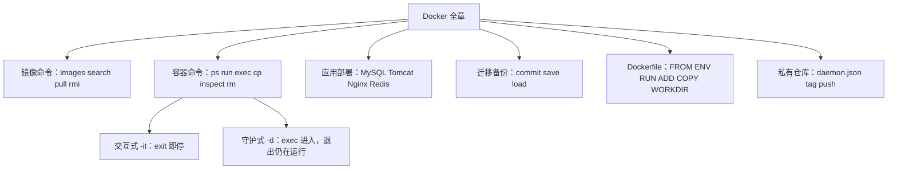

# Docker 全章复习地图：一条主线串起镜像、容器、部署、备份与私有仓库

> 🔒 安全提示：文中示例的口令/密钥均为课程教学环境演示口径，生产环境的安全要求见《安全与合规须知》。

Docker 章节过完，命令少说三十来条，散着背很容易背了后面忘前面。其实整章是一条主线：有了镜像才有容器，容器拿来跑应用，应用的数据要能迁移备份，自研的镜像要集中放进私有仓库。按这条线把知识点重新过一遍，复习就变成了看地图。

## 先给结论

- 镜像是模板，容器是根据模板创建出来的运行实例；容器之间环境隔离，用容器搭生产环境安全性较高。
- 服务管理一条线搞定：`systemctl start/stop/restart/status docker`，开机自启用 `enable`，加速器配在 `/etc/docker/daemon.json`。
- 命令分两组记：镜像组 `images`、`search`、`pull`、`rmi`；容器组 `ps`、`run`、`exec`、`start/stop`、`cp`、`inspect`、`rm`。
- 交互式创建（`-it`）的容器一 `exit` 就停；守护式创建（`-d`）的容器用 `exec` 进入，退出后照常运行。
- 迁移备份三件套 `commit`、`save`、`load`；私有仓库三步走：配 `daemon.json` 信任、`docker tag` 打标记、`docker push` 上传。

## 一、概念与安装：镜像、容器、加速器

整章的起点是两个概念。**镜像**可以看成一个模板，本机可以下载或构建很多镜像：CentOS、MySQL、Tomcat、Nginx、Redis，也包括自己写的应用程序打出来的镜像。**容器**是根据模板创建出来的一台「服务器」，每个容器都当作一台独立机器用。容器之间环境是隔离的，互不干扰，这是用容器搭生产环境安全性较高的根本原因。

装好 Docker 后第一件事是配国内加速器，编辑 `/etc/docker/daemon.json`，下载镜像的速度能明显提上来：

```json
{
  "registry-mirrors": ["https://docker.mirror.ustc.edu.cn"]
}
```

Docker 本身是一个服务，日常管理走 `systemctl` 一套：

```bash
systemctl start docker      # 启动
systemctl stop docker       # 停止
systemctl restart docker    # 重启
systemctl status docker     # 查看运行状态
systemctl enable docker     # 开机自启动，免得每次手动拉起
docker info                 # 查看 Docker 概要信息
```

## 二、命令体系：镜像一组，容器一组

整章命令虽多，按操作对象分只有两组。

**镜像组的四条**：查看 `docker images`、搜索 `docker search 镜像名`、拉取 `docker pull centos:7`、删除 `docker rmi 镜像ID`，配合 `$` 取值可以一次清空本地镜像：

```bash
docker rmi $(docker images -q)   # 删除所有镜像
```

**容器组围绕 `docker run` 展开**，常用参数要记牢：`-i` 让容器保持运行、`-t` 分配交互终端、`-d` 后台守护式运行、`--name` 给容器起名、`-v` 做目录挂载（主机目录：容器目录）、`-p` 做端口映射。创建方式分两种，行为差异是复习重点：

| 创建方式 | 典型命令 | 进入方式 | 退出后的状态 |
|---|---|---|---|
| 交互式 | `docker run -it --name=c1 centos /bin/bash` | 创建时直接进入容器内部 | `exit` 即停止 |
| 守护式 | `docker run -d --name=c2 centos /bin/bash` | 事后 `docker exec -it c2 /bin/bash` | 退出后仍在运行 |

剩余的容器命令各管一件事：`docker ps` 默认只看运行中的容器，加 `-a` 看全部、`-l` 看最后一次运行、`-f status=exited` 只看停止的；`docker cp` 在宿主机与容器间拷文件；`docker inspect 容器ID` 查看容器 IP 等元数据，配合 `--format='{{.NetworkSettings.IPAddress}}'` 可以只输出 IP；`docker start/stop` 控制启停；`docker rm` 删除容器。

整章的知识结构可以画成一张图，复习时按分支逐个回忆：



## 三、应用部署四件套

MySQL、Tomcat、Nginx、Redis 四个部署案例本质上都是前面命令的应用，差别只在参数组合上。MySQL 的特殊之处是要用 `-e` 传环境变量指定 root 用户的登录密码，其余几个主要是端口映射：

```bash
# MySQL：-e 指定 root 密码，-p 映射 3306
docker pull centos/mysql-5.7-centos7
docker run -d --name=mysql -p 3306:3306 -e MYSQL_ROOT_PASSWORD=123456 centos/mysql-5.7-centos7

# Nginx：映射 80
docker run -d --name=mynginx -p 80:80 nginx

# Redis：映射 6379
docker run -d --name=myredis -p 6379:6379 redis
```

Tomcat 同理，拉取镜像后 `-p 8080:8080` 映射即可。部署这一组时最值得记的不是命令本身，而是参数语义：`-e` 传配置、`-v` 挂目录、`-p` 通网络，绝大多数容器化部署的定制都落在这三个参数上。

## 四、迁移备份与私有仓库

迁移备份解决「镜像怎么搬运」的问题，三个命令各管一段：

```bash
docker commit 容器名 新镜像名:标签     # 把容器保存为镜像
docker save -o mynginx.tar mynginx    # 把镜像保存为 tar 文件
docker load -i mynginx.tar            # 把 tar 文件恢复为镜像
```

私有仓库解决「自研镜像放哪」的问题。仓库本身也是镜像，拉起一个 `registry` 容器就是仓库；随后三步不可颠倒。改 `/etc/docker/daemon.json` 加信任配置，改完必须重启 Docker 服务才生效：

```json
{
  "insecure-registries": ["192.168.184.141:5000"]
}
```

上传镜像前必须先 `tag` 打标记，让镜像名带上私有仓库地址，之后才能 `push`：

```bash
docker tag jdk1.8 192.168.184.141:5000/jdk1.8
docker start registry
docker push 192.168.184.141:5000/jdk1.8
```

## 五、Dockerfile 与自动化构建

手工 `commit` 造镜像不可复用、团队环境不一致，Dockerfile 用脚本把构建过程自动化。常用指令 `FROM`、`MAINTAINER`、`ENV`、`RUN`、`ADD`、`COPY`、`WORKDIR` 各司其职，整章的落点是用它构建了一个 JDK 8 镜像，后续所有微服务都以它作为基础镜像：

```dockerfile
FROM centos:7
MAINTAINER example-team
WORKDIR /usr
RUN mkdir -p /usr/local/java
ADD jdk-8u171-linux-x64.tar.gz /usr/local/java/
ENV JAVA_HOME /usr/local/java/jdk1.8.0_171
ENV PATH $JAVA_HOME/bin:$PATH
```

构建命令 `docker build -t jdk1.8 .`，末尾的点代表在当前目录找 Dockerfile。这个 `jdk1.8` 镜像在下一章会直接被 Maven 插件引用，作为微服务镜像的地基。

## 常见误区

- **交互式容器一退出就以为坏了**：`-it` 创建的容器 `exit` 即停止是设计行为，不是故障；要反复进出就用 `-d` 创建、`exec` 进入，退出后容器照常运行。
- **`ps` 看不到刚创建的容器**：`docker ps` 默认只列运行中的容器，停止的容器要加 `-a` 才能看见，误判「容器没创建成功」多半栽在这里。
- **改了 daemon.json 不重启**：这个文件在 Docker 服务启动时读取，`insecure-registries` 写完不执行 `systemctl restart docker`，推送依然被拒。
- **push 之前忘了 tag**：镜像名不带私有仓库地址前缀，Docker 默认往公有仓库推，必然失败；`tag` 的作用就是把上传目标写进镜像名里。

## 面试可能被问到的问题

1. 面试官追问：「镜像和容器是什么关系？」
   答：镜像是只读模板，容器是根据模板创建的运行实例。一个镜像可以起多个容器，每个容器相当于一台独立的服务器，环境互相隔离，因此用容器搭建生产环境安全性较高。

2. 面试官追问：「交互式和守护式创建容器有什么区别？」
   答：交互式用 `-it`，创建后直接进入容器内部，`exit` 退出时容器随之停止；守护式用 `-d`，创建后停留在宿主机，需要时用 `docker exec` 进入，退出后容器仍在运行。需要长期运行的服务一律用守护式。

3. 面试官追问：「容器化部署 MySQL 时最关键的参数是什么？」
   答：`-e MYSQL_ROOT_PASSWORD=123456` 指定 root 登录密码，这是 MySQL 镜像约定的环境变量；再配合 `-p 3306:3306` 做端口映射，外部客户端才能连上。数据要求高时还应加 `-v` 挂载目录持久化。

4. 面试官追问：「commit、save、load 各用在什么场景？」
   答：`commit` 把容器固化为镜像，用于把手工调试好的环境留存下来；`save` 把镜像导出成 tar 文件，用于离线搬运；`load` 把 tar 文件恢复成镜像。三者构成一条离线迁移链路，适合没有私有仓库的内网环境。

5. 面试官追问：「私有仓库搭建和上传的完整步骤是什么？」
   答：三步。先跑起 `registry` 容器；再在 `/etc/docker/daemon.json` 的 `insecure-registries` 里声明信任该地址并重启 Docker；最后 `docker tag` 给镜像加上带仓库地址的标记再 `push`。验证可以访问仓库的 `/v2/catalog` 看镜像清单。

6. 面试官追问：「为什么要用 Dockerfile 而不是手工 commit 做镜像？」
   答：手工方式步骤多、易出错、不可复用，团队成员各做各的会导致环境不一致；Dockerfile 把全部操作写成脚本，一条 `docker build` 命令自动构建，开发、测试、运维拿到同一份文件就能得到完全一致的镜像，可以无缝移植。

## 配套资料

- 本课无配套源码工程（`materials/code/01` 下没有 Docker 相关工程），正文命令与配置均取自课程实录（`daemon.json`、`systemctl` 系列、部署四件套、`commit/save/load`、Dockerfile 与私有仓库三步），可在装好 Docker 的 CentOS 7 宿主机上逐条复现。
- 分篇详解见本阶段 Docker 系列：镜像命令与容器操作、`0102-Dockerfile常用命令.md`、`0103-Dockerfile构建jdk1.8镜像.md`、`0104-Docker私有仓库的搭建与配置.md`、`0105-Docker私有仓库镜像上传.md`。
