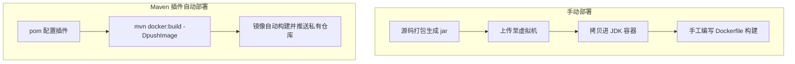

# 一条 Maven 命令把微服务发上 Docker：docker-maven-plugin 自动部署全流程

微服务数量一多，部署就成了体力活：每个服务都要先打 jar 包、上传到虚拟机、再拷进 JDK 容器，服务有几十个时这套手工动作既繁琐又容易出错。从这一章开始课程转向运维侧，Docker 的 Maven 插件就是把「打包、构建镜像、推送仓库」压缩成一条命令的工具，也是企业里实际使用的部署方式。

## 先给结论

- `docker-maven-plugin` 干的事：把打 jar、写 Dockerfile、`docker build`、`push` 私有仓库压成一条 `mvn docker:build -DpushImage`。
- 前提一：修改宿主机 `/lib/systemd/system/docker.service`，在 `ExecStart` 追加 `-H tcp://0.0.0.0:2375` 开放远程访问，改完 `daemon-reload` 再重启 Docker。
- 前提二：私有仓库已经搭好，并且本机 Docker 已在 `daemon.json` 里信任该仓库地址。
- 插件四个关键配置对应关系：`baseImage` 等价 `FROM`，`entryPoint` 等价 `ENTRYPOINT`，`resources` 等价 `ADD`，`imageName` 等价 `docker build -t` 的镜像名。
- 构建前先在父工程执行 `mvn install`，把公共模块装进本地仓库，否则业务模块编译直接失败。

## 一、本章目标与手动部署的瓶颈

这一章偏运维，学习目标共六项：掌握 Docker 的 Maven 插件使用、掌握持续集成工具 Jenkins 的安装与使用、掌握容器管理工具 Rancher 的安装与使用、掌握时间序列数据库 InfluxDB 的安装与使用、掌握容器监控工具 cAdvisor 的安装与使用、掌握图表工具 Grafana 的使用。正文从第一项 Docker 的 Maven 插件讲起，它解决的是微服务部署的最后一步自动化。

微服务部署有两种方法。手动部署是先基于源码打包生成 jar（或 war）包，把包上传至虚拟机并拷贝至 JDK 容器；自动部署则通过 Maven 插件完成。两条路的对比很直观：



服务数量少时手动做一两次还能忍，微服务架构下几十个服务每个发一版都要重走一遍，出错点分散在每个环节。插件方案把过程收敛进构建工具，本地工程执行一条 Maven 命令就能完成部署。

## 二、第一步：让宿主机 Docker 接受远程指挥

插件的工作模式是「本机工程远程指挥宿主机上的 Docker」：你在自己的开发机上执行 Maven 命令，实际干活的是虚拟机里的 Docker 守护进程。而 Docker 默认关闭远程访问，所以要先把门打开。

编辑 `/lib/systemd/system/docker.service`，在 `ExecStart` 等号后面追加 `-H` 配置：

```ini
[Service]
ExecStart=/usr/bin/dockerd -H tcp://0.0.0.0:2375 -H unix:///var/run/docker.sock
ExecReload=/bin/kill -s HUP $MAINPID
```

这句配置的含义是让 dockerd 同时监听两个通道：原来的 `unix:///var/run/docker.sock` 供本机使用，新增的 `tcp://0.0.0.0:2375` 供远程调用。保存退出后执行两条命令让改动生效：

```bash
systemctl daemon-reload     # 重新加载服务配置文件
systemctl restart docker    # 重启 Docker 服务
```

注意 `daemon-reload` 和 `restart` 缺一不可，只改文件不 reload，重启的仍是旧配置。另外重启 Docker 之后，之前跑着的 registry 容器可能已经停了，记得 `docker start registry` 拉起来，后面推送镜像要用。还有一点必须心里有数：2375 端口没有任何认证，谁连上谁就能操作 Docker，这套配置只适合内网学习或受控环境，生产环境必须加 TLS 或换用其他安全通道。

## 三、第二步：pom 里的插件配置逐行拆

在需要 Docker 部署的工程 pom 中增加插件配置。下面这份配置取自课程实录，原课程的模块名与包名已改写为中性命名（父工程 `microservice-parent`，业务模块 `base-service`）：

```xml
<build>
    <!-- 打包后的 jar 统一命名为 app.jar，被下面多个引用点使用 -->
    <finalName>app</finalName>
    <plugins>
        <!-- Spring Boot 打包插件，负责打出可执行 jar -->
        <plugin>
            <groupId>org.springframework.boot</groupId>
            <artifactId>spring-boot-maven-plugin</artifactId>
        </plugin>
        <!-- Docker 构建插件 -->
        <plugin>
            <groupId>com.spotify</groupId>
            <artifactId>docker-maven-plugin</artifactId>
            <version>0.4.13</version>
            <configuration>
                <!-- 生成镜像的名称：私有仓库地址/模块名:版本号 -->
                <imageName>192.168.184.141:5000/${project.artifactId}:${project.version}</imageName>
                <!-- 基础镜像，等价于 Dockerfile 中的 FROM jdk1.8 -->
                <baseImage>jdk1.8</baseImage>
                <!-- 容器启动后自动执行的命令，等价于 ENTRYPOINT -->
                <entryPoint>["java", "-jar", "/${project.build.finalName}.jar"]</entryPoint>
                <!-- 构建时上传的文件，等价于 ADD app.jar / -->
                <resources>
                    <resource>
                        <targetPath>/</targetPath>
                        <directory>${project.build.directory}</directory>
                        <include>${project.build.finalName}.jar</include>
                    </resource>
                </resources>
                <!-- 指挥哪台宿主机的 Docker，对应第二步开放的 2375 端口 -->
                <dockerHost>http://192.168.184.141:2375</dockerHost>
            </configuration>
        </plugin>
    </plugins>
</build>
```

这份配置的本质是「用 XML 写 Dockerfile」，五个配置项与手写脚本的对应关系如下：

| 配置项 | 作用 | 等价的 Dockerfile 写法 |
|---|---|---|
| `imageName` | 生成镜像的名称，`docker images` 列表里显示的名字 | `docker build -t 仓库地址/base-service:版本 .` |
| `baseImage` | 声明基础镜像 | `FROM jdk1.8` |
| `entryPoint` | 容器启动后自动执行的命令 | `ENTRYPOINT ["java", "-jar", "/app.jar"]` |
| `resources` | 把 `target` 下的 jar 拷进镜像根目录 | `ADD app.jar /` |
| `dockerHost` | 指定远程 Docker 地址 | 无，手写脚本时不存在这一步 |

`imageName` 里的三个占位符都来自 pom 自身：`${project.artifactId}` 取模块名，`${project.version}` 取版本号（如 `1.0-SNAPSHOT`），`${project.build.finalName}` 取 `build.finalName` 配置的 `app`，所以镜像名最终形如 `192.168.184.141:5000/base-service:1.0-SNAPSHOT`，镜像里放着根目录的 `app.jar`，启动时 `java -jar /app.jar`。`imageName` 带私有仓库地址前缀还有一层作用：构建完成后可以直接推到该仓库，不用再手工 `tag`。

## 四、第三步：构建、上传、起容器

配置齐了，进入执行环节。命令行用 IDEA 左下角的 Terminal 打开即可，在工程目录另开 cmd 效果相同；还有个小技巧，把工程直接拖向 Terminal 窗口会新开一个选项卡，当前目录就是该工程根目录。

```bash
# 1. 在父工程根目录执行：把所有子模块安装进本地仓库
mvn install

# 2. 进入要部署的业务模块目录
cd base-service

# 3. 构建镜像并推送到私有仓库，-DpushImage 区分大小写
mvn docker:build -DpushImage
```

第一步的 `mvn install` 不是走过场。多模块工程里有一个公共模块，存放通用实体类和工具类，业务模块都依赖它；先整体安装到本地仓库，后续打包时才能找到这个依赖。第三步的 `docker:build` 是插件提供的构建目标，加上 `-DpushImage` 参数则在构建完成后顺带推送，注意 `D` 大写、`pushImage` 连写。

命令跑完看到 `BUILD SUCCESS`，到宿主机上验证三层结果：

```bash
# 宿主机本地多出一个带仓库地址的镜像
docker images
# 192.168.184.141:5000/base-service   1.0-SNAPSHOT   xxx   23 seconds ago   617MB

# 浏览器访问私有仓库，清单里应出现 base-service
# http://192.168.184.141:5000/v2/catalog

# 起容器验证服务真的能跑，端口与工程 application.yml 里配置的服务端口一致
docker run -d --name=base -p 9001:9001 192.168.184.141:5000/base-service:1.0-SNAPSHOT
```

`docker images` 有镜像说明构建成功，仓库清单里出现同名条目说明推送成功，容器起来且映射端口有响应说明整条链路闭环。至此，从源码到运行中的容器，人工参与的只剩敲命令。

## 常见误区

- **改了 docker.service 不做 daemon-reload**：直接 `restart docker` 加载的还是旧配置，2375 端口根本没开，插件连接被拒。
- **`-DpushImage` 写错大小写或拆开写**：Maven 属性区分大小写，写成 `-dpushimage` 或 `-Dpush_image` 时只构建不推送，以为推上去了结果仓库是空的。
- **跳过 `mvn install` 直接构建业务模块**：公共模块不在本地仓库，业务模块编译阶段就报找不到依赖，根本走不到镜像构建。
- **重启 Docker 后忘记拉起 registry 容器**：`systemctl restart docker` 会停掉运行中的容器，不 `docker start registry` 就推送，必然连接失败。
- **容器端口与工程配置对不上**：`-p` 前后端口要一致，且必须等于工程 `application.yml` 里配置的服务端口（课程工程是 9001），映射错了服务无法从外部访问。

## 面试可能被问到的问题

1. 面试官追问：「docker-maven-plugin 替你省掉了哪些手工步骤？」
   答：手动部署要打 jar、上传虚拟机、拷进 JDK 容器、写 Dockerfile、构建、打 tag 推送六步；插件把这六步收敛进 pom 配置，本地执行 `mvn docker:build -DpushImage` 一条命令完成构建与推送，代码到镜像一气呵成。

2. 面试官追问：「插件配置和 Dockerfile 指令是怎么对应的？」
   答：`baseImage` 对应 `FROM` 指定基础镜像，`entryPoint` 对应 `ENTRYPOINT` 声明容器启动命令，`resources` 对应 `ADD` 把 jar 拷进镜像，`imageName` 相当于 `docker build -t` 的镜像命名。插件就是用 XML 形式重写了 Dockerfile 的核心指令。

3. 面试官追问：「为什么要修改 docker.service 开放 2375 端口？有什么风险？」
   答：插件在本机执行、Docker 在宿主机上跑，属于远程调用，而 Docker 默认只监听本地 unix socket，追加 `-H tcp://0.0.0.0:2375` 才能接受远程指令。风险是 2375 无认证，拿到端口就等于拿到宿主机 root 级操作权限，只能在受控内网使用，生产必须加 TLS 认证或走安全通道。

4. 面试官追问：「构建镜像前为什么要先执行 mvn install？」
   答：多模块工程中业务模块依赖公共模块，`install` 会把所有子模块安装进本地仓库，保证后续打包能解析到公共依赖。直接在业务模块目录执行插件命令，公共模块缺失会导致编译失败。

5. 面试官追问：「镜像推送到私有仓库后，怎么验证部署真的成功了？」
   答：三层验证：宿主机 `docker images` 能看到带仓库地址的镜像，说明构建成功；浏览器访问 `http://仓库地址:5000/v2/catalog` 出现该镜像名，说明推送成功；`docker run` 用该镜像起容器并映射工程配置的服务端口，服务可访问说明整条链路打通。

6. 面试官追问：「imageName 里带上私有仓库地址有什么好处？」
   答：镜像名以 `仓库地址:5000/` 开头后，它天然就是 push 的目标名，省掉手工 `docker tag` 这一步；同时不同环境从镜像名就能看出来源仓库，减少配置错误。

## 配套资料

- 本课无配套源码工程（`materials/code/01` 下没有 docker-maven 插件相关工程），pom 配置与命令均取自课程实录屏幕内容；原课程的多模块工程与包名已改写为中性命名（`microservice-parent`、`base-service`、`com.example`），示例可直接复用。
- 前置依赖见本阶段 `0104-Docker私有仓库的搭建与配置.md`（仓库搭建与 `daemon.json` 信任）与 `0105-Docker私有仓库镜像上传.md`（tag 与 push 细节），插件推送正是这两篇的手工动作自动化。
- 本章的持续集成部分见 `0108-持续集成与jenkins.md`；Rancher、InfluxDB、cAdvisor、Grafana 属于容器管理监控线，与插件部署互不依赖。
