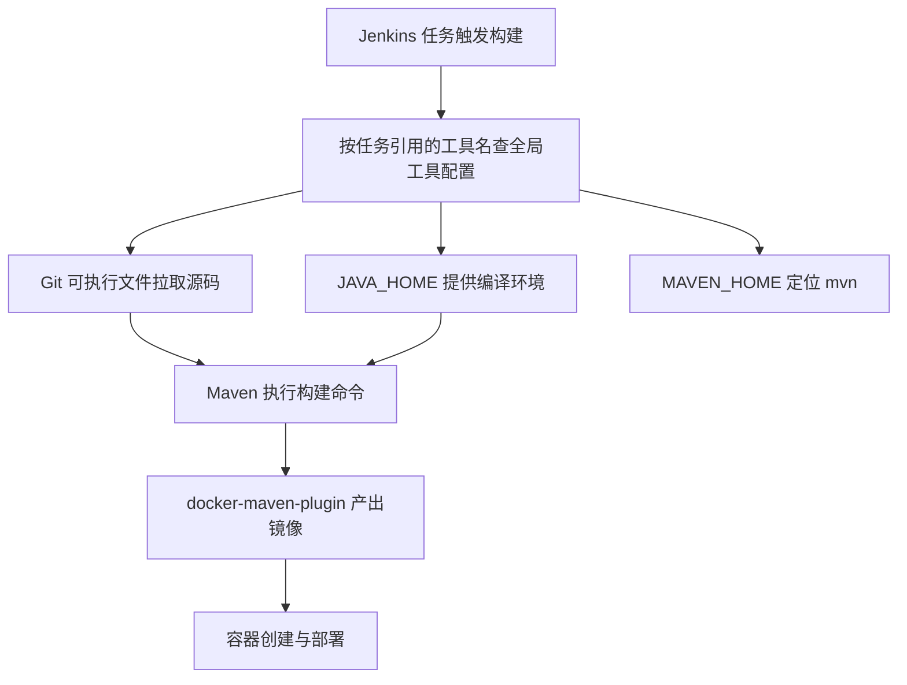

# Jenkins 全局工具配置：把 JDK、Git、Maven 的路径交待清楚

插件装了、Maven 软件也装了，按理说可以建任务开始持续集成了。但点进任务配置你会发现，Jenkins 并不知道这台服务器上哪有 JDK、哪有 Git、哪有 Maven。它不会自己去猜，找不到工具的构建任务只会报错收场。全局工具配置要做的，就是把这三个工具的「门牌号」登记给 Jenkins，让它拿到任务时知道去哪调用谁。

这一篇把 JDK、Git、Maven 三项全局工具配齐，顺带把从代码仓库拉源码要用的 Git 凭证也交代清楚。

## 先给结论

- 全局工具配置的入口在「系统管理」下的「全局工具配置」，它登记的是工具在本机的安装路径，供所有任务共享引用。
- 持续集成链路必须配三个工具：JDK 负责编译、Git 负责拉取代码、Maven 负责执行构建命令产出镜像。
- 配 JDK：新增一项，名称填 `jdk1.8`，取消勾选「自动安装」，`JAVA_HOME` 填 `/usr/java/jdk1.8.0_171-amd64`。
- 配 Maven：名称填 `Maven`，取消「自动安装」，`MAVEN_HOME` 填 `/usr/local/maven`。
- Git 在课程镜像里已经装好，路径填 `git` 即可；另外要配好 Git 凭证，Jenkins 才能从 Gogs 仓库拉取项目源码。

## 一、为什么必须登记工具路径

Jenkins 进程启动时并不知道机器上都装了什么，它只认自己主目录里那套东西。所谓全局工具配置，本质是一张「名字到路径」的映射表：你在全局配置里给某个工具起个名字、填上真实路径，之后任务里只需按名字引用，Jenkins 就按登记的路径去调用对应可执行文件。

这张表为什么恰好是 JDK、Git、Maven 三项？看持续集成的动作就明白了，课程安装文档对此有明确表述：Jenkins 进行持续集成工作时依赖 Jdk1.8、Git、Maven。拆开对应：

**第一，JDK 用来编译。** Java 工程的编译、打包都在 JVM 里进行，Jenkins 调用 Maven 前需要知道用哪个 JDK，`JAVA_HOME` 就是答案。

**第二，Git 用来拉代码。** 构建的第一步永远是拿到最新源码，Jenkins 通过 Git 客户端执行 clone 和 pull，没有它流水线源头就断了。

**第三，Maven 用来构建和部署。** 执行 `mvn` 命令完成编译打包，再经 docker-maven-plugin 产出镜像实现容器的创建，这就是 Maven 在链路里的位置。

配置之前，先在服务器上核对三个工具的真实位置，避免把路径填错：

```bash
# JDK 的实际目录
ls /usr/java/jdk1.8.0_171-amd64/bin/java

# Git 客户端位置与版本
which git && git --version

# Maven 的实际目录
ls /usr/local/maven/bin/mvn
```

三条命令都给出结果，说明工具已就位，剩下的只是把它们登记进 Jenkins。

## 二、配置 JDK 与 Maven

进入「系统管理」，打开「全局工具配置」页面，页面上会依次出现 JDK、Git、Maven 三块区域。

JDK 区域默认为空，点击「新增 JDK」，名称一栏填 `jdk1.8`。这里有个关键动作：把「自动安装」的勾去掉。勾着它，Jenkins 会在构建时自己联网下载指定版本的 JDK，速度慢且不可控；去掉之后页面才露出 `JAVA_HOME` 输入框，填入：

```text
JAVA_HOME = /usr/java/jdk1.8.0_171-amd64
```

这正是第一课装 JDK 时落下的那个目录，两者必须严格对应。

Maven 区域同理：点击「新增 Maven」，名称填 `Maven`，取消「自动安装」，`MAVEN_HOME` 填上一课移动好的目录：

```text
MAVEN_HOME = /usr/local/maven
```

自动安装和手动指定各有适用场景：自动安装省事，适合 Jenkins 独占的机器；手动指定路径可控、版本稳定，课程环境选后者，因为工具都是提前装好的。

## 三、Git 与拉代码的凭证

Git 的配置最简单，课程镜像里已经预装了 Git 客户端，页面上「Path to Git executable」填 `git` 即可，系统能从 `PATH` 里找到它就不需要写全路径。

不过光有 Git 客户端还不够：Jenkins 去代码仓库拉源码时需要账号密码，这就要在凭证（Credentials）里添加一条 Git 凭证，内容是 Git 仓库的用户名和密码。有了这条凭证，Jenkins 才能从 Gogs 仓库获取项目源码，任务配置里选择凭证即可完成关联，密码本身不会明文出现在任务配置中。

三项都填完，点「保存」，全局工具配置完成。

## 四、配置生效后的构建链路

把任务构建时的调用关系画出来，全局工具配置在其中的位置一目了然：



关键路径是第一步：任务按名字到映射表里取路径，任何一项没登记或路径写错，链路在源头就断掉。所以配置完成后值得做一次验证，在任务的构建步骤里写几行 shell：

```bash
which git
echo $JAVA_HOME
mvn -version
```

跑一次任务，输出里能看到 Git 位置、JDK 路径和 Maven 版本号，就说明 Jenkins 拿到的工具都是真实可用的，后面的持续集成才有了地基。

## 常见误区

- **保留「自动安装」勾选还想填路径**。勾着自动安装时路径输入框不生效，Jenkins 会尝试自己下载工具；手动安装必须先取消勾选。
- **`JAVA_HOME` 只填到 `/usr/java` 为止**。路径必须精确到 JDK 根目录 `jdk1.8.0_171-amd64`，也就是 `bin/java` 的上一级，填浅了找不到编译器。
- **全局工具配置里改了名字，任务里还引用旧名字**。名称是任务引用的钥匙，改完名字要同步更新所有用到它的任务，否则构建报工具不存在。
- **配了 Git 客户端却忘了配凭证**。客户端只能执行命令，访问私有仓库还需要仓库的账号密码凭证，两者都就位才能拉到源码。

## 面试可能被问到的问题

1. 面试官追问：「Jenkins 的全局工具配置解决的是什么问题？」
   答：它维护一张工具名到安装路径的映射表，让 Jenkins 知道 JDK、Git、Maven 等工具在服务器上的位置。任务按名字引用工具，Jenkins 按登记路径调用，从而把构建工具的管理与任务配置解耦。

2. 面试官追问：「持续集成环境为什么需要 JDK、Git、Maven 三个工具？」
   答：Git 负责从代码仓库拉取最新源码，是流水线的入口；JDK 提供编译运行的 Java 环境；Maven 负责依赖管理和打包，配合 docker-maven-plugin 还能直接产出镜像完成部署。三者分别对应拉代码、编译、构建部署三个环节。

3. 面试官追问：「工具配置里的自动安装和手动指定路径怎么选？」
   答：自动安装由 Jenkins 按选定版本联网下载，适合新环境快速搭建，但依赖网络且版本不可见；手动指定要求工具已装好，胜在版本固定、路径可控，企业 CI 服务器通常提前统一安装工具再手动登记。

4. 面试官追问：「Git 凭证的作用是什么？放在哪里合适？」
   答：凭证保存代码仓库的账号密码，Jenkins 拉取私有仓库源码时用它完成认证。凭证统一存在 Jenkins 的 Credentials 体系里，任务中按 ID 引用，避免明文散落在任务配置或脚本里。

5. 面试官追问：「构建报找不到 mvn 命令，你怎么排查？」
   答：按链路查三处：全局工具配置里 Maven 项是否存在、`MAVEN_HOME` 路径是否真实指向安装目录；任务里引用的工具名与配置名是否一致；服务器上 `/usr/local/maven/bin/mvn` 是否真实存在。在构建 shell 里执行 `mvn -version` 能快速确认 Jenkins 实际拿到的工具。

## 配套资料

- 讲义：`materials/docs/10/Jenkins安装文档.md`（「Jenkins 全局工具配置」章节给出 JDK、Maven、Git 三项配置与 Git 凭证的完整说明）
- 讲义：`materials/docs/10/Gogs安装文档.md`（代码仓库 Gogs 的搭建说明，全局工具配置中 Git 凭证所对应的仓库端）
