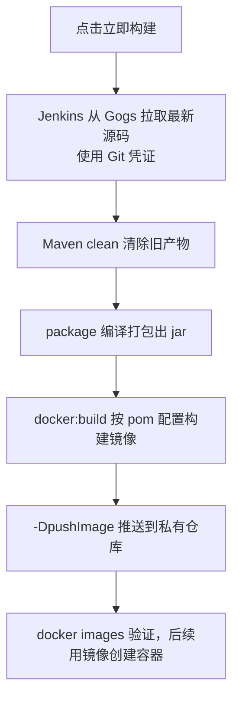

# Jenkins 任务创建与执行：一条命令让拉代码到出镜像全自动

镜像装了、插件装了、JDK 和 Maven 也登记进了全局工具配置、代码推上了 Gogs，持续集成的准备工作全部就位。轮到主戏：在 Jenkins 里建一个任务，把「拉代码、编译打包、构建镜像、推送镜像」一整套动作配进去，点一下按钮自动跑完。任务列表里那个天气图标和彩色小球，第一次见多半会愣住，这里一并说清楚。

## 先给结论

- 新建任务时类型选「构建一个 Maven 项目」，名称按构建对象起，课程里建的是 `tensquare`。
- 源码管理选 Git，粘贴 Gogs 仓库地址，分支 `master`，凭证用全局配置里那条 Git 凭证。
- 多模块工程的 Root POM 不能写 `pom.xml`，要写子模块路径，如 `tensquare_base/pom.xml`。
- 构建命令 `clean package docker:build -DpushImage`：清除、打包、构建镜像、推送镜像，`mvn` 前缀在 Jenkins 里可省。
- 任务列表的小球代表最近一次构建结果（灰从未执行、蓝成功、红失败），天气图标代表任务健康度；构建成功后宿主机 `docker images` 里能看到新镜像。

## 一、建任务：两处必配

回到 Jenkins 首页，点「新建任务」，输入名称，类型选「构建一个 Maven 项目」，确定后进入配置页。描述随意填一句，真正必须动的是两块。

**源码管理选 Git。** 粘贴 Gogs 仓库地址 `http://192.168.184.141:3000/liubei/tensquare.git`，Branch Specifier 填 `master`。Jenkins 拉私有仓库时用的账号密码，就是全局工具配置那一课里加的 Git 凭证，凭证选上即可，密码不会明文出现在任务配置中。

**Build 区域。** 这是任务的核心，下一节单独拆。

## 二、Build：Root POM 与构建命令

Build 区有两个输入框，填法如下（课堂文档实录）：

```text
Root POM: tensquare_base/pom.xml
Goals and options: clean package docker:build -DpushImage
```

**第一，Root POM 为什么不是 `pom.xml`。** Gogs 上这个仓库是聚合工程，根目录的 pom 只负责聚合，底下挂着一排子模块：`tensquare_article`、`tensquare_base`、`tensquare_eureka` 等。持续集成的对象是 `base` 模块，就必须告诉 Jenkins 去 `tensquare_base` 目录下找那一份 pom。直接写根下的 `pom.xml`，构建出来的不是你要的东西。

**第二，构建命令逐段拆。** 这里的 Goals and options 就是 Maven 命令的参数部分，`mvn` 三个字母不用写，Maven 项目类型会自动调用全局工具配置里登记的 mvn。拆开看：

```text
clean            清除上次的 target 产物
package          编译并打包出 jar
docker:build     调用 docker-maven-plugin，按插件配置构建 Docker 镜像
-DpushImage      构建完直接把镜像推送到私有仓库
```

`docker:build` 是插件暴露的调用入口，插件本身在工程的 pom 里声明（本课工程源码未包含在资料包，下面是按本课写法补全的示例）：

```xml
<build>
    <plugins>
        <plugin>
            <groupId>com.spotify</groupId>
            <artifactId>docker-maven-plugin</artifactId>
            <version>0.4.13</version>
            <configuration>
                <!-- 镜像名带私有仓库地址，push 时才能落到仓库 -->
                <imageName>192.168.184.141:5000/tensquare_base</imageName>
                <baseImage>jdk1.8</baseImage>
                <entryPoint>["java", "-jar", "/app.jar"]</entryPoint>
                <resources>
                    <resource>
                        <targetPath>/</targetPath>
                        <directory>${project.build.directory}</directory>
                        <include>${project.build.finalName}.jar</include>
                    </resource>
                </resources>
            </configuration>
        </plugin>
    </plugins>
</build>
```

配置项的含义：`imageName` 决定镜像叫什么、推去哪；`baseImage` 指明镜像基于 JDK 1.8；`entryPoint` 是容器启动命令；`resources` 把 `package` 打出的 jar 复制进镜像。也就是说，pom 里配一次，之后每次构建都自动走同一套镜像制作流程。

填完点保存，任务创建完毕，返回面板能看到任务行。

## 三、执行任务：小球、天气与控制台

任务行最右侧的按钮就是执行入口，点它触发一次构建。构建过程中，列表里会出现一个执行状态标志，点进去是 Console Output，效果和坐在服务器前看控制台一模一样：依赖解析、编译、打 jar、Docker 逐层构建镜像、推送，全程实时滚动。跑完看到结束标记即为成功。

面板上的两种图标值得专门解释：

**第一，小球是「最近一次结果」。** 灰色小球表示任务从未执行过；构建成功后变蓝色；失败变红色。一眼扫过去就知道哪个任务最近一次是好的。

**第二，天气是「健康趋势」。** 太阳表示任务一直健康、很少出错；发生过错误就开始「阴天」「下雨」，错误次数越多天气越差。它是把一段时期内的构建结果做了统计，用来发现那种「时好时坏」的不稳定任务。

构建成功后回服务器验证，镜像已经躺在本地：

```bash
docker images
# 192.168.184.141:5000/tensquare_base   latest   xxx   刚刚
```

把整个执行链路串起来：



关键路径在 pom 与 Jenkins 的分工：Jenkins 负责调度与执行，镜像怎么造、叫什么名、推去哪，全部写在工程 pom 的插件配置里，两边对上，一条命令直达镜像入库。

## 四、推广到所有微服务

`base` 跑通了，其余工程一个道理：pom 里加 docker-maven-plugin 配置、代码推上 Gogs、Jenkins 建一个对应的任务执行。每个微服务都有自己的镜像之后，就能各自创建容器，整套微服务的自动部署由此铺开。这正是持续集成的价值：把「上传、构建、部署」从每次手敲十几条命令，变成配置一次、点一下就完成。

## 常见误区

- **Root POM 写成根下的 `pom.xml`。** 聚合工程的根 pom 不产生可运行模块，构建要么报错要么不是目标模块。要构建哪个子模块，路径就写到它的 pom。
- **Goals 里手写 `mvn` 前缀。** Maven 项目类型自动调用 mvn，写成 `mvn clean package` 反而可能报找不到命令，只填参数部分。
- **任务拉不到代码就怀疑网络。** 十有八九是 Git 凭证没配或账号密码错，构建日志第一步就会提示认证失败，回全局配置补凭证即可。
- **只盯小球不看日志。** 小球只告诉成败，失败原因全在 Console Output 里，定位问题必须点进去看。

## 面试可能被问到的问题

1. 面试官追问：「Jenkins 里 Maven 项目类型和自由风格有什么区别？」
   答：自由风格是一组通用构建步骤的容器，Maven 项目类型针对 Maven 工程做了专门适配：直接填 Goals and options 就能执行，自动关联全局工具配置里的 Maven 与 JDK，多模块、快照依赖等场景处理更顺。本质上 Maven 类型是自由风格加 Maven 专属便利的封装。

2. 面试官追问：「`clean package docker:build -DpushImage` 每一段是什么意思？」
   答：`clean` 清除上次构建产物；`package` 编译打包出 jar；`docker:build` 触发 docker-maven-plugin 按工程 pom 的配置构建镜像；`-DpushImage` 是开关参数，让插件构建完把镜像推送到配置的私有仓库。四段连起来就是从源码到镜像入库的完整一击。

3. 面试官追问：「多模块工程做持续集成，任务怎么组织？」
   答：每个需要独立部署的子模块建一个 Jenkins 任务，Root POM 指向该子模块的 pom 路径，构建命令相同。公共做法是先构建被依赖的基础模块再构建上层模块，各任务产出各自的镜像，互不干扰，也便于单独重试失败的那个。

4. 面试官追问：「一次构建失败了，你怎么排查？」
   答：进任务点开失败的构建，先看 Console Output：认证失败查 Git 凭证；依赖下载失败查 Maven 仓库配置与网络；编译错误看具体报错类；docker 阶段失败查私有仓库地址与插件配置。控制台输出与本地执行 mvn 的输出一致，按段定位即可。

5. 面试官追问：「docker-maven-plugin 在这套流程里解决了什么问题？」
   答：它把「打 jar」和「造镜像」合并进同一次 Maven 构建。传统做法要先打包、再手写 Dockerfile、再 docker build、再 push，四步手工操作；插件在 pom 里声明镜像名、基础镜像、启动命令与文件复制规则后，一条 `docker:build` 全部代劳，CI 里就能自动产出并推送镜像。

## 配套资料

- 讲义：`materials/docs/10/Jenkins安装文档.md`（Jenkins 安装、常用插件、全局工具配置与 Git 凭证，任务创建与执行的前置条件）
- 讲义：`materials/docs/10/Gogs安装文档.md`（任务拉取源码的仓库端：Gogs 安装与新建仓库）
- 本课工程源码未包含在资料包，pom 中 docker-maven-plugin 配置为按本课写法补全的示例；任务配置项 `tensquare_base/pom.xml` 与命令 `clean package docker:build -DpushImage` 取自课堂实录。
