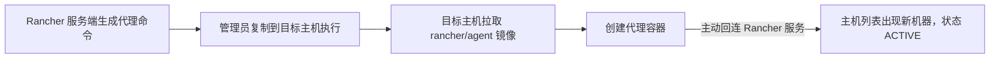

# 装好 Rancher 先做三件事：环境隔离、主机纳管、应用分组

Rancher 装好、界面切成中文之后，离「把它当成日常运维后台用」还差几步准备。直接去点添加服务会发现无从下手：容器该归到哪个空间里？别的服务器怎么交给它管？项目往哪儿放？Rancher 的初始化恰好就是三步：添加环境、添加主机、添加应用，按顺序做完，平台骨架就立起来了。

## 先给结论

- 初始化固定三步：添加环境、添加主机、添加应用，分别解决配置隔离、机器纳管、项目分组三个层面的问题。
- 环境是配置隔离的单位，开发、测试、生产各建一个，环境之间的配置互不可见、互不影响。
- 添加主机靠一段代理命令：Rancher 生成一条创建 agent 容器的命令，在目标服务器上执行，主机自动注册进来，状态变成 ACTIVE。
- 应用是服务的分组名称，一套项目一个应用；服务才对应 Docker 里的一个容器。

## 一、添加环境：给配置画隔离圈

环境（Environment）解决的是「多套配置混在一起」的问题。开发、测试、生产三套配置如果堆在同一个空间里，一次误操作就可能波及线上。Rancher 的做法是把资源按环境分组：每个环境拥有独立的基础架构资源和服务，在哪个环境下操作，就只看得见、改得了那个环境里的东西。

操作路径是「Default → 环境管理 → 添加环境」，依次创建：

- `dev`：开发环境
- `test`：测试环境
- `prod`：生产环境

创建环境时会遇到环境模板这个概念，列表里有 Cattle、Kubernetes、Mesos、Swarm、Windows 等选项，代表这个环境底层用哪种容器编排引擎来调度资源。课程使用默认的 Cattle 模板即可。三个环境建好后切换到 `test`，后续所有部署操作都在测试环境里进行。

## 二、添加主机：一条命令把服务器纳管进来

Rancher 服务本身跑在一台机器上，真正要部署容器的却是另外的服务器，所以要把它们「收编」进来。路径：基础架构 → 主机 → 添加主机。

**第一，先保存注册地址。** 打开添加主机页面，Rancher 默认选中当前站点地址作为主机注册地址，直接点保存，页面会给出分步指引，其中第 5 步就是关键的那段命令。课堂环境里这段命令被复制到 144 这台服务器上执行。

**第二，在目标主机上执行代理命令。** 这段命令的本质是创建一个 Rancher 代理（agent）容器。目标服务器先保证 Docker 在运行，再把页面复制来的命令整段原样执行，形式示意如下（尾部注册地址由服务端生成，以页面提供的为准）：

```bash
# 目标主机上先确保 Docker 服务在运行
sudo systemctl start docker

# Rancher 第 5 步生成的代理命令（示例按本课写法补全，注册地址从页面复制）
sudo docker run -d --privileged \
  -v /var/run/docker.sock:/var/run/docker.sock \
  -v /var/lib/rancher:/var/lib/rancher \
  rancher/agent http://<Rancher服务地址>/v1/scripts/<注册串>
```

命令跑起来后，目标主机会先下载 agent 镜像，再自动创建代理容器，代理容器反过来与 Rancher 服务建立连接。回到 Rancher 界面点关闭，主机列表里就多出一台机器，状态是 ACTIVE，纳管完成。



图里最关键的是最后那步回连：命令里带着服务端的注册地址，agent 容器一启动就主动找上门，所以主机不需要在 Rancher 侧手工填 IP 和账号密码。

## 三、添加应用：给服务分组

环境和主机都就位后，还剩「项目往哪儿放」的问题。Rancher 里的应用指的是某一整套项目，比如一个社区项目；项目下面会拆成很多微服务，每个服务对应 Docker 里的一个容器。应用本身不运行任何东西，它只是服务的一个分组名称，起归类作用。

操作路径：应用 → 用户 → 添加应用，填名称和描述即可，课程按业务语义命名为社区项目。创建完成后，不同业务的服务可以放进对应的应用里，界面上按应用浏览，层级清楚。

三步做完，平台结构就成了「环境包着主机和应用，应用包着服务，服务对应容器」，后续的 MySQL、RabbitMQ、微服务部署全部在这个骨架上展开。

## 常见误区

- **在目标主机上直接敲代理命令，却忘了先启动 Docker。** 代理容器也要靠 Docker 运行，`systemctl start docker` 得先执行，否则命令报连不上守护进程。
- **以为应用等于容器。** 应用只是分组名称，真正对应 Docker 容器的是服务，一个应用下面可以挂很多服务。
- **环境建了一堆，操作前却没切换。** 所有资源都挂在当前环境下面，想部署到测试环境却停在开发环境里，资源就建错地方了。
- **代理命令手工改写或漏拷。** 注册串是服务端生成的，改错一个字符主机就注册不上，整段复制最稳妥。

## 面试可能被问到的问题

1. 面试官追问：「Rancher 里的环境是做什么用的？」
   答：环境是资源与配置的隔离单位，每个环境拥有独立的基础架构资源和服务。典型划分是开发、测试、生产各一个环境，配置互不干扰，避免一次误操作跨环境扩散，也便于按环境做权限控制。

2. 面试官追问：「添加主机那段命令到底做了什么？」
   答：它在目标主机上创建一个 Rancher agent 容器。命令里带着服务端的注册地址，agent 启动后主动回连 Rancher，服务端随即将这台主机纳入管理，状态显示 ACTIVE。之后在这台机器上创建、监控容器都可以由 Rancher 下发。

3. 面试官追问：「应用和服务分别对应什么？」
   答：应用是一套项目的分组名称，本身不运行任何东西；服务才是运行单位，一个服务对应 Docker 里的一个容器。应用用于归类浏览，服务用于实际部署和扩缩容。

4. 面试官追问：「创建环境时的环境模板是什么？」
   答：模板决定该环境底层用哪种容器编排引擎，比如 Cattle（Rancher 自带编排）、Kubernetes、Mesos、Swarm。同一套 Rancher 可以按需创建不同编排引擎的环境，课程使用默认的 Cattle。

5. 面试官追问：「主机注册为什么不需要在服务端配置目标机器的账号密码？」
   答：因为注册是反向连接：命令由服务端生成并携带注册地址，目标主机上的 agent 主动连回服务端。服务端只需要校验注册串，不需要持有目标机器的凭据，这也是这类 agent 纳管机制的通用设计。

## 配套资料

- 本课无配套讲义与源码包，三步操作路径与界面状态（环境模板列表、主机 ACTIVE、添加应用）取自课堂实录，代理命令为按本课写法补全的示例；Rancher 安装过程见本阶段「Rancher 安装」一篇，下一课开始在应用里部署 MySQL 与 RabbitMQ 服务。
