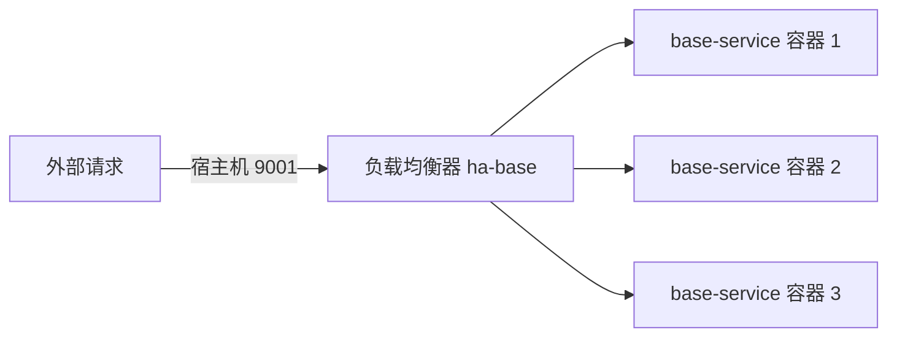

# Rancher 负载均衡器：给多容器集群开一个统一入口

上一课把 `base-service` 扩到 3 个容器时，特意去掉了端口映射。新问题马上出现：宿主机上没有任何端口指向这个服务，外部请求根本进不来，容器再多也白搭。Rancher 为这种场景准备了一种特殊服务：负载均衡器。它自己占用一个对外端口，把进来的请求转发给目标服务后面的全部容器，容器数量怎么变，入口都不用动。

## 先给结论

- 负载均衡器是 Rancher 里的一种特殊服务，专门给没有端口映射的服务提供统一对外入口。
- 添加入口藏在「添加服务」按钮旁的下拉箭头里，选项叫「添加负载均衡」。
- 关键配置三项：名称 `ha-base`、端口规则 `9001`、目标 `tensquare/base-service`。
- 请求到达负载均衡器后按轮询方式分发给后面的 3 个容器。
- 创建后的图标是一条横杠带连接线，与普通服务的图标明显不同。

## 一、扩容之后为什么访问不到

端口映射是宿主机端口与容器端口之间的一对一绑定。多容器集群里不能这么干：3 个容器都映射宿主机 9001，第二个容器创建时端口就冲突了。上一课去掉映射，正是为集群让路；去掉的副作用是服务在宿主机上没有入口，浏览器、接口测试工具全都无从下手。

负载均衡器补的就是这一环，它把「对外一个端口」和「对内一组容器」接在一起：



对外永远只有一个 9001，对内是 3 个容器；扩容缩容只改容器数量，入口纹丝不动。上一课敢把端口映射去掉，底气就在这里。

## 二、创建负载均衡器

进入应用页面，「添加服务」按钮旁边有一个向下的小箭头，点开选「添加负载均衡」。表单填三项：

| 配置项 | 填写值 | 说明 |
|---|---|---|
| 名称 | `ha-base` | 负载均衡器的服务名 |
| 端口规则 | `9001` | 对外监听的端口 |
| 目标 | `tensquare/base-service` | 请求要转发到的目标服务 |

「目标」下拉里选的就是上一课扩容到 3 个容器的那个服务，选中后负载均衡器会自动关联它的所有容器。点创建，服务列表里出现一条新记录，状态先是 Active（In Progress），即激活中；图标是一条横杠连着几条线，很形象：横线是入口，连线指向后面的容器。稍等片刻状态变成 Active，负载均衡器就绪。

## 三、验证：入口不变，背后轮询

浏览器访问 `http://192.168.184.144:9001`，返回的接口数据与当初单容器带端口映射时完全一样。区别在背后：此刻响应请求的是 3 个容器中的一个，负载均衡器按轮询（Round Robin）策略分发，第 1 个请求给容器 1，第 2 个给容器 2，依次循环，一圈之后从头再来。

轮询是负载均衡里最朴素的策略，各容器性能相近时效果最好。配合上一课的 Webhook 扩缩容：容器加一个，负载均衡器自动把它纳入分发；减一个，自动把它摘掉，全程不需要动任何配置。

这种「统一入口加后端多副本」的结构，在 Kubernetes 里有对应的声明式写法，课程资料里就有一份现成示例：

```yaml
apiVersion: v1
kind: Service
metadata:
 name: nginx
spec:
 type: NodePort
 ports:
  - port: 80
    nodePort: 33333
 selector:
   app: nginx
```

`NodePort` 相当于负载均衡器对外监听的端口，`selector` 相当于目标服务，被选中的 Pod 副本就是后面的容器。Rancher 的图形化界面与这份 YAML，讲的是同一件事。

## 常见误区

- **带着端口映射再去配负载均衡器。** 两套入口并存没有意义，还占着宿主机端口；参与扩缩容的服务应去掉端口映射，流量统一从负载均衡器进。
- **端口规则填成容器内部端口。** 端口规则填的是负载均衡器对外监听的端口，课堂演示里用业务端口 9001，它与容器端口的衔接由 Rancher 处理。
- **状态还在激活中就去访问。** 负载均衡器创建要经历部署过程，Active（In Progress）期间可能访问不通，等状态变成 Active 再验证。
- **以为配完负载均衡器就万事大吉。** 它只解决「请求进得来」，后面 3 个容器能不能扛住压力，还要靠扩缩容和监控配合。

## 面试可能被问到的问题

1. 面试官追问：「为什么扩容后的服务必须配负载均衡器才能访问？」
   答：多容器集群不能给每个容器都做端口映射，会冲突，服务本身因此没有对外端口。负载均衡器占用一个宿主机端口作为统一入口，把请求转发给目标服务的各个容器，入口稳定，容器数量可以自由伸缩。

2. 面试官追问：「负载均衡器和普通服务的区别是什么？」
   答：普通服务承载业务逻辑，负载均衡器不跑业务，它是 Rancher 里的一种特殊服务，职责是把外部请求按策略分发给后端容器。两者共用创建入口，负载均衡器在「添加服务」的下拉菜单里。

3. 面试官追问：「轮询是什么，有什么局限？」
   答：请求按顺序依次分发给每个后端容器，一圈之后从头开始。实现简单、负载均匀，是默认策略；局限在于不考虑各容器的实际负载差异，性能不均的集群可能出现忙闲不均。

4. 面试官追问：「这套结构和 Kubernetes 里的什么机制对应？」
   答：对应 Service。NodePort 类型的 Service 在节点上开一个对外端口，通过 selector 选中一组 Pod 并在其中做负载均衡。Rancher 的负载均衡器可以理解为这套机制的图形化封装。

5. 面试官追问：「扩缩容之后负载均衡器需要改配置或重启吗？」
   答：不需要。它会持续感知目标服务的容器列表，容器增加或减少后分发目标自动更新，这正是入口与实例解耦的价值。

## 配套资料

- 本课无配套源码包，操作路径、`ha-base` 参数与验证过程取自课堂实录。
- 「统一入口加后端多副本」的声明式写法可对照课程 Kubernetes 章节真实示例：`materials/code/01/6.k8s-基础/k8s-基础/资料/nginx-svc.yaml`（NodePort 加 selector）与 `materials/code/01/6.k8s-基础/k8s-基础/代码/demo8-svc.yaml`（Service 最简声明）。
