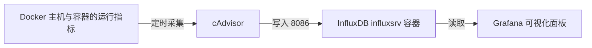

# InfluxDB：给监控数据安一个家

业务数据进 MySQL 天经地义，监控数据却是另一类东西：CPU 占用、内存用量、磁盘 IO，每隔几秒产生一条，条条带时间戳，查询总按时间段去捞。这类数据用关系型数据库存着别扭，业界为此专门做了一类时序数据库，InfluxDB 是其中最常用的一款，也是运维手里离不开的工具。

## 先给结论

- InfluxDB 是分布式时间序列数据库，主要用途是存储系统监控数据，不是业务数据库。
- 安装走容器方式：镜像 `tutum/influxdb`，映射 8083 与 8086，额外暴露 8090 与 8099，容器命名 `influxsrv`。
- 8083 是 Web 管理端口，浏览器打开管理界面，Query 框直接执行 InfluxQL 命令。
- 建库 `cadvisor`、建同名用户并授权，为 cAdvisor 的数据写入做好准备。
- `SHOW MEASUREMENTS` 查看采集到的数据表，库刚建时输出为空。

## 一、时间序列数据库特殊在哪

从名字就能看出 InfluxDB 是数据库产品，但它与 MySQL 这类关系型数据库有本质区别。**第一，数据形态不同。** 它存的每条记录天然带时间戳，按时间不断追加，典型形态就是每几秒一条的 CPU 占用率。**第二，用途定位不同。** 它一般不用于应用系统的业务开发，而是存储监控用的数据：内存有多大、CPU 占用多少、负载多高，都可以定期写进去。**第三，使用人群不同。** 它是运维常用的数据库，配合采集工具和报表工具组成监控体系。

它在后续方案里的分工一句话说清：cAdvisor 负责采集，InfluxDB 负责存储，Grafana 负责展示。本课先把存储这一环搭好。

## 二、安装：一条 docker run

安装仍然走容器方式，下载镜像、创建容器两步：

```bash
docker pull tutum/influxdb

docker run -d \
-p 8083:8083 \
-p 8086:8086 \
--expose 8090 \
--expose 8099 \
--name influxsrv \
tutum/influxdb
```

四个端口各有含义：

| 端口 | 类型 | 作用 |
|---|---|---|
| 8083 | 映射 | Web 管理端口，浏览器访问的界面 |
| 8086 | 映射 | 数据写入端口，外部程序往库里写数据走这里 |
| 8090 | 暴露 | 镜像要求暴露的端口，与集群通信相关 |
| 8099 | 暴露 | 镜像要求暴露的端口，与集群通信相关 |

`-p` 与 `--expose` 不是一回事：前者把容器端口映射到宿主机，外部能访问；后者只是在容器元数据上声明端口，供容器之间互访使用。创建成功后浏览器访问 `http://192.168.184.144:8083`，能看到 InfluxDB 的管理界面，数据库列表里已有一个默认库 `internal`。

## 三、Web 界面里的日常操作

界面上的 Query 框就是执行数据库命令的入口，旁边还配了查询模板，选 `create database` 模板后在引号里补上库名即可执行。

建库与查库：

```sql
CREATE DATABASE 'cadvisor'
SHOW DATABASES
```

执行后数据库列表里多出 `cadvisor`。接着创建用户并授权：

```sql
CREATE USER 'cadvisor' WITH PASSWORD 'cadvisor' WITH ALL PRIVILEGES
SHOW USERS
```

第一句创建用户 `cadvisor`，密码同为 `cadvisor`，并赋予全部特权；第二句查用户列表确认创建成功。更细粒度的授权用 GRANT 语句，格式是 `GRANT 权限 ON 库名 TO 用户名`：

```sql
GRANT ALL PRIVILEGES ON cadvisor TO cadvisor
GRANT WRITE ON cadvisor TO cadvisor
GRANT READ ON cadvisor TO cadvisor
```

三条分别对应授予全部权限、只授写权限、只授读权限。ON 后面是库，TO 后面是用户，课堂演示里两个名字恰好都是 `cadvisor`，写的时候别顺手颠倒。

查看采集的数据：

```sql
SHOW MEASUREMENTS
```

执行后没有任何输出。MEASUREMENT 相当于关系库里的表，库是刚建的，还没有任何数据写进来，等采集工具跑起来再查。

## 四、数据的来路与去向

本课建好的库和用户都是给 cAdvisor 铺路，监控三件套的分工如下：



cAdvisor 每隔固定间隔采集一次主机与容器的 CPU、内存等指标，通过 8086 端口写进 `cadvisor` 库，这正是建库时给用户授写权限的原因；Grafana 再以 InfluxDB 为数据源画图，读权限就够。后面两课分别把采集与展示两环补齐。

## 常见误区

- **拿它当业务数据库。** InfluxDB 面向监控类时序数据，业务系统的增删改查仍然交给关系型数据库，选型错位会在写入量与查询模式上双双吃亏。
- **8083 与 8086 记混。** 8083 给人看，8086 给程序写；cAdvisor、Grafana 连接的都是 8086。
- **GRANT 语句里库和用户写反。** 格式是 `ON 库名 TO 用户名`，两个名字相同时尤其容易顺手颠倒。
- **SHOW MEASUREMENTS 空结果当成故障。** 没有采集器写入时结果就是空的，先确认 cAdvisor 是否已经跑起来。

## 面试可能被问到的问题

1. 面试官追问：「InfluxDB 和 MySQL 最核心的区别是什么？」
   答：InfluxDB 是时间序列数据库，数据天然带时间戳、按时间追加，查询多为按时间范围聚合；MySQL 是关系型数据库，面向结构化业务数据与事务。监控指标这类持续产生的时间数据适合放时序库。

2. 面试官追问：「8083 和 8086 各是什么端口？」
   答：8083 是 Web 管理端口，浏览器打开可执行 InfluxQL 命令；8086 是数据写入端口，外部程序通过 HTTP 写数据走它，cAdvisor 与 Grafana 连接的都是 8086。

3. 面试官追问：「监控数据为什么不直接存 MySQL？」
   答：监控数据写入频率高、只增不改、按时间段聚合查询多，关系库的行存储与索引在这种负载下开销大；时序库针对时间维度做了压缩与索引优化，通常还自带数据保留策略，过期数据自动清理。

4. 面试官追问：「`WITH ALL PRIVILEGES` 和 `GRANT WRITE` 有什么区别？」
   答：前者是管理员级特权，可管理库、用户与全部数据；后者只授予指定库的写权限。按最小权限原则，采集器给写权限、展示端给读权限，只有管理用途才给全部特权。

5. 面试官追问：「SHOW MEASUREMENTS 查到的是什么？」
   答：MEASUREMENT 相当于关系库的表，一条对应一类指标。cAdvisor 写入后会出现 cpu_usage_idle、memory_usage 之类的表名，再用 SELECT 就能查具体数值。

## 配套资料

- 本课无配套源码包，镜像名、端口与全部 InfluxQL 命令取自课堂讲义实录，文中命令为按本课写法补全的可运行示例。
- 库名与用户名按课程取 `cadvisor`，与下一课 cAdvisor 的存储配置一一对应，改名时两边要同步。
