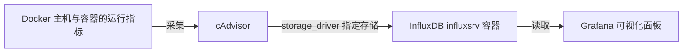

# cAdvisor：把容器运行数据采集进 InfluxDB

InfluxDB 已经就位，库里却是空的。谁来把主机的 CPU、内存以及每个容器的运行数据写进去？这一课的主角是 cAdvisor，Google 开源的容器监控工具，监控体系里的采集环节由它承担。

## 先给结论

- cAdvisor 是 Google 开源的用于监控和发现基础设施的工具，不需要任何配置，就能监控 Docker 主机上运行的所有容器，还能监控主机本身。
- 它只负责采集，数据存到哪由启动参数指定，本课指定存入 InfluxDB 的 `cadvisor` 库。
- 安装两条命令：拉取 `google/cadvisor` 镜像，`docker run` 创建容器；长命令里重点看 `--link` 与 `storage_driver` 两段。
- Web 界面开在 8080 端口，仪表盘实时展示 CPU、内存等指标。
- 验收看 InfluxDB：执行 `SHOW MEASUREMENTS`，出现 `cpu_usage_idle`、`memory_usage` 等一批表即采集成功。

## 一、它在监控体系里的位置

cAdvisor 的官方定位是监控和发现基础设施。它以容器方式跑在 Docker 主机上，不需要任何配置，通过挂载的系统目录就能读到这台主机上所有容器的运行数据，主机本身的资源占用也在监控范围之内。更多详细操作和配置选项可以查阅 GitHub 上的 cAdvisor 项目文档。

它的分工非常克制：只采集，不长期存储，数据落到哪里由启动参数告诉它。整套数据流如下：



本课要把 cAdvisor 这一格接上：容器跑起来，数据自动写进上一课准备好的 `cadvisor` 库。

它能拿到的指标维度也值得先有个概览：CPU 使用率与各态时间、内存占用与工作集、文件系统读写、网络的收发字节与错误数，每个容器单独一份，主机本身再汇总一份。采集按固定周期自动进行，业务代码完全不用埋点，这是它开箱即用的底气所在。

## 二、安装：长命令里只需要关心两段

```bash
docker pull google/cadvisor

docker run \
--volume=/:/rootfs:ro \
--volume=/var/run:/var/run:rw \
--volume=/sys:/sys:ro \
--volume=/var/lib/docker/:/var/lib/docker:ro \
--publish=8080:8080 \
--detach=true \
--link influxsrv:influxsrv \
--name=cadvisor \
google/cadvisor \
storage_driver=influxdb \
storage_driver_db=cadvisor \
storage_driver_host=influxsrv:8086
```

命令很长，拆开看只有两处是将来换环境时真正要动的地方。

**第一处是连接 InfluxDB 的三个 storage_driver 参数。** `storage_driver` 指定存储驱动为 influxdb，`storage_driver_db` 指定库名为上一课创建的 `cadvisor`，`storage_driver_host` 指定 InfluxDB 的地址与端口。配合 `--link influxsrv:influxsrv`：它把前面创建的 `influxsrv` 容器接入本容器，命令里才能用这个名称解析到对方。换环境要改的就是这几个名字。

**第二处是挂载与端口的写法习惯。** `--volume` 等价于常用的 `-v`，把宿主机的根目录、`/sys`、`/var/lib/docker` 等目录以只读方式挂进容器，cAdvisor 读的就是这些目录里的系统与容器信息；`--publish` 等价于 `-p`，把容器 8080 映射到宿主机 8080。只是写法换了个样子，含义没有变。

容器启动后采集立即开始，不需要任何额外触发。

## 三、Web 界面：先看实时数据

浏览器访问 `http://192.168.184.144:8080`，cAdvisor 自带一个 Web 界面。顶部是一排仪表，CPU、内存等实时数值一目了然；往下是 CPU 动态曲线、错误率、文件系统使用情况等图表，主机与每个容器的数据分开展示。这个界面适合临时排查，盯一眼就知道资源占用；要做成报表、留成历史曲线，还得靠下一课的 Grafana。

自带界面还有个天然短板：数据只在内存里留一小段，看不到更早的历史记录，也没法做多主机汇总展示。把它定位成「现场快照」就好，长期监控交给 Grafana 去 InfluxDB 里查历史数据，各干各的活。

## 四、回 InfluxDB 验收数据

切回 InfluxDB 的管理界面，切换到 `cadvisor` 库，再执行上一课那句 `SHOW MEASUREMENTS`，这次有输出了：

```text
cpu_usage_idle
cpu_usage_system
cpu_usage_total
cpu_usage_user
fs_limit
fs_usage
load_average
memory_usage
memory_working_set
rx_bytes
tx_bytes
tx_errors
rx_errors
```

这些表名就是 cAdvisor 采集到的指标清单：`cpu_usage_idle` 是 CPU 空闲率，`memory_usage` 是内存占用量，`rx_bytes`、`tx_bytes` 是网络收发字节数。想看具体数值，用 SELECT 查任意一张表（示例按本课写法补全）：

```sql
SELECT * FROM memory_usage LIMIT 5
```

每条记录都带着时间戳，说明数据已经在持续落库。至此采集与存储两环打通，只差把数据画出来。

## 常见误区

- **以为 cAdvisor 自己存历史数据。** 它默认只在内存里保留很短时间的数据供界面展示，持久化必须靠 `storage_driver` 参数指向 InfluxDB 这类后端，不配的话重启即丢。
- **`--link` 的目标写错。** 它指向的是前面创建的 InfluxDB 容器名 `influxsrv`，名字对不上，容器直接起不来。
- **漏挂宿主机目录。** `/sys`、`/var/lib/docker` 不挂进去，cAdvisor 读不到内核与容器的底层信息，界面里会大面积空白。
- **8080 端口冲突。** 宿主机 8080 被占时换个宿主机端口即可，如 `--publish=8081:8080`，Web 界面跟着换地址访问。

## 面试可能被问到的问题

1. 面试官追问：「cAdvisor 是什么，解决什么问题？」
   答：Google 开源的容器监控工具，以容器方式运行在 Docker 主机上，采集主机与所有容器的 CPU、内存、文件系统、网络等运行指标，解决「容器里跑着的服务资源状况怎么看」的问题。

2. 面试官追问：「为什么说它不需要任何配置就能监控？」
   答：它通过挂载 `/sys`、`/var/lib/docker` 等只读目录，直接读取内核与 Docker 暴露的运行信息，自动发现主机上的全部容器，被监控对象侧不需要安装任何东西。

3. 面试官追问：「采集到的数据怎么持久化？」
   答：cAdvisor 支持 InfluxDB 等多种存储后端，通过 `storage_driver` 系列参数指定驱动、库名与地址。本课方案里它把数据实时写入 InfluxDB 的 cadvisor 库，Grafana 再从库里读数出图。

4. 面试官追问：「`--link` 参数的作用是什么？」
   答：把另一个容器接入本容器，建立容器名到对方地址的解析关系，同时隐含启动顺序依赖。本课里 cAdvisor 靠它解析 influxsrv，如今更推荐用自定义网络替代。

5. 面试官追问：「`cpu_usage_idle` 为什么是重点指标？」
   答：它表示 CPU 空闲时间占比，数值越低说明 CPU 越忙。监控里常用 100 减去它得到使用率，Grafana 画图时同样基于这类基础指标做计算。

## 配套资料

- 本课无配套源码包，镜像与 `docker run` 参数、指标表名取自课堂讲义实录，文中命令为按本课写法补全的可运行示例。
- 存储目标 `cadvisor` 库与同名用户的创建命令见「InfluxDB」一篇；可视化展示见「Grafana」一篇。
