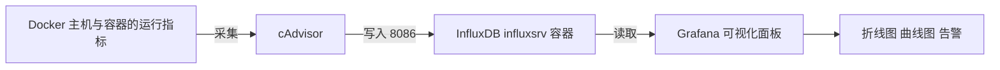

# Grafana：把零散的监控数据画成仪表盘

监控数据已经躺在 InfluxDB 里了，可它是一行行带时间戳的数值，想看趋势得一条条查。运维真正想要的是折线图、曲线图，把每个节点的数据穿起来，一眼看出负载走势。补上这块拼图的是 Grafana，一套可视化面板工具，也是这套监控方案的展示层。

## 先给结论

- Grafana 是可视化面板（Dashboard）工具，图表漂亮、度量仪表盘功能齐全，支持 Graphite、zabbix、InfluxDB、Prometheus、OpenTSDB 作为数据源。
- 安装：镜像 `grafana/grafana`，容器内 3000 端口映射到宿主机 3001。
- 创建容器时用 `INFLUXDB_` 开头的一组环境变量预置数据源连接信息，启动即连上 InfluxDB。
- 默认账号与密码均为 admin，首次登录强制修改。
- 主界面左侧菜单四块功能：创建、仪表盘管理、告警管理、配置（数据源、用户、插件）。

## 一、监控三件套的最后一块

采集（cAdvisor）与存储（InfluxDB）已经打通，缺的是把数字变成图。三件套的分工：



Grafana 从 InfluxDB 这类数据库里读数据，按配置画成图表。它本身不存监控数据，只做展示，这是理解它配置方式的关键：所有配置都围绕「数据源在哪、画什么、怎么排」三件事。

## 二、安装：环境变量把数据源一次配好

```bash
docker pull grafana/grafana

docker run -d \
-p 3001:3000 \
-e INFLUXDB_HOST=192.168.184.144 \
-e INFLUXDB_PORT=8086 \
-e INFLUXDB_NAME=cadvisor \
-e INFLUXDB_USER=cadvisor \
-e INFLUXDB_PASS=cadvisor \
--link influxsrv:influxsrv \
--name grafana \
grafana/grafana
```

容器内 Grafana 服务监听 3000，映射为宿主机 3001。关键是那组环境变量，它们完整描述了数据源的连接方式：

| 环境变量 | 取值 | 含义 |
|---|---|---|
| `INFLUXDB_HOST` | `192.168.184.144` | InfluxDB 所在主机 |
| `INFLUXDB_PORT` | `8086` | 数据写入端口 |
| `INFLUXDB_NAME` | `cadvisor` | 数据库名 |
| `INFLUXDB_USER` / `INFLUXDB_PASS` | `cadvisor` / `cadvisor` | 连接用户与密码 |

取值与前面两课严格对应：库和用户是 InfluxDB 一课创建的 `cadvisor`，端口是数据写入端口 8086。`--link` 把 `influxsrv` 容器接入，容器名可直接解析；数据源连接实际走的是宿主机 IP 加映射端口，两条路都通。

## 三、登录与主界面

浏览器访问 `http://192.168.184.144:3001`，进入登录页，输入用户名 admin、密码 admin，系统随即要求修改密码，设一个新密码保存后进入主界面。

主界面左侧自上而下四个功能区：最上面的加号代表创建，可以新建仪表盘和数据源；第二个是仪表盘管理，Grafana 最核心的功能都在这里；第三个是告警管理，可以按指标设置告警规则；再往下是配置区，管理数据源、用户与插件。日常操作基本都从左侧这一列出发。

进主界面后不妨先打开系统自带的演示面板，对照着感受「一个面板就是一个查询」的组成方式：左上是图例与当前值，中部是曲线，底部是查询语句。之后自己建面板时照葫芦画瓢，上手会快很多。

## 四、数据源与仪表盘怎么连起来

环境变量方式的好处是省一步：启动时自动把 InfluxDB 注册为数据源，Add data source 里能看到现成的配置。要补充的是，这套环境变量是旧版镜像提供的便捷功能，新版 Grafana 不再靠它，需要在界面里手动添加：类型选 InfluxDB，地址填宿主机 IP 加 8086，库名、用户名、密码照 InfluxDB 一课的填。

数据源就位后新建仪表盘，在面板里写 InfluxQL 选数据、选图表类型，一张 CPU 折线图就出来了。面板查询的典型样子如下（示例为主流写法补全，课堂在下一课展开常用操作）：

```sql
SELECT mean("cpu_usage_idle") FROM "cpu" WHERE $timeFilter GROUP BY time($__interval)
```

`$timeFilter` 由 Grafana 按右上角时间范围自动替换，`GROUP BY time($__interval)` 控制折线每个点聚合多长时间的数据。至此采集、存储、展示三环全部打通。

折线出图只是起点，Grafana 的价值还在于组合：把 CPU、内存、网络各放一个面板排成一页，就是一张主机监控大盘；再配上右上角的时间范围选择与自动刷新，排障时切换时间段对比负载走势非常顺手。

## 常见误区

- **3000 与 3001 混用。** 3000 是容器内端口，浏览器访问的是映射出来的宿主机端口 3001，地址写 3000 会连接失败。
- **以为 admin/admin 就是最终密码。** 首次登录会强制修改密码，改完要记牢，忘了只能进容器重置。
- **新版镜像下环境变量不生效就慌。** `INFLUXDB_` 自动配置是旧版镜像的功能，新版在界面手动 Add data source 即可，连接参数完全一样。
- **数据源连不上只盯着 Grafana 排查。** 先用 8086 端口确认 InfluxDB 服务在跑、库和用户存在、密码正确，多数故障出在数据源侧而不是 Grafana 侧。

## 面试可能被问到的问题

1. 面试官追问：「Grafana 和 InfluxDB 是什么关系？」
   答：分工不同。InfluxDB 是时序数据库，负责存监控数据；Grafana 是可视化面板，以 InfluxDB 为数据源读取数据并画成图表。Grafana 自身不存监控数据。

2. 面试官追问：「Grafana 支持哪些数据源？」
   答：支持 Graphite、zabbix、InfluxDB、Prometheus、OpenTSDB 等多种数据源，并通过插件机制继续扩展。这也是它流行的原因之一：存储层换什么，展示层可以不动。

3. 面试官追问：「创建容器时传一组 INFLUXDB_ 环境变量是做什么的？」
   答：让 Grafana 启动时自动完成数据源注册，省去界面手动配置。host、port、库名、用户名密码分别对应数据源连接的要素，取值必须与 InfluxDB 侧创建的库和用户一致。

4. 面试官追问：「监控三件套各自的职责是什么？」
   答：cAdvisor 采集主机与容器的运行指标，InfluxDB 做时序存储，Grafana 做可视化展示与告警。采集、存储、展示解耦之后，任何一环都能独立替换。

5. 面试官追问：「首次登录 Grafana 要注意什么？」
   答：默认账号密码都是 admin，登录后系统强制修改密码。生产环境应及时改掉默认口令，否则任何能访问该端口的人都能进控制台。

## 配套资料

- 本课无配套源码包，镜像名、端口映射与环境变量取自课堂讲义实录，文中命令为按本课写法补全的可运行示例；第四节的面板查询语句为主流写法示例。
- 库名与用户对应「InfluxDB」一篇创建的 `cadvisor`，指标含义见「cAdvisor」一篇。
