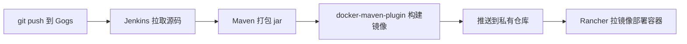
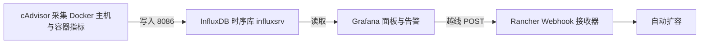
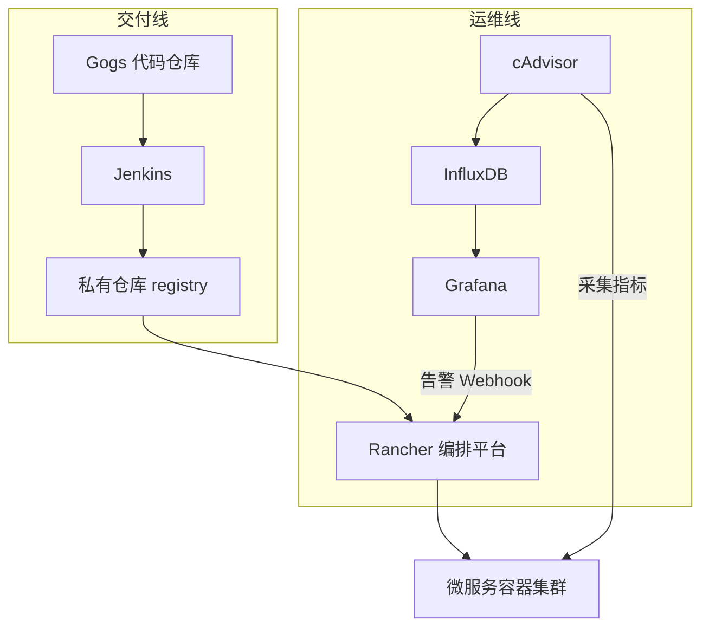

# 持续集成与容器管理收尾：两条主线串起六个工具

这一章的名词密度是全阶段最高的：Docker Maven 插件、Jenkins、Rancher、InfluxDB、cAdvisor、Grafana。单个工具都会用了，但实战与面试考的是把它们串起来：一条交付线把一行代码变成跑着的容器，一条运维线让集群自己看住自己。收尾把全章重新走一遍，把散落各课的命令与配置接回原位。

## 先给结论

- 交付线：git push 到 Gogs → Jenkins 拉代码、调用本机 JDK 与 Maven 执行 `clean package docker:build -DpushImage` → docker-maven-plugin 按 pom 配置构建镜像并推到私有仓库 → Rancher 从仓库拉镜像部署成容器。
- 运维线：cAdvisor 采集主机与容器指标写进 InfluxDB → Grafana 读库画面板 → 告警越线触发 Webhook → Rancher 自动扩容。
- 持续集成两个收益：随时产生最新的可测版本；集成之后尽早暴露问题。
- Rancher 是基于 Docker 的图形化容器管理平台，额外提供负载均衡、扩容缩容这些编排能力。
- 监控三件套职责一句话：cAdvisor 负责写，InfluxDB 负责存，Grafana 负责读。

## 一、交付线：从 push 到容器

**docker-maven-plugin 解决「代码怎么变镜像」。** 在微服务工程的 pom 里声明插件，镜像名、基础镜像、启动命令一次配死：

```xml
<build>
    <finalName>${project.artifactId}</finalName>
    <plugins>
        <plugin>
            <groupId>org.springframework.boot</groupId>
            <artifactId>spring-boot-maven-plugin</artifactId>
        </plugin>
        <!-- docker-maven-plugin：构建镜像并打上私有仓库地址前缀 -->
        <plugin>
            <groupId>com.spotify</groupId>
            <artifactId>docker-maven-plugin</artifactId>
            <version>0.4.15</version>
            <configuration>
                <imageName>192.168.184.141:5000/${project.artifactId}:${project.version}</imageName>
                <baseImage>jdk1.8</baseImage>
                <entryPoint>["java", "-jar", "${project.build.finalName}.jar"]</entryPoint>
                <resources>
                    <resource>
                        <targetPath>/</targetPath>
                        <directory>${project.build.directory}</directory>
                        <include>${project.build.finalName}.jar</include>
                    </resource>
                </resources>
            </configuration>
        </plugin>
    </plugins>
</build>
```

`imageName` 带上私有仓库地址 `192.168.184.141:5000`，push 时镜像才能落进仓库；`baseImage` 选 `jdk1.8`，容器里直接跑 jar。前提是宿主机 Docker 开了远程访问：改 `/lib/systemd/system/docker.service`，然后 `systemctl daemon-reload` 加 `systemctl restart docker`，插件才能把构建请求发到那台机器上。

**Jenkins 解决「谁来天天跑这套构建」。** 持续集成的含义是经常性地把软件自动部署到测试环境，产生可测版本。Jenkins 任务配三件事：Git 仓库地址与凭证（从 Gogs 拉源码）、Root POM 指到子模块的 pom、构建命令 `clean package docker:build -DpushImage`。Jenkins 调用本机 JDK 与 Maven 完成「编译、打包、做镜像、推仓库」四步，构建一成功，私有仓库里就是最新的镜像。

**私有仓库是交付线的枢纽。** `docker run -d --name=registry -p 5000:5000 registry` 起仓库，Docker 侧在 `/etc/docker/daemon.json` 配 `{"insecure-registries":["192.168.184.141:5000"]}` 允许 HTTP 推送。Rancher 部署服务时按 `192.168.184.141:5000/base-service:1.0-SNAPSHOT` 这样的地址拉镜像。整条交付线：



## 二、编排线：Rancher 把容器管起来

Jenkins 只管「造出镜像」，镜像怎么变成一组容器、怎么组成集群，交给 Rancher。它基于 Docker 提供图形化管理界面，安装两步：

```bash
docker pull rancher/server
docker run -d --name=rancher -p 9090:8080 rancher/server
```

初始化三连：添加环境 → 添加主机 → 添加应用。应用里再建服务，中间件与业务微服务都在图形界面里构建：MySQL、RabbitMQ、Redis，以及自己的 `base-service` 等，镜像地址填私有仓库的，端口映射与环境变量按需填。

Rancher 两个最实用的编排能力值得单独记：

**扩容与缩容。** 服务去掉端口映射后，扩容就是横向加容器：界面上点，或者建 Webhook 接收器（动作、目标服务、步长、最小最大数量）用 POST 触发。步长 2、副本从 1 涨到 3 的那套操作，是这一章动手最完整的一课。

**负载均衡器。** 容器多了之后对外入口保持唯一：负载均衡器把请求分发到后面所有实例，容器数量增减不影响访问地址，这正是弹性伸缩的结构前提。

## 三、运维线：监控三件套与告警闭环

InfluxDB、cAdvisor、Grafana、Rancher 四个软件在一条数据管道上：



**InfluxDB 是时序数据库**，专存带时间戳的指标数据：`docker pull tutum/influxdb`，`docker run -d -p 8083:8083 -p 8086:8086` 起容器，建 `cadvisor` 库与同名用户。

**cAdvisor 是采集器**：`google/cadvisor` 镜像，挂载 `/var/run/docker.sock` 与 `/var/lib/docker`，`--link` 连上 InfluxDB 容器，把主机与每个容器的 CPU、内存等指标持续写进 `cadvisor` 库。它自带 8080 网页看实时值，但存历史、画趋势要靠后两环。

**Grafana 是展示与告警层**：读 InfluxDB 画面板（基础微服务-内存监控那张曲线），再配 Webhook 通知渠道与告警规则，越线自动 POST Rancher 扩容。

到这一步，两条线在 Webhook 处会师：交付线造出的服务，运维线看得见、护得住。整套体系的骨架一张图收拢：



## 常见误区

- **把三个管理类工具的职责搅在一起。** Docker 是容器运行时，管单机容器；Jenkins 管从代码到镜像的构建流水；Rancher 管容器的编排、扩缩与负载均衡。Jenkins 不管运行时拓扑，Rancher 不管编译打包。
- **把监控三件套当成三个独立软件。** 它们是写、存、读三段，拆掉任何一段链路都断；配置时库名、用户、端口必须三边一致。
- **忽略 insecure-registries。** 私有仓库走 HTTP，Docker 不配 `{"insecure-registries":[...]}` 就推不上也拉不下，报错看起来像网络问题，其实是协议被拒。
- **以为持续集成等于装个 Jenkins。** Jenkins 只是执行器，持续集成是实践：代码频繁合入、每次合入自动构建出可测版本、问题尽早暴露。插件配置与镜像推送缺了，流水线只剩空壳。

## 面试可能被问到的问题

1. 面试官追问：「什么是持续集成，它带来什么好处？」
   答：开发过程中经常性地把软件自动构建并部署到测试环境，产生可测版本。好处两个：随时有最新的可测版本供验证；集成之后问题尽早暴露，修复代价小。工具链依赖代码仓库、构建工具与 CI 服务器。

2. 面试官追问：「docker-maven-plugin 在流水线里做了什么？」
   答：把镜像构建挂进 Maven 生命周期。按 pom 里配置的 imageName（带私有仓库地址）、baseImage、entryPoint，把 package 打出的 jar 做成镜像，配合 -DpushImage 直接推送仓库。宿主机 Docker 需开放远程访问，插件才能下发构建请求。

3. 面试官追问：「Rancher 和 Docker 是什么关系？」
   答：Docker 是容器运行时，负责单机上创建和运行容器；Rancher 基于 Docker 做图形化管理层，管多主机环境、应用与服务的编排，额外提供负载均衡与扩容缩容。分工上 Jenkins 产镜像，Rancher 用镜像。

4. 面试官追问：「监控三件套的数据流是怎么走的？」
   答：cAdvisor 挂载 docker.sock 采集主机与容器指标，写入 InfluxDB 的 cadvisor 库；Grafana 以 InfluxDB 为数据源读数画面板；告警规则越线后经 Webhook 渠道 POST 到 Rancher 接收器触发扩容。写、存、读、联动四段。

5. 面试官追问：「Webhook 触发扩容的完整链路是什么？」
   答：Grafana 按 60 秒窗口算指标平均值，越过阈值触发告警，向通知渠道配置的 URL 发 POST；该 URL 是 Rancher 的 Webhook 接收器，绑定了扩容动作、目标服务与步长；Rancher 收到请求即按步长增加容器，受最小最大数量约束。

6. 面试官追问：「这套方案上线前你会补什么？」
   答：至少三件事：告警阈值按真实量纲重新标定；Send Test 与扩缩接收器加访问控制，防止误触发与恶意调用；持续集成任务加构建结果通知与失败处理，坏镜像不部署进环境。

## 配套资料

- 本章节无配套源码包，pom 配置、安装命令与接收器参数取自课堂讲义实录，示例为按本课写法补全（镜像名与项目名已换成中性写法）。
- 各工具的分课展开见本章节前面各篇：插件与 Jenkins 任务、Rancher 初始化与扩缩容、监控三件套、仪表盘与告警。
- 平台内建自动扩缩容的后续路线可对照 `materials/code/01/6.k8s-基础/k8s-基础/代码/demo4-hpa.yaml`。
