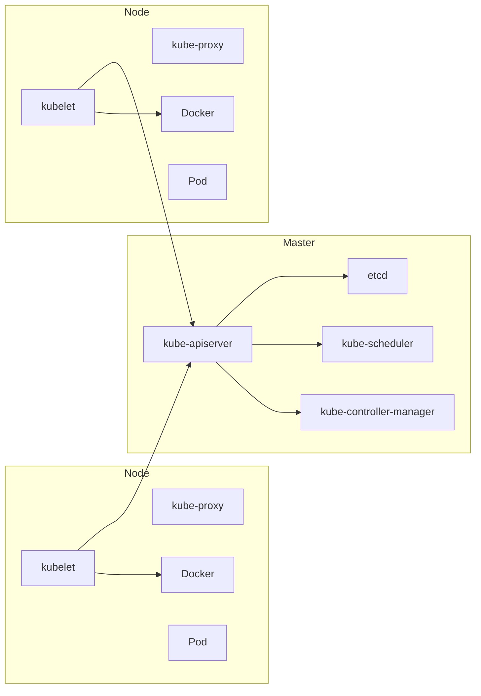
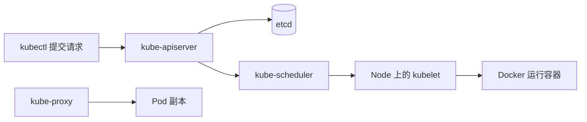
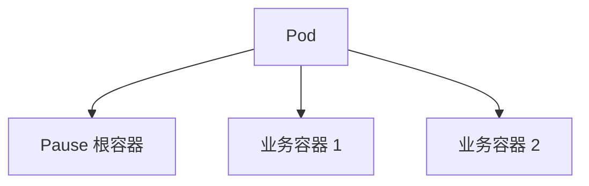

# Kubernetes 从集群搭建到核心概念（21 节合并版）

手工部署一套服务时，你要登录每一台机器，拉镜像、写启动命令、配端口映射，挂了还得自己爬起来重启；服务一多，副本数一变，这套动作就会重复到让人怀疑人生。Kubernetes（下文按行业习惯简称 K8s）要解决的就是这件事：你只需要声明「我要 3 个 nginx 副本、对外暴露 33333 端口」，剩下拉镜像、调度、重启、扩缩容全部由它完成。

这一篇把 K8s 入门阶段的 21 节内容完整合并：先认识 K8s，再跑通一个单机快速入门案例，弄清基本架构与术语，然后用二进制包把一主两节的真正集群搭起来，做健康检查与 nginx 部署测试，最后进入核心技术 Pod 的定义、分类、生命周期与资源配置。全部命令与配置文件都来自课堂真实操作，可以直接照着做。

> ⚠ **时效性警示**：这一篇依据课程录制年代的 Kubernetes（约 1.5）部署方式编写（yum 二进制 + KUBE_ADMISSION_CONTROL + pod-infrastructure + ReplicationController）。现代生产环境请使用 kubeadm / Kind / Minikube 或云托管 K8s，工作负载以 Deployment + Service 为标准形态。文末附有新旧部署对照。

## 先给结论

- K8s 是 Google 在 2014 年开源的容器编排系统，与 Docker 配合使用：Docker 负责把容器真正跑起来，K8s 负责自动化部署、扩展、自我修复、服务发现与负载均衡，保证云平台中的容器按用户期望运行。
- 集群由 Master 和 Node 两类角色组成：Master 是大脑，负责调度决策，运行 kube-apiserver、kube-scheduler、kube-controller-manager、etcd；Node 才是真正干活的，运行 kubelet、kube-proxy 和 Docker。
- Pod 是 K8s 的最小调度单元，每个 Pod 里有一个特殊的 Pause 根容器加一个或多个业务容器；Replication Controller（RC）声明期望副本数并自动补齐；Service 提供访问一组 Pod 的稳定入口和负载均衡。
- 用二进制包搭集群的主线是：Master 侧依次部署 etcd、kube-apiserver、kube-controller-manager、kube-scheduler 并用 systemd 管理，Node 侧部署 kubelet、kube-proxy 与 Docker；每个服务启动后都要 `systemctl status` 确认 active（running）。
- 入门阶段的坑集中在四处：Docker 起不来改 SELinux；`kubectl get pods` 提示 No resources found 要去掉 apiserver 配置里的 ServiceAccount；镜像拉不下来要搭 Docker 私有仓库并改 kubelet 的 pod-infra 容器镜像参数；YAML 缩进和冒号后的空格不能错。

## 第1部分：Kubernetes介绍

### Kubernetes 是什么

K8s 是 Google 在 2014 年发布的一个开源项目，用于自动化容器应用的部署、扩展和管理。名字里的 K 和 S 中间隔着 8 个英文字母，所以简称为 K8s。它通常与 Docker 容器配合工作，帮助整合多个运行 Docker 容器的主机集群，目标是让容器化应用的部署简单高效。官网地址是 `https://kubernetes.io/`，中文社区是 `https://www.kubernetes.org/docs`，官网可以切换中英文，核心特性列表就直接放在首页的「Kubernetes 特性」页面上。

它的核心特点是能够自主地管理容器，保证云平台中的容器按照用户的期望去运行。官网上列出的特性包括这几项：

- 自动包装（自动装箱）
- 自我修复
- 横向缩放
- 服务发现和负载均衡
- 自动部署和回滚
- 密钥和配置管理
- 存储编排
- 批处理

### 使用 K8s 能做什么

K8s 可以看作一个全新的、基于容器技术的分布式架构领先方案，它是一个开放平台，具有无侵入性，现有系统很容易迁移上去。它也是一个完备的分布式系统支撑平台，可以在物理机或虚拟机组成的 K8s 集群上运行容器化应用，并提供以容器为中心的基础架构，满足生产环境和开发环境的需求。具体能做的事包括：

- 多个进程协同工作
- 存储系统挂载
- 分发 secrets（敏感配置的下发）
- 应用镜像的复制
- Pod 自动伸缩
- 负载均衡
- 滚动更新
- 资源监控
- 日志访问
- 调试应用程序
- 服务认证授权

### 为什么要用 K8s

**第一，可以轻装上阵开发复杂系统。** 运维层面的部署、扩容、监控都交给平台，开发团队把精力放在业务上。

**第二，全面拥抱微服务。** 微服务的核心是把一个巨大的单体应用拆分为很多小的、互相连接的微服务，一个微服务还可以有多个副本，副本数量随系统负载变化动态调整。系统越大，需要管理和监控的副本就越多，K8s 正好接管了这部分工作，让开发更简单。

**第三，动态扩容与横向扩展能力。** K8s 可以帮助应用动态扩容，系统本身具有超强的横向扩容能力，这也是要学习和熟悉它的基本原因。

## 第2部分：Kubernetes快速入门

### 三步走：环境准备、配置、测试

快速入门案例分三步：环境准备（关防火墙、安装 etcd 与 K8s 软件、启动相关服务）、配置（用 K8s 部署一个 Tomcat）、测试。配置环节涉及两个文件：Tomcat 的 ReplicationController 配置文件和 Tomcat 的 Service（svc）配置文件，前者帮助建立应用，后者做服务的访问控制。

### 环境准备

在 CentOS 7 上按讲义执行：

```bash
systemctl disable firewalld
systemctl stop firewalld
yum install -y etcd kubernetes
systemctl start etcd
systemctl start docker
```

课件原文把服务名简写成 firewall，实际服务名是 firewalld。安装前建议先执行一次 `yum update`，保证 yum 是最新版本再安装；安装 etcd 与 kubernetes 的过程中会顺带把 Docker 装上。每启动一个服务，都用 `systemctl status etcd` 这类命令确认状态是 active（running）。

**Docker 启动失败的处理。** 这一步很容易出问题：启动 Docker 显示失败时，修改 SELinux 配置文件，把 selinux 后面的值改为 disabled，保存后重启机器，再启动 Docker 就可以了：

```bash
vi /etc/sysconfig/selinux
# SELINUX=disabled
reboot
systemctl start docker
```

之后把 K8s 相关服务全部启动：kube-apiserver、kube-controller-manager、kube-scheduler、kubelet、kube-proxy，每起一个就 status 检查一次。

### 两份 YAML：RC 与 Service

在 `/usr/local` 下创建一个 `kubernetes` 目录，进入后新建两个 YAML 文件。YAML 文件写的时候要注意它的语法特点：冒号后面一定要有空格。第一个是 `mytomcat-rc.yaml`，定义一个 ReplicationController，声明副本数为 2：

```yaml
apiVersion: v1
kind: ReplicationController
metadata:
  name: mytomcat
spec:
  replicas: 2
  selector:
    app: mytomcat
  template:
    metadata:
      labels:
        app: mytomcat
    spec:
      containers:
        - name: mytomcat
          image: tomcat:7-jre7
          ports:
            - containerPort: 8080
```

文件里配置了使用的镜像（Tomcat 镜像）和副本数量，template 部分是 Pod 模板。第二个是 `mytomcat-svc.yaml`，定义 Service，配置服务对外的暴露端口：

```yaml
apiVersion: v1
kind: Service
metadata:
  name: mytomcat
spec:
  type: NodePort
  ports:
    - port: 8080
      nodePort: 30000
  selector:
    app: mytomcat
```

类型是 NodePort，容器内部端口 8080 映射到节点上对外暴露的 30000 端口，访问时走的是 nodePort。

### 创建资源与第一个坑

创建 RC 和 Service：

```bash
kubectl create -f mytomcat-rc.yaml
kubectl create -f mytomcat-svc.yaml
kubectl get svc
```

执行后提示 replication controller「mytomcat」created，Service 也创建成功，`kubectl get svc` 能看到名为 mytomcat 的 Service。但此时执行 `kubectl get pods` 会拿到 `no resource found`，看不到任何 Pod。

**解决办法：** 编辑 apiserver 的配置文件，找到 `KUBE_ADMISSION_CONTROL` 这一项，把其中的 ServiceAccount 值删掉，保存后重启 apiserver 服务：

```bash
vi /etc/kubernetes/apiserver
# KUBE_ADMISSION_CONTROL 中去掉 ServiceAccount
systemctl restart kube-apiserver
kubectl get pods
```

重启后就能看到两个 mytomcat 的 Pod。为什么是两个？因为 RC 配置文件里 replicas 定义为 2，它就会帮你创建两个。

## 第3部分：Kubernetes环境搭建常见问题解决

### 问题一：docker pull 失败

根本原因是网络：国内访问国外镜像仓库会被屏蔽，Docker 拉镜像会失败。解决思路是把需要的镜像先想办法下载下来，推送到自己的本地私有仓库，再让 kubelet 从私有仓库拉取。讲义给了两种方案。

**方案一（换可用的 infra 镜像源）：**

```bash
yum install -y rhsm
docker pull registry.access.redhat.com/rhel7/pod-infrastructure:latest
# 如果上面拉不动，再搜索可用的镜像并转到自己的仓库
docker search pod-infrastructure
docker pull docker.io/tanyej/pod-infrastructure
docker tag tanyej/pod-infrastructure 192.168.126.143:5000/pod-infrastructure
docker push 192.168.126.143:5000/pod-infrastructure
```

然后修改 kubelet 配置文件里 pod-infra 容器镜像的指向：

```bash
vi /etc/kubernetes/kubelet
```

```ini
KUBELET_POD_INFRA_CONTAINER="--pod-infra-container-image=192.168.126.143:5000/pod-infrastructure:latest"
```

改完重启相关服务：

```bash
systemctl restart kube-apiserver
systemctl restart kube-controller-manager
systemctl restart kube-scheduler
systemctl restart kubelet
systemctl restart kube-proxy
```

**方案二（用 pause 镜像替代 infra 镜像）：**

```bash
docker pull kubernetes/pause
docker tag docker.io/kubernetes/pause:latest 192.168.126.143:5000/google_containers/pause-amd64:3.0
docker push 192.168.126.143:5000/google_containers/pause-amd64:3.0
vi /etc/kubernetes/kubelet
```

```ini
KUBELET_ARGS="--pod-infra-container-image=192.168.126.143:5000/google_containers/pause-amd64:3.0"
systemctl restart kubelet
```

两种做法本质相同：把网上拉不下来的镜像在本地重新下载一遍，并让 kubelet 指向它。改完后 `kubectl get pods`，Pod 会先处于 ContainerCreating 状态，稍等一会儿就变成 Running。

### 问题二：外网不能访问

Pod 起来之后浏览器访问不了，需要修改 `/etc/sysctl.conf`，在文件末尾加一行开启转发：

```bash
vim /etc/sysctl.conf
```

```ini
net.ipv4.ip_forward=1
```

这一行帮系统做自动跳转，配好之后浏览器就能访问了。

### 问题三：get pods 拿不到数据

与快速入门部分相同：编辑 `/etc/kubernetes/apiserver`，在 `KUBE_ADMISSION_CONTROL` 里去掉 ServiceAccount，然后 `systemctl restart kube-apiserver`。

### 重建资源完成验证

如果访问仍有问题，可以把资源删掉重建一遍：

```bash
kubectl replace -f mytomcat-rc.yaml
kubectl delete svc --all
kubectl create -f mytomcat-svc.yaml
```

之后浏览器访问节点的 8080 端口（如 `http://192.168.126.144:8080`），就能看到 Tomcat 8.5.33 的欢迎页面。要强调的是：虽然整个过程在一台机器上操作，但这台机器既是 master 也是 node；快速入门案例里出现的 master、node、kubelet 等概念，正是后面要展开的内容。案例中 replicas 写 2 就相当于建立两个 Pod，把 replicas 调大就是在扩容。

## 第4部分：Kubernetes基本架构与常用术语

### 集群架构总览

K8s 集群包含节点代理（kubelet、kube-proxy）和 Master，一切基于分布式存储系统（etcd）。架构图把服务分成两类：运行在工作节点（node）上的服务，和组成集群级别控制平面的服务（master）。所有 node 都受 master 控制，每个 node 上都要运行 Docker，由 Docker 负责具体镜像的下载和运行。



这张图在讲请求与控制的双向路径：apiserver 是唯一入口，状态落到 etcd；Node 上的 kubelet 与 apiserver 保持交互，真正驱动 Docker 运行容器。关键路径是：任何操作都从 apiserver 走，任何容器都由 Node 上的 Docker 承载。

### 核心组件

- etcd：保存整个集群的状态。
- kube-apiserver：提供资源操作的唯一入口，并提供认证、授权、访问控制、API 注册和发现等机制。
- kube-controller-manager：负责维护集群的状态，比如故障检测、自动扩展、滚动更新等。
- kube-scheduler：负责资源的调度，按照预定的调度策略将 Pod 调度到相应的机器上。
- kubelet：负责维护容器的生命周期，同时负责 Volume（CVI）和网络（CNI）的管理。
- Container runtime：负责镜像管理以及 Pod 和容器的真正运行（CRI）。
- kube-proxy：负责为 Service 提供 cluster 内部的服务发现和负载均衡。

除这些核心组件外还有一些推荐组件，会在高级课程里展开。

### 分层架构

K8s 的设计理念和功能类似 Linux 的分层架构：

- 核心层：K8s 最核心的功能，对外提供 API 构建高层的应用，对内提供插件式的应用执行环境。
- 应用层：部署（无状态应用、有状态应用、批处理任务、集群应用等）和路由（服务发现、DNS 解析等）。
- 管理层：系统度量（基础设施、容器和网络的度量）、自动化（自动扩展、动态 Provision）以及策略管理（RBAC、Quota、PSP、NetworkPolicy 等）。
- 接口层：kubectl 命令行工具、客户端 SDK 以及集群联邦。
- 生态系统：在接口层之上的庞大容器集群管理调度生态，分为两个范畴。K8s 外部：日志、监控、配置管理、CI、CD、Workflow、FaaS、ChatOps 等；K8s 内部：CRI、CNI、CVI、镜像仓库、Cloud Provider、集群自身的配置和管理等。

### Cluster、Master 与 Node

**Cluster（集群）** 是计算、存储和网络资源的集合，K8s 利用这些资源运行各种基于容器的应用；整个集群由 master 和 node 组成。

**Master** 主要职责是调度，即决定将应用放在哪运行。它运行 Linux 系统，可以是物理机或虚拟机，是整个 cluster 的大脑，运行着这些 daemon 服务：kube-apiserver、kube-scheduler、kube-controller-manager、etcd 和 Pod 网络。

- API Server（kube-apiserver）：提供 HTTP/HTTPS RESTful API，即 Kubernetes API，是 K8s 里所有资源增删改查（CRUD）等操作的唯一入口，也是集群控制的入口进程。
- Scheduler（kube-scheduler）：负责资源调度的进程，简单说，它决定将 Pod 放在哪个 Node 上运行。
- Controller Manager（kube-controller-manager）：所有资源对象的自动化控制中心，负责管理 cluster 各种资源，保证资源处于预期的状态。controller 有多种，如 replication controller、endpoints controller、namespace controller、serviceaccounts controller 等，不同的 controller 管理不同的资源。
- etcd：负责保存 K8s cluster 的配置信息和各种资源的状态信息，数据发生变化时会快速通知 K8s 相关组件。
- Pod 网络：Pod 之间要能相互通信，集群必须有 Pod 网络，flannel 是其中一个可选方案。

**Node** 是真正做事的机器。除 master 以外的机器都称为 node，职责是运行容器；node 由 master 管理，负责监控并汇报容器的状态，同时根据 master 的要求管理容器的生命周期。Node 上运行两个关键组件加一个引擎：

- kubelet：负责 Pod 对应容器的创建、启停，同时与 master 协作实现集群管理。
- kube-proxy：名字里就带着代理的含义，保证 K8s Service 的通信以及负载。
- Docker 引擎：真正承载容器的运行时。

### Pod、Service 与 Replication Controller

**Pod** 是 K8s 的最小单元，也是最重要、最基本的概念。每个 Pod 包含一个或多个容器，Pod 里的容器会作为一个整体被 master 调度到某个 node 上运行。K8s 为每个 Pod 分配唯一的 IP 地址，称为 Pod IP，一个 Pod 里的多个容器共享这个 Pod IP。在 K8s 里，一个 Pod 里的容器与另一个 Pod 上的容器能够直接通信，不局限于是否在同一台主机上，Pod 与 Pod 之间是可以直接互访的。

**Service** 定义了外界访问一组特定 Pod 的方式，是访问这组 Pod 的唯一入口。Service 有自己的 IP 和端口（与 Pod IP 不同），为 Pod 提供负载均衡，是 K8s 最核心的资源对象之一。每个 Service 其实就对应微服务架构中的一个「微服务」，K8s 与微服务是紧密相连的。

**Replication Controller（RC）** 是 K8s 系统的核心概念之一，定义了一个期望的场景：声明某种 Pod 的副本数量在任何时刻都符合某个预期。RC 的定义包含三部分内容：

- Pod 期待的副本数（replicas），例如配置文件里写 replicas 为 2，就是控制副本数量；
- 用于筛选目标 Pod 的 Label Selector（标签选择器），通过设置标签来圈定它管理的 Pod；
- 当 Pod 副本数量小于预期时，用于创建新 Pod 的 Pod 模板（template）。

把某个 Pod 干掉时，RC 会按照模板自动重建它。大多数情况下，通过一个 RC 就能实现 Pod 的创建过程以及副本数量的自动控制：创建 RC 时指定镜像、副本数量，RC 内部包含完整的 Pod 定义模板，并通过 Label Selector 机制实现对 Pod 副本的自动控制。RC 定义了期望的运行场景，也规范了 Pod 的数量。

## 第5部分：Kubernetes集群搭建环境准备

### 部署方式选择与机器规划

快速入门其实也是一个单体版的集群，只不过 master 和 node 在同一台机器上。真正的集群要把 master 和 node 分别放到不同的虚拟机上。K8s 用于协调高度可用的计算机集群，把这些计算机连接成单个单元高效工作，自动分发和调度容器化应用。

集群有两种资源：Master 和 Node。Master 是集群的调度控制节点，Node 是应用程序实际运行的节点，也就是 Node 才是真正干活的。

K8s 集群的部署方式有 kubeadm、minikube 和二进制包三种：前两种属于自动化部署，简化了操作；课程选择二进制包方式，因为它能让你了解更多细节，对每个模块知道得更清楚。

推荐配置是 2 核 2G 的机器，没有物理机用虚拟机也可以，Docker 用 17.05 版本。规划为一台 Master 加两台 Node：

| 角色 | IP | 组件 |
| --- | --- | --- |
| master | 192.168.126.140 | etcd, kube-apiserver, kube-controller-manager, kube-scheduler, docker |
| node01 | 192.168.126.141 | kube-proxy, kubelet, docker |
| node02 | 192.168.126.142 | kube-proxy, kubelet, docker |

### 关闭防火墙

无论 master 还是 node，操作之前都要把防火墙关掉：

```bash
firewall-cmd --state
systemctl stop firewalld.service
systemctl disable firewalld.service
```

### 下载二进制包

到 GitHub 上打开 `https://github.com/kubernetes/kubernetes/blob/master/CHANGELOG-1.9.md`，找到对应版本（如 v1.9.0）的 Downloads 部分，选择 Server Binaries 里的 `kubernetes-server-linux-amd64.tar.gz` 下载即可。这个包里包含了 K8s 需要运行的全部服务端程序，一个包就够。

## 第6部分：Kubernetes集群搭建Master安装-Docker安装

快速入门里安装 etcd 时顺带装好了 Docker；二进制安装则要手动装 Docker。步骤是设置 yum 源、安装 Docker、查看版本。操作之前先执行 `yum update` 更新一下源。

设置 yum 源（文件不存在会自动创建）：

```bash
vi /etc/yum.repos.d/docker.repo
```

```ini
[dockerrepo]
name=Docker Repository
baseurl=https://yum.dockerproject.org/repo/main/centos/$releasever/
enabled=1
gpgcheck=1
gpgkey=https://yum.dockerproject.org/gpg
```

安装并查看版本：

```bash
yum install docker-engine -y
docker -v
```

安装过程会下载 10 个左右的依赖包，装完用 `docker -v` 确认版本。这里有一个细节：讲义规划里 master 是 140 这台机器，但演示时实际用的是 147，这是为了示范当你的 IP 地址与讲义不一样时该如何调整：后面所有配置文件里的 IP 都要替换成你自己的。

## 第7部分：Kubernetes集群搭建Master安装-etcd服务

etcd 是 K8s 集群的主要服务，在安装 K8s 各个服务之前，要先把 etcd 安装并启动。

### 下载部署 etcd

到 `https://github.com/etcd-io/etcd/releases` 下载 `etcd-v3.3.9-linux-amd64.tar.gz`，上传到 master（可以用 `rz` 命令上传），然后在 `/usr/local` 下建一个 `kubernetes` 目录存放，解压：

```bash
mkdir -p /usr/local/kubernetes
cd /usr/local/kubernetes
rz
tar -zxvf etcd-v3.3.9-linux-amd64.tar.gz
cd etcd-v3.3.9-linux-amd64
cp etcd /usr/bin/
cp etcdctl /usr/bin/
```

按讲义要求，把 etcd 和 etcdctl 两个文件复制到 `/usr/bin` 目录。

### 配置 systemd 服务并启动

新建 systemd 服务文件 `/usr/lib/systemd/system/etcd.service`：

```bash
vi /usr/lib/systemd/system/etcd.service
```

```ini
[Unit]
Description=etcd Server
After=network.target
[Service]
Type=simple
EnvironmentFile=/etc/etcd/etcd.conf
WorkingDirectory=/var/lib/etcd
ExecStart=/usr/bin/etcd
Restart=on-failure
[Install]
WantedBy=multi-user.target
```

注意配置里的工作目录 `/var/lib/etcd` 默认不存在，要手动创建：

```bash
mkdir -p /var/lib/etcd
systemctl daemon-reload
systemctl enable etcd.service
systemctl start etcd.service
systemctl status etcd.service
```

状态显示 active（running）后，再检查健康状态：

```bash
etcdctl cluster-health
```

输出 member 列表健康即说明 etcd 服务安装完成。

## 第8部分：Kubernetes集群搭建Master安装-kube-apiserver服务

### 解压安装包并复制二进制

把 `kubernetes-server-linux-amd64.tar.gz` 上传到 master（同样用 `rz`），解压并进入二进制目录：

```bash
tar -zxvf kubernetes-server-linux-amd64.tar.gz
cd kubernetes/server/bin
ls
```

在这个目录下可以找到 kube-apiserver、kube-controller-manager、kube-scheduler 等文件，把它们复制到 `/usr/bin`，复制过去就相当于服务安装完成：

```bash
cp kube-apiserver kube-controller-manager kube-scheduler kubelet /usr/bin/
```

### 编写服务文件与配置文件

创建 systemd 服务文件：

```bash
vi /usr/lib/systemd/system/kube-apiserver.service
```

```ini
[Unit]
Description=Kubernetes API Server
Documentation=https://github.com/kubernetes/kubernetes
After=network.target
[Service]
Type=simple
EnvironmentFile=/etc/kubernetes/apiserver
ExecStart=/usr/bin/kube-apiserver $KUBE_APISERVER_OPTS
Restart=on-failure
[Install]
WantedBy=multi-user.target
```

创建配置目录和配置文件：

```bash
mkdir -p /etc/kubernetes
vi /etc/kubernetes/apiserver
```

```ini
KUBE_API_ARGS="-storage-backend=etcd3 -etcd-servers=http://127.0.0.1:2379 --insecure-bind-address=0.0.0.0 --insecure-port=8080 --service-cluster-ip-range=10.0.0.1/24 --service-node-port-range=30000-32767 --admission-control=NamespaceLifecycle,LimitRanger,ServiceAccount,DefaultStorageClass,ResourceQuota --log-dir=/var/log/kubernetes --v=2"
```

参数含义：`-etcd-servers` 指定 etcd 服务的地址；`--insecure-bind-address=0.0.0.0` 表示任意地址都可以访问；`--insecure-port=8080` 是对外开放的端口；`--service-cluster-ip-range` 指定整个集群的网段；`--service-node-port-range` 指定 NodePort 可用的端口范围。粘贴完把格式调整好，kube-apiserver 就安装完成了。

## 第9部分：Kubernetes集群搭建Master安装-kube-controller-manager服务

kube-controller-manager 服务依赖于 kube-apiserver 服务，如果之前 kube-apiserver 安装失败，它肯定也起不来。服务文件里的 After 与 Requires 两个字段就是在声明这种依赖：

```bash
vi /usr/lib/systemd/system/kube-controller-manager.service
```

```ini
[Unit]
Description=kubernetes Controller Manager
Documentation=https://github.com/GoogleCloudPlatform/kubernetes
After=kube-apiserver.service
Requires=kube-apiserver.service

[Service]
EnvironmentFile=/etc/kubernetes/controller-manager
ExecStart=/usr/bin/kube-controller-manager $KUBE_CONTROLLER_MANAGER_ARGS
Restart=on-failure
LimitNOFILE=65536

[Install]
WantedBy=multi-user.target
```

创建配置文件：

```bash
vi /etc/kubernetes/controller-manager
```

```ini
KUBE_CONTROLLER_MANAGER_ARGS="--master=http://192.168.126.147:8080 --logtostderr=true --log-dir=/var/log/kubernetes --v=2"
```

这里的 IP 地址一定要改成你自己 master 主机的 IP（演示机是 192.168.126.147，讲义规划里是 140）。只是把配置原样粘贴过来而不改 IP，服务是起不来的；`--master` 设错，kube-controller-manager 就无法工作。

## 第10部分：Kubernetes集群搭建Master安装-kube-scheduler服务

kube-scheduler 同样依赖于 kube-apiserver。编写服务文件：

```bash
vi /usr/lib/systemd/system/kube-scheduler.service
```

```ini
[Unit]
Description=kubernetes Scheduler
Documentation=https://github.com/GoogleCloudPlatform/kubernetes
After=kube-apiserver.service
Requires=kube-apiserver.service

[Service]
EnvironmentFile=/etc/kubernetes/scheduler
ExecStart=/usr/bin/kube-scheduler $KUBE_SCHEDULER_ARGS
Restart=on-failure
LimitNOFILE=65536

[Install]
WantedBy=multi-user.target
```

创建配置文件：

```bash
vi /etc/kubernetes/scheduler
```

```ini
KUBE_SCHEDULER_ARGS="--master=http://192.168.126.147:8080 --logtostderr=true --log-dir=/var/log/kubernetes --v=2"
```

两个易错点：一是粘贴讲义内容时别把 controller-manager 与 scheduler 的内容混在一起，服务文件里的 Description、配置文件路径、环境变量名都要对应 scheduler 本身；二是 `--master` 里的 IP 必须写成自己 master 的地址。到这里，K8s 集群 master 侧的相关服务（kube-apiserver、kube-controller-manager、kube-scheduler）都配置完了，接下来启动它们。

## 第11部分：Kubernetes集群搭建Master安装-启动

### 按顺序启动并逐个检查

完成以上配置后，按顺序启动服务：

```bash
systemctl daemon-reload
systemctl enable kube-apiserver.service
systemctl start kube-apiserver.service
systemctl enable kube-controller-manager.service
systemctl start kube-controller-manager.service
systemctl enable kube-scheduler.service
systemctl start kube-scheduler.service
systemctl status kube-apiserver.service
systemctl status kube-controller-manager.service
systemctl status kube-scheduler.service
```

etcd 和 Docker 也一起带上：

```bash
systemctl enable etcd.service
systemctl start etcd.service
systemctl status etcd.service
systemctl start docker
systemctl status docker
```

每个服务起完一定要看状态，确认是 active（running）。

### 排错示例：scheduler 起不来

演示中 kube-scheduler 启动报错，status 显示 `Active: failed (Result: exit-code)`，进程以 status=1/FAILURE 退出。排查思路：服务文件本身没问题（能找到服务），问题出在配置文件上。检查 `/etc/kubernetes/scheduler`，发现是粘贴时少粘了内容；把配置补全、格式修正后重新启动：

```bash
vi /etc/kubernetes/scheduler
systemctl restart kube-scheduler
systemctl status kube-scheduler
```

状态变为 active（running），master 节点搭建完成。

### 别忘了防火墙

master 上所有服务起来之后，还要把防火墙关掉：

```bash
systemctl stop firewalld
systemctl disable firewalld
```

单机测试没问题不代表集群没问题：接下来 node 节点要连 master，防火墙不关，影响会很大。

## 第12部分：Kubernetes集群搭建Node安装-准备工作

无论 node1 还是后面的 node2，安装前都有两件准备工作。

**第一件，把 kubelet 和 kube-proxy 二进制文件放到 node 上。** 在 `/usr/local` 下创建 `kubernetes` 目录，用 `rz` 上传 `kubernetes-server-linux-amd64.tar.gz`，解压后进入 `kubernetes/server/bin`，把 kubelet 和 kube-proxy 两个文件复制到 `/usr/bin`：

```bash
tar -zxvf kubernetes-server-linux-amd64.tar.gz
cd kubernetes/server/bin
cp kubelet kube-proxy /usr/bin/
```

讲义的表述是：在 Node1 节点上，以同样的方式把从压缩包中解压出的二进制文件 kubelet、kube-proxy 放到 `/usr/bin` 目录中。

**第二件，在 node 节点上安装 Docker 并启动。** 参考 master 上的 Docker 安装即可：yum 源配置和镜像都一样，只需要 `yum install docker-engine` 装完，再启动 Docker 服务。

还有一个要留意的点：演示环境的 master 是 147、node 是 148，与讲义开头规划的 140/141 有差异，后续所有配置文件里的 IP 都要按自己的真实地址来写。

## 第13部分：Kubernetes集群搭建Node安装-kubelet服务

### 编写 kubelet 服务文件

kubelet 二进制已就位，参考讲义创建 systemd 服务文件：

```bash
vi /usr/lib/systemd/system/kubelet.service
```

```ini
[Unit]
Description=kubernetes kubelet Server
Documentation=https://github.com/GoogleCloudPlatform/kubernetes
After=docker.service
Requires=docker.service

[Service]
WorkingDirectory=/var/lib/kubelet
EnvironmentFile=/etc/kubernetes/kubelet
ExecStart=/usr/bin/kubelet $KUBELET_ARGS
Restart=on-failure
KillMode=process

[Install]
WantedBy=multi-user.target
```

服务文件声明 kubelet 依赖 Docker（After=docker.service、Requires=docker.service）。配置里的工作目录 `/var/lib/kubelet` 需要手动创建：

```bash
mkdir -p /var/lib/kubelet
```

### 编写 kubelet 配置文件

如果 `/etc/kubernetes` 目录不存在，先创建，再写 kubelet 配置：

```bash
mkdir -p /etc/kubernetes
vi /etc/kubernetes/kubelet
```

```ini
KUBELET_ARGS="--kubeconfig=/etc/kubernetes/kubeconfig --hostname-override=192.168.126.148 --logtostderr=false --log-dir=/var/log/kubernetes --v=2 --fail-swap-on=false"
```

`--hostname-override` 写的是当前这台 node 自己的 IP（node1 是 192.168.126.148），它决定这个节点在集群里的注册名称。

### 编写 kubeconfig：kubelet 连接 Master 的凭证

配置里 `--kubeconfig` 指向 `/etc/kubernetes/kubeconfig`，这个文件描述 kubelet 要连接的服务器是谁。它是 YAML 格式，缩进层次一定要对：

```bash
vi /etc/kubernetes/kubeconfig
```

```yaml
apiVersion: v1
kind: Config
clusters:
- cluster:
    server: http://192.168.126.147:8080
    name: local
contexts:
- context:
    cluster: local
    namespace: default
    user: myuser
  name: mycontext
current-context: mycontext
```

关键的一行是 `server`：要改成 master 的地址（这里写 192.168.126.147:8080，指向 master 的 apiserver 端口）。粘贴后要逐层核对缩进，server、name、context、current-context 各自的层级不能乱，否则 kubelet 解析不了。保存之后，kubelet 服务就配置完成，接下来还差 kube-proxy。

## 第14部分：Kubernetes集群搭建Node安装-kube-proxy服务

### 依赖 network 服务

kube-proxy 服务依赖于 network 服务，所以一定要保证 network 服务正常。如果 network 服务启动失败，讲义提供了四种常见解决方案，基本能解决问题；有的环境还需要禁用 NetworkManager 后再操作。

### 编写 kube-proxy 服务文件

```bash
vi /usr/lib/systemd/system/kube-proxy.service
```

```ini
[Unit]
Description=kubernetes kube-proxy Server
Documentation=https://github.com/GoogleCloudPlatform/kubernetes
After=network.service
Requires=network.service

[Service]
EnvironmentFile=/etc/kubernetes/proxy
ExecStart=/usr/bin/kube-proxy $KUBE_PROXY_ARGS
Restart=on-failure
LimitNOFILE=65536
KillMode=process

[Install]
WantedBy=multi-user.target
```

课件画面上的 ExecStart 一行在转写时有缺漏，规范写法是用 ExecStart 指向 kube-proxy 的二进制路径并引用环境变量（如上所示），以自己机器上 kube-proxy 的实际位置为准。

### 编写 proxy 配置文件

```bash
vi /etc/kubernetes/proxy
```

```ini
KUBE_PROXY_ARGS="--master=http://192.168.126.147:8080 --hostname-override=192.168.126.148 --logtostderr=true --log-dir=/var/log/kubernetes --v=2"
```

这个文件涉及两个 IP：`--master` 是要连接的 master 地址（192.168.126.147:8080），`--hostname-override` 是 node 自己的 IP（node1 是 148）。两个地址千万不能写混，保存后 kube-proxy 就配置完成。

## 第15部分：Kubernetes集群搭建Node安装-启动

把 node 上的服务该启动的都启动，逐个确认状态：

```bash
systemctl daemon-reload
systemctl start docker
systemctl status docker
systemctl start kubelet
systemctl status kubelet
systemctl start kube-proxy
systemctl status kube-proxy
```

docker、kubelet、kube-proxy 依次显示 active（running）后，一个节点就做好了。kubelet 的启动命令行里能看到它加载了 pod-infra 容器镜像参数，kube-proxy 的命令行里能看到它带着 `--master=http://192.168.126.147:8080 --hostname-override=192.168.126.148` 在跑。

## 第16部分：Kubernetes集群搭建Node2安装

### 克隆虚拟机

node2 的安装步骤与 node1 完全一样，所以可以直接把 node1 的虚拟机克隆一份，只改 IP 和配置文件。操作：关闭 node1 虚拟机电源，右键「管理」→「克隆」→ 创建完整克隆，命名为 kubernetes-node2-demo，指定存储位置，等待克隆完成。

克隆出来的机器 IP 与 node1 相同（148），先做两件事：

1. 编辑 `/etc/sysconfig/network-scripts/ifcfg-ens33`（具体文件名以你的网卡为准），把 IP 地址从 148 改成 149；
2. 在 VMware 的虚拟机设置里打开网络适配器的高级选项，重新生成一个 MAC 地址，避免两台机器 MAC 冲突。

保存后把两台机器都启动，node1 是 148，node2 是 149，分别建立 SSH 连接（终端编码建议设为 UTF-8）。

### 修改 node2 的三份配置文件

克隆过来的机器带着 node1 的全部配置，kubelet 的注册名、kubeconfig、proxy 参数都还是 148 的，要逐个改：

```bash
vi /etc/kubernetes/kubelet
# hostname-override 改为 192.168.126.149
```

```bash
vi /etc/kubernetes/kubeconfig
# server 保持指向 master：http://192.168.126.147:8080
```

```bash
vi /etc/kubernetes/proxy
# --master 保持 192.168.126.147:8080，--hostname-override 改为 192.168.126.149
```

对应的 IP 全部改完之后，node2 这个节点就安装完成了。

## 第17部分：Kubernetes集群健康检查与测试(1)

### 查看集群状态

master（147）和两个 node（148、149）都装完后，先做健康检查。查看集群节点：

```bash
kubectl get nodes
```

如果提示找不到 kubectl 命令，原因是搭建 master 时漏拷了这个二进制，补一下：

```bash
cd /usr/local/kubernetes/kubernetes/server/bin
cp kubectl /usr/bin/
```

执行结果（IP 以自己的规划为准）：

```text
NAME              STATUS     AGE
192.168.126.141   Ready      1m
192.168.126.147   Ready      1m
```

两个节点都是 Ready，说明 node 已经注册进集群。如果 get nodes 时报 No resources found 这类问题，按快速入门部分的办法改 apiserver 配置即可。再查看 master 集群组件状态：

```bash
kubectl get cs
```

```text
NAME                 STATUS    MESSAGE              ERROR
scheduler            Healthy   ok
controller-manager   Healthy   ok
etcd-0               Healthy   {"health": "true"}
```

scheduler、controller-manager、etcd 都是 Healthy，集群整体健康。

### 创建 nginx 的 RC 与 Service

接下来把一个完整的工程跑起来：在 `/usr/local/kubernetes` 目录下创建 `nginx-rc.yaml`，描述一个 3 副本的 nginx，对外暴露 80 端口：

```yaml
apiVersion: v1
kind: ReplicationController
metadata:
  name: nginx
spec:
  replicas: 3
  selector:
    app: nginx
  template:
    metadata:
      labels:
        app: nginx
    spec:
      containers:
      - name: nginx
        image: nginx
        ports:
        - containerPort: 80
```

再创建 `nginx-svc.yaml`，Service 对外映射的端口用 33333，类型还是 NodePort：

```yaml
apiVersion: v1
kind: Service
metadata:
  name: nginx
spec:
  type: NodePort
  ports:
    - port: 80
      nodePort: 33333
  selector:
    app: nginx
```

依次创建两个资源：

```bash
kubectl create -f nginx-rc.yaml
kubectl create -f nginx-svc.yaml
kubectl get pods
```

RC 和 Service 都创建成功，但 `kubectl get pods` 又出现了 `no resource found`。这个问题该怎么解决，正是下一节的内容。

## 第18部分：Kubernetes集群健康检查与测试(2)

### 问题根源与私有仓库

Pod 起不来的根本原因是镜像拉取有问题：K8s 默认情况下要从 gcr.io 这个仓库拉取镜像，国内网络访问不到。解决办法是指定从自己的私有仓库拉取，前提是先把私有仓库搭出来。

在 node 节点上搭建私有仓库：

```bash
docker pull registry
```

拉取完成后把私有仓库运行起来，映射到本机 5000 端口。然后修改 Docker 的守护进程配置文件：

```bash
vi /etc/docker/daemon.json
```

在原有配置（例如 `registry-mirrors: ["https://docker.mirrors.ustc.edu.cn"]`）基础上，加上自己私有仓库的地址，IP 换成你自己的。注意 JSON 每一项之间要用逗号分隔：演示时因为少写了一个逗号，`systemctl restart docker` 直接报错，补上逗号再重启就好了。

### 把 infra 镜像推进私有仓库

先拉取镜像，打上标签，再推送到自己的私有仓库（IP 一定要改成自己的 node 地址，这里是 148）：

```bash
docker pull kubernetes/pause
docker tag docker.io/kubernetes/pause:latest 192.168.126.148:5000/google_containers/pause-amd64:3.0
docker push 192.168.126.148:5000/google_containers/pause-amd64:3.0
```

### 修改 kubelet 并重启

然后修改 kubelet 配置文件，添加 pod-infra 容器镜像的指向，告诉它从自己的 148 机器 5000 端口拉取：

```bash
vi /etc/kubernetes/kubelet
```

```ini
KUBELET_POD_INFRA_CONTAINER="--pod-infra-container-image=192.168.126.148:5000/google_containers/pause-amd64:3.0 "
```

注意参数值末尾的空格和整行的完整性，保存后重启 kubelet：

```bash
systemctl restart kubelet
systemctl status kubelet
```

这里只改了 node1（148），node2（149）也要把同样的操作执行一遍：私有仓库、daemon.json、镜像推送、kubelet 配置、重启 kubelet，一个都不能少。

### 验证

回到 master 节点再看：

```bash
kubectl get pods
```

Pod 的状态已经从 READY/ContainerCreating 变成 Running。用 `kubectl describe` 查看某个 Pod 的详细信息，能看到镜像已经全部拉取下来，并且按 RC 配置的副本数创建出了对应数量的容器。到 node 节点上执行 `docker images`，nginx 镜像被自动下载下来了：这是因为在 `/usr/local/kubernetes` 的 `nginx-rc.yaml` 里 image 指定为 nginx，K8s 就会在各个节点上通过 Docker 自动拉取想要的镜像。

## 第19部分：Kubernetes集群健康检查与测试(3)

### 架构与组件总结

把课程里用到的组件串一遍。用户通过 kubectl 提交运行 Docker 容器的请求，这一组容器（或单个容器）就是一个 Pod；kube-apiserver 把请求存储到 etcd（一个分布式数据库）里；kube-scheduler 做分配扫描，确定 Pod 运行在哪个 node 节点上；kubelet 找到自己需要的容器并在本机运行；用户提交的 RC 监视集群中的容器并保持数量，例如 `nginx-rc.yaml` 里既规定了运行什么镜像的容器，也用 replicas 规定了副本数量；用户提交 Service 描述文件后，由 kube-proxy 负责具体的工作流量转发，`nginx-svc.yaml` 里确定了对外映射的端口和 NodePort 这种端口类型。

Master 与 Node 各自的组件职责：

- kube-apiserver：整个 K8s 系统的入口，封装了核心对象的增删改查操作，以 RESTful API 接口方式提供给外部客户和内部组件调用，维护 REST 对象的持久化存储到 etcd。无论是 node 还是外部访问，都从这个入口走。
- kube-scheduler：协调者，为新建立的 Pod 做节点选择和分配，相当于管家，规范 Pod 具体在哪个 Node 上运行；负责集群的资源调度，设计上逐渐抽离，可以方便地替换成其他调度器。
- kube-controller-manager：负责执行各种控制器，目前已提供很多种控制器来保证 K8s 正常运行。
- Replication Controller：管理并维护关联的 Pod，保证 RC 定义中声明的副本数量与实际运行的 Pod 数量一致；副本数就是在 RC 里的 replicas 字段定义的。
- Node 上一定要装 Docker：真正的容器运行服务都通过 Docker 做。
- kubelet：负责管控容器，从 kube-apiserver 接收 Pod 创建请求，启动和停止容器，监控容器运行状态并汇报给 kube-apiserver，始终保持与 apiserver 的同步。
- kube-proxy：为 Pod 创建代理层，从 kube-apiserver 获取所有 Service 信息，并根据 Service 信息创建代理服务，实现 Service 到 Pod 的请求路由和转发，构成 proxy 层级的虚拟转发网络；外部访问时就是通过 proxy 代理走进来的。

一句话概括：master 整体上是协调管理，node 才是真正干活的。

请求在集群里的流转可以用这张图概括：



这张图在讲一次部署请求的完整旅程：请求先进 apiserver，状态落在 etcd，调度器安排节点，kubelet 驱动 Docker，kube-proxy 负责把外部流量路由到 Pod。

### 搭建过程中的问题回顾

- `kubectl get pods` 或 `kubectl get nodes` 出现 no resource found：改 apiserver 配置文件，去掉 `KUBE_ADMISSION_CONTROL` 里的 ServiceAccount，再重启 kube-apiserver。
- 容器镜像拉取失败：国内网络访问国外站点受限导致，需要搭建 Docker 私有仓库，把镜像拉取出来放到私有仓库里，后续通过私有仓库拉取。

### 常用命令清单

```bash
kubectl get pod                                   # 获取当前命名空间下的容器
kubectl get all                                   # 获取所有容器列表
kubectl create -f nginx-rc.yaml                   # 按 YAML 文件创建容器
kubectl delete pods/test-pd                       # 按 Pod 名删除
kubectl delete -f nginx-rc.yaml                   # 按文件删除
kubectl get pod/test-pd -o wide                   # 查看指定 Pod 跑在哪个 node 上
kubectl logs nginx-8586cf59-mwwtc                 # 查看容器日志
kubectl exec -it nginx-8586cf59-mwwtc /bin/bash   # 进入容器终端
kubectl exec -it my-pod -c main-app /bin/bash     # 多容器 Pod 用 -c 指定容器
kubectl describe pod/mysql-m8rb1                  # 查看容器详情列表
kubectl get svc                                   # 查看服务状态
```

多容器 Pod 的 `-c` 参数值得单独记一下：假如有个 Pod 叫 my-pod，里面有两个容器 main-app 和 helper-app，`kubectl exec -it my-pod -c main-app /bin/bash` 就会打开 main-app 的 shell。

### 删除与重建演练

删除资源时，`delete -f` 后面跟的是 YAML 文件名而不是资源名，现场就踩了直接传资源名的坑（提示不存在），改用文件名即可：

```bash
kubectl get svc
kubectl delete -f nginx-rc.yaml
kubectl delete -f nginx-svc.yaml
kubectl get svc
kubectl get pods
```

删除后服务与 Pod 都没了，再按顺序重建：

```bash
kubectl create -f nginx-rc.yaml
kubectl create -f nginx-svc.yaml
kubectl get pods
kubectl get svc
```

Pod 先是全 0 的初始状态，再执行一遍 get 就全部 running 了。此外还可以用 `kubectl describe` 查看 Pod 的具体信息，用 `kubectl exec -it` 进入容器终端（进去之后就是 nginx 容器内部，用 exit 退出，体验和 Docker exec 非常相似）。整个入门课程到这里收尾，K8s 还有更深入的机制值得继续学习。

## 第20部分：kubernetes核心技术-Pod(1)

### Pod 的结构与根容器

Pod 是 K8s 的重要概念。每个 Pod 都有一个特殊的、被称为根容器的 Pause 容器，Pause 容器对应的镜像属于 K8s 平台的一部分；除了 Pause 容器，每个 Pod 还有一个或多个紧密相关的用户业务容器（user containers）。



这张图在讲 Pod 的内部组成：Pause 根容器打底，业务容器挂在其上；整个 Pod 在集群里又被当成一个整体调度到某个 node 上，一个 Pod 里可以装多个 container。

Pod 与几个相近概念的边界要划清楚：

- Pod 与应用：每个 Pod 都是应用的一个实例，有专用的 IP。
- Pod 与容器：一个 Pod 可以包含多个容器，彼此之间共享网络和存储资源；每个 Pod 中有一个 Pause 容器，用来保存所有容器的状态，通过管理 Pause 容器就能达到管理 Pod 中所有容器的效果。
- Pod 与节点：同一个 Pod 中的容器总会被调度到同一个 Node 上，不同节点间 Pod 的通信基于虚拟的二层网络技术实现。
- Pod 分类：Pod 分为普通 Pod 和静态 Pod 两种，下一部分展开。

### Pod 的定义文件

定义一个 Pod 通过 YAML 文件完成。完整定义很长，下面按字段含义整理出常用部分：

```yaml
apiVersion: v1            # 版本
kind: Pod                 # 类型：Pod
metadata:                 # 元数据
  name: string            # Pod 的名字
  namespace: string       # Pod 所属的命名空间
  labels:                 # 标签列表
    - name: string
  annotations:            # 自定义注释
    - name: string
spec:                     # Pod 中容器的详细定义
  containers:             # Pod 中的容器列表，可以有多个容器
  - name: string          # 容器的名称
    image: string         # 容器的镜像
    imagePullPolicy: Always   # 获取镜像的策略，默认 Always，每次都尝试重新下载
    command: [string]     # 容器的启动命令列表（不配置则使用镜像内的命令）
    args: [string]        # 启动参数列表
    workingDir: string    # 容器的工作目录
    ports:
    - name: string        # 容器需要暴露的端口名
      containerPort: int  # 容器需要暴露的端口
      hostPort: int       # 容器映射到宿主机的端口；设置 hostPort 后同一台宿主机将不能启动其它容器的相同端口
      protocol: string    # TCP 和 UDP，默认为 TCP
    env:                  # 环境变量
    - name: string
      value: string
    resources:            # 资源分配
      limits:             # 资源限制，容器的最大可用资源数量
        cpu: string
        memory: string
      requests:           # 资源请求，容器启动时可使用的资源数量
        cpu: string
        memory: string
    livenessProbe:        # 健康检查
      exec:               # exec 方式需要执行的命令或脚本
        command: [string]
      httpGet:            # 通过 httpGet 检查健康
        port: string
        host: string
        scheme: string
      tcpSocket:          # 通过 tcpSocket 检查健康
        port: string
      initialDelaySeconds: 0   # 首次检查时间
      periodSeconds: 0         # 检查间隔时间
      successThreshold: 0      # 成功阈值
      failureThreshold: 0      # 失败阈值
    securityContext:      # 安全配置
      privileged: false   # 是否允许特权模式
  restartPolicy: Always   # 重启策略，默认为 Always
  nodeSelector: object    # 节点选择器，将该 Pod 调度到指定节点，key:value 格式
  imagePullSecrets:       # 镜像拉取密钥
  - name: string
  hostNetwork: false      # 是否使用主机网络模式，共用 Docker 网络，默认否
  volumes:                # 在 Pod 上定义的共享存储卷
  - name: string
    emptyDir: {}          # 与生命周期相关的临时存储卷，内容为空
```

看到一份 Pod 定义时，不清楚的字段直接对照文档查含义即可，例如 ports 里的 containerPort 是容器要暴露的接口，hostPort 是容器所在主机监听的接口，resources 是具体的资源分配情况。

### Pod 的基本用法

K8s 对运行容器有一个硬性要求：容器的主程序需要一直在前台运行，而不是在后台。如果创建的 Docker 镜像启动命令是后台执行程序，K8s 创建包含该容器的 Pod 后，运行该命令即认为 Pod 已结束，会立即销毁这个 Pod；如果还为它定义了 RC，创建与销毁就会陷入无限循环。所以容器主进程必须前台运行。

Pod 可以由一个容器组成，也可以由多个紧密耦合的容器组成。单容器的例子用 `demo1.yaml`：

```yaml
# 一个容器组成的 Pod
apiVersion: v1
kind: Pod
metadata:
  name: mytomcat
  labels:
    name: mytomcat
spec:
  containers:
  - name: mytomcat
    image: 192.168.126.112:5000/docker.io/tomcat
    ports:
    - containerPort: 8080
```

操作一遍（已存在就先删再建）：

```bash
kubectl get pods
kubectl delete -f demo1.yaml
kubectl create -f demo1.yaml
kubectl get pods
```

mytomcat 会先处于 ContainerCreating 状态，稍等就能创建成功。多容器的例子用 `demo2.yaml`，一个 Pod 里装 tomcat 和 redis 两个紧密耦合的容器，分别暴露 8080 与 6379 端口：

```yaml
# 两个紧密耦合的容器
apiVersion: v1
kind: Pod
metadata:
  name: myweb
  labels:
    name: tomcat-redis
spec:
  containers:
  - name: tomcat
    image: tomcat
    ports:
    - containerPort: 8080
  - name: redis
    image: redis
    ports:
    - containerPort: 6379
```

```bash
kubectl create -f demo2.yaml
kubectl get pods
```

创建后 get pods 就能看到 myweb。这印证了前面的结论：一个 Pod 里可以只有一个容器，也可以有多个容器。

## 第21部分：kubernetes核心技术-Pod(2)

### Pod 的查看、创建与删除命令

```bash
kubectl create -f demo2.yaml      # 按 YAML 创建 Pod
kubectl get pod                   # 等价写法还有 get po / get pods
kubectl get pod busybox           # 查看指定名字的 Pod
kubectl get pods -o wide          # 查看更多信息
kubectl describe pod busybox      # 查看 Pod 详细信息
kubectl delete -f demo1.yaml      # 按 YAML 文件删除 Pod
kubectl delete pod busybox        # 按名字删除
kubectl delete pods --all         # 删除全部 Pod
```

`kubectl describe pod busybox` 的输出包含 Pod 的完整档案：Name、Namespace、Node、Start Time、Labels、Status、IP、容器镜像与 Command、State、Last State、Restart Count 等。下面是一份节选：

```text
Name:         busybox
Namespace:    default
Node:         127.0.0.1/127.0.0.1
Status:       Running
IP:           10.254.74.5
Containers:
  busybox:
    Command:
      sleep
      3000
    State:       Running
    Last State:  Terminated
    Reason:      Completed
    Ready:       True
    Restart Count:  10
Conditions:
  Type           Status
  Initialized    True
  Ready          True
  PodScheduled   True
```

### Pod 的分类：普通 Pod 与静态 Pod

**普通 Pod** 一旦被创建，就会被放入 etcd 中存储，随后被 master 调度到某个具体的 node 上并绑定，接着该 Pod 对应 node 上的 kubelet 进程会实例化一组相关的 Docker 容器并启动。默认情况下，Pod 里某个容器停止时，K8s 会自动检测到并重新启动这个 Pod 里的所有容器；Pod 所在 node 宕机了，会把该 node 上的所有 Pod 重新调度到其他节点上。普通 Pod 在整个集群的管理范围内，出了问题会自动被检测、迁移和重建。

**静态 Pod** 由 kubelet 进行管理，仅存在于特定 node 上，不能通过 API Server 进行管理，无法与 RC、Deployment 或 DaemonSet 关联，kubelet 也无法对它做健康检查。静态 Pod 用得很少，了解即可；实际工作中用得更多的是普通 Pod。

### Pod 的生命周期与状态

Pod 有五种状态：

| 状态值 | 说明 |
| --- | --- |
| Pending | API Server 已创建了该 Pod，但 Pod 中的一个或多个容器的镜像还没有创建，包括镜像下载过程 |
| Running | Pod 内所有容器已创建，且至少一个容器处于运行、正在启动或正在重启状态 |
| Completed | Pod 内所有容器均已成功退出，且不会再重启 |
| Failed | Pod 内所有容器均已退出，但至少一个容器退出失败 |
| Unknown | 由于某种原因无法获取 Pod 状态，例如网络通信不畅 |

### Pod 的重启策略

| 重启策略 | 说明 |
| --- | --- |
| Always | 当容器失败时，由 kubelet 自动重启该容器（默认值） |
| OnFailure | 当容器终止运行且退出码不为 0 时，由 kubelet 自动重启该容器 |
| Never | 不论容器运行状态如何，kubelet 都不会重启该容器 |

结合 Pod 状态看几种常见的转换情况（以包含两个容器的 Pod 为例）：

| 发生事件 | RestartPolicy=Always 的结果 | RestartPolicy=OnFailure 的结果 | RestartPolicy=Never 的结果 |
| --- | --- | --- | --- |
| 容器正常执行退出 | Running（自动重启） | Succeeded | Succeeded |
| 容器被 OOM 杀掉 | Running（自动重启） | Running | Failure |
| 容器失败退出 | Running（自动重启） | Running | Failure |

### Pod 的资源配置

创建 Pod 时可以给它指定可用资源的限额，K8s 中可以设置限额的计算资源有 CPU 与 Memory。CPU 的单位是 CPU 的数量，是一个绝对值而非相对值；Memory 的单位是内存字节数，同样是绝对值。资源限定需要两个参数：

- requests：该资源的最小申请数，系统必须满足要求；
- limits：该资源的最大申请数，不能突破；容器试图使用超过 limits 的资源时，可能会被 kill 掉并重启。

示例：

```yaml
spec:
  containers:
  - name: db
    image: mysql
    resources:
      requests:
        memory: "64Mi"
        cpu: "250m"
      limits:
        memory: "128Mi"
        cpu: "500m"
```

这份配置表示：mysql 容器申请最少 0.25 个 CPU（250m 即 0.25）以及 64Mi 内存；运行过程中允许使用的上限是 0.5 个 CPU 与 128Mi 内存，超过了就会被 K8s 杀掉并重启。

## 常见误区

- **把 Pod 当成容器。** 错例：认为一个容器就是一个 Pod，直接拿 Docker 的思维套。正解：Pod 是最小调度单元，内部由 Pause 根容器加一个或多个业务容器组成，同 Pod 内容器共享网络和存储；Pod 会作为一个整体被调度到同一个 Node 上。
- **YAML 缩进与冒号后空格随手写。** 错例：`port:8080` 冒号后不加空格，kubeconfig 里 server 与 name 层级缩进错位。正解：YAML 对缩进和空格极其敏感，写完逐层核对；kubeconfig 的 clusters、contexts、current-context 各归各位，否则 kubelet 解析失败。
- **把 `kubectl get pods` 报 No resources found 当成集群故障。** 错例：反复重建 Pod 还是查不到。正解：这是 apiserver 的 `KUBE_ADMISSION_CONTROL` 配置里带了 ServiceAccount 导致的，去掉该值并 `systemctl restart kube-apiserver` 即可。
- **配置文件里的 IP 原样照抄讲义。** 错例：controller-manager、scheduler 的 `--master` 和 kubelet、proxy 的 `--hostname-override` 都抄成示例地址。正解：`--master` 必须是自己的 master 地址，`--hostname-override` 必须是本机地址，写错服务起不来或注册不上。
- **克隆虚拟机只改 IP 不改 MAC。** 错例：node2 直接克隆 node1，改完 ifcfg 文件就启动。正解：还要在虚拟机设置里重新生成 MAC 地址，同时把 kubelet、kubeconfig、proxy 三份配置里的 IP 逐个核对。
- **删资源时 `delete -f` 后面传资源名。** 错例：`kubectl delete -f nginx`，提示不存在。正解：`delete -f` 接的是 YAML 文件名（如 `kubectl delete -f nginx-rc.yaml`），按名字删除用 `kubectl delete pod <名字>`。
- **给后台进程的镜像配 RC。** 错例：镜像启动命令是后台方式，又给它套上 RC。正解：K8s 要求容器主程序前台运行，后台方式会被判定 Pod 结束并销毁，配合 RC 会陷入创建销毁的无限循环。

## 面试可能被问到的问题

1. 面试官追问：「Kubernetes 和 Docker 是什么关系？」
   答：Docker 是容器运行时，负责镜像管理和容器的真正运行；Kubernetes 是容器编排系统，与 Docker 配合工作，负责自动化部署、扩展、自我修复、服务发现和负载均衡，把多个运行 Docker 容器的主机整合成一个集群，保证容器按用户期望运行。
2. 面试官追问：「Master 和 Node 上分别运行哪些组件，各负责什么？」
   答：Master 是集群的大脑，运行 kube-apiserver（资源操作唯一入口，RESTful API，状态持久化到 etcd）、kube-scheduler（决定 Pod 放在哪个 Node）、kube-controller-manager（各类控制器，维护集群状态）、etcd（保存集群配置与资源状态）。Node 真正干活，运行 kubelet（容器生命周期管理、启停容器并向 apiserver 汇报状态）、kube-proxy（Service 的服务发现与负载均衡、流量转发）和 Docker。
3. 面试官追问：「Pod 里为什么有一个 Pause 容器？」
   答：Pause 是根容器，对应镜像属于 K8s 平台的一部分，用来保存 Pod 中所有容器的状态；管理 Pause 容器就等于管理整个 Pod，业务容器则一个或多个挂在它之上，共享 Pod 的网络和存储。
4. 面试官追问：「Replication Controller 的作用是什么？」
   答：RC 定义期望场景：通过 replicas 声明副本数、通过 Label Selector 圈定目标 Pod、通过 template 提供 Pod 模板。副本数量小于预期时自动按模板创建，Pod 被删掉会自动重建，保证任何时刻实际运行的 Pod 数量与声明一致，这就是副本的自动控制与自愈。
5. 面试官追问：「kubectl get pods 提示 No resources found，怎么排查？」
   答：常见原因是 apiserver 配置文件 /etc/kubernetes/apiserver 的 KUBE_ADMISSION_CONTROL 中包含 ServiceAccount，资源创建被准入控制拦掉；去掉该值，执行 systemctl restart kube-apiserver 后再 get pods 就能看到。镜像拉不下来导致的 Pod 一直 ContainerCreating 则要用私有仓库方案解决。
6. 面试官追问：「Service 的 NodePort 是怎么让外部访问到 Pod 的？」
   答：Service 定义外界访问一组特定 Pod 的方式，有自己的 IP 和端口。type 设为 NodePort 后，K8s 在节点的 nodePort 范围（默认 30000 到 32767）里开一个端口（如 33333）映射到容器端口；kube-proxy 从 apiserver 获取所有 Service 信息并创建代理服务，实现 Service 到 Pod 的请求路由和转发，外部流量由此进入 Pod。
7. 面试官追问：「Pod 有哪几种状态，重启策略有哪些？」
   答：状态有 Pending（API Server 已创建但镜像未就绪，含下载过程）、Running（容器已创建且至少一个在运行或重启）、Completed（全部成功退出不再重启）、Failed（全部退出但至少一个失败）、Unknown（无法获取状态，如网络不通）。重启策略有 Always（容器失败即重启，默认）、OnFailure（退出码非 0 才重启）、Never（从不重启）。
8. 面试官追问：「requests 和 limits 有什么区别？」
   答：两者都是绝对值，requests 是最小申请数，系统必须满足；limits 是最大申请数，不能突破。例如 requests 设 cpu 250m、memory 64Mi，limits 设 cpu 500m、memory 128Mi，表示保底 0.25 核 64Mi，上限 0.5 核 128Mi，超限容器可能被 kill 并重启。
9. 面试官追问：「普通 Pod 和静态 Pod 的区别？」
   答：普通 Pod 创建后进入 etcd，由 master 调度绑定到 node，kubelet 实例化容器；容器停止自动重启，node 宕机时 Pod 会被重新调度到其他节点，全集群范围内自愈。静态 Pod 由 kubelet 直接管理，仅存在于特定 node，不能通过 API Server 管理，无法与 RC、Deployment、DaemonSet 关联，kubelet 也无法对它做健康检查，实际很少使用。

## 附：课程年代部署与现代部署对照

正文完整保留了课程录制年代的部署实录，这一节把旧步骤映射到 2026 年的环境口径。课程年代的底座是 K8s 约 1.5：yum 或二进制包逐组件手装、准入控制写在 apiserver 的 KUBE_ADMISSION_CONTROL 参数里、kubelet 依赖 pod-infrastructure（pause）基础镜像、工作负载以 ReplicationController 为主。这些细节在当前发行版里大多已默认化或废弃，yum 源里的 kubernetes 包、--insecure-port 参数与 CHANGELOG-1.9 下载页均已下线，照搬正文会在第一步就卡住。

| 对照项 | 课程年代（K8s 约 1.5） | 现代做法 |
| --- | --- | --- |
| 安装方式 | yum 安装 etcd 与 kubernetes，或二进制包解压复制到 /usr/bin 再逐个写 systemd 单元 | kubeadm init / kubeadm join 拉起集群；本地练习用 Minikube 或 Kind，生产可上云托管 K8s |
| 准入控制 | /etc/kubernetes/apiserver 里的 KUBE_ADMISSION_CONTROL 参数，需手工去掉 ServiceAccount | 默认内置，按需用 --enable-admission-plugins 调整；ServiceAccount 由组件自动管理，无需手工摘除 |
| 核心工作负载 | ReplicationController（RC） | Deployment（滚动更新、回滚、副本自愈），RC 已废弃；有状态与守护类场景用 StatefulSet、DaemonSet |
| 网络插件 | flannel 一类的可选方案，ip_forward 与防火墙要手工处理 | CNI 生态按需选择（Calico、Cilium、Flannel 等），kubeadm init 后一条 kubectl apply 完成 |
| 镜像版本 | tomcat:7-jre7 这类老镜像，还可能遇到配置 tag 与实际欢迎页版本对不上的情况；pause 镜像要自建私有仓库预下载 | 应用镜像固定明确 tag（如 tomcat:9-jre8），pause 基础镜像随发行版自动处理，公共仓库或自有仓库直接拉取 |
| 端口暴露写法 | Service 用 type: NodePort，port 8080 加 nodePort 30000 | NodePort 仍可用于调试，常规 HTTP 入口交给 Ingress，NodePort 常作为前置负载均衡的后端 |

与正文手工二进制步骤对应的最小 kubeadm 起步流程：

```bash
# 全部节点装好 containerd、kubeadm、kubelet、kubectl 后，在 master 上初始化
kubeadm init --pod-network-cidr=10.244.0.0/16
mkdir -p $HOME/.kube && cp -i /etc/kubernetes/admin.conf $HOME/.kube/config
# master 上安装网络插件（以 Flannel 为例）
kubectl apply -f https://github.com/flannel-io/flannel/releases/latest/download/kube-flannel.yml
# node 节点用 init 输出的 join 命令加入集群
kubeadm join <master-ip>:6443 --token <token> --discovery-token-ca-cert-hash sha256:<hash>
kubectl get nodes
```

正文 mytomcat 案例的现代等价写法：用 Deployment 替代 RC，Service 结构保持一致。

```yaml
apiVersion: apps/v1
kind: Deployment
metadata:
  name: mytomcat
spec:
  replicas: 2
  selector:
    matchLabels:
      app: mytomcat
  template:
    metadata:
      labels:
        app: mytomcat
    spec:
      containers:
        - name: mytomcat
          image: tomcat:9-jre8
          ports:
            - containerPort: 8080
---
apiVersion: v1
kind: Service
metadata:
  name: mytomcat
spec:
  type: NodePort
  selector:
    app: mytomcat
  ports:
    - port: 8080        # Service 端口
      targetPort: 8080  # Pod 内容器端口
      nodePort: 30000   # 节点对外端口
```

一句话澄清正文里 nodePort 30000 与「访问 8080 端口」的关系：按现代口径应写作「nodePort 30000 映射到 Pod 内 8080」，即 Service 的 port 与 targetPort 都是 8080、节点对外的入口是 30000，外部统一访问 `http://<节点 IP>:30000`；正文出现访问 8080 端口看到 Tomcat 欢迎页的现象，源于课程年代 kube-proxy 的 userspace 代理模式会在节点上把 Service 的 port 与 nodePort 一并监听出来，现代 iptables/IPVS 模式只暴露 nodePort，复现时一律走 nodePort 入口。

## 配套资料

- 代码：`materials/code/01/6.k8s-基础/k8s-基础/代码/demo1.yaml`（单容器 Pod，即文中的 mytomcat 示例，镜像指向私有仓库地址）
- 代码：`materials/code/01/6.k8s-基础/k8s-基础/代码/demo2.yaml`（tomcat 与 redis 双容器 Pod，即文中的 myweb 示例）
- 资料：`materials/code/01/6.k8s-基础/k8s-基础/资料/nginx-rc.yaml`（3 副本 nginx RC，即健康检查测试用的 `nginx-rc.yaml`）
- 资料：`materials/code/01/6.k8s-基础/k8s-基础/资料/nginx-svc.yaml`（nodePort 33333 的 nginx Service，即 `nginx-svc.yaml`）
- 本课无配套讲义 PDF，systemd 单元文件与各服务配置按课件画面和课堂操作整理；文中的 mytomcat RC 与 Service 配置按课件内容整理，IP 与端口以自己环境为准。
