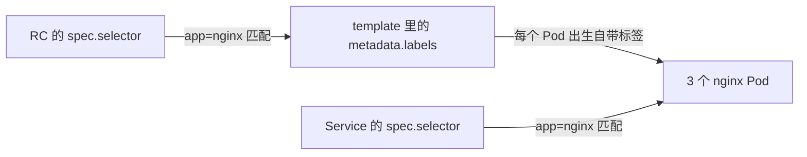
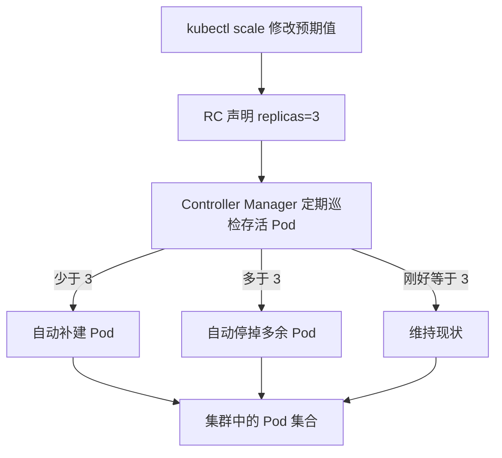
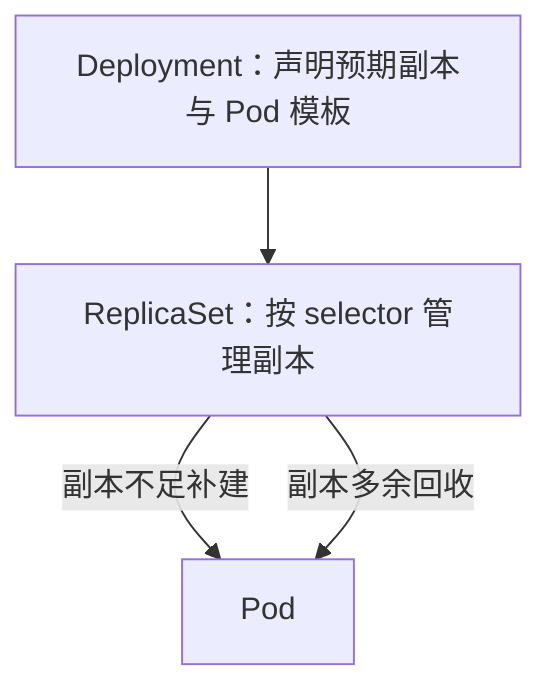
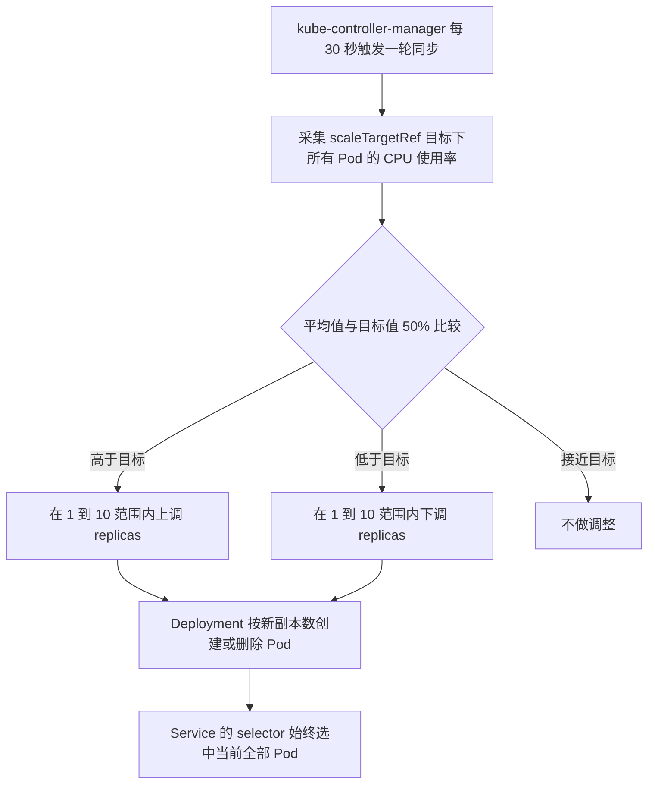
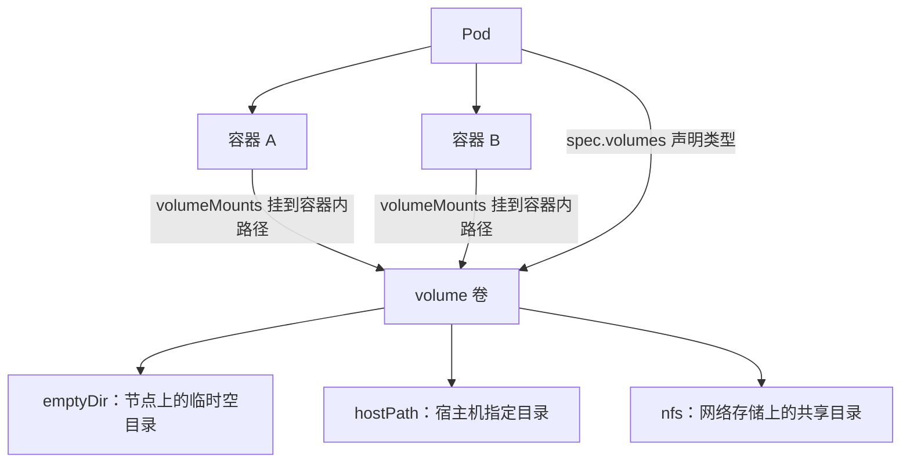
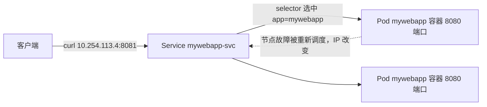

# Kubernetes 核心技术合辑：Label、控制器、HPA、volume 与 namespace

## 先给结论

- 六篇内容覆盖 Kubernetes 核心技术六件套：Label、Replication Controller、ReplicaSet 与 Deployment、HPA、volume、namespace 与 Service。
- Label 是分组管理的地基：资源贴 KV 标签，`spec.selector` 按等式或集合方式圈选，RC 与 Service 都靠这一对字段关联 Pod。
- RC 把副本数锁死在预期值：Controller Manager 周期巡检，多余停掉、不足补建，`kubectl scale` 一条命令随时扩缩。
- ReplicaSet 是 RC 的升级替代物，实质差别只在支持集合式 selector；官方建议不直接用它，而是包在 Deployment 里获得滚动升级能力。
- HPA 解决流量波动的自动扩缩容：按 Pod 负载在副本区间内自动调整，Pod 模板必须声明 `resources.requests.cpu`，否则无从判断。
- volume 生命周期与 Pod 相同：emptyDir 放临时数据，hostPath 挂宿主机目录，nfs 做跨节点共享，声明分 volumes 与 volumeMounts 两段。
- namespace 做逻辑分组与资源隔离，不指定时全部落进 default；查非默认空间要显式加 `--namespace` 参数。
- Service 给漂移的 Pod 一个稳定入口：Pod IP 随调度漂移，Service 地址不变，无 selector 配合 Endpoints 还能把外部服务挂成后端。
- 学习主线从「给资源贴标签」到「让副本守约、随负载伸缩、数据不丢、分组隔离、访问稳定」，串起 Pod 编排的完整逻辑。

## 第1部分：Kubernetes 的 Label：给资源贴标签，再用 selector 圈起来管理

集群里的资源一多，问题马上就来了：几十个 Pod、几个 Service、几个 RC，凭什么知道哪个 Service 该把流量转给哪些 Pod，哪个 RC 该管哪批 Pod？Kubernetes 的答案不是靠名字，而是靠 Label：先给资源贴上键值对形式的标签，再用 Label Selector 把同一类资源圈在一起。

Label 是 Kubernetes 系统的另一个核心概念，也是理解后续 RC、Service、Deployment 的前置知识，因为它们全部建立在「贴标签、选标签」这层机制上。

### 一、Label 是什么：挂在资源上的键值对

一个 Label 就是一个 KV 键值对，例如 `app: nginx`，key 是 `app`，value 是 `nginx`，两个都由用户自己指定。它可以附加到 Kubernetes 集群的各种资源对象上，Node、Pod、Service、RC 都行。

用途一句话概括：对这些资源对象做分组管理。贴了相同标签的资源天然就是一组，管理动作（调度、转发、伸缩）都以组为单位发生。

Label 通常在资源对象定义时确定，也可以在对象创建后动态添加或删除。也就是说标签是「活」的，可以先创建 Pod 后补标签，这是它比硬编码名字灵活的地方。

命名上也有讲究：key 一般用语义明确的维度词，如 `app`、`tier`、`env`；value 放具体取值，如 `nginx`、`frontend`、`dev`。团队里先约定一套键名规范，后面写 selector 时才能对得上；标签一旦各写各的，selector 就跟着失效，分组管理也就无从谈起。

### 二、定义与引用：metadata.labels 与 spec.selector

Label 最常见的用法是一对字段配合：给对象添加 Label 用 `metadata.labels`，引用这批对象用 `spec.selector`。把课程里连续出现的 RC 和 Service 定义放在一起看，这层关系一目了然：

```yaml
apiVersion: v1
kind: ReplicationController
metadata:
  name: nginx
spec:
  replicas: 3
  selector:              # 引用：我要管的是带 app=nginx 标签的 Pod
    app: nginx
  template:              # template 相当于一个 Pod 定义
    metadata:
      labels:
        app: nginx       # 定义：给将来创建出的每个 Pod 贴上标签
    spec:
      containers:
      - name: nginx
        image: nginx
        ports:
        - containerPort: 80
---
apiVersion: v1
kind: Service
metadata:
  name: nginx
spec:
  type: NodePort
  ports:
  - port: 80
    nodePort: 33333
  selector:              # 引用：流量转给带 app=nginx 标签的 Pod
    app: nginx
```



图里有两个「引用方」指向同一批标签：RC 靠 `spec.selector` 找到要管的 Pod，Service 靠 `spec.selector` 找到要转发的 Pod。template 部分定义的 `labels` 是标签的「生产端」，RC 创建出的每个 Pod 都自动带上它。

实际操作中很少单独定义 Pod，都是在 RC 的 template 里定义，标签也顺势写在 `template.metadata.labels` 下，这也是上面 yaml 的写法。

### 三、实操：从 demo3.yaml 看两组标签

课程资料里的 `demo3.yaml` 给一个对象贴了两组标签，并演示了完整的创建、删除、查看流程：

```yaml
apiVersion: extensions/v1beta1
kind: Deployment
metadata:
  name: frontend
spec:
  replicas: 1
  selector:
    matchLabels:
      tier: frontend
    matchExpressions:
      - {key: tier, operator: In, values: [frontend]}
  template:
    metadata:
      labels:
        app: app-demo
        tier: frontend
    spec:
      containers:
      - name: tomcat-demo
        image: tomcat
        ports:
        - containerPort: 8080
```

`template.metadata.labels` 下有 `app: app-demo` 和 `tier: frontend` 两组标签；`spec.selector` 里用 `matchLabels` 加 `matchExpressions` 对它们做引用。命令行上的验证流程：

```bash
kubectl delete -f demo3.yaml    # 先清掉旧对象
kubectl get pods                # 确认已经没有了
kubectl create -f demo3.yaml    # 重新创建
kubectl describe -f demo3.yaml  # 查看详情，Labels 一栏能看到定义的标签
```

`describe` 输出里 `Labels:` 一栏展示的正是定义阶段写下的标签，后续所有 selector 引用的就是它。

### 四、Label Selector 的两种匹配方式

selector 引用标签时有两种写法，`demo3.yaml` 里恰好两种都出现了。

**第一种是 `matchLabels`，等值匹配。** `matchLabels: {tier: frontend}` 表示资源必须带有 `tier=frontend` 这个标签，语义最简单。

**第二种是 `matchExpressions`，条件表达式匹配。** 它支持 In、NotIn、Exists、DoesNotExist 等操作符，例如 `- {key: tier, operator: In, values: [frontend]}` 表示 key 为 tier 的标签，其 value 在 frontend 这个集合里。一个 key 集合形式的条件表达，比等值匹配灵活得多。

两种方式可以叠加使用，叠加时是「与」的关系，资源要同时满足所有条件才会被选中。这套匹配能力就是「分组管理」落地的地方：贴标签是分组，selector 是按组操作。

命令行同样支持动态贴标签：`kubectl label pod <名字> env=dev` 可以给运行中的对象补一个标签，键名后跟减号（如 `env-`）则删除该标签。用它验证多对多关系最直观，比改 yaml 重建快得多。

## 第2部分：Replication Controller：让 Pod 副本数永远等于预期值

手工管理 Pod 有个无解的问题：Pod 挂了谁补？节点崩了上面那批业务谁负责重新拉起？靠人盯着 `kubectl get pods` 再逐个 create，既不及时也不可靠。Replication Controller（简称 RC）就是为这个问题而生的核心对象：声明一个预期的副本数，剩下的交给系统自动纠偏。

RC 也是上一篇文章 Label 机制最大的使用者，它的 selector 与 template 就靠标签配对工作。理解了 RC，后面的 ReplicaSet 与 Deployment 只是换了更强的表达方式。

### 一、RC 是什么：副本数的自动纠偏器

RC 是 Kubernetes 系统的核心概念之一。它的工作模型可以用一句话说清：声明式地指定「我想要几个什么样的 Pod」，系统负责把现实拉向声明。



关键路径在 Controller Manager：定义一个 RC 并提交到 Kubernetes 集群后，Master 节点上的 Controller Manager 组件就会得到通知，随后周期性地巡检系统中存活的 Pod 数量。少于预期值就创建新的 Pod，多于预期值就停掉一些，目标永远是把实际数量拉回 RC 里写的那个数。

正因为有这条巡检回路，Pod 崩溃会被自动替换，节点宕机后其上的 Pod 会在别处重建，这就是 RC 提供的容灾能力。

### 二、定义与运行：三个副本的 nginx

资料包里的 `demo5-rc.yaml` 是一个最小可用的 RC 定义：

```yaml
apiVersion: v1
kind: ReplicationController
metadata:
  name: nginx
spec:
  replicas: 3          # 预期副本数
  selector:            # 通过标签引用要管理的 Pod
    app: nginx
  template:            # Pod 模板，副本不足时按它创建
    metadata:
      labels:
        app: nginx
    spec:
      containers:
      - name: nginx
        image: nginx
        ports:
        - containerPort: 80
```

三个字段构成 RC 的全部骨架：`replicas` 是预期值，`selector` 圈定管理范围，`template` 是 Pod 模板。配套的 `demo5-svc.yaml` 用 NodePort 把这批 Pod 暴露出去：

```yaml
apiVersion: v1
kind: Service
metadata:
  name: nginx
spec:
  type: NodePort
  ports:
  - port: 80
    nodePort: 33333
  selector:
    app: nginx
```

创建与查看：

```bash
kubectl create -f demo5-rc.yaml
kubectl create -f demo5-svc.yaml
kubectl get pods
# nginx-xxx   1/1  Running
# nginx-xxx   1/1  Running
# nginx-xxx   1/1  Running
kubectl get svc   # 能看到配套的 nginx Service
```

`get pods` 列出的三个 nginx Pod 正是 `replicas: 3` 的产物，名字里的随机后缀由系统生成，从这里开始就不需要手工创建 Pod 了。

### 三、动态扩缩容：一条 scale 命令

预期值不是写死的，运行中随时可改：

```bash
kubectl scale rc nginx --replicas=5
kubectl get pods    # nginx Pod 变成 5 个

kubectl scale rc nginx --replicas=1
kubectl get pods    # 只剩 1 个
```

改成 5，Controller Manager 巡检时发现存活数量少于预期，补建两个；改成 1，发现多了，停掉四个。扩容与缩容走的是同一条纠偏回路，差别只在偏差的方向。线上做容量调整时，这条命令就是最直接的旋钮，不用改 yaml 重新提交。

### 四、RC 的升级者：ReplicaSet 与 Deployment

RC 与 Kubernetes 代码中的一个模块 Replication Controller 同名，官方在 1.2 版本之后引入了新概念 ReplicaSet，定位是下一代的 RC。

两者唯一的实质区别在标签选择上：

| 对象 | 支持的 Label Selector | 典型用法 |
|---|---|---|
| ReplicationController | 等式 selector，如 `app: nginx` | 独立定义，直接管理 Pod |
| ReplicaSet | 基于集合的 selector，如 In、NotIn | 很少单独使用，与 Deployment 配合 |

也就是说，RC 只能写 `key: value` 这种等值匹配，ReplicaSet 可以表达 value 属于某个集合这类条件，标签匹配能力更强。

ReplicaSet 很少单独使用，它一般与更高层面的资源对象 Deployment 一起工作，两者形成一整套 Pod 创建、更新的编排机制。日常新建应用时，主流写法就是 Deployment，它会自动管理底层的 ReplicaSet，再由 ReplicaSet 管理 Pod。

### 五、为什么不要绕过 RC 直接建 Pod

课程反复强调一条原则：最好不要越过 RC 直接创建 Pod。原因在于单独创建的 Pod 是「裸奔」的，没有任何控制器为它做巡检，挂了就真的没了。

而通过 RC 创建的 Pod 从出生起就在管理范围内：Replication Controller 会持续管理这些副本，实现自动创建、补充、替换 Pod 副本，提高应用的容灾能力，减少由于节点崩溃等意外状况造成的损失。即便应用程序只需要一个 Pod 副本，也建议用 RC（或它的升级版）来管，因为要的不是多副本，而是那条自动纠偏的回路。

## 第3部分：ReplicaSet 与 Deployment：RC 之后的新一代 Pod 编排

上一篇文章留下了两个悬念：RC 在 1.2 版本之后被谁接班，以及「与 Deployment 配合使用」的 Deployment 到底是什么。这一篇把这条对象链补全：ReplicaSet 是 RC 的直系替代者，只换了 selector 能力；Deployment 再包住 ReplicaSet，成为官方推荐的新入口。

到这一层，Pod 的管理栈就完整了：Deployment 管 ReplicaSet，ReplicaSet 管 Pod，而 RC 逐渐退居教学与老集群。

### 一、ReplicaSet：换了 selector 的 RC

ReplicaSet 与 RC 的关系一句话能说清：没有本质区别，只是名字不一样。它是 Kubernetes 1.2 之后升级出的新概念，官方把它定位为 RC 的替代物，使用上基本相同，唯一区别是 selector 支持集合方式。

对比一下两种对象的选择器能力：

| 对象 | Label Selector 能力 | 官方建议 |
|---|---|---|
| ReplicationController | 等式 selector，如 `app: nginx` | 老集群兼容，逐渐过渡 |
| ReplicaSet | 集合式 selector，如 In、NotIn | 避免直接使用，与 Deployment 配合 |

等式 selector 只能表达「标签必须等于某个值」，集合式 selector 可以表达「value 在某个集合里」「key 存在或不存在」这类条件，批量圈定 Pod 时灵活得多。

正因为它足够「底层」，官方并不建议直接使用 ReplicaSet，而是让 Deployment 来驱动它。

### 二、Deployment：包住 ReplicaSet 的编排层

Deployment 是 Kubernetes 1.2 引入的新概念，引入目的是更好地解决 Pod 的编排问题。它内部使用 ReplicaSet 来实现副本管理，定义方式与 ReplicaSet 很类似，除了 apiVersion 与 kind 两处不同，其余字段完全一致。

三层关系如下：



关键路径：用户只面向 Deployment 声明「要几个什么 Pod」，Deployment 创建并维护 ReplicaSet，ReplicaSet 沿用上一篇讲过的巡检纠偏机制管理 Pod。模板里 `template.metadata.labels` 定义标签，`spec.selector` 引用标签，这套路数与 RC 完全一致，只是 selector 可以写成集合形式。

### 三、动手：创建与查看一个 Deployment

资料包里的 `demo4-deployment.yaml` 定义了一个最简单的 Deployment：

```yaml
apiVersion: apps/v1beta1
kind: Deployment
metadata:
  name: nginx-deployment
spec:
  replicas: 1          # 预期目标 1 个
  template:
    metadata:
      name: nginx
      labels:
        app: nginx
    spec:
      containers:
      - name: nginx
        image: nginx
        resources:
          requests:
            cpu: 50m
        ports:
        - containerPort: 80
```

与 RC 定义逐字段对照，区别只有两处：`apiVersion` 变成 `apps/v1beta1`，`kind` 变成 `Deployment`。创建与查看：

```bash
kubectl create -f demo4-deployment.yaml
kubectl get deployments
# NAME               DESIRED   CURRENT   UP-TO-DATE   AVAILABLE   AGE
# nginx-deployment   1         1         1            1           1m
```

想看完整细节用 describe：

```bash
kubectl describe deployment nginx-deployment
# Name:                   nginx-deployment
# Namespace:              default
# Labels:                 app=nginx
# Selector:               app=nginx
# Replicas:               1 updated | 1 total | 1 available | 0 unavailable
# StrategyType:           RollingUpdate
# RollingUpdateStrategy:  1 max unavailable, 1 max surge
# OldReplicaSets:         <none>
```

输出里能看到两层信息：`Labels` 与 `Selector` 正是定义阶段的标签与引用；`StrategyType: RollingUpdate` 则暴露了它比 RC 「编排上更好」的部分，Deployment 默认带滚动升级策略，更新模板时逐个替换 Pod，服务不中断。同样的能力 RC 只能靠手工删除旧 Pod 再新建来模拟。

`get deployments` 的几列也顺手看懂：DESIRED 是期望副本数，CURRENT 是当前实际数量，UP-TO-DATE 是已更新到最新模板的副本，AVAILABLE 是可正常提供服务的副本。滚动更新过程中这几列的差值会拉大，全部追平即更新完成。

### 四、集合式 selector 的写法

ReplicaSet 与 Deployment 都可以写集合式 selector，资料包 `demo3.yaml` 是标准示例：

```yaml
spec:
  replicas: 1
  selector:
    matchLabels:                       # 等式部分：标签必须相等
      tier: frontend
    matchExpressions:                  # 集合部分：条件表达式
    - {key: tier, operator: In, values: [frontend]}
  template:
    metadata:
      labels:
        app: app-demo
        tier: frontend
```

`matchLabels` 负责等值匹配，`matchExpressions` 用操作符表达集合条件，这里 In 表示 key 为 `tier` 的标签，value 在 `frontend` 集合内。两种写法叠加时取交集，Pod 要同时满足才会被选中。RC 没有这一层表达力，这也是 ReplicaSet 取代它的直接原因。

滚动升级时 Deployment 的做法也值得提前知道：修改 Pod 模板后，它会新建一个 ReplicaSet 承接新版本，新旧 ReplicaSet 按策略逐步增减副本，全部就绪后旧的 ReplicaSet 缩为零但保留记录，回滚就是把它重新放大。describe 输出里 `OldReplicaSets` 字段记录的正是这条线索。

## 第4部分：流量高峰不用守着敲命令：用 HPA 让 Kubernetes 自动扩缩容

Deployment 跑起来只是第一步。业务高峰期三个副本扛不住，凌晨流量低谷又剩一堆 Pod 空烧资源，靠人盯监控、手动改副本数，永远慢一拍。Kubernetes 对这个问题给出的答案是 Horizontal Pod Autoscaler，简称 HPA，即 Pod 水平自动扩缩器：你只负责定指标和副本数范围，加减副本这件事交给集群自己完成。

### HPA 是什么，解决什么问题

水平扩容指的是多起几个 Pod 分摊流量，缩容则是减少 Pod 个数，这与给单个 Pod 加内存加 CPU 的「垂直扩容」是两条路线，HPA 走的是水平这条。

**第一，它是与 RC、Deployment 并列的资源对象。** HPA 本身不管理 Pod，它通过 `scaleTargetRef` 指向一个 Deployment 或 RC，分析这些控制器名下所有目标 Pod 的负载变化情况，决定是否需要针对性地调整副本数。真正动手创建和删除 Pod 的仍然是 Deployment。

**第二，它的调整有边界。** 自动模式要求用户指定一个性能指标（如平均 CPU 使用率）以及 Pod 副本数量的范围，系统只会在这个范围内根据指标变化调整，不会无限扩、也不会缩到零。

### 手动与自动两条路

手动方式前期已经用过，靠 `kubectl scale` 直接对 Deployment 或 RC 设置副本数：

```bash
kubectl scale deployment frontend --replicas 1
```

这条命令改完立即生效，但副本数是写死的：流量再涨还得再敲一次。自动方式把「什么时候扩、扩到多少」的决策交给系统，两种方式的使用场景可以这样划分：

| 方式 | 手段 | 适用场景 |
|---|---|---|
| 手动 | `kubectl scale` 设置固定副本数 | 发布前临时调整、压测时控制规模 |
| 自动 | HPA 按指标在范围内浮动 | 负载随时间明显波动的在线业务 |

### 三个文件组成的最小示例

课程资料里的 `demo4` 由 Deployment、HPA、Service 三个 YAML 构成。先把 Deployment 定下来：

```yaml
apiVersion: apps/v1beta1
kind: Deployment
metadata:
  name: nginx-deployment
spec:
  replicas: 1          # 初始副本数，之后由 HPA 接管
  template:
    metadata:
      name: nginx
      labels:
        app: nginx
    spec:
      containers:
      - name: nginx
        image: nginx
        resources:
          requests:
            cpu: 50m   # 声明基准 CPU，HPA 计算使用率百分比靠它
        ports:
        - containerPort: 80
```

关键声明是 `resources.requests.cpu: 50m`。HPA 判断的是「实际用量占请求量的百分比」，没有这个请求值，百分比无从算起。

接着是主角 HPA：

```yaml
apiVersion: autoscaling/v1
kind: HorizontalPodAutoscaler
metadata:
  name: nginx-hpa
spec:
  scaleTargetRef:
    apiVersion: apps/v1beta1
    kind: Deployment
    name: nginx-deployment   # 指向上面定义的 Deployment
  minReplicas: 1             # 副本数下限
  maxReplicas: 10            # 副本数上限
  targetCPUUtilizationPercentage: 50   # 平均 CPU 使用率目标值
```

三个核心字段正好对应「指向谁、范围多大、按什么调」：`scaleTargetRef` 绑定名为 `nginx-deployment` 的 Deployment；`minReplicas` 与 `maxReplicas` 圈定副本数的浮动区间，也就是 1 到 10；`targetCPUUtilizationPercentage: 50` 表示所有 Pod 的平均 CPU 使用率超过 50% 时扩容，低于 50% 时缩容，调整的目标是让使用率向 50% 回归。

最后补一个 Service，让外界始终通过固定入口访问这组随时会变数量的 Pod：

```yaml
apiVersion: v1
kind: Service
metadata:
  name: nginx-svc
spec:
  ports:
  - port: 80
  selector:
    app: nginx
```

### 控制器的运行机制

HPA 不是提交之后就一直盯着，它的检测是周期性的。同步周期由 Master 上 kube-controller-manager 的启动参数 `--horizontal-pod-autoscaler-sync-period` 定义，默认值为 30 秒。控制器周期性检测 Pod 的 CPU 使用率，满足条件时对 RC 或 Deployment 的 Pod 副本数量做调整，使其符合用户定义的平均 CPU 使用率。整个闭环如下：



图里值得注意的一点是 HPA 只改 Deployment 的 `replicas` 字段，创建删除 Pod 由 Deployment 的副本机制完成，Service 又通过 label 把流量平摊到当前存活的 Pod 上，三层各司其职。

除了 CPU，缩扩容依据也可以换成内存等其他指标，思路一致：在 HPA 里声明对应的指标类型与目标值即可，可以自行练习一遍基于内存的自动扩缩容。

## 第5部分：Pod 里的数据放哪：Kubernetes volume 数据卷一次讲透

容器一重启，写在容器文件系统里的日志、临时缓存全没了；同一个 Pod 里的 Tomcat 和 Redis 想交换文件，也找不到一个共同目录。这两个麻烦指向同一个答案：volume（数据卷）。它是 Pod 中能被多个容器访问的共享目录，把「数据放哪、活多久」从容器身上解耦出来。

### volume 是什么

把 volume 想象成 Pod 内置的一块「公共磁盘」：它在 Pod 级别被定义，Pod 里的容器各自用 `volumeMounts` 把它挂到自己文件系统的某个路径下，于是多个容器看到了同一个目录。

**第一，它的生命周期绑定 Pod 而不是容器。** 容器崩溃重启，新容器重新挂上同一个卷，之前写进去的数据还在；而容器自身文件系统里的内容早就随旧容器一起销毁了。这是 volume 与生俱来的价值。

**第二，使用它必须显式声明两件事。** 卷的类型和内容由 Pod 的 `spec.volumes` 字段定义，容器内的挂载位置由 `spec.containers[].volumeMounts` 映射，两段通过 `name` 关联起来。结构与关系如下图：



同一份卷定义挂在两个容器下，就是容器间共享数据的方式；类型决定数据实际落在哪，落在哪就决定了它活多久。

### emptyDir：随 Pod 生灭的临时目录

emptyDir 类型的卷在 Pod 被调度到某个节点时创建，初始为空。同一个 Pod 内的容器都能读写 emptyDir 里的同一批文件；一旦 Pod 离开这个节点（删除或被调度走），emptyDir 中的数据就被永久删除。基于这个特性，它常用于服务日志或临时文件的读写。

```yaml
apiVersion: v1
kind: Pod
metadata:
  name: test-pd
spec:
  containers:
  - image: docker.io/nazanpc/webserver
    name: test-container
    volumeMounts:
    - mountPath: /cache        # 容器内看到的路径
      name: cache-volume       # 与 volumes 里的名字对应
  volumes:
  - name: cache-volume
    emptyDir: {}               # 空声明，即默认的临时空目录
```

`emptyDir: {}` 后面没有任何属性，表示用节点默认的介质创建一个空目录。容器里的 `/cache` 从此就有了持久于容器重启、止于 Pod 删除的属性。

### hostPath：把宿主机目录挂进容器

hostPath 类型的卷让容器能访问当前宿主机上的指定目录。典型场景：需要访问 Docker 系统目录的容器，就用宿主机的 `/var/lib/docker` 作为 hostPath 卷；要在容器内运行 cAdvisor 这类监控组件，就挂宿主机上 cgroups 相关的目录。

```yaml
apiVersion: v1
kind: Pod
metadata:
  name: test-pd
spec:
  containers:
  - image: docker.io/nazanpc/webserver
    name: test-container
    volumeMounts:
    - mountPath: /test-pd      # 容器内路径
      name: test-volume
  volumes:
  - name: test-volume
    hostPath:
      path: /data              # 宿主机上的目录
```

这份配置把宿主机的 `/data` 与容器内的 `/test-pd` 关联起来，容器里对该路径的读写实际发生在宿主机上。

**hostPath 有一个必须记住的行为差异：** Pod 离开宿主机后，hostPath 里的数据不会被永久删除，但也绝不会随 Pod 迁移到其他节点。各个节点上文件系统的结构和内容并不一样，同一个 Pod 的 hostPath 在不同节点上可能表现出完全不同的行为。调度一变，读到的可能就是另一台机器上另一个 `/data`。

### nfs：跨节点的持久共享

emptyDir 和 hostPath 的数据都留在本节点，要让数据真正跟随业务、跨节点共享，需要网络存储。nfs 类型的卷允许把一块现有的网络硬盘在同一个 Pod 的容器间共享，数据存在独立的 NFS 服务器上，与节点的生死无关。

课程给的是一个给 Redis 挂持久存储的 Deployment 示例：

```yaml
apiVersion: apps/v1 # for versions before 1.9.0 use apps/v1beta2
kind: Deployment
metadata:
  name: redis
spec:
  selector:
    matchLabels:
      app: redis
  revisionHistoryLimit: 2
  template:
    metadata:
      labels:
        app: redis
    spec:
      containers:
      - image: redis
        name: redis
        imagePullPolicy: IfNotPresent
        ports:
        - containerPort: 6379
          name: redis6379
        env:
        - name: ALLOW_EMPTY_PASSWORD
          value: "yes"
        - name: REDIS_PASSWORD
          value: "redis"
        volumeMounts:
        - name: redis-persistent-storage
          mountPath: /data     # Redis 数据目录落到 NFS 上
      volumes:
      - name: redis-persistent-storage
        nfs:
          path: /k8s-nfs/redis/data      # NFS 服务器上的导出目录
          server: 192.168.128.112        # NFS 服务器地址
```

Redis 的数据目录 `/data` 被映射到 NFS 服务器 `192.168.128.112` 的 `/k8s-nfs/redis/data`。无论 Redis 的 Pod 被调度到哪个节点、重建多少次，数据始终在那台 NFS 机器上，这就是「持久」的真正含义。

## 第6部分：资源怎么分组、Pod 怎么被稳定访问：namespace 与 Service 详解

把一群 Pod、RC、Service 全部丢进集群后，两个问题很快浮出水面：多个团队共用一个集群，资源对象混作一团没法分别管理；好不容易用 `curl PodIP:8080` 打通了应用，节点一出故障 Pod 被重新调度，IP 换了，访问全断。前者靠 namespace 做逻辑分组，后者靠 Service 提供统一入口，两者配合，集群才能多人协作、稳定对外。

### 一、namespace：逻辑分组与资源隔离

namespace 在多数场景下用于实现多用户的资源隔离。它把集群内部的资源对象分配到不同的命名空间中，形成逻辑上的分组。注意「逻辑上」这三个字：它不划分子网、不切物理机，各个分组依然共享使用整个集群的资源，只是从管理视角上被分开了。

**第一，集群自带 default 命名空间。** Kubernetes 集群启动时会创建一个名为 `default` 的 namespace。创建 Pod、RC、Service 时如果不指定 namespace，系统会把它们全部放进这个默认命名空间。用 `kubectl describe pod mywebapp` 看一个早期创建的 Pod，输出里 `Namespace: default` 就是这么来的：创建时没指定，系统替你选了默认值。

**第二，创建命名空间和往里放东西都是普通 YAML。** 课程资料里的 `demo6` 由两个文件构成，先建命名空间：

```yaml
apiVersion: v1
kind: Namespace
metadata:
  name: development
```

再创建一个 Pod，用 `metadata.namespace` 把它放进 `development`：

```yaml
apiVersion: v1
kind: Pod
metadata:
  name: busybox
  namespace: development
spec:
  containers:
  - image: busybox
    command:
    - sleep
    - "3600"
    name: busybox
```

**第三，查看时必须带上命名空间参数。** 提交之后直接执行 `kubectl get pods`，是找不到这个 busybox 的，因为默认列出的其实是 `default` 命名空间下的 Pod。要看 `development` 里的内容，命令要写成：

```bash
kubectl get pods --namespace=development
```

namespace 的本质作用就一句话：对资源做逻辑分组，方便分组管理。不指定就用 default，要隔离就在对象元数据里写 `namespace` 字段。

### 二、Service：给漂移的 Pod 一个稳定入口

对外提供服务的容器应用，最简单的暴露方式是走 TCP/IP，监听 IP 和端口号。听起来直接拿 Pod 的 IP 加端口就够了，实际却经不起折腾，一组真实操作演示这个过程。

**第一，先有一组 Pod。** `demo7` 的 RC 创建名为 `mywebapp` 的 Tomcat 应用：

```yaml
apiVersion: v1
kind: ReplicationController
metadata:
  name: mywebapp
spec:
  replicas: 1
  template:
    metadata:
      name: mywebapp
      labels:
        app: mywebapp
    spec:
      containers:
      - name: mywebapp
        image: 192.168.126.112:5000/docker.io/tomcat
        ports:
        - containerPort: 8080
```

用 `kubectl get pods -l app=mywebapp -o yaml | grep podIP` 拿到 Pod 的 IP，`curl 该IP:8080` 能正常返回 Tomcat 页面，直接访问成立。

**第二，直接访问 Pod IP 为什么不可靠。** 当 Pod 所在的 Node 发生故障时，Pod 会被 Kubernetes 重新调度到另一个 Node，重新调度后 Pod 的地址随之改变，原来记下的 IP:端口再也访问不到，客户端总不能每次都先查一遍 Pod IP 再发请求。

**第三，Service 就是那个不变的入口。** `demo7` 的 Service 文件：

```yaml
apiVersion: v1
kind: Service
metadata:
  name: mywebapp-svc
spec:
  ports:
  - port: 8081
    targetPort: 8080
  selector:
    app: mywebapp
```

`selector` 通过标签 `app: mywebapp` 圈定后端 Pod；`port: 8081` 是 Service 自己暴露的端口，`targetPort: 8080` 是容器实际监听的端口。提交后 `kubectl get svc` 能看到 `mywebapp-svc` 分配到的集群 IP（如 `10.254.113.4`），此后始终 `curl 10.254.113.4:8081`，无论后端 Pod 怎么失效、迁移，访问照常。整个链路如下：



图中的虚线表达的是关键因果：Pod 的 IP 会漂移，Service 的 ClusterIP 不变，selector 每次都按标签找到当下真实的 Pod 集合。`kubectl describe svc mywebapp-svc` 输出里的 `Type: ClusterIP`、`Port`、`TargetPort`、`Endpoints`，正是这份映射关系的落地。

### 三、两个进阶玩法：多端口与外部服务

**多端口 Service。** 一个容器应用可能同时提供多个端口的服务，Service 定义中可以设置多个端口，分别对应到不同应用服务：

```yaml
apiVersion: v1
kind: Service
metadata:
  name: mywebAppService
spec:
  ports:
  - port: 8080
    targetPort: 8080
    name: web
  - port: 8085
    targetPort: 8085
    name: management
  selector:
    app: mywebapp
```

写法上无非是在 `ports` 列表里多放几组映射，每组用不同的 `name` 区分用途、各自的 `targetPort` 指向容器内的不同端口，对外仍是同一个 Service 名字。

**无 selector 的外部服务 Service。** 另一些特殊场景里，应用需要把一个外部数据库作为后台服务来连接，或者把另一个集群、另一个 namespace 中的服务当作后端。这类后端没有标签可选中，做法是创建一个不带 selector 的 Service，再用同名的 Endpoints 手工指定后端地址。课程 `demo8` 的两个文件：

```yaml
apiVersion: v1
kind: Service
metadata:
  name: my-service
spec:
  ports:
  - protocol: TCP
    port: 80
    targetPort: 80
```

```yaml
apiVersion: v1
kind: Endpoints
metadata:
  name: my-service
subsets:
- addresses:
  - ip: 10.254.74.3
  ports:
  - port: 8080
```

Endpoints 的名字必须与 Service 的名字一致，`subsets` 里写明真实的后端 IP 和端口。绑定之后访问 `my-service` 的 80 端口（HTTP 默认端口，curl 里可不写），请求实际分发到 `10.254.74.3:8080` 上的 Tomcat。Service 没有标签选择能力时，由 Endpoints 替它指路。

## 常见误区

- **以为 Label 能单独定义**：Label 与 Label Selector 都不能单独使用，必须附加在资源对象的定义文件上，通常写在 RC 或 Service 中，单独写一个只有标签的 yaml 没有意义。
- **selector 与 template 里的标签对不上**：RC 的 `spec.selector` 引用了 `app: nginx`，template 的 `labels` 却写成 `app: web`，RC 永远凑不齐副本。selector 指向的标签必须在 template 里真实存在。
- **以为一个标签只能贴一个对象**：实际是多对多，一个资源可以有任意多个 Label，一个 Label 也可以贴到任意多个资源上，多个 Service 用同一个标签选中同一批 Pod 是正常用法。
- **标签写完从不利用**：标签的价值在 selector 侧，RC、Service、后续的 Deployment 都按标签圈对象，只贴标签不建引用等于白贴。
- **把 RC 理解成负载均衡器**：RC 只负责副本数量，不负责流量转发；把请求分摊到各个 Pod 是 Service 的职责，两者配合但职责不同。
- **selector 与 template 标签脱节**：`selector` 写 `app: nginx`，模板标签写成别的值，RC 会一直处于凑不齐副本的状态，因为新 Pod 的标签永远匹配不上自己的选择器。
- **扩缩容靠删 Pod 或重建 RC**：删 Pod 会被 RC 立刻补回来，越删越多；正确做法是用 `kubectl scale` 改预期值，让纠偏回路自己干活。
- **以为 ReplicaSet 完全取代了 RC**：1.2 之后 ReplicaSet 是推荐的下一代对象，但它设计上不单独使用，而是作为 Deployment 的底层组件存在；理解 RC 的工作模型依然是理解 ReplicaSet 与 Deployment 的前提。
- **直接拿 ReplicaSet 单独建应用**：官方明确建议避免直接使用 ReplicaSet，它应当由 Deployment 驱动。绕过 Deployment 意味着放弃滚动升级这层编排能力。
- **apiVersion 写错版本**：Deployment 的 apiVersion 随集群版本变化，老集群用 `extensions/v1beta1`，新些的用 `apps/v1beta1`、`apps/v1`。apiVersion 与集群不匹配时 `kubectl create -f` 会直接报 API 版本不兼容错误，课程环境里就撞到了这个报错。
- **以为 Deployment 是全新物种**：它的核心字段与 RC、ReplicaSet 一模一样，template 定义 Pod、selector 引用标签、replicas 声明副本数。把它当成「加了编排能力的 RC」理解，迁移成本最低。
- **selector 仍按 RC 习惯只写等值**：Deployment 支持集合式 selector，有批量圈定需求时不用再硬凑多个等值条件。
- **Pod 模板不写 `resources.requests.cpu` 就指望 HPA 生效**：没有请求值就算不出使用率百分比，HPA 会一直拿不到指标、不动手。示例里那行 `cpu: 50m` 不是可删的装饰。
- **`scaleTargetRef.name` 写错或指向不存在的 Deployment**：HPA 提交成功但不产生任何效果，排查时要先确认它关联的目标对象真实存在。
- **以为改完立刻扩容**：控制器按 30 秒周期同步，加上采集指标本身的延迟，调整总是滞后的，短促的流量尖峰可能还没等到扩容就过去了。
- **把手动 scale 和 HPA 混着用**：HPA 接管后，手动 `kubectl scale` 设置的副本数会在下一轮同步时被改回去，两种方式二选一。
- **把 volume 当成容器自己的目录**：volume 定义在 Pod 上、容器通过 `volumeMounts` 挂载使用，`volumeMounts` 写在 containers 列表对应容器这一层，缩进位置错了 Pod 都起不来。
- **以为容器重启数据就丢**：恰恰相反，volume 的生命周期与 Pod 相同、与容器无关，容器重启数据不丢；会随 Pod 一起消失的是 emptyDir。
- **以为 hostPath 的数据会跟着 Pod 走**：Pod 被调度到新节点后，读的是新节点的同名目录，旧节点上的数据不会迁移，不同节点上还可能表现不一致。
- **emptyDir 用来存重要数据**：Pod 一离开节点数据就被永久删除，emptyDir 只适合日志、临时文件这类可再生数据，重要数据交给 nfs 这类网络存储。
- **`kubectl get pods` 找不到新命名空间里的 Pod 就以为没创建成功**：默认命令只列 `default` 命名空间，查看其他命名空间必须带 `--namespace` 参数。
- **把 namespace 当成物理隔离**：它只是逻辑分组，各组仍共享整个集群的资源；需要硬性资源配额要另外配 ResourceQuota。
- **Service 的 `port` 和 `targetPort` 傻傻分不清**：`port` 是 Service 对外暴露的端口（客户端访问它），`targetPort` 是容器内应用监听的端口（请求最终去哪），两者可以不同，如 8081 映射 8080。
- **selector 的标签写错以为 Service 坏了**：selector 按 label 匹配后端 Pod，标签对不上时 Endpoints 为空，Service 活着但后面没有任何 Pod，请求必然失败。
- **以为无 selector 的 Service 不能用**：配上同名的 Endpoints 指定真实后端地址，它恰恰是接外部数据库、跨集群服务这类场景的标准做法。

## 面试可能被问到的问题

1. 面试官追问：「Label 是什么，解决什么问题？」
   答：Label 是附加在 Kubernetes 资源对象上的 KV 键值对，key 与 value 由用户指定。它的目的是对集群中的资源做分组管理，配合 Label Selector 可以按组完成调度、转发、伸缩等操作，而不依赖资源名字。

2. 面试官追问：「metadata.labels 和 spec.selector 什么关系？」
   答：前者是标签的定义端，写在资源对象模板上，例如 RC 的 template 或 Pod 自身；后者是标签的引用端，RC 用它圈定要管理的 Pod，Service 用它圈定要转发流量的 Pod，两边标签匹配上才生效。

3. 面试官追问：「matchLabels 和 matchExpressions 有什么区别？」
   答：matchLabels 是等值匹配，要求资源带有指定的 key=value 标签；matchExpressions 是条件表达式，支持 In、NotIn、Exists、DoesNotExist 等操作符，能表达 value 属于某个集合这类条件。两者可叠加，叠加时取交集。

4. 面试官追问：「一个资源能有多少个 Label？」
   答：一个资源对象可以定义任意数量的 Label，同一个 Label 也可以被添加到任意数量的资源对象上，是典型的多对多关系。

5. 面试官追问：「Label 可以在对象创建之后再改吗？」
   答：可以。Label 通常在资源对象定义时确定，也支持在对象创建后动态添加或删除，标签与对象生命周期解耦，这也是它适合做动态分组管理的原因。

6. 面试官追问：「Replication Controller 的核心机制是什么？」
   答：声明预期副本数并持续巡检。RC 提交后 Master 上的 Controller Manager 得到通知，定期检查存活的 Pod 数量，少于预期自动补建，多于预期自动停掉，保证目标 Pod 实例数始终等于预期值。

7. 面试官追问：「线上想从 3 个副本扩到 5 个，怎么做？」
   答：`kubectl scale rc nginx --replicas=5`，Controller Manager 巡检发现实际数量少于预期值会自动补建两个 Pod。缩容同理，改小预期值即可，全程不用重建 RC。

8. 面试官追问：「RC 和 ReplicaSet 有什么区别？」
   答：功能定位相同，都是保证副本数；核心差别在 Label Selector，RC 只支持等式匹配，ReplicaSet 支持基于集合的选择器如 In、NotIn。ReplicaSet 是 1.2 之后的下一代 RC，一般不单独使用，而是作为 Deployment 的底层对象。

9. 面试官追问：「为什么不建议直接创建 Pod？」
   答：直接创建的 Pod 没有控制器管理，异常退出不会自动恢复。通过 RC 创建的 Pod 会被持续巡检，自动创建、补充、替换副本，提高容灾能力。即使只有一个副本，也建议交给 RC 或 Deployment 管理，获得自动纠偏能力。

10. 面试官追问：「Pod 挂了之后是谁把它拉起来的？」
   答：两条路径：容器进程崩溃时，按 Pod 的重启策略由该节点上的 kubelet 直接重启容器；整个 Pod 或节点级别的故障，由 Controller Manager 按 RC 的预期副本数在其他节点重建 Pod。前者管容器内重启，后者管副本数纠偏。

11. 面试官追问：「ReplicaSet 和 RC 有什么区别？」
   答：没有本质区别，ReplicaSet 是 1.2 之后 RC 的替代物，副本管理机制相同，唯一实质差别是它支持基于集合的 Label Selector，如 In、NotIn，而 RC 只支持等式 selector。

12. 面试官追问：「为什么官方不建议直接使用 ReplicaSet？」
   答：ReplicaSet 只负责副本数量这一层，直接使用会缺少编排能力。官方建议与 Deployment 配合：Deployment 管理版本更新、滚动升级，ReplicaSet 在底层管理副本，两者形成一整套 Pod 创建与更新的编排机制。

13. 面试官追问：「Deployment 引入的目的是什么？」
   答：更好地解决 Pod 的编排问题。它内部使用 ReplicaSet 实现，定义与 ReplicaSet 类似，只有 apiVersion 与 kind 不同，额外提供 RollingUpdate 这类滚动升级策略，新版本推荐用 Deployment 替代 RC。

14. 面试官追问：「Deployment、ReplicaSet、Pod 三者是什么关系？」
   答：Deployment 声明预期副本数与 Pod 模板，创建并维护 ReplicaSet；ReplicaSet 按 selector 与标签的匹配管理 Pod 副本，不足补建、多余回收；Pod 是真正运行容器的最小单位。

15. 面试官追问：「创建 Deployment 时报 API 版本不兼容，通常是什么原因？」
   答：apiVersion 与集群版本不匹配。Deployment 在不同版本集群里分别使用 extensions/v1beta1、apps/v1beta1、apps/v1，写 yaml 前先确认集群支持的版本，或用 `kubectl api-versions` 查看。

16. 面试官追问：「新项目还应该用 RC 吗？」
   答：不建议。RC 与 Deployment 做的本质工作相同，但 Deployment 内部用 ReplicaSet 实现且默认带 RollingUpdate 滚动升级策略，编排能力更强，是官方在 1.2 之后推荐的标准做法。

17. 面试官追问：「HPA 的工作原理是什么？」
   答：HPA 是 Kubernetes 的一种资源对象，控制器内嵌在 Master 的 kube-controller-manager 里，默认每 30 秒同步一次。它周期性采集 scaleTargetRef 指向的 Deployment 或 RC 下所有 Pod 的平均 CPU 使用率，与声明的目标值比较，在 minReplicas 与 maxReplicas 的范围内调整副本数，使平均使用率向目标值回归。

18. 面试官追问：「HPA 扩容时，新的 Pod 是它创建的吗？」
   答：不是。HPA 只修改目标 Deployment 或 RC 的 replicas 字段，Pod 的创建和删除由 Deployment 的副本机制完成。HPA 是决策者，控制器是执行者。

19. 面试官追问：「HPA 只能依据 CPU 吗？」
   答：课程示例用的是 autoscaling/v1 版本的 CPU 使用率目标。更完整的 autoscaling/v2 版本还支持内存以及自定义业务指标，原理相同：声明指标类型和目标值，控制器按指标浮动副本数。

20. 面试官追问：「为什么 Pod 不声明 requests 会导致 HPA 失效？」
   答：HPA 依据的是 CPU 使用率百分比，即实际用量除以声明的请求量。没有 requests.cpu 这个分母，百分比无法计算，控制器拿不到有效指标，自然无法做出扩缩容决策。

21. 面试官追问：「手动 kubectl scale 和 HPA 同时用会怎样？」
   答：HPA 会覆盖手动结果。控制器每个同步周期都会按指标重新计算期望副本数，手动改的值最多保留一个周期就被纠正，两者只能选一个作为副本数的最终决策方。

22. 面试官追问：「volume 的生命周期和谁绑定？」
   答：与 Pod 绑定，与容器无关。容器终止或重启时 volume 中的数据不会丢失，新容器重新挂载同一个卷即可继续使用；Pod 被删除时，emptyDir 这类卷的数据才随之销毁。

23. 面试官追问：「emptyDir、hostPath、nfs 各适合什么场景？」
   答：emptyDir 是 Pod 调度到节点时创建的临时空目录，适合日志和临时文件；hostPath 让容器访问宿主机指定目录，适合访问 Docker 目录、运行 cAdvisor 这类与节点强相关的场景；nfs 挂载网络存储，数据独立于节点存在，适合需要持久化和跨节点共享的数据。

24. 面试官追问：「同一个 Pod 里的两个容器怎么共享文件？」
   答：在 Pod 的 spec.volumes 里定义一个卷，两个容器各自通过 volumeMounts 把它挂到各自的路径上，通过 name 关联。两个容器看到的就是同一个目录，emptyDir 是最常用的选择。

25. 面试官追问：「hostPath 有什么风险？」
   答：数据不随 Pod 迁移，Pod 被调度到其他节点后访问的是新节点的目录；且各节点文件系统结构和内容不同，相同的 hostPath 在不同节点可能表现不同。同时它也打开了容器写宿主机文件系统的口子，路径要严格受控。

26. 面试官追问：「Kubernetes 还支持哪些卷类型？」
   答：除 emptyDir、hostPath、nfs 外，还有 glusterfs、rbd、cephfs 等分布式存储，gitRepo、secret、downwardAPI 等特殊卷，以及 persistentVolumeClaim 这种通过声明式存储卷申请存储的方式，声明两段式的用法是一致的。

27. 面试官追问：「namespace 的作用是什么？它是物理隔离吗？」
   答：namespace 用于多用户的资源隔离，把集群内资源对象分配到不同命名空间，形成逻辑分组，便于分别管理。它是逻辑隔离，各分组仍共享整个集群的资源，不是物理切分。

28. 面试官追问：「不指定 namespace，资源去哪了？」
   答：集群启动时系统会创建名为 default 的命名空间，Pod、RC、Service 创建时未指定 namespace 就全部落在 default 下，kubectl 默认查询的也是它。

29. 面试官追问：「为什么不能直接用 Pod IP 访问应用？」
   答：Pod 所在节点故障时会被重新调度到其他节点，Pod 的 IP 随之改变，客户端记录的地址立即失效。Service 提供不变的统一入口地址，按 selector 把请求负载分发到当前存活的各后端容器。

30. 面试官追问：「Service 的 port 和 targetPort 分别是什么？」
   答：port 是 Service 自身暴露给客户端的端口，targetPort 是后端容器实际监听的端口，Service 负责把前者收到的请求转发到后者。多端口场景下每组映射各配一个 name 加以区分。

31. 面试官追问：「怎么让 Service 指向集群外的服务？」
   答：创建不带 selector 的 Service，再创建一个与之同名的 Endpoints 资源，在 subsets 的 addresses 里写外部服务的 IP、ports 里写端口。Service 收到请求后按 Endpoints 指定的地址分发，适用于外部数据库或另一集群的服务作后端的场景。

32. 面试官追问：「selector 匹配不上 Pod 时会怎样？」
   答：Service 的 Endpoints 列表为空，ClusterIP 仍然存在但请求无处可去。排查时用 kubectl describe svc 看 Endpoints 是否为空，再核对 selector 与 Pod 模板的 labels。

## 配套资料

- 代码：`materials/code/01/6.k8s-基础/k8s-基础/代码/demo3.yaml`（两组 Label 加 matchExpressions 的完整定义，文中镜像与 apiVersion 保持资料原样）
- 资料：`materials/code/01/6.k8s-基础/k8s-基础/资料/nginx-rc.yaml` 与 `materials/code/01/6.k8s-基础/k8s-基础/资料/nginx-svc.yaml`（metadata.labels 与 spec.selector 配对的最小示例）
- 本课无配套讲义 PDF，RC 与 Service 的 yaml 片段按课件画面与资料文件整理
- 代码：`materials/code/01/6.k8s-基础/k8s-基础/代码/demo5-rc.yaml`、`materials/code/01/6.k8s-基础/k8s-基础/代码/demo5-svc.yaml`（三个副本的 nginx RC 与配套 Service，即文中示例）
- 代码：`materials/code/01/6.k8s-基础/k8s-基础/代码/demo7-rc.yaml`（单副本 RC 管理一个 tomcat Pod 的例子，镜像地址已改为 `registry.example.com` 中性写法）
- 资料：`materials/code/01/6.k8s-基础/k8s-基础/资料/nginx-rc.yaml`、`materials/code/01/6.k8s-基础/k8s-基础/资料/nginx-svc.yaml`
- 本课无配套讲义 PDF，yaml 与命令按课件画面和资料文件整理
- 代码：`materials/code/01/6.k8s-基础/k8s-基础/代码/demo4-deployment.yaml`（文中创建的 nginx Deployment，含 `requests: cpu: 50m` 资源申请）
- 代码：`materials/code/01/6.k8s-基础/k8s-基础/代码/demo3.yaml`（集合式 selector 的完整示例，matchLabels 与 matchExpressions 叠加）
- 同目录 `demo4-svc.yaml` 与 `demo4-hpa.yaml` 是这套 Deployment 配套的 Service 与 HPA 定义，后续 Service 与弹性伸缩篇会展开
- 本课无配套讲义 PDF，yaml 与 describe 输出按课件画面和资料文件整理
- HPA 资源定义：`materials/code/01/6.k8s-基础/k8s-基础/代码/demo4-hpa.yaml`
- 配套 Deployment：`materials/code/01/6.k8s-基础/k8s-基础/代码/demo4-deployment.yaml`
- 配套 Service：`materials/code/01/6.k8s-基础/k8s-基础/代码/demo4-svc.yaml`
- 本章代码目录：`materials/code/01/6.k8s-基础/k8s-基础/代码/`（含 Pod、Deployment、HPA、namespace、Service 各 demo 的 yaml，volume 部分无独立文件）
- 文中三个 yaml 为按本课课件示例补全的配置，字段与课程屏幕演示一致
- namespace 与 Pod 示例：`materials/code/01/6.k8s-基础/k8s-基础/代码/demo6-namespace.yaml`、`demo6-pod.yaml`
- Service 基本用法：`materials/code/01/6.k8s-基础/k8s-基础/代码/demo7-rc.yaml`、`demo7-svc.yaml`
- 无 selector 的外部服务：`materials/code/01/6.k8s-基础/k8s-基础/代码/demo8-svc.yaml`、`demo8-endpoints.yaml`
