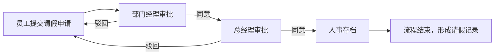

# 请假条是怎么变成代码的：Activiti7 工作流引擎入门

每个系统里都躲着几条「流程」：请假要走审批，报销要层层签字，入职要多个部门交接。业务代码写着写着就发现，这类逻辑如果用 if 加状态字段硬编码，改一个审批节点就得动表结构、动代码、发一次版。Activiti7 就是为这类问题而生的工作流引擎，它最新的 7 版本于 2018 年 9 月发布，也是人事管理（SaaS-HRM）这类传统行业项目里审批模块的底座。

## 先给结论

- 流程是事物发展的业务过程，请假审批就是一条典型的流程：员工申请、部门经理审批、总经理审批、人事存档。
- 在计算机帮助下实现流程的自动化控制，就叫工作流；纸质请假条的人工传递不算，那只是流程本身。
- 工作流引擎是让流程一步一步自动往后走的工具，Activiti 就是其中最常用的一款。
- Activiti 以 Maven 依赖引入工程，靠配置文件连上数据库，启动时会自动建出一整套 `act_` 开头的表。
- 流程本身被定义成 BPMN 文件部署进引擎，流转数据由引擎持久化到数据库，形成可追溯的审批记录。

## 从一张请假条说起：什么是流程

流程就是工作的一种流程，是事物发展的一个业务过程。每个事物的发展都有它自己的过程，把这个过程记录下来、按步骤走完，就是流程。

请假是最熟悉的一条流程：员工先写一份申请，交到部门经理那里签字，经理同意后交给总经理再签字，都没问题后由人事进行存档，至此请假流程结束，员工在指定的日期休假即可。把这条线画出来：



这条链路里每个节点都有明确的动作和去向，谁审批、同意之后到哪、驳回之后回哪，全都定死了。定死的这串步骤，就是流程。

## 从纸质传递到线上审批：什么是工作流

**传统方式解决流程，靠的是请假条的物理传递。** 员工写好请假条，跑到部门经理办公室等签字；经理签完，单子再被送到总经理桌上；最后一站是人事部门，请假条归档，请假环节才算做完。整个过程由人跑腿、人来推进，纸就是数据载体。

**无纸化办公之后，传递变成了线上申请、线上审批。** 员工不再找纸写条子，直接在线上发起申请，审批人在线上处理，最终这条请假数据永久保存在数据库的某一张表里，形成一条请假记录，流程结束。

两者的差别不在步骤，而在推动者：前者靠人拿着纸跑，后者在计算机的帮助下让流程自动地一步一步往后走。在计算机的帮助下实现流程的自动化控制，这就是工作流的定义。还停留在纸面传递的，只能叫流程，是传统方式的流程控制，谈不上工作流。

## 工作流引擎：让流程自己往后走

要让流程自动化，就得有人替你记住「现在走到哪一步了、下一步该谁处理、驳回要回到哪」。把这套推进逻辑做成通用组件，就是工作流引擎。为了实现自动化控制，Activiti 引擎由此产生，它的存在意义就是帮助开发者实现流程的自动化管理。

把职责拆开看更清楚：

| 角色 | 负责的事 |
|---|---|
| 业务代码 | 发起请假、展示待办，只关心业务数据 |
| 流程定义 | 把审批链路描述成引擎能读的 BPMN 文件 |
| Activiti 引擎 | 记录流程实例走到哪、自动推进、持久化流转数据 |
| 数据库 | 存流程定义、流程实例与每一步审批记录 |

业务代码不再自己维护「审批到第几级」这种状态字段，流程怎么走、走到哪，引擎说了算，改流程只是改流程定义，不动业务代码。

## 在工程里见到 Activiti7 的真容

课程配套工程里，引入 Activiti7 的 pom 关键部分如下（包名与 groupId 已改为中性的 `com.example`）：

```xml
<groupId>com.example.activiti</groupId>
<artifactId>activiti01</artifactId>
<version>1.0-SNAPSHOT</version>

<dependencies>
    <!-- 工作流引擎核心 -->
    <dependency>
        <groupId>org.activiti</groupId>
        <artifactId>activiti-engine</artifactId>
        <version>7.0.0.Beta1</version>
    </dependency>
    <!-- 与 Spring 集成 -->
    <dependency>
        <groupId>org.activiti</groupId>
        <artifactId>activiti-spring</artifactId>
        <version>7.0.0.Beta1</version>
    </dependency>
    <!-- BPMN 模型与转换工具 -->
    <dependency>
        <groupId>org.activiti</groupId>
        <artifactId>activiti-bpmn-model</artifactId>
        <version>7.0.0.Beta1</version>
    </dependency>
    <!-- 数据库驱动与连接池，引擎的表要落到 MySQL -->
    <dependency>
        <groupId>mysql</groupId>
        <artifactId>mysql-connector-java</artifactId>
        <version>5.1.40</version>
    </dependency>
    <dependency>
        <groupId>org.mybatis</groupId>
        <artifactId>mybatis</artifactId>
        <version>3.4.5</version>
    </dependency>
    <dependency>
        <groupId>commons-dbcp</groupId>
        <artifactId>commons-dbcp</artifactId>
        <version>1.4</version>
    </dependency>
</dependencies>
```

引擎单独运行时，通过 `activiti.cfg.xml` 配置数据源和引擎配置类：

```xml
<!-- 数据源配置，dbcp 连接池 -->
<bean id="dataSource" class="org.apache.commons.dbcp.BasicDataSource">
    <property name="driverClassName" value="com.mysql.jdbc.Driver" />
    <property name="url" value="jdbc:mysql://localhost:3306/activiti" />
    <property name="username" value="root" />
    <property name="password" value="root" />
</bean>

<!-- 单独启动方式的引擎配置，默认要求 bean 的 id 为 processEngineConfiguration -->
<bean id="processEngineConfiguration"
      class="org.activiti.engine.impl.cfg.StandaloneProcessEngineConfiguration">
    <property name="dataSource" ref="dataSource" />
    <!-- 是否自动生成表结构 -->
    <property name="databaseSchemaUpdate" value="true" />
</bean>
```

两个细节是约定：配置文件默认叫 `activiti.cfg.xml`，引擎配置 bean 的 id 默认叫 `processEngineConfiguration`。之后一行代码就能拿到引擎：

```java
package com.example.test;

import org.activiti.engine.ProcessEngine;
import org.activiti.engine.ProcessEngines;
import org.junit.Test;

/**
 * 测试 Activiti 运行所需表的生成
 */
public class ActivitiTest {

    @Test
    public void testGenTable() {
        // 依赖两个默认约定：配置文件名 activiti.cfg.xml，bean 的 id 为 processEngineConfiguration
        ProcessEngine processEngine = ProcessEngines.getDefaultProcessEngine();
        System.out.println(processEngine);
    }
}
```

`databaseSchemaUpdate` 设为 true 时，引擎第一次启动就会在 `activiti` 库里自动创建一整套 `act_` 开头的表，例如存放部署信息的 `act_re_deployment`、存放流程定义的 `act_re_procdef`、存放 BPMN 文件与图片的 `act_ge_bytearray`。上一节说的「请假记录永久保存在数据库表里」，落到 Activiti 里就是这些表。

## 常见误区

- **把工作流等同于流程**：流程是业务过程本身，纸质请假条传递也是流程；只有流程在计算机的帮助下被自动化控制时，才叫工作流。
- **用 if 和状态字段硬写审批流**：审批层级一变就要改表改代码。交给工作流引擎后，流转逻辑沉淀在流程定义里，业务代码只负责发起与展示。
- **以为 Activiti 只是一个 jar 不碰数据库**：引擎的运行强依赖数据库，数据源、连接池、驱动都要在配置里备齐，首次启动还会自动建表。
- **随意改名配置文件与 bean 的 id**：`ProcessEngines.getDefaultProcessEngine()` 按默认约定去加载 `activiti.cfg.xml` 和 `processEngineConfiguration`，名字不按约定就要显式指定，否则拿不到引擎。

## 面试可能被问到的问题

1. 面试官追问：「什么是工作流？和普通业务流程有什么区别？」
   答：流程是事物发展的业务过程，比如请假审批的几个环节。工作流强调的是在计算机的帮助下实现流程的自动化控制：步骤由引擎自动推进、状态由引擎记录，而不是靠人工传递单据。纸质请假条的传递只是流程，不是工作流。

2. 面试官追问：「工作流引擎解决什么问题？」
   答：解决流程的自动化管理问题。它替应用记住流程实例当前走到哪个节点、下一步流转到谁、驳回后回到哪，并把每一步持久化到数据库。业务代码从复杂的流转状态维护中解放出来，改审批链路只需调整流程定义。

3. 面试官追问：「Activiti7 是什么时候发布的？」
   答：Activiti 目前的主版本是 7，于 2018 年 9 月发布。课程工程使用的是 7.0.0.Beta1 版本的 `activiti-engine` 等依赖。

4. 面试官追问：「Activiti 首次运行发生了什么？」
   答：按默认约定加载 activiti.cfg.xml 中 id 为 processEngineConfiguration 的配置，用配置的数据源连接数据库，在 databaseSchemaUpdate 为 true 时自动创建 act_ 开头的一整套表，之后返回 ProcessEngine 对象供代码获取各个 Service 操作流程。

5. 面试官追问：「为什么审批模块要引入工作流引擎而不是自己写？」
   答：审批流的共性很强，流程定义、节点流转、驳回回退、审批记录留存这些能力与具体业务无关。引擎把这些通用能力做成了成熟组件，自带持久化与流程定义模型，自研相当于重复造轮子且难以应对流程变更。

## 配套资料

- 本课源码工程：`materials/code/02/Activiti7-day01-基础原理与使用/Activiti7-day01-基础原理与使用/代码/activiti01/`
  （含 `pom.xml`、`src/main/resources/activiti.cfg.xml`、`ActivitiTest.java` 等，文中包名与 groupId 已统一改为 `com.example`）
- 工程内另有 `ActivitiDeployment.java`（流程定义部署，把 BPMN 文件以 zip 形式部署进引擎，写入 `act_re_deployment`、`act_re_procdef`、`act_ge_bytearray` 表），可对照后续流程部署课程阅读
