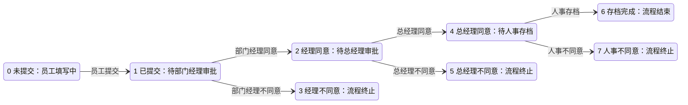

# 请假审批不用引擎也能跑：状态字段方案的完整推演与它的死穴

接到「请假审批」需求时的第一反应，往往是不引任何框架：建一张请假单表，加一个状态字段，每个角色按状态值查自己的待办，处理完改一下状态。这条路确实走得通，工作流引擎出现之前大家都是这么干的。把这条最原始的路线完整推演一遍，才能看清它卡在哪、为什么后来非引擎不可。

## 先给结论

- 工作流（Workflow）指通过计算机对业务流程实现自动化管理的过程；一个系统或项目具备流程自动化管理功能，就可以称为工作流系统。
- 不用工作流引擎也能实现流程自动化，最直接的方式是程序员编码：用状态字段的取值标记流程进展，各角色按状态值查询、处理、再更新状态。
- 状态值的含义全靠程序员定义并牢记，流转逻辑全部硬编码在查询条件与 update 语句里。
- 最大问题在变更：业务流程一变（例如砍掉总经理审批环节），原有代码立刻作废。
- 于是目标变成「以不变应万变」：流程怎么变代码都不变，这正是引入 Activiti 的动机。

## 一、工作流与工作流系统：两个名词钉牢

工作流的定义一句话就能说完：通过计算机对业务流程实现自动化管理的过程。关键词有两个，计算机、自动化。请假审批这种流程古已有之，纸质请假条靠人跑腿传递，那只是流程；把流程搬进系统、由程序自动推进，才叫工作流。

工作流系统是对系统的称呼：一个系统或项目具备流程自动化管理的功能，它就是工作流系统。两者是能力与载体的关系，工作流描述能力，工作流系统描述具备这种能力的系统。

**顺着定义就会撞上第一个真问题：** 流程自动化管理有哪些实现手段？问得更直白些就是，面试官一句「你们的流程自动化怎么做的」到底在问什么。不用 Activiti 这类引擎显然也能做，早年在工作流引擎出现之前，流程自动化照样有人实现，靠的就是程序员编码，这是方式一。

## 二、方式一：把流程编码进状态字段

以请假流程为载体：员工发起申请，部门经理审批，总经理审批，人事存档。设计一张请假单表，业务字段之外额外加一个状态字段，让它充当整条流程的「进度条」（以下表结构为示例，按本课写法补全）：

```sql
CREATE TABLE leave_apply (
  id         INT PRIMARY KEY AUTO_INCREMENT COMMENT '请假单编号',
  emp_no     VARCHAR(20)  COMMENT '员工工号',
  emp_name   VARCHAR(32)  COMMENT '员工姓名',
  dept_no    VARCHAR(20)  COMMENT '部门编号',
  leave_date DATE         COMMENT '请假日期',
  days       INT          COMMENT '请假天数',
  reason     VARCHAR(200) COMMENT '请假事由',
  status     INT NOT NULL DEFAULT 0 COMMENT '0未提交 1已提交 2经理同意 3经理不同意 4总经理同意 5总经理不同意 6存档完成 7存档不同意'
);
```

状态字段的取值与含义，就是一张流程地图：



每个角色围绕这个字段各司其职：

**员工只碰 0 和 1。** 填写中状态为 0，点下提交按钮，一条 update 把状态改成 1，请假单就算交到了部门经理手里。

**部门经理的查询条件有两个。** 状态等于 1，并且单子上的部门编号等于自己所在的部门编号：开发部经理只能审开发部的单子。审完把状态 update 成 2（同意）或 3（不同意）。

**总经理不限部门，只认状态。** 总经理掌管所有部门，部门编号条件可以省掉，直接查状态等于 2 的记录，那都是经理批完同意、轮到自己处理的单子。处理完 update 成 4（同意）或 5（不同意）。

**人事存档查状态等于 4 的记录。** 存档动作做完把状态 update 成 6 或 7，流程走到终点。

核心代码就是「查询 + 更新」这两板斧（示例代码，按本课写法补全）：

```java
/** 部门经理环节：查询待办并审批 */
public class DeptManagerHandler {

    /** 待办列表：本部门 + 已提交（状态 1） */
    public List<LeaveApply> todoList(String deptNo) {
        return leaveApplyMapper.selectByDeptAndStatus(deptNo, 1);
    }

    /** 审批：同意置 2，不同意置 3 */
    public void approve(long id, boolean agree) {
        leaveApplyMapper.updateStatus(id, agree ? 2 : 3);
    }
}
```

整条流程的推进，对数据库而言就是一轮轮 select 和 update：状态变 3 一看便知被经理否决，变 2 总经理一查就能接手。流程能自动往后走，自动化管理的目标达到了。

## 三、问题分析：需求一变，代码白写

给这套方案来一次变更压力测试：公司决定砍掉总经理审批环节，部门经理同意后直接进入人事存档。改动清单立刻出来：

- 状态字典错位：原来 2 表示「经理同意、待总经理审」，现在 2 就该直接进人事；4、5 两个状态彻底消失，人事存档的查询条件要从 `status=4` 改成 `status=2`。
- 涉及状态的代码全部重写：查询、update、页面上的状态展示，一处都不能漏。
- 状态含义只存在于程序员的脑子里和注释里，接手的人要先破译一遍。

**症结在这里：** 这种方式可以实现流程自动化管理，但对程序员而言它一点也不「自动」。每个状态值代表什么、每个环节查什么改什么，全靠人来定义、人来编码。业务流程变更后程序不能使用，算法写得再高效也救不回来；需求变更对程序员就是一场噩梦，而流程变更恰恰是业务方说了算、控制不了的事。

所以目标被重新表述成：流程你怎么变，代码都不变，以不变应万变。Activiti 的承诺正是这一句：业务流程变化后，程序代码不需要改动。它靠什么机制做到只更新流程图、就能让系统按新流程跑，后面的课程会把这个内部机制拆开讲透。

## 常见误区

- **把流程自动化等同于必须用工作流引擎**：状态字段硬编码同样能实现自动化，引擎解决的不是能不能做，而是流程变更的代价。
- **状态值没有字典**：`status=4` 是什么意思全靠猜，状态含义要落进文档或数据字典，否则没人维护得动。
- **部门经理的待办漏了部门条件**：只写 `status=1` 会把别的部门的单子也捞进来，必须同时限定部门编号相同。
- **只写同意分支**：3、5、7 这些不同意终态同样是合法结果，漏处理会让流程记录永远卡在中间状态。

## 面试可能被问到的问题

1. 面试官追问：「什么是工作流？什么又是工作流系统？」
   答：工作流指通过计算机对业务流程实现自动化管理的过程，关键词是自动化控制。一个系统或项目具备流程自动化管理功能，就可以称为工作流系统；前者是能力，后者是具备这种能力的系统。

2. 面试官追问：「不用工作流引擎能实现流程自动化吗？怎么做？」
   答：可以。最传统的方式是程序员编码：业务表里加状态字段，用状态值标记流程进展，每个角色按状态值加权限条件查询待办，处理完后 update 状态值交给下一环节，整条流程靠状态值接力推进。

3. 面试官追问：「这种方式最大的问题是什么？」
   答：经不起业务变更。流程环节一变，状态值定义、查询条件、更新逻辑全要重改，原有代码基本作废。它把流转逻辑硬编码进了程序，流程与代码强耦合。

4. 面试官追问：「部门经理审批的查询条件有哪些？为什么？」
   答：状态等于 1 加部门编号等于经理所在部门，保证只看到本部门提交且已提交的申请单。总经理掌管所有部门，所以只按状态等于 2 查询，不再限定部门。

5. 面试官追问：「引入 Activiti 之后，流程变更时改的是什么？」
   答：改的是业务流程图即流程定义，源代码不需要更新。引擎按流程定义推进流程，节点增减只影响流程定义数据，不触碰业务代码。

## 配套资料

- 本章节源码工程：`materials/code/02/Activiti7-day01-基础原理与使用/Activiti7-day01-基础原理与使用/代码/activiti01/`
  （本课为概念课，工程内是引擎环境搭建相关代码；文中请假单表结构与处理器示例为按本课写法补全）
