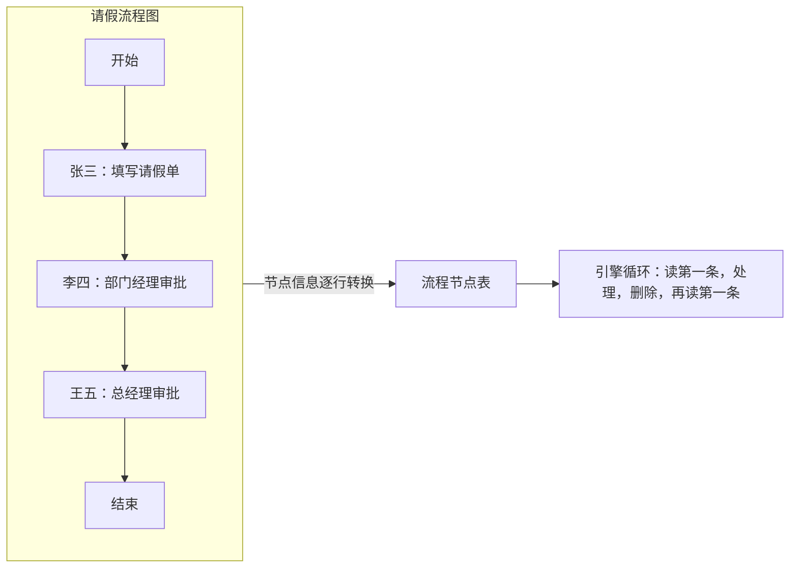
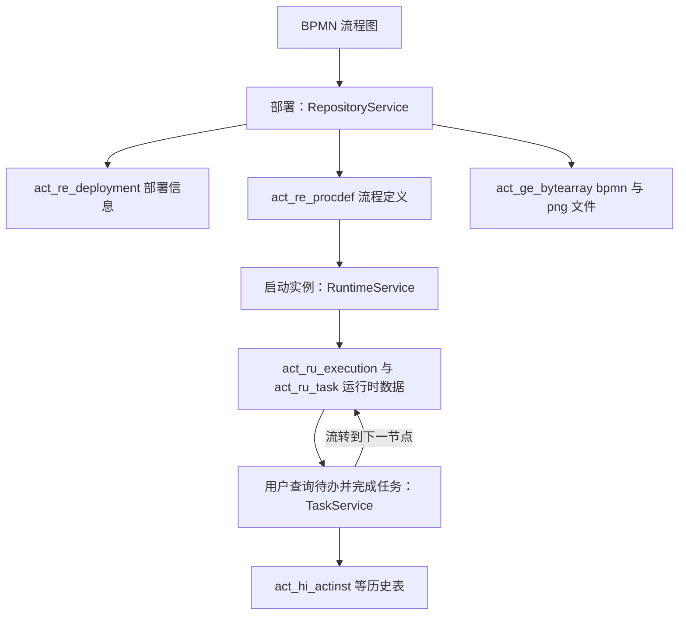
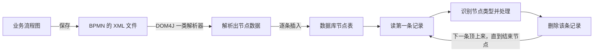
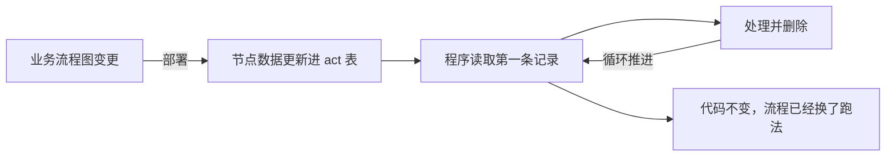

# Activiti 内部核心机制拆解：从手工推演到框架落点与 Activiti7

## 先给结论

- 核心机制一句话：把流程图节点的信息转换成数据库表中的记录，程序不断读取第一条记录，识别节点类型、处理、删除，再读下一条。
- 节点增减对表而言只是多一行或少一行，读取逻辑永远不变，这就是流程图变了代码不动的根源。
- 节点类型决定引擎动作：开始节点意味着流程启动，任务节点生成待办，结束节点终结流程。
- 推演出的实现链路四件套：BPMN 标准下用 XML 定义流程、XML 解析技术读节点、数据库表存记录、JDBC 或 MyBatis 一类持久化方案写表，数据库不限于 MySQL。
- 真实 Activiti 的落点是 `act_` 前缀的表：部署与定义写进 `act_re_*`，运行时数据在 `act_ru_*`，历史留痕在 `act_hi_*`；业务代码只和引擎的各个 Service 打交道，不直接操作这些表。
- Activiti 是 Alfresco 公司 2010 年 5 月 17 日宣布启动的开源项目，首席架构师 Tom Baeyens 原本是 jBPM 的架构师，所以常说 Activiti 的前身是 jBPM。
- 版本脉络 5.x、6.x 到 7：Activiti7 内部生成 25 张表，编程模型双轨并行，老的 `TaskService`、`TaskQuery` 依然可用，同时新增 `ProcessRuntime`、`TaskRuntime` 一套运行时 API。
- 三篇的递进关系：先手工造一张表模拟引擎循环，再推演从图到 XML 到表的自动化路径，最后把机制收束成一句话并交代 Activiti7 的来历。

## 第1部分：流程图变了代码不动：Activiti 内部核心工作机制拆解

「把流程图一改，系统就按新流程跑，源代码一行不动」，这句话初听像魔法。把引擎拆开看，核心机制朴素得出奇：流程图上的节点被转换成数据库表里的行，程序永远读第一行、识别、处理、删掉，再读新的一行。用一张手工版的表把这个机制推演出来，再对照真实的 Activiti 表名与课程工程代码验证，魔法就还原成了工程。

### 一、手工版引擎：先把流程图装进一张表

推演从一个最普通的请假流程开始：开始节点，张三填写请假单，李四以部门经理身份审批，王五以总经理身份审批，结束节点。没有引擎时，怎么让程序自动沿着这张图走？

思路是把图上的信息提前读出来放进一张数据库表：编号列、节点名称列，节点携带的属性再往后排。请假单节点上挂着请假人、天数、起止时间、事由这些数据，审批节点上挂着审批人：

| 编号 | 节点名称 | 节点属性 |
|---|---|---|
| 1 | 开始 | 无 |
| 2 | 填写请假单 | 张三、3 天、事由 |
| 3 | 部门经理审批 | 李四 |
| 4 | 总经理审批 | 王五 |
| 5 | 结束 | 无 |

图到表的转换是整个机制的第一块基石：



图上的每个节点变成表里的一行，节点名称决定引擎「做什么」，节点属性决定「谁来做、做的时候带什么数据」。

### 二、引擎循环：永远只读第一条

程序的处理逻辑从此变得极简：到表里读第一条记录，识别节点类型；是开始节点就让流程启动，是填写节点就等张三填完，是审批节点就把待办交给李四；这条记录一旦处理完成就删掉，下一条自动顶上来成为新的第一条。整个循环可以写成几行示意代码（示意代码，按本课机制补全）：

```java
/** 引擎推进逻辑的最简模型 */
public class FlowEngineModel {

    /** 不断读取第一条记录，处理完删除，直到结束节点 */
    public void drive() {
        NodeRecord current = nodeTable.first();
        while (!"结束".equals(current.getName())) {
            dispatch(current);            // 按节点类型分发：启动、生成待办、等待提交
            nodeTable.delete(current);    // 该环节处理完成，记录删除
            current = nodeTable.first();  // 下一条顶上来，流程前进一步
        }
    }
}
```

张三填完单，他那行被删掉，李四进来读到的第一条就是「部门经理审批」；李四批完删掉，王五读到的就是总经理环节。每个参与者看到的永远是自己的环节，流程就这样自动往后走，最后读到结束节点，整个流程完事。

### 三、变更为什么只是增删一行

现在砍掉总经理审批环节。对流程图而言少一个节点，对表而言少一行：编号 4 那条记录不复存在。再看循环逻辑：读第一条、处理、删除、再读第一条，一个字都不用改。李四批完删掉自己那行，下一条直接就是结束节点，流程自动按新形状跑完。反过来增加环节，也只是往表里插一行。

**关键就在节点与表之间的信息转换。** 流程的形状被翻译成了表里的行数和行序，程序面对的永远是「读第一条」这个不变的逻辑。业务流程变更后程序代码不需要改动，靠的就是这层转换，多一个节点少一个节点对程序没有任何影响。这也是 Activiti 敢承诺「以不变应万变」的底气。

### 四、真实的 Activiti：同一机制的工程化落点

手工模型在真实引擎里被工程化成 `act_` 前缀的表，课程工程 `activiti01` 的类注释直接标出了每步操作背后影响的表。部署流程定义时（包名已改为 `com.example`）：

```java
/** 流程定义部署：写入 act_re_deployment、act_re_procdef、act_ge_bytearray */
public class ActivitiDeployment {

    public static void main(String[] args) {
        // 1. 创建 ProcessEngine 对象
        ProcessEngine processEngine = ProcessEngines.getDefaultProcessEngine();

        // 2. 得到 RepositoryService 实例
        RepositoryService repositoryService = processEngine.getRepositoryService();

        // 3. 读取 bpmn 与 png 打包的 zip，进行部署
        InputStream is = ActivitiDeployment.class.getClassLoader()
                .getResourceAsStream("diagram/holidayBPMN.zip");
        ZipInputStream zipInputStream = new ZipInputStream(is);

        Deployment deployment = repositoryService.createDeployment()
                .addZipInputStream(zipInputStream)
                .name("请假申请单流程")
                .deploy();

        System.out.println(deployment.getName());
        System.out.println(deployment.getId());
    }
}
```

启动流程实例与查询处理任务，同样各有一组表伺候（取自工程内的启动与查询处理类）：

```java
// 启动流程实例：影响 act_ru_execution、act_ru_task 及 act_hi_* 历史表
ProcessEngine processEngine = ProcessEngines.getDefaultProcessEngine();
RuntimeService runtimeService = processEngine.getRuntimeService();
ProcessInstance instance = runtimeService.startProcessInstanceByKey("holiday");

// 查询王五的待办任务：读 act_ru_task
TaskService taskService = processEngine.getTaskService();
Task task = taskService.createTaskQuery()
        .processDefinitionKey("holiday")
        .taskAssignee("wangwu")
        .singleResult();
taskService.complete(task.getId()); // 完成任务：运行时表删记录，历史表留痕迹
```

两条线拼成整张机制图：



对照手工模型看：`act_ru_task` 就是那张「读第一条、处理完删」的节点表，`act_hi_*` 把手工模型里被删掉的行留了底，审批记录因此可追溯。业务代码从头到尾只碰 Service，表全部由引擎维护。

## 第2部分：把流程图翻译成 XML 再翻译成表：Activiti 核心机制的实现原理推演

引擎的核心思想已经清楚：节点信息进表、读第一条、处理、删除。真正让人安心的问题是，这套思想如果交给自己实现，每一步到底怎么落地。把实现路径从头推演一遍就会发现，整个过程只用到 XML、XML 解析、数据库和持久化四样技术，而 Activiti 做的事情就是把这条链路原封不动地封装成了框架。

### 一、画图要先有标准

把请假流程自动化，头一件事是把流程图画出来。用普通画图软件也能干：画一个圆角框当开始节点，填上颜色，再画矩形框、连线、往框里写字，一张「开始、填写请假单、部门经理审批、总经理审批、结束」的图就这么成型了。这种画法的问题是完全不专业：没有工具约束节点的形状和含义，也没有任何程序能稳定地理解这张图。

解决思路分两层。**第一，画图要有专门工具。** 流程建模有专业的设计器，开始、任务、连线这些元素都是现成的图标，拖出来就带标准语义，比手工画框填色靠谱得多。**第二，画法要遵守同一套标准。** 全世界的程序员如果都按同一套符号规范来画业务流程图，画出来的图就是全世界统一的，人能看懂，程序也能按同样的规则去读。这个「统一标准」的需求，正是 BPMN 规范存在的理由。

### 二、图是给人看的，XML 才是给程序用的

有了标准化的画法，下一个问题跟着来：程序怎么把图上的数据读出来？如果对着一张图片做文字识别，识别出框里写的是「填写请假单」、旁边标的是审批人，成本高且不可靠，这条路走不通。

正确的做法藏在文件的背后：建模工具里看到的是一张图，保存到磁盘上其实是一个 XML 文件。用 IDE 打开课堂演示的 `holiday.bpmn` 文件，看到的就是一段 XML：

```xml
<?xml version="1.0" encoding="UTF-8"?>
<definitions xmlns="http://www.omg.org/spec/BPMN/20100524/MODEL"
             xmlns:activiti="http://activiti.org/bpmn">
  <!-- 流程本体：id 是流程的唯一标识 -->
  <process id="myProcess" isExecutable="true">
    <startEvent id="2" name="StartEvent"/>
    <userTask id="3" name="UserTask">
      <extensionElements>
        <!-- 节点携带的业务数据，例如表单字段 -->
        <activiti:formField id="name" name="姓名" required="true" type="string"/>
      </extensionElements>
    </userTask>
    <!-- 连线：sourceRef 指向起点，targetRef 指向终点 -->
    <sequenceFlow id="4" sourceRef="2" targetRef="3"/>
    <endEvent id="4" name="EndEvent"/>
  </process>
  <!-- 图形信息：每个节点的坐标与连线的路径，专门用来还原图的样子 -->
  <bpmndi:BPMNDiagram>
    <bpmndi:BPMNPlane bpmnElement="myProcess">
      <bpmndi:BPMNShape bpmnElement="2"/>
      <bpmndi:BPMNEdge bpmnElement="4" sourceElement="2" targetElement="3"/>
    </bpmndi:BPMNPlane>
  </bpmndi:BPMNDiagram>
</definitions>
```

这段 XML 是节选，结构保留了课堂演示的原样。它能说明两件事：**其一，业务数据有着落。** XML 做配置文件的能力早就验证过，流程上每个节点的名称、属性、表单字段全都能存进标签里，`extensionElements` 就是挂自定义数据的位置。**其二，图形与语义分离。** `process` 部分描述流程本身，`bpmndi` 部分只存坐标和连线轨迹，负责让人打开工具时还能看到图。程序要的只是前半部分。

### 三、解析、入库、读表：自动化路径的完整闭环

图既然是 XML，剩下的事就顺理成章了。读取一个节点等于解析一个 XML 节点；解析出来的数据插入 MySQL（或其他数据库）的一张表，形成一条记录；把所有节点解析完、全部入库，图到表的转换就完成了。用 DOM4J 解析的核心动作大概是这样（示例代码，按本课写法补全）：

```java
SAXReader reader = new SAXReader();
Document doc = reader.read(new File("src/main/resources/diagram/holiday.bpmn"));
Element process = doc.getRootElement().element("process");

// 遍历所有任务节点，每个节点解析成一条记录
for (Iterator<Element> it = process.elementIterator("userTask"); it.hasNext(); ) {
    Element task = it.next();
    String id = task.attributeValue("id");
    String name = task.attributeValue("name");
    // 解析出的节点数据插入节点表，形成一条记录
    nodeTable.insert(id, name);
}
```

入库之后，流程推进就彻底变成了数据库操作，整条数据流可以画成一张图：



关键路径在读表之后的循环：读到开始节点，流程启动；读到任务节点，对应负责人处理；处理完删掉这一行，下一条自动变成第一条；读到结束节点，流程收尾。节点一个一个进表、一行一行被消费，图上的推进就完整映射成了表上的增删查。

### 四、技术选型与框架的封装边界

把上面的推演收拢，自己实现这套自动化需要的技术清单其实很短：一套流程定义的标准（XML）、一个解析工具（DOM4J 这类 XML 解析库）、一个数据库（MySQL 或其他数据库都行）、一套持久化方案（JDBC 相关技术，往表里存录和删除数据）。

Activiti 的价值在于把这条链路整段封装：节点标准怎么定、XML 怎么解析、数据库里建多少张表、每张表怎么读写，这些细节全部交给工作流引擎处理。开发者要学的只剩下这个工具怎么用。理解了这层封装关系，后面学 Activiti 时就不会迷失在细节里，因为每一个 API 背后都是这段推演里的一步。

## 第3部分：从推演到框架：核心机制收束与 Activiti7 的来历

工作流引擎的底层机制已经推演完毕：节点进表、读第一条、处理、删除。把这个机制收束成一句结论，就可以正式认识 Activiti 本尊了：它是谁做的、从哪来、到 7 这个大版本和 5.x、6.x 比有什么看得见的变化。这些背景决定了课程工程为什么用 7.0.0.Beta1，也决定了后面要学哪些 API。

### 一、把机制收束成一句话

前几轮推演拆了很多细节，合起来其实只有一句话：程序永远只认那张表。流程图发生变化后，重新部署一次，节点数据立刻更新进表；程序这边什么都没动，照样读第一条、处理、删除。表里的记录怎么变，完全由流程图的节点决定：



这张图就是「流程与业务解耦」的落点：变化被吸收在图与表之间，程序侧保持恒定。只要这个转换通道存在，审批环节增增减减都只是表里多几行少几行的事。

### 二、实现链路：四样技术就够了

支撑这个机制的技术清单也很短。流程定义用 XML 文件承载；读节点靠 DOM4J 一类的 XML 解析技术；解析出的数据存进 MySQL，当然换成其他数据库也成立；往表里写数据可以用原生 JDBC，也可以用 Hibernate、MyBatis 这类持久化框架。每一环都有成熟的通用技术，没有黑魔法。Activiti 做的正是把这四样按流程引擎的需求组装好：多少张表、表结构怎么设计、解析和读写什么时候触发，全部由引擎内部决定。

### 三、Activiti 从哪来

**第一，出身。** Activiti 是 Alfresco 公司在 2010 年 5 月 17 日宣布启动的业务流程管理开源项目。**第二，人物。** 它的首席架构师 Tom Baeyens 是 BPM 领域的专家，此前正是 jBPM 的架构师，后来加入了 Alfresco 主导 Activiti。**第三，血缘。** 因为两套引擎早期出自同一人之手，说 Activiti 的前身是 jBPM 并没有问题，两者在流程建模思想上是一脉相承的。

课程工程选择的是 7.0.0.Beta1，这也是当时官网 Learn more 页面上能看到的最新版本；它前面经历过 5.x 和 6.x 两代。官网的 Previous Versions 入口可以找到 6.x 与 5.x 的历史资料，对照着看版本差异很方便。

### 四、7 相对 6.x 的两个看得见的变化

**第一，开箱建表的体验更完整。** 引入 `activiti-engine` 等坐标后，只要按默认约定给出 `activiti.cfg.xml`（bean 的 id 为 `processEngineConfiguration`），把 `databaseSchemaUpdate` 设为 true，第一次拿到引擎就会把整套表建出来。Activiti7 一共 25 张 `act_` 开头的表，5.x 时代是 23 张或 24 张，表结构还在继续加厚。课堂工程里的真实配置如下（包名已改为中性的 `com.example`）：

```xml
<!-- 单独启动方式的引擎配置，默认要求 bean 的 id 为 processEngineConfiguration -->
<bean id="processEngineConfiguration"
      class="org.activiti.engine.impl.cfg.StandaloneProcessEngineConfiguration">
    <property name="dataSource" ref="dataSource"/>
    <!-- 代表是否生成表结构：true 时首次启动自动建齐 25 张 act_ 表 -->
    <property name="databaseSchemaUpdate" value="true"/>
</bean>
```

**第二，编程模型长出了新轨道。** 老的 Service 体系在 7 里原样保留，课堂工程查询待办用的仍是经典写法：

```java
// 老 API 在 Activiti7 中依然可用：TaskService + TaskQuery
ProcessEngine processEngine = ProcessEngines.getDefaultProcessEngine();
TaskService taskService = processEngine.getTaskService();

Task task = taskService.createTaskQuery()
        .processDefinitionKey("holiday")
        .taskAssignee("wangwu")
        .singleResult();
```

与此同时，7 引入了 `ProcessRuntime`、`TaskRuntime` 为代表的新运行时 API，启动实例、查任务、办任务改由这组面向安全上下文与分页查询的接口承担。下面的启动实例写法出自课程资料包里的官方示例工程（示例，新 API 的完整用法在后续新特性课程展开）：

```java
// 新 API：ProcessRuntime 启动流程实例（摘自官方示例工程的写法）
Page<ProcessDefinition> defs = processRuntime.processDefinitions(Pageable.of(0, 10));
ProcessInstance instance = processRuntime.start(ProcessPayloadBuilder.start()
        .withProcessDefinitionKey("holiday")
        .withVariable("days", 3)
        .build());
```

两套 API 的分工是理解 7 的钥匙：老 API 贴近引擎内核，适合单独部署引擎的学习场景；新 API 面向与 Spring Boot 的深度整合，是 7 之后的演进方向。

## 常见误区

- **以为引擎真的把记录物理删除**：手工模型里处理完删行，真实引擎是运行时表删、历史表留，`act_hi_` 前缀的表保证每一步审批可查。

- **混淆流程定义与流程实例**：流程定义是模板，流程实例是一次具体的请假；修改流程定义影响的是之后启动的实例，不影响已经在跑的实例。

- **把 `act_` 表当业务表直接读写**：这些表由引擎内部维护，业务数据放业务表，需要关联时用 businessKey 挂到流程实例上。

- **以为改流程图等于改代码**：改动落在流程定义即 BPMN 与部署数据上，业务代码不需要重新编译发布，这正是引擎的核心价值。

- **以为引擎在做图像识别**：引擎从不看图，图只是给人看的界面；它解析的是 BPMN 文件里的 XML，识别图片文字的思路从一开始就不成立。

- **以为 BPMN 文件里只有流程信息**：文件里还有 `bpmndi` 开头的图形坐标部分，专门负责把图还原出来；删掉它流程照样跑，只是设计器里看不到图了。

- **以为必须自己写 XML 解析和建表 SQL**：这些是引擎内部实现，业务代码只通过引擎的 API 操作流程，手写解析只出现在理解原理的场合。

- **以为方案绑死 MySQL**：存储层可以换成其他数据库，持久化可以用 JDBC、MyBatis 或 Hibernate，引擎不关心具体是哪一种。

- **以为 7 推翻重写了老 API**：`TaskService`、`RuntimeService`、`RepositoryService` 全部还在，课程工程大量使用；新 Runtime API 是加出来的轨道，不是替换。

- **以为自动建表不需要任何配置**：数据源、驱动、连接池照样要配齐，`databaseSchemaUpdate` 为 true 只是免去了手工执行建表 SQL，不是免配置。

- **把 jBPM 和 Activiti 当成毫无关系的两个产品**：两者早期出自同一架构师，建模思想同源，选型时才需要比较现状与生态。

- **以为表数量是固定常识**：25 张是 Activiti7 的数字，5.x 是 23、24 张，版本升级表会变，面试报数字时带上版本更稳。

## 面试可能被问到的问题

1. 面试官追问：「Activiti 为什么能做到流程变更而源代码不变？」
   答：引擎把流程图上的节点信息转换成数据库表中的记录，程序永远读取第一条记录，识别节点类型、处理、删除，再读下一条。流程变更只是表里多一行或少一行，读取逻辑不变，代码自然不用改。

2. 面试官追问：「引擎内部是怎么推进流程的？」
   答：按节点循环推进：读当前记录判断节点类型，任务节点生成待办交给负责人；负责人完成待办后，运行时记录删除、历史记录落库，下一条记录顶上，直到读到结束节点流程结束。

3. 面试官追问：「部署流程定义会写哪些表？」
   答：`act_re_deployment` 存部署信息，`act_re_procdef` 存流程定义信息，`act_ge_bytearray` 存 BPMN 文件和图片等二进制资源。

4. 面试官追问：「启动流程实例影响哪些表？」
   答：运行时表 `act_ru_execution`、`act_ru_task`、`act_ru_identitylink` 记录当前执行到哪与当前任务；历史表 `act_hi_procinst`、`act_hi_taskinst`、`act_hi_actinst` 等同步落一份痕迹。

5. 面试官追问：「`act_ru_` 和 `act_hi_` 前缀的表有什么区别？」
   答：`ru` 是 runtime，运行时数据，只保存正在流转的流程，节点走完即删；`hi` 是 history，历史数据，流程的每一步都会留痕，用于审批记录查询与追溯。

6. 面试官追问：「业务代码和引擎表的关系是什么？」
   答：业务代码通过 ProcessEngine 获取 RepositoryService、RuntimeService、TaskService 等 API 操作流程，不直接读写 `act_` 表；业务数据放业务表，通过 businessKey 与流程实例关联。

7. 面试官追问：「Activiti 内部是怎么把流程图变成可执行数据的？」
   答：流程图保存后本质是一个 BPMN 的 XML 文件，节点数据都在标签里。引擎解析这个 XML，把每个节点的信息插入数据库表形成记录，流程的推进就转化为读表、处理、删除记录的循环，直到读到结束节点。

8. 面试官追问：「为什么不直接对流程图图片做识别，而要用 XML？」
   答：图像识别要辨认节点形状和框内文字，成本高、不可靠，而且丢失了节点的结构关系。XML 天然可以做配置文件，节点的层级、连线指向、携带属性都能结构化表达，解析成本低且确定。

9. 面试官追问：「自己实现一个最简工作流引擎需要哪些技术？」
   答：一套流程定义标准（XML 载体）、XML 解析工具（如 DOM4J）、数据库存节点数据、JDBC 或类似持久化方案做增删查。核心逻辑是节点入库后循环读第一条、处理、删除。

10. 面试官追问：「BPMN 文件里 BPMNDiagram 部分是干什么的？」
   答：存图形坐标和连线轨迹，供设计器还原图形显示，属于展示层信息；引擎执行流程只依赖 process 部分的语义定义，两者分离互不影响。

11. 面试官追问：「这套机制里 Activiti 到底替开发者做了什么？」
   答：流程定义的标准落法、XML 解析、自动建表（Activiti7 会生成 25 张 act_ 开头的表）、节点数据的读写与流程推进全部由引擎封装，开发者通过 API 使用，不需要自己实现其中任何一环。

12. 面试官追问：「用一句话总结 Activiti 的核心机制？」
   答：流程图变更后重新部署，节点数据更新进数据库表，程序永远从表里读第一条记录、处理、删除再读下一条。变化被吸收在图与表之间，程序代码不需要改动。

13. 面试官追问：「实现这套机制需要哪些技术？」
   答：XML 文件定义流程，DOM4J 一类解析器读取节点，数据库存节点记录，JDBC、MyBatis 或 Hibernate 做持久化。数据库不限于 MySQL，持久化框架也可以替换。

14. 面试官追问：「Activiti 和 jBPM 什么关系？」
   答：Activiti 由 Alfresco 公司 2010 年 5 月 17 日宣布启动，首席架构师 Tom Baeyens 之前是 jBPM 的架构师，两个项目早期出自同一人之手，所以常说 Activiti 的前身是 jBPM，建模思想一脉相承。

15. 面试官追问：「Activiti7 相比 6.x 有什么主要变化？」
   答：一是开箱体验，按默认约定配置后首次启动自动建齐 25 张 act_ 表，比 5.x 的 23、24 张更多；二是新增 ProcessRuntime、TaskRuntime 等新运行时 API，同时完整保留老的 Service 体系，两套 API 并存。

16. 面试官追问：「课程工程为什么用 7.0.0.Beta1？」
   答：这是该课程编写时官网提供的最新版本，企业老项目里 Beta1 时期留下的集成方式也很常见；学习时以它入门，新特性与 Spring Boot 整合的正式用法可以对照官方示例工程补充。

## 配套资料

- 本课源码工程：`materials/code/02/Activiti7-day01-基础原理与使用/Activiti7-day01-基础原理与使用/代码/activiti01/`
  （含 `ActivitiDeployment.java`、`ActivitiStartInstance.java`、`ActivitiTaskQuery.java`、`ActivitiCompleteTask(1).java`、`src/main/resources/activiti.cfg.xml`，文中包名已统一改为 `com.example`）

- 手工版引擎与节点表为课堂推演的示意代码，按本课机制补全

- 本课源码工程：`materials/code/02/Activiti7-day01-基础原理与使用/Activiti7-day01-基础原理与使用/代码/activiti01/`
  （含 `pom.xml`、`src/main/resources/activiti.cfg.xml`、`ActivitiDeployment.java` 等，文中包名已统一改为 `com.example`）

- BPMN 文件片段来自课堂对 `holiday.bpmn` 的演示；DOM4J 解析代码为按本课写法补全的示例，工程内不包含该解析类

- 本课源码工程：`materials/code/02/Activiti7-day01-基础原理与使用/Activiti7-day01-基础原理与使用/代码/activiti01/`
  （含 `pom.xml`、`src/main/resources/activiti.cfg.xml`、`ActivitiTaskQuery.java`，文中包名已统一改为 `com.example`）

- 新 API 示例工程：`materials/code/02/Activiti7-day06-新特性/Activiti7-day06-新特性/资料/activiti-examples-master/activiti-api-basic-full-example/`
  （官方示例，含 `ProcessRuntime`、`TaskRuntime` 的完整用法）
