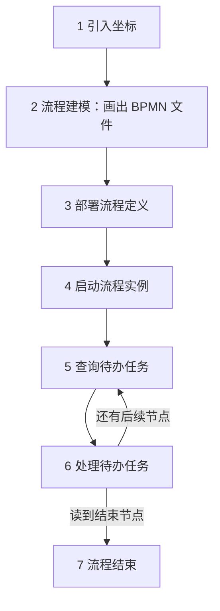

# 七步把 Activiti7 接进项目：从引坐标到流程结束

机制和规范都铺垫完了，剩下的问题是落地：真要在 SaaS-HRM 这样的项目里整合 Activiti，动手顺序是什么？答案是一套固定的七步流程，从引坐标开始，到流程结束收尾。把七步和课程工程 `activiti01` 里的真实代码对上号，每一步该写什么类、调什么 API 就都清楚了。

## 先给结论

- 七个步骤依次是：引入坐标、流程建模、部署流程定义、启动流程实例、查询待办任务、处理待办任务、流程结束。
- 建模就是用流程设计器按 BPMN 规范把业务流程画成 `bpmn` 文件，图背后是 XML。
- 部署把 BPMN 文件交给引擎写入 `act_` 表；启动流程实例后引擎才开始真正读节点。
- 用户视角只有两个动作：查待办、办待办；`complete` 一次，流程自动推进一格。
- 所有节点走完读到结束节点，流程终止，运行时表清空、历史表留痕。

## 一、七步总览

把整合路径画成一张图，后面每一节对应其中一步：



五个查询与处理之间的循环就是引擎的推进方式：张三办完自己的节点，李四查到待办、办完，王五再查再办，直到结束节点。代码不需要写任何「跳到下一步」的逻辑，推进完全由引擎接管。

## 二、第一步：引入坐标与基础配置

整合的第一步是把 Activiti 当成普通依赖导进工程，该引坐标引坐标。课程工程 `activiti01` 的 pom 关键部分如下（包名与 groupId 已改为中性的 `com.example`）：

```xml
<groupId>com.example.activiti</groupId>
<artifactId>activiti01</artifactId>
<version>1.0-SNAPSHOT</version>

<dependencies>
    <!-- 工作流引擎核心 -->
    <dependency>
        <groupId>org.activiti</groupId>
        <artifactId>activiti-engine</artifactId>
        <version>7.0.0.Beta1</version>
    </dependency>
    <!-- 引擎的表要落到 MySQL，数据源用 dbcp 连接池 -->
    <dependency>
        <groupId>mysql</groupId>
        <artifactId>mysql-connector-java</artifactId>
        <version>5.1.40</version>
    </dependency>
    <dependency>
        <groupId>commons-dbcp</groupId>
        <artifactId>commons-dbcp</artifactId>
        <version>1.4</version>
    </dependency>
</dependencies>
```

配套的 `activiti.cfg.xml` 里配好数据源和引擎配置对象，`databaseSchemaUpdate` 设为 true，首次拿到引擎时 25 张 `act_` 表自动建齐。配置就绪后，`ProcessEngines.getDefaultProcessEngine()` 一行就能拿到引擎入口。

## 三、第二步：流程建模

建模说白了就是把业务流程的规则画出来：用流程设计器（activiti-designer 一类工具）按 BPMN 规范拖节点、连线、填名称，生成 `holiday.bpmn` 这样的业务流程定义文件。文件里 `process` 的 `id` 是流程的唯一标识，后面的代码全靠它找流程，画图时就要把 key 定好，比如请假流程定成 `holiday`。节点上还可以挂表单字段、审批人这些数据，供运行时使用。

## 四、第三步：部署流程定义

图有了还要交给引擎，这个动作叫部署。部署把 BPMN 文件与图片存进引擎，写入 `act_re_deployment`、`act_re_procdef`、`act_ge_bytearray` 三张表。课程工程 `ActivitiDeployment` 里的直接资源部署写法如下（包名已改为 `com.example`）：

```java
package com.example.activiti;

import org.activiti.engine.ProcessEngine;
import org.activiti.engine.ProcessEngines;
import org.activiti.engine.RepositoryService;
import org.activiti.engine.repository.Deployment;

/** 流程定义部署 */
public class ActivitiDeployment {

    public static void main(String[] args) {
        // 1. 创建 ProcessEngine 对象
        ProcessEngine processEngine = ProcessEngines.getDefaultProcessEngine();

        // 2. 得到 RepositoryService 实例
        RepositoryService repositoryService = processEngine.getRepositoryService();

        // 3. 进行部署：添加 bpmn 资源与流程图片
        Deployment deployment = repositoryService.createDeployment()
                .addClasspathResource("diagram/holiday.bpmn")
                .addClasspathResource("diagram/holiday.png")
                .name("请假申请单流程")
                .deploy();

        // 4. 输出部署信息
        System.out.println(deployment.getName());
        System.out.println(deployment.getId());
    }
}
```

工程里另有把 `bpmn` 与 `png` 打成 zip 后用 `addZipInputStream` 部署的变体，zip 形式更便于上传服务器，两种写法落库的效果一致。

## 五、第四步：启动流程实例

部署只是把模板放进引擎，什么时候开始读节点，由启动流程实例决定。启动后引擎从第一个节点开始逐个读取，运行时数据写入 `act_ru_execution`、`act_ru_task` 等表，历史表同步留痕。这是 `ActivitiStartInstance` 的真实代码：

```java
package com.example.activiti;

import org.activiti.engine.ProcessEngine;
import org.activiti.engine.ProcessEngines;
import org.activiti.engine.RuntimeService;
import org.activiti.engine.runtime.ProcessInstance;

/** 启动流程实例，前提是流程定义已完成部署 */
public class ActivitiStartInstance {

    public static void main(String[] args) {
        // 1. 得到 ProcessEngine 对象
        ProcessEngine processEngine = ProcessEngines.getDefaultProcessEngine();

        // 2. 得到 RuntimeService 对象
        RuntimeService runtimeService = processEngine.getRuntimeService();

        // 3. 创建流程实例，参数是流程定义的 key：holiday
        ProcessInstance processInstance = runtimeService.startProcessInstanceByKey("holiday");

        // 4. 输出实例相关信息
        System.out.println("流程定义ID" + processInstance.getProcessDefinitionId());
        System.out.println("流程实例ID" + processInstance.getId());
    }
}
```

注意这里传的是流程定义的 `key`，也就是建模时 `process` 的 `id`。同一个流程定义可以反复启动，每次启动都是一个独立的流程实例。

## 六、第五、六步：查询待办与处理待办

引擎推进到某个用户任务节点时，对应的负责人要先查到自己的待办。课程工程 `ActivitiTaskQuery` 查询王五的任务：

```java
package com.example.activiti;

import org.activiti.engine.ProcessEngine;
import org.activiti.engine.ProcessEngines;
import org.activiti.engine.TaskService;
import org.activiti.engine.task.Task;

/** 查询当前用户的任务列表 */
public class ActivitiTaskQuery {

    public static void main(String[] args) {
        // 1. 得到 ProcessEngine 对象
        ProcessEngine processEngine = ProcessEngines.getDefaultProcessEngine();

        // 2. 得到 TaskService 对象
        TaskService taskService = processEngine.getTaskService();

        // 3. 按流程定义 key 与负责人 assignee 查询当前用户的任务
        Task task = taskService.createTaskQuery()
                .processDefinitionKey("holiday")
                .taskAssignee("wangwu")
                .singleResult();

        // 4. 任务信息展示
        System.out.println("流程实例ID:" + task.getProcessInstanceId());
        System.out.println("任务ID:" + task.getId());
        System.out.println("任务负责人:" + task.getAssignee());
        System.out.println("任务名称:" + task.getName());
    }
}
```

查询条件靠两个维度锁定任务：流程定义的 key 加上负责人 `assignee`，张三、李四的查询只是把 `taskAssignee` 的值换掉，工程里以注释变体的形式保留了另外两人的写法。查到任务之后办理，`ActivitiCompleteTask` 一行核心调用：

```java
// 处理当前用户的任务，背后操作 act_ru_task 等运行时表与 act_hi_* 历史表
Task task = taskService.createTaskQuery()
        .processDefinitionKey("holiday")
        .taskAssignee("wangwu")
        .singleResult();
taskService.complete(task.getId()); // 完成任务，流程自动推进到下一节点
```

`complete` 之后引擎删掉当前运行时记录、写入历史，推进到下一个节点生成新的待办。整个过程业务代码只做了「查询」和「完成」两个动作，节点的流转判断全部在引擎内部。

## 七、第七步：流程结束

王五批完最后一个审批节点后，引擎读到结束节点，整个流程实例执行完毕。此刻运行时表里这条流程的数据被清掉，`act_hi_actinst`、`act_hi_procinst`、`act_hi_taskinst` 等历史表留下了完整的每一步痕迹，审批记录因此可追溯。回看七个步骤：一次建模与部署对应一个流程模板，启动实例、查询、处理的循环对应每一次真实的请假，模板与运行分得清清楚楚。

## 常见误区

- **部署完就以为流程在跑了**：部署只是入库模板，不启动流程实例引擎不会读任何节点；两者是「存模板」和「开一单」的关系。
- **key 与 assignee 对不上**：`startProcessInstanceByKey("holiday")` 的 key 必须等于建模时 `process` 的 `id`，`taskAssignee` 必须与节点上配置的负责人一致，任何一个写错都查不到实例或任务。
- **以为要自己写「跳到下一节点」的代码**：推进由 `complete` 触发引擎自动完成，手动改表或自己维护状态字段等于把引擎架空。
- **忽略同一流程的多次启动**：流程定义只有一个，流程实例可以有无数个，查任务时若不限定流程实例，多个并行请假单的任务会混在一起。

## 面试可能被问到的问题

1. 面试官追问：「在项目里整合 Activiti7 的完整步骤是什么？」
   答：引入 activiti-engine 等坐标并配置数据源；用设计器按 BPMN 规范建模生成 bpmn 文件；通过 RepositoryService 部署流程定义；用 RuntimeService 启动流程实例；用户通过 TaskService 查询待办、complete 处理待办；所有节点走完读到结束节点，流程结束。

2. 面试官追问：「流程定义和流程实例是什么关系？」
   答：流程定义是 BPMN 文件部署后形成的模板，一个模板一个定义；每次 `startProcessInstanceByKey` 启动出一个实例，一个定义可以同时跑任意多个实例，互不干扰。

3. 面试官追问：「部署流程定义会写哪些表？」
   答：`act_re_deployment` 存部署信息，`act_re_procdef` 存流程定义信息，`act_ge_bytearray` 存 bpmn 文件和 png 图片等二进制资源。

4. 面试官追问：「用户查询待办任务靠什么条件？」
   答：靠流程定义的 key 加负责人 assignee 两个条件组合查询，`taskService.createTaskQuery().processDefinitionKey(...).taskAssignee(...)`，单人单任务用 `singleResult`，多条结果用 `list`。

5. 面试官追问：「`complete` 方法背后发生了什么？」
   答：引擎删除当前任务在 `act_ru_task` 等运行时表的记录，把活动信息写入 `act_hi_actinst` 等历史表，然后按流程定义推进到下一节点；如果下一节点是用户任务就生成新待办，如果是结束节点流程实例终止。

6. 面试官追问：「zip 部署和单文件部署有什么区别？」
   答：`addClasspathResource` 一次加一个资源文件；把 bpmn 与 png 打成 zip 后用 `addZipInputStream` 一次部署全部资源，更适合文件较多或需要上传服务器的场景，落库结果一致。

## 配套资料

- 本课源码工程：`materials/code/02/Activiti7-day01-基础原理与使用/Activiti7-day01-基础原理与使用/代码/activiti01/`
  （含 `pom.xml`、`src/main/resources/activiti.cfg.xml`、`ActivitiDeployment.java`、`ActivitiStartInstance.java`、`ActivitiTaskQuery.java`、`ActivitiCompleteTask(1).java`，文中包名与 groupId 已统一改为 `com.example`）
