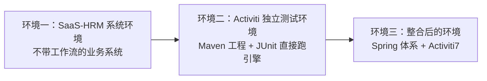
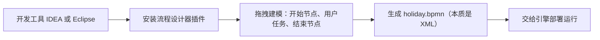

# Activiti7 开发环境搭建清单：版本组合、下载方式与流程设计器的角色

搭工作流引擎的环境，怕的不是步骤多，而是版本组合不对：JDK 一个版本、MySQL 另一个版本、驱动又是一个版本，平时相安无事，引擎一初始化就报错，报错信息还指不到根因。在 SaaS-HRM 项目里引入 Activiti7 之前，先把版本卡死、把获取方式弄清，后面三步整合才不会返工。

## 先给结论

- 环境分三层搭：SaaS-HRM 系统本身的环境、Activiti 独立测试环境、两者整合后的环境。一次只引入一个变量，每层独立验证，出问题不会互相牵连。
- 版本组合：JDK 1.8 或以上，MySQL 5 及以上（课程采用 5.5），Tomcat 8.5，开发工具 IDEA 与 Eclipse 都可以，流程设计器插件两边都能装。
- 引擎选 Activiti 7.0.0.Beta1，2018 年发布的版本，默认支持 Spring 5.x。
- 从 7.x 起官方不再提供 5.x、6.x 那种完整开发包压缩包，依赖统一走 Maven 坐标获取；Beta1 这类版本还需要在 pom 里补官方仓库地址。
- 流程设计器插件只负责建模：把画出来的图翻译成 BPMN XML，把 XML 渲染成图，不参与运行时。

## 一、为什么要拆成三个环境

工作流不是孤立功能，它要嵌进业务系统。直接在业务工程里边建边试，引擎报错时分不清是业务配置的问题还是引擎本身的问题。把环境拆开，路径就清晰了：



这张图在讲环境的搭建顺序。图里最关键的是中间那层：独立测试环境最小，一个 Maven 工程加 JUnit 就能把引擎跑起来，版本组合对不对、坐标全不全，在这里最先暴露，成本也最低。业务系统环境和整合环境都建立在这层验证通过的基础上，逐步往里叠加。

## 二、版本组合清单

| 组件 | 要求 | 用途说明 |
|---|---|---|
| JDK | 1.8 或以上 | Activiti7 与 Spring 5.x 的运行基线 |
| 数据库 | MySQL 5 及以上，课程采用 5.5 | 引擎自动建 25 张 `act_` 表的落点 |
| Web 容器 | Tomcat 8.5 | 供后续整合与 Web 演示使用 |
| 数据库客户端 | SQLyog 或其它 | 建库、观察引擎生成的表 |
| 文本编辑器 | EditPlus 或其它 | 直接查看 `bpmn`、`png` 原始内容 |
| Java 开发工具 | IDEA 或 Eclipse | 均可安装 Activiti 流程定义插件 |

两个容易被忽略的点：

**第一，独立测试环境用不到 Web 容器。** 引擎本身就是一组 jar，JUnit 里直接构建 `ProcessEngine` 就能跑，整个过程不经过 Servlet 容器。Tomcat 装好备用即可，别在这个阶段折腾部署。

**第二，驱动版本要和数据库配套。** 课程工程用的是 `mysql-connector-java 5.1.40`，配 MySQL 5.x 稳定。如果数据库直接上 MySQL 8，老驱动会遇到认证插件不支持和时区问题，报错信息与依赖本身无关，排查方向极易跑偏。学习阶段跟随课程组合，把精力留给引擎本身。

## 三、Activiti7 的获取方式

官网下载地址是 `http://activiti.org/download.html`。和 5.x、6.x 时代不同，页面上没有完整开发包压缩包可下，给出的是一段 Maven 的 `dependencyManagement` 配置，也就是所谓 BOM（物料清单）：

```xml
<dependencyManagement>
    <dependencies>
        <dependency>
            <groupId>org.activiti</groupId>
            <artifactId>activiti-dependencies</artifactId>
            <version>7.0.0.Beta1</version>
            <scope>import</scope>
            <type>pom</type>
        </dependency>
    </dependencies>
</dependencyManagement>
```

`type` 为 `pom`、`scope` 为 `import` 的写法，作用是把 Activiti 全家桶的版本号集中仲裁：工程里引用 `activiti-engine` 等模块时不用再逐个写版本，避免模块之间版本错配。

课程真实工程 `activiti01` 采用的是直接声明坐标加补仓库的写法（groupId 已改为中性的 `com.example`）：

```xml
<groupId>com.example.activiti</groupId>
<artifactId>activiti01</artifactId>
<version>1.0-SNAPSHOT</version>

<dependencies>
    <!-- 工作流引擎核心 -->
    <dependency>
        <groupId>org.activiti</groupId>
        <artifactId>activiti-engine</artifactId>
        <version>7.0.0.Beta1</version>
    </dependency>
    <!-- 与 Spring 整合用，独立测试阶段可先不引 -->
    <dependency>
        <groupId>org.activiti</groupId>
        <artifactId>activiti-spring</artifactId>
        <version>7.0.0.Beta1</version>
    </dependency>
    <!-- BPMN 模型、转换器、自动布局等建模支撑模块 -->
    <dependency>
        <groupId>org.activiti</groupId>
        <artifactId>activiti-bpmn-model</artifactId>
        <version>7.0.0.Beta1</version>
    </dependency>
    <!-- 引擎的表要落到 MySQL，数据源用 dbcp 连接池 -->
    <dependency>
        <groupId>mysql</groupId>
        <artifactId>mysql-connector-java</artifactId>
        <version>5.1.40</version>
    </dependency>
    <dependency>
        <groupId>commons-dbcp</groupId>
        <artifactId>commons-dbcp</artifactId>
        <version>1.4</version>
    </dependency>
</dependencies>

<!-- Beta1 版本坐标在中央仓库不全，补官方发布仓库 -->
<repositories>
    <repository>
        <id>alfresco</id>
        <name>Activiti Releases</name>
        <url>https://artifacts.alfresco.com/nexus/content/repositories/activiti-releases/</url>
    </repository>
</repositories>
```

BOM 与直接写坐标两种方式取其一即可，效果一致。仓库地址这一段建议保留，Beta 期的部分构件只有官方仓库里有，缺了它构建就会在中途报「找不到依赖」。

## 四、流程设计器插件在整套环境里的位置

数据库和引擎环境就绪之后，还差建模能力：流程要画成 `bpmn` 文件交给引擎。`bpmn` 本质是一个 XML 文本，靠手写节点和坐标效率极低，所以需要在 IDEA 或 Eclipse 里装一个流程设计器插件，它做两件事：把拖拽出来的图翻译成 XML，把 XML 里的节点信息（id、名称、x 与 y 坐标、宽高）渲染回图形。



这张图在讲插件的定位。图里值得注意的是最后两环：插件只到「生成 XML 文件」为止，文件落盘后引擎部署与运行完全不依赖插件；换一台没装插件的机器，只要有 `bpmn` 文件，部署照常进行。插件的安装分别在 Eclipse 与 IDEA 两个工具下的做法，见后续两篇。

## 常见误区

- **到处找 Activiti7 的完整开发包**：7.x 已不再提供 5.x、6.x 那种 zip 开发包，官方只给 Maven 坐标，按第三节的方式引依赖即可。
- **数据库与驱动随意混搭**：MySQL 8 配 5.1.40 老驱动会出现认证插件与时区报错，看似引擎问题实为驱动问题；版本要配套。
- **独立测试环境非装 Tomcat 不可**：JUnit 直接跑引擎不需要容器，容器是整合与演示阶段的事。
- **把流程设计器当成引擎的一部分**：插件只是建模工具，装在哪台机器、哪个 IDE 都不影响运行时，`bpmn` 文件才是引擎认识的东西。

## 面试可能被问到的问题

1. 面试官追问：「Activiti7 对开发环境有哪些版本要求？」
   答：JDK 1.8 及以上，数据库 MySQL 5 及以上（课程采用 5.5），Web 容器 Tomcat 8.5，开发工具 IDEA 或 Eclipse 均可；引擎版本 7.0.0.Beta1，默认支持 Spring 5.x。

2. 面试官追问：「为什么 Activiti7 下载不到完整开发包？依赖怎么引入？」
   答：从 7.x 起官方调整了分发方式，不再提供打包好的开发包，改为通过 Maven 坐标获取。可以在 `dependencyManagement` 里 import `activiti-dependencies` 这个 BOM 统一管版本，也可以像课程工程一样直接声明 `activiti-engine` 等坐标，Beta 版还需在 pom 里补官方仓库地址。

3. 面试官追问：「`type` 为 `pom`、`scope` 为 `import` 的依赖是什么用法？」
   答：这是 BOM 导入写法，把目标 pom 里声明的依赖版本清单整体引入当前工程的版本仲裁，配合 `dependencyManagement` 使用，子依赖不必逐个写版本，避免模块间版本错配。

4. 面试官追问：「流程设计器插件和 Activiti 引擎是什么关系？」
   答：插件属于建模工具，把可视化图形与 BPMN XML 互相转换，只在开发期使用；引擎运行时只认部署进去的 `bpmn` 文件，与插件无关。

5. 面试官追问：「为什么建议先搭独立测试环境再整合业务系统？」
   答：独立环境只有引擎加数据库，变量最少，版本组合、仓库配置的问题在这里最先暴露；先验证引擎可用，再叠加 Spring 整合与业务代码，出错时排查范围小得多。

## 配套资料

- 本课源码工程：`materials/code/02/Activiti7-day01-基础原理与使用/Activiti7-day01-基础原理与使用/代码/activiti01/`
  （含 `pom.xml` 与 `src/main/resources/activiti.cfg.xml`，文中 groupId 已统一改为 `com.example`）
- 素材目录：`materials/code/02/Activiti7-day01-基础原理与使用/Activiti7-day01-基础原理与使用/素材/`
  （含 `pom.xml`、`activiti.cfg.xml`、`log4j.properties`，可作独立测试环境的最小配置参照）
- 流程设计器插件安装包本课无配套资料，插件安装步骤以后两篇按实际工具写法补全
