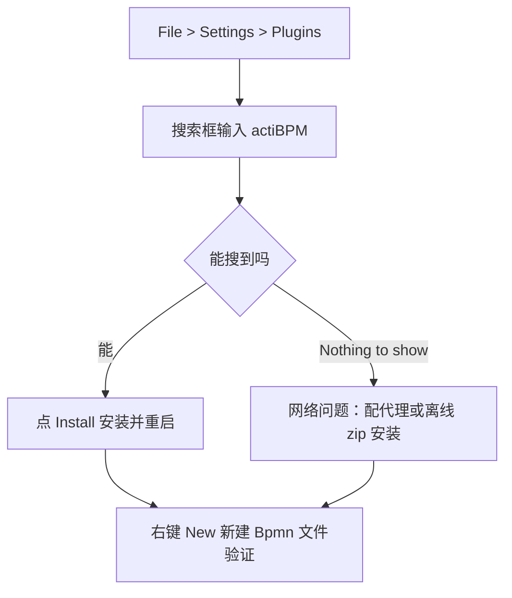

# IDEA 安装 actiBPM 流程设计器：从插件市场搜索到画出第一张 BPMN 图

Eclipse 那边的设计器装完了，IDEA 用户对应的插件叫 actiBPM。安装入口本身不复杂，真正的坎在插件市场：搜索框输入 actiBPM，结果区常年转圈甚至显示 Nothing to show，很多人在这一步误以为插件已经绝迹。这里把安装动作、搜索不到的判断、画图方式与 Eclipse 版的差异一次讲清；网络问题本身的解法留到下一篇专门展开。

## 先给结论

- 入口固定：`File > Settings > Plugins`，搜索框输入 actiBPM，点 `Install` 安装，装完重启生效。
- 已安装的判断方式：在插件列表里能直接看到 actiBPM，并且按钮变成 `Uninstall`，说明当前环境已可用。
- 搜索不到或下载卡住基本都是网络问题，不是插件消失了，处理思路见下一篇（代理或离线 zip）。
- 画图路径：右键新建 Bpmn 文件，右侧元素面板拖入 StartEvent、UserTask、EndEvent；连线靠光标移入节点、待形状变化后向目标方向拖拽拉出。
- 与 Eclipse 版差异明显：actiBPM 没有自动对齐辅助线，不能点节点边缘快捷生成下一个任务，全靠手拖。
- 新版本 IDEA 与 actiBPM 不兼容时，可在插件市场搜索 Activiti BPMN visualizer 一类替代插件（按主流写法补充的示例方案）。

## 一、安装 actiBPM



这张图在讲安装与验证主路径，两条分支最后都汇到「能新建 Bpmn 文件」这个验证动作上。图里的分叉点就是绝大多数人卡住的地方：搜不到时先判定网络，而不是反复刷新。

具体操作：打开 `File` 菜单选 `Settings`，左侧定位到 `Plugins`。未安装的状态下在市场搜索框输入 actiBPM，结果区出现插件后点 `Install`，等待下载完成，按提示重启 IDE。安装成功后再回到这个页面搜索，actiBPM 会出现在已安装列表里，按钮显示 `Uninstall`，此刻点它会卸载，这也侧面确认了插件确实装进了本地。

搜索或下载阶段失败的表现有两类：结果区显示 Nothing to show，或者列表出来了、`Install` 长时间无响应。根因是插件市场服务在境外，直连不稳定，与 IDEA 版本无关。

装完后插件落在用户配置目录里，排查重装问题时用得上（路径为示例，IDEA 版本不同目录名略有差异）：

```bash
# 查看 actiBPM 是否已落盘，Windows 用户配置目录
ls "$APPDATA/JetBrains/"IntelliJIdea*/plugins | grep -i bpm

# 重装异常时：关闭 IDEA，删除 actiBPM 目录，再从插件市场重新安装
```

## 二、画出第一张请假流程图

装好插件后，在工程目录上右键 `New`，向导里会出现 Bpmn 文件类型，新建一个命名为 `myholiday`，后缀必须是 `.bpmn`。文件打开后右侧是元素面板，StartEvent、EndEvent、UserTask 都在这里，用拖拽的方式搭一条审批链：

- 拖入 StartEvent 作为开始节点；
- 拖入 UserTask，命名为 `填写请假单`；
- 再拖一个 UserTask 命名为 `部门经理审批`；
- 最后放 EndEvent 结束。

连线是 actiBPM 上手最容易卡住的点：没有画线工具图标，把光标移到节点框内，等光标形状变化（变成十字或变色）时按下鼠标，向目标节点方向拖拽，一条带箭头的连线就拉出来了。每个节点之间都这样操作，StartEvent 连到第一个任务，任务依次连到 EndEvent。

两个工具的画图体验对比：

| 能力 | Eclipse 设计器 | IDEA actiBPM |
|---|---|---|
| 生成下一个任务 | 点节点边缘图标，节点连线一次生成 | 从面板拖入，手动连线 |
| 对齐辅助线 | 拖动时自动出现 | 没有，靠目测 |
| 连线方式 | 图标自动连接 | 光标变色后拖拽拉出 |
| 产物 | BPMN 2.0 XML | BPMN 2.0 XML |

从体验看不少人偏爱 Eclipse 版设计器，但工具差异只影响画图效率：只要用习惯了，任何一个都能画出符合规范的 BPMN 文件，产物没有本质区别。公司用哪个 IDE，就跟哪个 IDE 的插件。

## 三、画完之后文件里长什么样

和 Eclipse 版一样，`myholiday.bpmn` 本质是 XML。actiBPM 打开时渲染成图，切到文本视图看到的就是节点与连线的标签。按本课画出的流程，文件核心结构如下（简化示例，按本课画法补全）：

```xml
<?xml version="1.0" encoding="UTF-8"?>
<definitions xmlns="http://www.omg.org/spec/BPMN/20100524/MODEL"
             xmlns:activiti="http://activiti.org/bpmn"
             targetNamespace="http://example.com/bpmn">
  <!-- process 的 id 就是流程定义的 key，启动流程实例时靠它定位 -->
  <process id="myholiday" name="请假申请单" isExecutable="true">
    <startEvent id="startEvent1"/>
    <userTask id="userTask1" name="填写请假单"/>
    <userTask id="userTask2" name="部门经理审批"/>
    <endEvent id="endEvent1"/>
    <sequenceFlow id="flow1" sourceRef="startEvent1" targetRef="userTask1"/>
    <sequenceFlow id="flow2" sourceRef="userTask1" targetRef="userTask2"/>
    <sequenceFlow id="flow3" sourceRef="userTask2" targetRef="endEvent1"/>
  </process>
</definitions>
```

两个细节值得留意：`process` 的 `id` 要在这一步定好，后续 `startProcessInstanceByKey("myholiday")` 用的就是它；文件放在 `src/main/resources` 之下，部署时 `addClasspathResource("myholiday.bpmn")` 按 classpath 路径读取。

## 常见误区

- **搜不到就断定插件不存在**：Nothing to show 是市场连不通的表现，先用浏览器验证网络，再走代理或离线安装。
- **新版 IDEA 硬装 actiBPM**：actiBPM 停更早，新版本 IDE 上可能装不上或装上不可用，此时换 Activiti BPMN visualizer 一类仍在维护的替代插件。
- **连线画不出来就找画线按钮**：actiBPM 没有独立画线工具，必须在节点框内等光标变形后再拖拽。
- **bpmn 建在 Java 源码目录**：部署走 classpath 读取，文件要放 `resources` 目录，否则部署时找不到资源。
- **以为图必须画得好看**：连线歪斜不影响引擎执行，`sequenceFlow` 的指向才是运行时依据，先画对再谈美观。

## 面试可能被问到的问题

1. 面试官追问：「actiBPM 和 Activiti Designer 有什么区别？」
   答：是两套 IDE 上的建模插件，actiBPM 用于 IDEA，Activiti Designer 用于 Eclipse，底层都产出符合 BPMN 2.0 规范的 XML。差异在画图体验：Eclipse 版有快捷生成任务与对齐辅助线，actiBPM 需要手动拖拽连线。

2. 面试官追问：「IDEA 里插件搜不到，你怎么处理？」
   答：先用浏览器确认插件市场网页能否访问，判断是网络问题还是插件下架；网络问题走 HTTP 代理配置或从市场网页下载 zip 后用 Install Plugin from Disk 离线安装；插件下架则找替代插件。

3. 面试官追问：「actiBPM 生成的 bpmn 文件应该放在哪，引擎怎么读到它？」
   答：放在 `src/main/resources` 下，部署时通过 `repositoryService.createDeployment().addClasspathResource("myholiday.bpmn")` 按 classpath 路径加载，文件随打包进入 classpath。

4. 面试官追问：「流程图里的 process id 和代码里的 key 什么关系？」
   答：是同一个值。建模时 `process` 标签的 `id` 就是流程定义的 key，`startProcessInstanceByKey` 按它定位流程定义，建模阶段就要把命名定好并保持一致。

5. 面试官追问：「为什么很多资料更推荐 Eclipse 的设计器？」
   答：主要是操作效率：Eclipse 版支持节点边缘快捷生成任务、自动对齐辅助线，画大图更省事；actiBPM 长期未更新且新版本 IDEA 兼容性差。但产物规范一致，选择最终取决于团队用什么 IDE。

## 配套资料

- 本课源码工程：`materials/code/02/Activiti7-day01-基础原理与使用/Activiti7-day01-基础原理与使用/代码/activiti01/`
  （含 `pom.xml`、`src/main/resources/activiti.cfg.xml`，bpmn 文件的存放位置与部署加载方式可对照其中部署类）
- actiBPM 插件包本课无配套资料，安装步骤按课程实际操作记录整理；替代插件方案为按主流写法补全的示例
