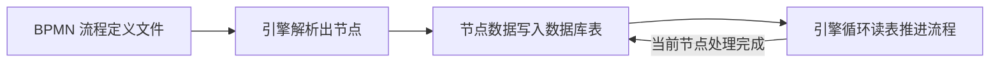

# 给 Activiti 准备数据库：支持哪几种库，建库前要做什么

跑 Activiti 的第一道门槛不是画流程图，而是配数据库：不建库、连不上库，引擎连启动都启动不了。原因要从引擎的工作机制说起，BPMN 流程定义文件里的每个节点，最终都要落到数据库表里，Activiti7 一整套是 25 张表。这一篇先把库准备好，解决「支持哪些数据库」和「建库要做哪些事」两个问题。

## 先给结论

- Activiti 官方支持 h2、mysql、oracle、postgres、db2、mssql 六种数据库，h2 是默认配置的内存库，实战主力是 MySQL 和 Oracle。
- 引擎把 BPMN 流程定义的节点写入数据库表，运行时靠读表推进流程，数据库是 Activiti 运转的存储底座。
- 25 张表不需要手工创建，ProcessEngine 初始化时会自动生成，具体做法在后续两篇展开。
- 建库准备只有两步：启动 MySQL 服务，然后执行一条建库 SQL。
- 库名可以任意取，字符集建议指定 utf8。

## 一、为什么 Activiti 离不开数据库

Activiti 内部核心机制的落脚点在数据库：流程图上的节点信息被转换成数据库表里的记录，程序不断读取第一条记录，识别节点类型、处理、删除，再读下一条。BPMN 文件部署时，节点数据要写进表；流程启动之后，任务、变量、执行分支也都在表里流转。



这张图讲的是流程从文件到表、再到引擎循环的完整路径。关键一环在右侧那张表：它属于 Activiti 的 25 张表，库不存在或表缺失，整条链路在第一环就断掉，这就是动引擎之前先把数据库准备好的原因。

## 二、官方支持的六种数据库

课件给出的支持清单，带官方测试过的版本与 JDBC URL 示例：

| 数据库类型 | 测试版本 | JDBC URL 示例 | 备注 |
|---|---|---|---|
| h2 | 1.3.166 | `jdbc:h2:tcp://localhost:9092/activiti` | 默认配置的数据库 |
| mysql | 5.1.21 | `jdbc:mysql://localhost:3306/activiti?autoReconnect=true` | 使用 mysql-connector-java 驱动测试 |
| oracle | 11.2.0.1.0 | `jdbc:oracle:thin:@localhost:1521:xe` | |
| postgres | 8.1 | `jdbc:postgresql://localhost:5432/activiti` | |
| db2 | DB2 10.1 | `jdbc:db2://localhost:50000/activiti` | |
| mssql | 2008 | `jdbc:sqlserver://localhost:1433;activiti` | |

**h2 是默认项，不是必选项。** h2 是一个内存数据库，引擎默认配置它，适合演示和单元测试，进程一结束数据就没了。实战里公司系统用什么库，Activiti 就配什么：系统用 MySQL，就给引擎配上 MySQL 的驱动与 URL；用 Oracle、DB2、SQL Server 同理，切换成本很低。

课程后续所有测试都选 MySQL。官方表格里 MySQL 用 mysql-connector-java 驱动测试，课程工程的 pom 里引的是 5.1.40 版本，兼容 MySQL 5.x 没有问题。

这张表还解释了一个问题：为什么 25 张表不能靠手写 SQL 预先建好。引擎内部为每种数据库准备了一套自己的建表脚本，字段类型、自增写法随数据库方言变化，同一张表在 MySQL 和 Oracle 上的 DDL 并不相同。让引擎在初始化时按当前连接的数据库自动挑选脚本执行，才是换库成本的正确打开方式。

## 三、建库准备：两步做完

**第一，启动 MySQL 服务。** 本机服务被停过的话，在服务管理器里把它起起来，或者命令行执行：

```bash
net start mysql
```

**第二，建一个空库。** 用客户端工具连上 MySQL，执行建库语句：

```sql
-- 库名任意，课程统一用 activiti
CREATE DATABASE activiti DEFAULT CHARACTER SET utf8;
```

刷新一下，库已经出现，里面一张表都没有。表的活交给引擎：后面写一段 Java 代码把 ProcessEngine 拉起来，25 张表就会生成到这个库里，那时准备工作才算真正闭环。

字符集这一项落在真实数据上是能感知的：BPMN 文件内容、流程名称、流程变量值都会存进引擎的表，其中不少字段是中文。库里字符集不对，写入时是乱码还是读出时是乱码，排查起来远比建库时多写一个参数麻烦。

这套连接信息将来配在哪里？课程工程 `activiti01` 的 `activiti.cfg.xml` 数据源部分就是它的归宿：

```xml
<bean id="dataSource" class="org.apache.commons.dbcp.BasicDataSource">
    <property name="driverClassName" value="com.mysql.jdbc.Driver" />
    <property name="url" value="jdbc:mysql://localhost:3306/activiti" />
    <property name="username" value="root" />
    <property name="password" value="root" />
</bean>
```

url 指向的库名与刚建的库对应，账号密码按自己的环境修改。这份配置在下一篇建表时就会真正用上。

## 常见误区

- **不建库直接跑引擎**：`databaseSchemaUpdate` 只负责建表，不负责建库，库不存在时直接报 Unknown database 连接失败。先建库，再谈建表。
- **建库不指定 utf8**：流程名称、流程变量经常带中文，字符集不对读出来就是乱码，建库时把 `DEFAULT CHARACTER SET utf8` 带上。
- **以为默认配 h2 就只能用 h2**：默认只表示不配置时的兜底，生产环境必须换 MySQL、Oracle 这类持久化数据库。
- **以为库名必须叫 activiti**：库名任意，只要配置文件里的 URL 与实际库名一致即可。

## 面试可能被问到的问题

1. 面试官追问：「Activiti 支持哪些数据库？默认是哪个？」
   答：官方支持 h2、mysql、oracle、postgres、db2、mssql 六种，h2 是默认配置的内存数据库。生产环境常用 MySQL 或 Oracle，切换时给出对应驱动与 JDBC URL 即可。

2. 面试官追问：「为什么 Activiti 必须依赖数据库？」
   答：引擎的核心机制是把 BPMN 流程定义的节点写入数据库表，运行时靠读表、处理、删除记录来推进流程，25 张表就是引擎的存储层，没有数据库这套机制无从运转。

3. 面试官追问：「给 Activiti 建库要注意什么？」
   答：库名任意，字符集指定 utf8 防止中文乱码；建库之后不需要手工建表，引擎初始化时会按配置自动生成全部 25 张表。

4. 面试官追问：「h2 是什么数据库，适合什么场景？」
   答：轻量级内存数据库，Activiti 默认配置它，适合演示与单元测试；数据不持久化，进程结束即失，生产环境要换成持久化数据库。

5. 面试官追问：「Activiti 从 MySQL 切换到 Oracle 要改哪些地方？」
   答：换 pom 里的驱动依赖，改配置中的驱动类名与 JDBC URL，建库后重新初始化引擎即可；建表脚本由引擎按数据库方言自动选择，表结构与业务代码都不需要调整。

## 配套资料

- 课程工程：`materials/code/02/Activiti7-day01-基础原理与使用/Activiti7-day01-基础原理与使用/代码/activiti01/`
  （含 `pom.xml`、`src/main/resources/activiti.cfg.xml`，文中包名已统一改为 `com.example`）
- 建库 SQL 与数据库支持清单取自本课课件，无独立源码包
