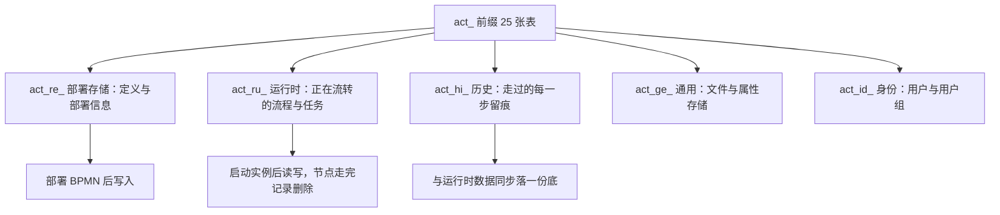

# 建表的四个细节：bean 命名约定、建表策略、文件名与 25 张表的分类

测试跑通、25 张表落库之后，几个新问题马上冒出来：bean 的 id 改个名字为什么引擎就报错？`databaseSchemaUpdate` 除了 true 还能写什么？配置文件名是不是写死了？25 张表又为什么要按前缀分类？这些细节决定你以后改配置时心里有没有底，一篇说清。

## 先给结论

- 引擎默认按 bean id `processEngineConfiguration` 找配置对象，改名后必须用双参数版 `createProcessEngineConfigurationFromResource` 显式指定，否则抛 NoSuchBeanDefinitionException。
- `databaseSchemaUpdate=true` 的行为是表不存在就创建、存在就沿用；false 则不会创建缺失的表。
- 配置文件名也能改，比如 `activiti01.cfg.xml`，把新名字传给方法的第一个参数即可。
- dataSource bean 不是必需的，连接信息可以直接挂到 processEngineConfiguration 上，写法在下一篇展开。
- 25 张表统一 `act_` 前缀，按第二段字母分五类：re 部署存储、ru 运行时、hi 历史、ge 通用、id 身份。

## 一、bean 的 id 是一份默认约定

先把实验环境重置，删库重建：

```sql
drop database activiti;
create database activiti;
```

把配置文件里 bean 的 id 从 `processEngineConfiguration` 改成 `processEngineConfiguration01`，其他内容一字不动，再跑测试，失败，异常信息很直白：

`NoSuchBeanDefinitionException: No bean named 'processEngineConfiguration' available`

原因在单参数版 `createProcessEngineConfigurationFromResource("activiti.cfg.xml")` 的内部逻辑：它从配置文件里找名字叫 `processEngineConfiguration` 的 bean，找不到就抛异常。这个 id 是引擎写死的默认约定，想换名字可以，用双参数版把名字告诉引擎（课程工程测试类里保留的这段代码，包名已改为 `com.example`）：

```java
@Test
public void testGenTable() {
    // 第一个参数：配置文件名称  第二个参数：processEngineConfiguration 的 bean id
    ProcessEngineConfiguration configuration = ProcessEngineConfiguration
            .createProcessEngineConfigurationFromResource("activiti.cfg.xml", "processEngineConfiguration01");
    // 创建 ProcessEngine 对象
    ProcessEngine processEngine = configuration.buildProcessEngine();
    // 输出 processEngine 对象
    System.out.println(processEngine);
}
```

再跑一次，25 张表照样生成。规则的完整表述是：**单参数版认默认名字，双参数版认你给的名字。** 配置与代码两边对得上，怎么起名都行。

这条约定源自 Activiti 与 Spring 的血缘关系：配置文件本体就是一份 Spring 的 beans XML，引擎解析它时沿用 Spring 的 bean 查找逻辑，默认名字由此固化下来。理解了这一点，双参数版的第二个参数就不再是死记硬背的咒语，而是一次普通的按名查找，报错信息里那个找不见的名字，正对应你配置里实际写的 id。

## 二、databaseSchemaUpdate：建表策略开关

配置对象上的第二个 property 是 `databaseSchemaUpdate`，含义是是否生成表结构，取值决定引擎对表的策略：

- `true`：初始化时检查，表不存在就创建，存在就沿用，日常开发用这个。
- `false`：不做任何创建，库里缺表时引擎初始化或运行直接失败，多用于生产环境表结构由 DBA 统一管理的场景。
- 引擎还提供 `create-drop` 档位，启动时建表、关闭时删表，适合临时演示。

`true` 的语义是「缺了补、有就不动」，不是每次推倒重建。这也回答了另一个疑问：25 张表并不是每次测试都重新创建，ProcessEngine 在项目运行期间初始化一次就够了，反复创建引擎对象只会反复做无意义的检查，没有收益只有成本。

建表之外还有一条隐性动作：引擎把建表脚本的版本号记录在 act_ge_property 表里，之后每次启动都拿它和当前引擎自带的脚本版本比对，校验库结构与引擎是否匹配。所以这张通用小表不要随手清空，记录没了，引擎对库结构的判断就失去依据，启动行为会变得不可预期。

## 三、文件名与数据源也都可以变

两个顺手的细节，验证过都成立：

**配置文件名不叫 activiti.cfg.xml 也能跑。** 比如改名 `activiti01.cfg.xml`，方法第一个参数传新名字即可。但 `ProcessEngines.getDefaultProcessEngine()` 这个快捷方式固定读 `activiti.cfg.xml`，走快捷方式就得守默认名。

**dataSource bean 可以省掉。** 把连接信息直接作为 property 挂到 processEngineConfiguration 上，引擎内部自建连接，效果一样。这个写法涉及属性名变化，单独放在下一篇细讲。

## 四、25 张表的分类：前缀就是说明书

刷新库，25 张 `act_` 开头的表整齐排列。命名规则来自课件：第一段 `act_` 固定，第二段两个字母标识用途，看到前缀就知道表归哪一类：

| 前缀 | 含义 | 代表表 |
|---|---|---|
| act_re_ | repository，流程部署与定义的静态存储 | `act_re_deployment`、`act_re_procdef` |
| act_ru_ | runtime，正在流转的运行时数据 | `act_ru_execution`、`act_ru_task`、`act_ru_variable` |
| act_hi_ | history，历史留痕 | `act_hi_procinst`、`act_hi_taskinst`、`act_hi_actinst` |
| act_ge_ | general，通用数据 | `act_ge_bytearray`、`act_ge_property` |
| act_id_ | identity，用户与组 | `act_id_user`、`act_id_group` |



这张图把 25 张表按前缀分成五类。解读时盯住 ru 与 hi 的分工：正在跑的流程看 ru，事后追溯审批记录看 hi，两者一份数据两种生命周期。每张表内部字段与用途，后续篇章逐类展开。

五类前缀里还有一条实用线索：部署时上传的 BPMN 文件、流程图片这类二进制资源，统一落在 act_ge_bytearray 这张通用表里，按字节流存储。以后排查「部署到底把什么东西存进了库」，第一现场就是它，沿着这张表的记录能追出每一次部署留下的原始文件。

## 常见误区

- **改 bean id 只改配置不改代码**：单参数方法仍按 `processEngineConfiguration` 找 bean，直接抛 NoSuchBeanDefinitionException，配置与代码要用同一个名字。
- **以为 true 每次重建表**：true 是缺表才建，不会 drop 已有表；想从零重来，删库重建最省事。
- **配了 false 还指望自动建表**：false 的定位就是不创建缺失的表，缺表时引擎起不来或运行报错。
- **ru 和 hi 混为一谈**：ru 只存正在流转的数据，节点走完记录就删；hi 留全部痕迹，用于历史查询，两者互不替代。

## 面试可能被问到的问题

1. 面试官追问：「为什么 bean 的 id 必须叫 processEngineConfiguration？」
   答：这是引擎的默认约定，createProcessEngineConfigurationFromResource 单参数版只找这个名字的 bean；要用自定义名字，就用双参数版把 bean id 显式传入，配置与代码保持一致即可。

2. 面试官追问：「databaseSchemaUpdate 有哪些取值？各是什么行为？」
   答：true 是缺表创建、有表沿用；false 不自动创建，缺表时初始化或运行失败；另有 create-drop，启动建表、关闭删表。开发环境用 true，生产由 DBA 管表结构时用 false。

3. 面试官追问：「Activiti 的 25 张表怎么分类？」
   答：统一 act_ 前缀，第二段两个字母标识用途：act_re_ 部署与流程定义、act_ru_ 运行时数据、act_hi_ 历史记录、act_ge_ 通用数据、act_id_ 用户身份信息。

4. 面试官追问：「ProcessEngine 为什么保持单例就够？」
   答：它的初始化开销大，加载配置、检查建表都在这一步完成；初始化一次后各 Service 都从它获取，重复创建只有成本没有收益。

5. 面试官追问：「想换配置文件名怎么处理？」
   答：把新文件名传给 createProcessEngineConfigurationFromResource 的第一个参数即可；但 ProcessEngines.getDefaultProcessEngine() 固定读 activiti.cfg.xml，用快捷方式就必须守默认名。

## 配套资料

- 课程工程：`materials/code/02/Activiti7-day01-基础原理与使用/Activiti7-day01-基础原理与使用/代码/activiti01/`
  （含测试类 `ActivitiTest.java` 中保留的双参数版代码、`src/main/resources/activiti.cfg.xml`，文中包名已统一改为 `com.example`）
- 表命名规则与分类清单取自本课课件，无独立源码包
