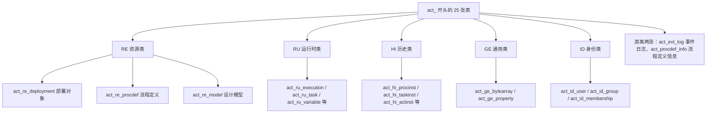
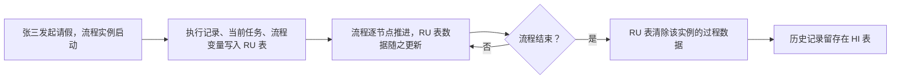

# act_ 前缀背后的分类规则：读懂 Activiti 的 25 张表

打开建好的 `activiti` 库，25 张表齐刷刷以 `act_` 开头。第一反应可能是担心：自己的业务系统里还有几十张人力资源相关的表，放同一个库里会不会混？看懂命名规则后这个担心自然消失，前缀本身就是隔离带。真正要弄明白的是 `act_` 后面那两个字母：`RE`、`RU`、`HI`、`GE`、`ID`，它们标出了每张表的职责边界。

## 先给结论

- `act_` 是引擎专属前缀，引擎的表与业务系统的表天然隔离，互不干扰。
- 前缀后两位字母代表表的职责域：`RE` 存流程静态资源，`RU` 存运行时数据，`HI` 存历史归档，`GE` 存通用数据，`ID` 存身份信息。
- `RU` 与 `HI` 的联动是核心：流程运行期间数据写在 `RU`，流程结束 `RU` 数据清除，转存到 `HI`。
- 25 张表里还有两张游离在五类之外：`act_evt_log` 事件日志表与 `act_procdef_info` 流程定义信息表。

## 一、前缀隔离：引擎的表和业务的表不掺和

命名规则第一条就是前缀。Activiti 自己的表全部以 `act_` 打头，业务系统里那 50 张人力资源表用业务命名，两类表混在同一个数据库里也不会打架，一眼就能分清谁是谁。反过来说，看到 `act_` 开头的表就知道不能随便动，它们是引擎的领地，字段、外键、数据都由引擎自己维护。

## 二、五类前缀逐类拆解

课件里给出的分类是 `ACT_RE_*`、`ACT_RU_*`、`ACT_HI_*`、`ACT_GE_*` 四组，加上身份类的 `ACT_ID_*`，拼成完整的分类体系：

| 前缀 | 含义 | 存什么 | 代表表 |
|---|---|---|---|
| `RE` | Repository，资源 | 流程的静态资源：部署对象、流程定义、设计模型 | `act_re_deployment`、`act_re_procdef`、`act_re_model` |
| `RU` | Runtime，运行时 | 流程启动后产生的实时数据：执行记录、任务、变量、参与者 | `act_ru_execution`、`act_ru_task`、`act_ru_variable`、`act_ru_identitylink`、`act_ru_job` |
| `HI` | Historic，历史 | 流程走完后留下的历史记录：活动、任务、流程实例、变量 | `act_hi_actinst`、`act_hi_taskinst`、`act_hi_procinst`、`act_hi_varinst` |
| `GE` | General，通用 | 引擎通用的数据：二进制资源与属性 | `act_ge_bytearray`、`act_ge_property` |
| `ID` | Identity，身份 | 用户与用户组 | `act_id_user`、`act_id_group`、`act_id_membership` |

**RE 是静态的那一半。** 流程定义文件、流程图图片这类资源，部署之后原样存进 `RE` 开头的表，它们描述「流程长什么样」，流程还没跑，数据先就位。

**RU 是活的那一半。** 一个流程实例从启动那一刻开始，走到哪个节点、当前任务谁负责、流程变量是什么值，全都落在 `RU` 开头的表里，包括到期的与挂起的作业、事件订阅这些运行细节。

**HI 负责留住痕迹。** 流程跑完，`RU` 里的过程数据会被清除，清除之前引擎把该留的都记进了 `HI` 开头的表，历史数据的查询都从这一组表走。

**GE 是引擎的杂物间。** `act_ge_bytearray` 用字节形式存部署的 bpmn 文件与 png 图片，相当于资源的二进制备份；`act_ge_property` 存引擎自身的属性，比如历史级别、主键生成策略、引擎版本号这类键值对。

分类结构一张图看完：



树的最底层是日常打交道最多的几张：查部署看 `act_re_deployment`，查流程定义看 `act_re_procdef`，看当前跑到哪一步看 `act_ru_task`，查审批历史看 `act_hi_taskinst`。

## 三、RU 与 HI 的数据流转

张三请假的例子把这套规则走一遍：



流转路径里最值得记的是分叉之后的去向：流程一结束，`act_ru_*` 里属于这个实例的数据被删除，`act_hi_*` 里对应的历史记录补全。运行数据不堆积是引擎的设计取向，历史查询永远走 `HI` 表。

## 四、用 SQL 验证这套分类

示例 SQL 为按本课写法补全，可在建好表的 `activiti` 库直接执行：

```sql
-- 数一数每类前缀各有多少张表
SELECT SUBSTRING(table_name, 1, 7) AS prefix, COUNT(*) AS table_count
FROM information_schema.tables
WHERE table_schema = 'activiti' AND table_name LIKE 'act_%'
GROUP BY SUBSTRING(table_name, 1, 7)
ORDER BY prefix;
```

```sql
-- GE 通用表里的引擎属性：历史级别、主键生成策略、版本号都在这里
SELECT * FROM act_ge_property;
-- 部署产生的 bpmn 与 png 以字节形式备份在通用资源表里
SELECT * FROM act_ge_bytearray;
```

查询结果和课件里展示的一致：`act_ge_property` 里能看到历史级别配置与引擎版本号，`act_ge_bytearray` 的每一行对应部署包里的一个文件，带着所属的部署 id。

## 常见误区

- **把 `act_ge_bytearray` 当业务附件表用**：它是引擎内部资源存储，业务附件应该用业务自己的表，混进去会干扰引擎的资源管理。
- **以为流程结束后数据全没了**：清掉的只是 `RU` 表的运行数据，`HI` 表的历史记录完整保留，查历史别去 `RU` 表里翻。
- **手动删 `RU` 表数据来「清理」流程**：绕过引擎直接动表会留下状态不一致的残局，删除流程实例要走引擎提供的级联删除接口。
- **只记表名不记前缀语义**：25 张表靠背记不住，按 `RE`、`RU`、`HI`、`GE`、`ID` 五类记，见名知位。

## 面试可能被问到的问题

1. 面试官追问：「Activiti 的 25 张表是怎么分类的？」
   答：按前缀分五类。RE 资源类存部署与流程定义等静态资源，RU 运行时类存流程运行中的实时数据，HI 历史类存流程结束后的归档数据，GE 通用类存二进制资源与引擎属性，ID 身份类存用户与用户组；另有 act_evt_log 与 act_procdef_info 两张表游离于五类之外。

2. 面试官追问：「RU 表和 HI 表的区别与联动是什么？」
   答：RU 表存流程运行期间的数据，HI 表存历史数据。流程实例运行时数据写在 RU，流程结束时 RU 中该实例的数据被清除，引擎事先将记录转存到 HI，运行数据不堆积，历史查询走 HI。

3. 面试官追问：「act_ge_bytearray 存什么？为什么需要它？」
   答：以二进制字节形式存储部署的资源，主要是 bpmn 流程定义文件与生成的流程图 png，并关联部署 id。引擎需要随时读取原始流程资源，字节表就是这些文件的落库备份。

4. 面试官追问：「为什么 Activiti 的表都带 act_ 前缀？」
   答：一是与业务系统的表做命名隔离，同库共存互不混淆；二是标识这些表归引擎管理，结构与数据由引擎维护，业务代码不应直接读写，统一通过引擎的 Service 接口访问。

5. 面试官追问：「业务系统接入 Activiti 后，两类表如何共存？」
   答：同一个业务库即可，act_ 前缀保证隔离。业务表存业务数据，引擎表存流程数据，两边通过流程变量与业务主键关联，互不侵入对方的表结构。

## 配套资料

- 课程工程：`materials/code/02/Activiti7-day02-工作流使用/代码/代码/`
  （含 `activiti.cfg.xml` 与生成 25 张表的测试类，文中包名已统一改为 `com.example`；本询单讲表结构规范，无新增代码，示例 SQL 为按本课写法补全）
- 建表工程：`materials/code/02/Activiti7-day01-基础原理与使用/Activiti7-day01-基础原理与使用/代码/activiti01/`
