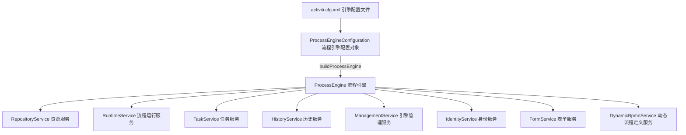
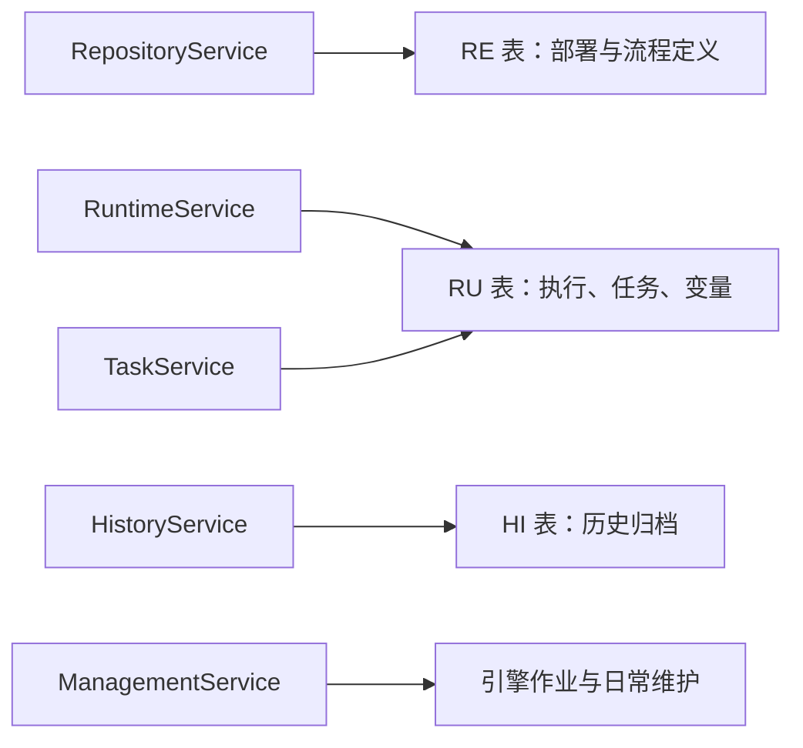

# 从配置文件到七大 Service：Activiti 服务架构全景

表建好了，ProcessEngine 对象也拿到了，接下来的问题是：怎么让流程一步一步跑起来？Activiti 给出的答案是围绕流程引擎的一组 Service，引擎把它们从 ProcessEngine 上一个个 get 出来。服务架构图把这些 Service 与配置、引擎的关系画成一张图，这张图就是 Activiti 编程模型的地图，后面所有流程操作都从这里出发。

## 先给结论

- 架构分三层：配置文件 `activiti.cfg.xml` 生成 ProcessEngineConfiguration，配置对象构建 ProcessEngine，引擎再向外提供各种 Service。
- ProcessEngine 是门面，`getRepositoryService()`、`getRuntimeService()`、`getTaskService()`、`getHistoryService()`、`getManagementService()` 等方法各取一个 Service。
- Service 的本质是引擎替你封装好的表操作接口：HistoryService 对应 `HI` 表的查询，RuntimeService 对应 `RU` 表的流转，不用自己写 domain、DAO、Service。
- 独立运行时 Service 用完即取；整合 Spring 后这些 Service 直接注册成 bean，业务代码注进来就能用。

## 一、架构图：三层往外拿

这张图从左到右就是一次引擎的初始化顺序，也是每个 Activiti 程序的骨架：



最左边是已经写好的配置文件，右边一层是配置对象 `ProcessEngineConfiguration`，它读配置、管数据源、定建表策略；再往右构建出 `ProcessEngine`，整个引擎的门面。七大 Service 从门面上取，另外代码里还能看到一个 `getDynamicBpmnService()`，用来动态修改流程定义信息。IdentityService 与 FormService 在新版 Activiti7 中已经移除，图里保留它们是因为老项目里还会遇到，后面的文章会专门交代。

分层的好处在于职责隔离：配置对象负责「怎么连库、怎么建表」这类启动期决策，引擎负责运行期的全部对外能力，Service 再按业务域细分。启动与运行分开，意味着改配置只需重启生效，业务代码感知不到配置细节；Service 按域细分，则让每个操作都能一眼定位到该找哪个对象。ProcessEngine 是重量级对象，线程安全，全应用共享一份即可，从它取出的 Service 也可以放心在多线程环境里传递使用。

## 二、代码上的三层对应

课程测试类里的代码，正好是架构图左半边的落地（包名已改为 `com.example`）：

```java
package com.example.test;

import org.activiti.engine.ProcessEngine;
import org.activiti.engine.ProcessEngineConfiguration;
import org.junit.Test;

/** 测试类：测试 Activiti 引擎所需的 25 张表的生成 */
public class ActivitiTest {

    @Test
    public void testGenTable() {
        // 1.创建 ProcessEngineConfiguration 对象，第一个参数：配置文件名称，
        //   第二个参数：processEngineConfiguration 的 bean 的 id
        ProcessEngineConfiguration configuration = ProcessEngineConfiguration
                .createProcessEngineConfigurationFromResource("activiti.cfg.xml");
        // 2.创建 ProcessEngine 对象
        ProcessEngine processEngine = configuration.buildProcessEngine();
        // 3.输出 processEngine 对象
        System.out.println(processEngine);
    }
}
```

架构图右半边就是接着往下写的事。想拿哪个 Service，就在引擎对象上调对应的 get 方法，一行一个：

```java
// 从引擎取服务，拿到即可调用
HistoryService historyService = processEngine.getHistoryService();
RuntimeService runtimeService = processEngine.getRuntimeService();
TaskService taskService = processEngine.getTaskService();
RepositoryService repositoryService = processEngine.getRepositoryService();
ManagementService managementService = processEngine.getManagementService();
```

取出来的 Service 各管一摊：查历史信息用 HistoryService，查部署与流程定义信息用 RepositoryService，查流程运行状态用 RuntimeService，查某个用户当前有什么任务用 TaskService。

这五个 get 方法覆盖了日常开发的绝大多数场景，分组记忆比逐个背名字有效：RepositoryService 管静态资源，也就是流程定义与部署；RuntimeService 管运行中的流程实例与变量；TaskService 管人的待办；HistoryService 管归档数据；ManagementService 管引擎自身的作业，比如定时任务与异步 job。写代码前先想清楚要操作哪一类数据，Service 的选择自然就定下来了。

## 三、Service 的本质：那 25 张表的增删改查早有人写好了

拿到 HistoryService 时容易冒出一个念头：要查 `HI` 表的历史信息，自己写一个 domain、配一个 DAO、再封一层 Service，增删改查方法全齐，不也行吗？思路本身没错，可真这么做了，用 Activiti 的意义就没了。引入引擎的目的，恰恰是这 25 张表的后续操作不需要自己维护，引擎提供专门的 Service 直接可用。



RuntimeService 拿到手后，背后 `RU` 开头那一组表的相关操作它全包了，调它的方法就等于对那组表做读写；HistoryService 对 `HI` 组、RepositoryService 对 `RE` 组同理。业务代码因此只面向 Service 编程，表的细节被引擎挡在身后。25 张表不让人发懵，靠的就是这层封装，流程管理反而变得更简单。

落到业务系统里，最常见的组合是 RuntimeService 加 TaskService 再加 HistoryService：发起流程、办理任务、查审批记录正好各占一个。RepositoryService 的出场集中在流程管理页面，比如部署列表与流程定义列表的展示；ManagementService 平时很少直接调，涉及定时边界事件或异步作业排查时才会用到。

## 常见误区

- **自己写 SQL 直接改 `act_` 表**：引擎内部对表状态有严格管理，绕过引擎改数据会造成引擎与数据库状态不一致，所有表操作都应走 Service。
- **以为要为每张表建实体类**：引擎内部用 MyBatis 封装好了 25 张表的持久层，业务代码不需要也不应该重复造 domain 与 DAO。
- **自己 new 一个 Service**：Service 由 ProcessEngine 统一提供，取用方式是 get 方法或 Spring 注入，没有公开的构造路径。
- **在 Activiti7 里找 IdentityService 与 FormService**：新版已移除这两个 Service，老版本 5、6 的资料里出现属正常，按新版写代码别再引用。

## 面试可能被问到的问题

1. 面试官追问：「说说 Activiti 的整体服务架构。」
   答：三层结构。activiti.cfg.xml 作为引擎配置文件，生成 ProcessEngineConfiguration 配置对象，配置对象构建出 ProcessEngine 流程引擎；引擎作为门面向外提供 RepositoryService、RuntimeService、TaskService、HistoryService、ManagementService 等 Service，各 Service 封装对应表组的操作。

2. 面试官追问：「ProcessEngine 为什么叫门面？」
   答：它把引擎的全部对外能力集中到一个接口后面，所有 Service 都通过它的 get 方法获取，业务代码只需要持有引擎对象，不需要关心各 Service 的实例化与内部依赖。

3. 面试官追问：「HistoryService 本质上在做什么？」
   答：提供操作 HI 开头那组历史表的接口。按传统思路查历史要自己写表的 domain、DAO 与 Service，HistoryService 把这些封装好了，直接调用它的查询方法就能拿到流程实例、任务、活动的历史记录。

4. 面试官追问：「为什么用 Activiti 之后不用自己维护那 25 张表的增删改查？」
   答：引擎按 Service 分域封装了全部表操作，RuntimeService 包办 RU 表，RepositoryService 包办 RE 表，HistoryService 包办 HI 表。自己再写一套不仅重复劳动，还会绕开引擎的事务与状态管理。

5. 面试官追问：「架构图里的 DynamicBpmnService 是干什么的？」
   答：用于动态修改流程定义信息，比如在不重新部署流程定义的情况下调整流程定义的部分运行参数，它是对流程定义的动态干预通道，常规流程操作用得少，但架构图里与七大 Service 并列存在。

## 配套资料

- 课程工程：`materials/code/02/Activiti7-day02-工作流使用/代码/代码/`
  （含 `ActivitiTest.java`、`activiti.cfg.xml`，文中包名已统一改为 `com.example`）
- 建表与部署工程：`materials/code/02/Activiti7-day01-基础原理与使用/Activiti7-day01-基础原理与使用/代码/activiti01/`
