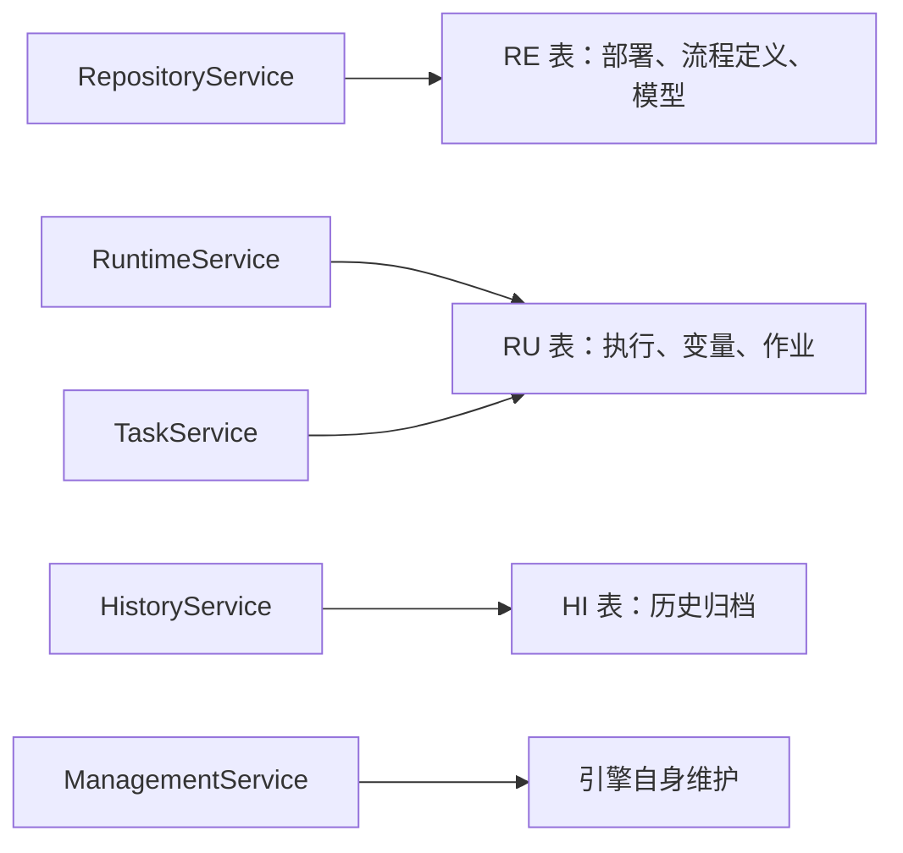

# Activiti 核心类与接口详解：两种配置、两种创建方式与五个 Service 的分工

架构图看懂了整体形状，落到写代码还有几个具体的口子要抠清：配置对象有几种创建方式？引擎对象除了测试类里那套写法还有没有捷径？每个 Service 到底管哪些事、有哪些高频方法？这一篇把架构图上的类与接口逐个说透，写完这几个问题，Activiti 的编程面就铺平了。

## 先给结论

- `ProcessEngineConfiguration` 有两条路线：`StandaloneProcessEngineConfiguration` 独立运行，`SpringProcessEngineConfiguration` 与 Spring 整合、事务交给 Spring 管理。
- `activiti.cfg.xml` 本身就是一份 Spring 格式的配置文件，整合 Spring 时各 Service 用 `factory-method` 配成 bean，业务代码 `@Autowired` 直接注入。
- 创建 ProcessEngine 有两种方式：`configuration.buildProcessEngine()` 显式构建，`ProcessEngines.getDefaultProcessEngine()` 一行搞定，后者要求文件名与 bean id 都走默认约定。
- 重点掌握四个 Service：RepositoryService、RuntimeService、TaskService、HistoryService；ManagementService 是引擎自身的维护类，开发中很少用。
- IdentityService 与 FormService 在 Activiti7 最新版已删除，老版本资料里见到不必奇怪。

## 一、ProcessEngineConfiguration 的两种创建方式

独立运行方式前面已经在用：配置对象类是 `StandaloneProcessEngineConfiguration`，引擎不依赖 Spring 容器，自己管理数据源与运行。整合方式换成了 `SpringProcessEngineConfiguration`，它必须与 Spring 整合后才能使用，事务管理器也一并交给 Spring。课程整合素材里的核心配置如下：

```xml
<!-- 数据源 -->
<bean id="dataSource" class="org.apache.commons.dbcp.BasicDataSource">
    <property name="driverClassName" value="com.mysql.jdbc.Driver"/>
    <property name="url" value="jdbc:mysql://localhost:3306/activiti"/>
    <property name="username" value="root"/>
    <property name="password" value="root"/>
</bean>

<!-- 工作流引擎配置 bean，必须与 Spring 整合使用 -->
<bean id="processEngineConfiguration"
      class="org.activiti.spring.SpringProcessEngineConfiguration">
    <!-- 数据源 -->
    <property name="dataSource" ref="dataSource"/>
    <!-- 使用 spring 事务管理器 -->
    <property name="transactionManager" ref="transactionManager"/>
    <!-- 数据库策略 -->
    <property name="databaseSchemaUpdate" value="drop-create"/>
    <!-- activiti 的定时任务开关 -->
    <property name="jobExecutorActivate" value="false"/>
</bean>

<!-- 流程引擎，通过工厂 bean 产出 -->
<bean id="processEngine" class="org.activiti.spring.ProcessEngineFactoryBean">
    <property name="processEngineConfiguration" ref="processEngineConfiguration"/>
</bean>
```

留意一个细节：`activiti.cfg.xml` 的根标签就是 Spring 的 `beans`，bean 的写法与 Spring 配置文件完全一致。也就是说 Activiti 与 Spring 整合时，这份配置文件天然就是 Spring 配置的一部分。整合环境下连 Service 都能配成 bean，靠的是工厂方法注入：

```xml
<!-- 各 Service 由 processEngine 的工厂方法产出，业务代码可直接注入 -->
<bean id="repositoryService" factory-bean="processEngine"
      factory-method="getRepositoryService"/>
<bean id="runtimeService" factory-bean="processEngine"
      factory-method="getRuntimeService"/>
<bean id="taskService" factory-bean="processEngine"
      factory-method="getTaskService"/>
<bean id="historyService" factory-bean="processEngine"
      factory-method="getHistoryService"/>
```

这样配完，业务代码里 `@Autowired` 一个 RepositoryService 就能直接用，不用再走引擎的 get 方法。两种方式的选择标准很直白：工程里没有 Spring 用独立方式，有 Spring 就走整合方式。

## 二、ProcessEngine 的两种创建方式

早期一直用的显式写法，两行完成：

```java
// 方式一：通过配置对象显式构建
ProcessEngine processEngine = ProcessEngineConfiguration
        .createProcessEngineConfigurationFromResource("activiti.cfg.xml")
        .buildProcessEngine();
System.out.println(processEngine);
```

课程工程 `ActivitiTest` 里保留了另一种更省事的写法（包名已改为 `com.example`）：

```java
package com.example.test;

import org.activiti.engine.ProcessEngine;
import org.activiti.engine.ProcessEngines;
import org.junit.Test;

/** 测试类：测试 Activiti 所需要的 25 张表的生成 */
public class ActivitiTest {

    @Test
    public void testGenTable() {
        // 条件：1.配置文件名称 activiti.cfg.xml  2.bean 的 id 为 processEngineConfiguration
        ProcessEngine processEngine = ProcessEngines.getDefaultProcessEngine();
        System.out.println(processEngine);
    }
}
```

一行代码背后有两个默认条件，缺一个就跑不通：

**第一，配置文件名必须是 `activiti.cfg.xml`。** `getDefaultProcessEngine()` 按 engineId 去读 classpath 下的默认配置文件，名字对不上就报找不到文件。

**第二，配置对象的 bean id 必须是 `processEngineConfiguration`。** 引擎按默认 bean id 从配置文件里找配置对象，id 改成别的名字同样找不到。

两个条件都满足时，这行代码会完整走一遍引擎初始化，25 张表照样建出来。验证时可以先把库删了重建，跑一次测试再刷新，效果与显式写法一致。

## 三、五个 Service 的职责与真实用法

各 Service 按资源域分工，课程工程里的部署、启动、查询三类给了完整示范：

| Service | 定位 | 高频操作 |
|---|---|---|
| RepositoryService | 资源管理类，管理与控制流程发布包和流程定义 | 部署流程定义、查询流程定义与部署、暂停或激活发布包、获取流程图资源 |
| RuntimeService | 流程运行管理类 | 启动流程实例、按流程实例推进运行时状态 |
| TaskService | 任务管理类，从中获取任务信息 | 查询某负责人的任务、完成任务 |
| HistoryService | 历史管理类，以查询为主 | 查流程实例、任务、活动的历史数据 |
| ManagementService | 引擎管理类 | 引擎作业与日常维护，不在工作流驱动的应用里使用 |

部署流程定义用 RepositoryService，课程工程 `ActivitiDeployment` 的核心段（包名已改为 `com.example`）：

```java
// 1.创建 ProcessEngine 对象
ProcessEngine processEngine = ProcessEngines.getDefaultProcessEngine();
// 2.得到 RepositoryService 实例
RepositoryService repositoryService = processEngine.getRepositoryService();
// 3.流程制作成 zip 上传更方便，把文件流转为 ZipInputStream
InputStream is = ActivitiDeployment.class.getClassLoader()
        .getResourceAsStream("diagram/holidayBPMN.zip");
ZipInputStream zipInputStream = new ZipInputStream(is);
// 4.进行部署
Deployment deployment = repositoryService.createDeployment()
        .addZipInputStream(zipInputStream)
        .name("请假申请单流程")
        .deploy();
```

部署之外，RepositoryService 还能查询流程定义与流程实例、暂停和激活发布包（暂停后对应流程不能再执行任何操作，激活是反向操作）、拿到发布包里的资源文件与引擎自动生成的流程图。

运行与任务两类 Service 的用法在启动实例与任务查询的代码里：

```java
// RuntimeService：启动流程实例，按流程定义的 key 发起
RuntimeService runtimeService = processEngine.getRuntimeService();
ProcessInstance processInstance = runtimeService.startProcessInstanceByKey("holiday");

// TaskService：查询 zhangsan 的任务列表并逐个查看
TaskService taskService = processEngine.getTaskService();
List<Task> taskList = taskService.createTaskQuery()
        .processDefinitionKey("holiday")
        .taskAssignee("zhangsan")
        .list();
```

HistoryService 以查询为主，引擎执行流程时会按配置保存流程实例启动时间、任务参与者、完成时间、执行路径这些数据，查它们就是调 HistoryService 的查询方法。ManagementService 面向引擎自身的管理与维护，日常业务开发基本用不到，知道它的定位即可。

Service 与职责域的对应关系一张图收尾：



## 常见误区

- **默认条件不满足还用最简写法**：配置文件改了名或 bean id 改了名，`getDefaultProcessEngine()` 直接找不到目标，此时要么恢复默认约定，要么改用显式构建。
- **把 `drop-create` 当日常配置**：这个策略每次启动都清库重建表，只适合演示和反复验证，生产环境用 `true` 让引擎按需建表。
- **整合 Spring 后还手动构建引擎**：引擎与各 Service 已交给容器管理，再手动 `buildProcessEngine()` 会造出第二套引擎对象，浪费资源还可能引起状态混乱。
- **在 Activiti7 工程里 import IdentityService 或 FormService**：新版已移除，照老资料写会直接编译不过。
- **把 ManagementService 当业务 Service 用**：它管的是引擎自身的维护，业务流程操作该找其余四个 Service。

## 面试可能被问到的问题

1. 面试官追问：「StandaloneProcessEngineConfiguration 与 SpringProcessEngineConfiguration 的区别？」
   答：前者是独立运行方式，引擎自己管理数据源与运行，不依赖 Spring 容器；后者必须与 Spring 整合，事务交给 Spring 的事务管理器，还可以配置定时任务开关，适合与业务系统同一个事务边界工作的场景。

2. 面试官追问：「ProcessEngines.getDefaultProcessEngine() 生效的前提是什么？」
   答：两个默认条件：classpath 下必须存在名为 activiti.cfg.xml 的配置文件，且其中引擎配置对象的 bean id 必须是 processEngineConfiguration。任一条件不满足都会报找不到文件或找不到 bean，此时应改用显式构建方式。

3. 面试官追问：「整合 Spring 后 Service 是怎么注入进来的？」
   答：activiti.cfg.xml 本身就是 Spring 格式配置，通过 factory-bean 指向 processEngine、factory-method 指向对应的 get 方法，把 Service 注册为 bean，业务代码用 @Autowired 直接注入使用。

4. 面试官追问：「RepositoryService 能做哪些事？」
   答：它是资源管理类，负责部署流程定义文件，查询流程定义与部署，暂停或激活发布包，获取发布包内的资源文件与引擎生成的流程图，还可以拿到流程定义的对象形式用于程序化解析。

5. 面试官追问：「ManagementService 什么时候用？」
   答：它面向 Activiti 引擎自身的管理与维护，比如引擎作业的管理，不在工作流驱动的业务应用中使用，日常开发接触很少，重点是别把它当成业务 Service。

6. 面试官追问：「Activiti7 相比 5、6 版本在 Service 层有什么变化？」
   答：最新版删除了 IdentityService 与 FormService 两个接口。企业老项目里基于 5、6 的代码仍在使用它们，学习时按新版走，维护老项目时知道这两个接口的历史即可。

## 配套资料

- 课程工程：`materials/code/02/Activiti7-day02-工作流使用/代码/代码/`
  （含 `ActivitiTest.java`、`ActivitiDeployment.java`、`ActivitiStartInstance.java`、`ActivitiTaskQuery.java`、`activiti.cfg.xml`，文中包名已统一改为 `com.example`）
- Spring 整合素材：`materials/code/02/Activiti7-day06-新特性/Activiti7-day06-新特性/资料/基本素材/01activiti与spring整合素材/activiti-spring.xml`
