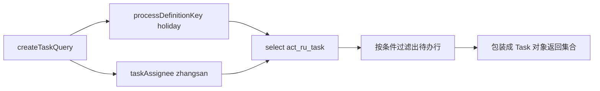

# 查询自己的待办任务：TaskService 查询链与 act_ru_task 结果溯源

流程推进到「填写请假单」，任务负责人是张三。张三登录系统，第一件事不是办任务，而是查出「我有哪些待办」，查到之后才是下一步的办理。Activiti 把查询交给 `TaskService`，一条链式调用就能拿回任务列表，但结果里的实例 ID、任务 ID 分别对应表里哪一列，查出来是空又是怎么回事，值得掰开讲一遍。

## 先给结论

- 任务查询用 `TaskService.createTaskQuery()`，按流程定义 key 加负责人 assignee 两个条件过滤，`list()` 返回任务集合。
- 查询是纯读操作，不写任何表，本质上是对 `act_ru_task` 做一次条件查询。
- 输出的四项信息都能溯源到 `act_ru_task` 的一行记录：流程实例 ID 2501 来自 PROC_INST_ID_，任务 ID 2505 就是 ID_，负责人与名称来自 ASSIGNEE_ 与 NAME_。
- 一个人同时有多条待办是常态，`list()` 有几条算几条；拿不准结果数就别用 `singleResult()`。
- 查询的下一步是办理：拿到任务 ID 后调 `taskService.complete(taskId)`，流程才能推进。

## 查询与处理，流程推进的两步

流程启动后，每个任务的负责人都要先查自己当前需要处理的任务，查出来的都是待办任务；负责人选中任务进行处理、完成任务，流程才能往下一个节点走。所以每个参与人的操作都是固定两步：先查询、再处理。有没有活干，先查了才知道，查询是所有后续动作的入口。

## 查询代码：一条链式调用

```java
package com.example.activiti;

import org.activiti.engine.ProcessEngine;
import org.activiti.engine.ProcessEngines;
import org.activiti.engine.TaskService;
import org.activiti.engine.task.Task;

import java.util.List;

/**
 * 查询当前用户的任务列表
 */
public class ActivitiTaskQuery {
    public static void main(String[] args) {
        //1.得到ProcessEngine对象
        ProcessEngine processEngine = ProcessEngines.getDefaultProcessEngine();
        //2.得到TaskService对象
        TaskService taskService = processEngine.getTaskService();
        //3.根据流程定义的key、任务的assignee实现当前用户的任务列表查询
        List<Task> taskList = taskService.createTaskQuery()
                .processDefinitionKey("holiday")
                .taskAssignee("zhangsan")
                .list();
        //4.任务列表的遍历展示
        for (Task task : taskList) {
            System.out.println("流程实例ID：" + task.getProcessInstanceId());
            System.out.println("任务ID：" + task.getId());
            System.out.println("任务负责人：" + task.getAssignee());
            System.out.println("任务名称：" + task.getName());
        }
    }
}
```

如果业务上确定某人当前只有一个任务，也可以用 `singleResult()` 直接取单个对象。工程里给 wangwu 查询的写法就是这样：

```java
Task task = taskService.createTaskQuery()
        .processDefinitionKey("holiday")
        .taskAssignee("wangwu")
        .singleResult();
System.out.println("任务ID：" + task.getId());  //5002
```

两条链子读起来都是「建查询对象、加条件、执行」：`createTaskQuery()` 返回一个 `TaskQuery` 查询对象，`processDefinitionKey("holiday")` 把范围限定到请假这一套流程，`taskAssignee("zhangsan")` 再限定到具体负责人，`list()` 执行查询并返回结果。条件还能继续叠加，比如按任务名称再过滤一层。查询条件之外，排序与分页也是现成的：orderByTaskCreateTime().desc() 让新任务排前面，listPage(0, 10) 取第一页十条，任务量大时这两件套是标配。各方法都返回查询对象自身，想加几段加几段，全部挂在 list() 之前即可，这也是所有 Activiti 查询 API 的通用套路。

## 结果怎么溯源到表

查询对 25 张表没有任何写入，跑完程序再刷新表，记录一条不多、一条不少。执行程序，张三名下查到一条任务，输出与 `act_ru_task` 里那条记录一一对应：

| 输出项 | 本例的值 | 对应来源 |
|---|---|---|
| 流程实例ID | 2501 | `act_ru_task` 的 PROC_INST_ID_ |
| 任务ID | 2505 | `act_ru_task` 的 ID_ |
| 任务负责人 | zhangsan | `act_ru_task` 的 ASSIGNEE_ |
| 任务名称 | 填写请假单 | `act_ru_task` 的 NAME_ |

2501 这个实例 ID 在 `act_ru_execution` 与 `act_hi_procinst` 里同样能查到；2505 这个任务 ID 在 `act_hi_taskinst` 的历史里也能对上。所谓查询结果，就是引擎把 `act_ru_task` 的一行记录包装成了 `Task` 对象，getter 方法与表字段一一对应。

溯源还有一个实用推论：任务对象上只有流程进度本身的信息，请假单填了几天、什么原因这类业务数据并不在任务表里，要拿流程实例 ID 2501 回业务表反查。这正是后面 businessKey 机制要解决的问题：启动实例时把业务主键挂上去，任务查询之后顺着它就能拼出完整的业务视图。



图里能看出查询的本质：两个条件最终都变成 SQL 的 where 子句，落到 `act_ru_task` 上过滤，命中的行打包返回。

## 为什么列表里常常不止一条

一个人同时有多条待办是常态。张三这个月请了两次假，两次都还没批完，他的任务列表里就是两条记录；总经理这类角色一天要处理的审批任务可能有二三十个，列表更长。职位越高、经手的审批越多，列表里的任务也就越多，所以业务代码一律按集合处理，循环渲染成待办列表，这也是企业真实系统的标准形态。

只有当业务上能保证「此刻最多一条」时才用 `singleResult()`，而且它在命中多条时会直接抛异常，别拿它当「取第一条」用。

## 常见误区

- **assignee 写错查不到，却以为没任务**：`taskAssignee` 是精确匹配，库里存的是 zhangsan，传成 ZhangSan 就查空。查空时先去表里核对 ASSIGNEE_ 的实际值。
- **对可能多于一条的查询用 `singleResult()`**：命中多条直接抛异常，待办列表一律用 `list()` 循环处理。
- **以为查询会动表**：任务查询只是 select，`act_ru_task` 不增不减，历史表也不写，数据变化只来自启动、办理这类操作。
- **拿流程实例 ID 当任务 ID 办理**：`complete()` 需要的是任务 ID 2505，传成实例 ID 2501 会查不到对应任务。

## 面试可能被问到的问题

1. 面试官追问：「查询某个用户的待办任务怎么实现？」
   答：通过 TaskService.createTaskQuery() 构建查询，processDefinitionKey 限定流程，taskAssignee 限定负责人，list() 返回 Task 集合。本质上是对 act_ru_task 的条件查询。

2. 面试官追问：「查询出来的任务 ID 和流程实例 ID 分别是什么？」
   答：任务 ID 是 act_ru_task 的主键，流程实例 ID 是该行 PROC_INST_ID_ 指向的实例主键。同一个实例在推进过程中 PROC_INST_ID_ 不变，任务 ID 却随节点推进不断更换。

3. 面试官追问：「任务查询会影响哪些表？」
   答：不写任何表，纯 select。act_ru_task 只在任务创建与任务完成时变化，历史表也只由办理动作驱动，查询本身零副作用。

4. 面试官追问：「一个人有多条待办怎么办？」
   答：用 list() 返回集合按列表渲染，这是常态，管理者一天几十条审批很正常。singleResult() 只在确定结果唯一时使用，命中多条会抛异常。

5. 面试官追问：「查询出待办之后的下一步是什么？」
   答：拿到任务 ID 后调用 taskService.complete(taskId) 办理任务，引擎删除 act_ru_task 里的待办记录、补全 act_hi_taskinst 的历史，并把流程推进到下一个节点。

## 配套资料

- 任务查询代码：`materials/code/02/Activiti7-day02-工作流使用/Activiti7-day02-工作流使用/代码/代码/src/main/java/` 下的 `ActivitiTaskQuery.java`
  （含 zhangsan 的 list 版与 wangwu、lishi 的 singleResult 版，文中包名已按规范改为 `com.example`）
- 办理任务代码：同目录 `ActivitiCompleteTask.java`（查询后调 `complete()` 推进流程的写法）
