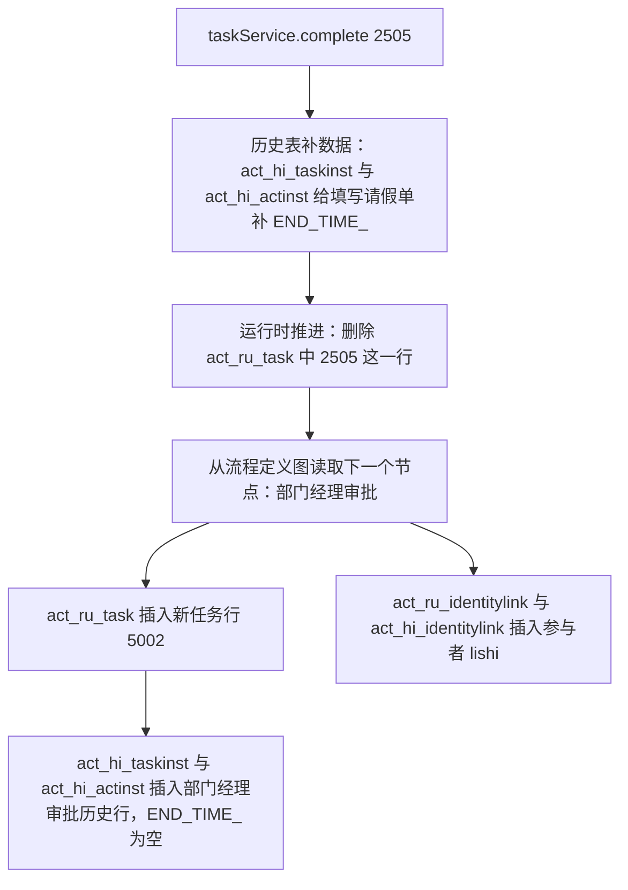

# 办理待办任务：taskService.complete 一行调用背后的多表联动

张三查到了自己的待办：任务 ID 2505，名称「填写请假单」。接下来就是把任务办掉，流程才能从「填写请假单」推进到「部门经理审批」。Activiti 里办理任务的代码只有一行 `taskService.complete("2505")`，但这一行执行完，数据库里的动静远比看上去大：有的行被补上结束时间，有的行被整行删掉，又有新的行插入进来。只盯着一处表看，很容易误判流程的状态。

## 先给结论

- 办理任务调用 `TaskService.complete(任务ID)`，参数是 `act_ru_task` 的主键任务 ID，不是流程实例 ID 2501。
- complete 的效果是一次「删旧插新」：当前任务的运行时记录被删除，下一节点的新任务记录被插入，流程自动推进。
- 历史表在同一个事务里补数据：`act_hi_taskinst` 与 `act_hi_actinst` 给完成的任务补 `END_TIME_`，同时插入部门经理审批的新记录。
- 参与者表 `act_ru_identitylink`、`act_hi_identitylink` 各新增一条李四（lishi）的参与者记录。
- 任务 ID 不必手抄进代码，查询与办理合在一起写，用 `task.getId()` 动态取值。

## 一、办理任务的代码：一行 complete

办理任务依然从默认流程引擎拿到 `TaskService`，区别只是最后一步不再调查询，而是调 complete。最小可用版本长这样（包名已按规范改为 `com.example`）：

```java
package com.example.activiti;

import org.activiti.engine.ProcessEngine;
import org.activiti.engine.ProcessEngines;
import org.activiti.engine.TaskService;

/**
 * 处理当前用户的任务
 */
public class ActivitiCompleteTask {

    public static void main(String[] args) {
        //1.得到ProcessEngine对象
        ProcessEngine processEngine = ProcessEngines.getDefaultProcessEngine();
        //2.得到TaskService对象
        TaskService taskService = processEngine.getTaskService();
        //3.处理任务，结合当前用户任务列表的查询操作的话，任务ID:2505
        taskService.complete("2505");
    }
}
```

`complete` 的参数必须来自任务查询。上一节用 `taskAssignee("zhangsan")` 查出来的任务 ID 就是 2505，这里传 2505，就等于张三把「填写请假单」这张单子办完了。

**第一，任务 ID 不能写死。** 2505 是数据库自动生成的主键，换一个环境、重新部署一次流程，ID 就完全不同了。演示阶段写死无妨，工程里必须先查再办：

```java
//3.查询当前用户的任务
Task task = taskService.createTaskQuery()
        .processDefinitionKey("holiday")
        .taskAssignee("zhangsan")
        .singleResult();
//4.处理任务，任务ID从查询结果里拿
taskService.complete(task.getId());
//5.输出任务的id
System.out.println(task.getId());
```

**第二，complete 之前不需要自己改任何状态字段。** 「任务办完了」这件事不用业务代码去 update，引擎在 complete 内部把状态、时间、表记录全部处理完，业务代码只负责告诉引擎「这个任务我办完了」。

## 二、complete 之后，表里发生了什么

执行完这一行，回到数据库逐张表核对，变化集中在一组运行时表和历史表上：

| 表 | 变化 | 本例的数据 |
|---|---|---|
| `act_hi_taskinst` | 更新 + 插入 | 填写请假单一行的 `END_TIME_` 补上值；新插入部门经理审批一行，`END_TIME_` 为空 |
| `act_hi_actinst` | 更新 + 插入 | 填写请假单活动补结束时间；插入部门经理审批活动记录 |
| `act_ru_task` | 删除 + 插入 | 填写请假单（ID 2505）整行删除；插入部门经理审批（ID 5002，负责人 lishi） |
| `act_ru_identitylink` | 插入 | 新参与者 lishi |
| `act_hi_identitylink` | 插入 | lishi 的参与者历史记录（participant 类型） |
| `act_ru_execution` | 行数变化 | 从一条变为两条，随节点推进保持，流程结束才清空 |
| `act_re_` 与 `act_ge_bytearray` | 无变化 | 部署与定义数据不参与运行时推进 |

这张表里有两条线索值得单独说。**一条是 `act_ru_task` 的删旧插新。** 2505 这行消失，5002 这行出现，任务名称从「填写请假单」换成「部门经理审批」，负责人从 zhangsan 换成 lishi。查询的本质是 select 这张表，办理的本质则是在这张表上换行，一张表撑起了待办的两端。

**另一条是历史表的节奏。** 填写请假单在启动实例时就写进了 `act_hi_taskinst`，当时只有 `START_TIME_` 没有 `END_TIME_`，因为任务还没办完。complete 之后结束时间补上了，同时引擎立刻把下一节点的记录插进来，同样只有开始时间。历史表不是「流程走完才一次性写」，而是每个节点推进时都在滚动更新。

## 三、原理：act_ru_task 为什么永远只放当前任务

把镜头拉远，引擎的运转方式可以这样理解：流程定义部署后，节点信息都在库里；运行时，引擎从流程定义图中摘取当前节点，放到 `act_ru_task`；节点上的任务一旦办完，这一行立即删除；引擎再摘取下一个节点放进来。如此循环，直到走到结束事件。



图上从上往下就是 complete 一次的完整动作链。这个设计最直接的收益是查询速度：`act_ru_task` 里永远只有当前待办，一个实例任意时刻只占一行，表始终很小，「我的待办列表」这种最高频的查询天然就是最快的那一类 SQL。

反过来理解也成立：一行 complete 调用背后，引擎要联动五六张表才能把一个节点办完。这正是工作流引擎的价值所在，业务代码一行，脏活引擎全包。

## 常见误区

- **对同一个任务 ID 调两次 complete**：第一次执行后 2505 这行已删，第二次调用找不到对应任务直接抛异常。待办是一次性的，办完即消失。
- **把 complete 理解成删除或撤销**：它表示「此节点我办理完毕，流程继续走」，历史照常留存，流程推进到下一节点，不是把流程废掉。
- **只盯 `act_ru_task` 验证结果**：历史表的更新与插入发生在同一事务，漏看历史表会误以为「办理只删了数据、新数据没进去」。
- **手抄任务 ID 进代码**：2505 换个库就不存在了，正确做法是先 `createTaskQuery()` 查出 `Task`，再 `complete(task.getId())`。

## 面试可能被问到的问题

1. 面试官追问：「调用 complete 之后，引擎在数据库层面做了哪些事？」
   答：删除 act_ru_task 中当前任务行，插入下一节点的新任务行；act_hi_taskinst 与 act_hi_actinst 给完成任务补 END_TIME_ 并插入新节点记录；act_ru_identitylink 与 act_hi_identitylink 新增下一节点参与者；act_ru_execution 行数随节点推进变化。全部在一个事务内完成。

2. 面试官追问：「为什么 act_ru_task 的查询速度有保证？」
   答：这张表只存放当前正在执行的任务，任务完成即删行、下一节点即插行，一个流程实例任意时刻只占一行，表规模小且稳定，待办查询始终是小表上的精确条件查询。

3. 面试官追问：「complete 的参数应该传什么？传错了会怎样？」
   答：传 act_ru_task 的主键任务 ID。传成流程实例 ID 或已完成的任务 ID 时查不到对应任务，直接抛异常。工程上应通过任务查询动态获取，不写死。

4. 面试官追问：「历史表的数据是谁写的，业务代码需要同步吗？」
   答：引擎在办理任务的事务里自动维护，业务代码不需要也不应该手动 update 历史表。任务到达时插入开始记录，complete 时补结束时间并插入下一节点记录。

5. 面试官追问：「查询任务和办理任务为什么建议写在同一段代码里？」
   答：任务 ID 是动态主键，查询与办理合并后用 task.getId() 传参，代码与环境解耦；拆开写就得人工传递 ID，跨环境必然出错。

## 配套资料

- 办理任务代码：`materials/code/02/Activiti7-day02-工作流使用/Activiti7-day02-工作流使用/代码/代码/src/main/java/` 下的 `ActivitiCompleteTask.java`
  （类注释里列出了背后操作的表；含 zhangsan、lishi 的写死 ID 版与 wangwu 的查询合并版，文中包名已改为 `com.example`）
- 任务查询代码：同目录 `ActivitiTaskQuery.java`（合并写法中查询部分的来源）
