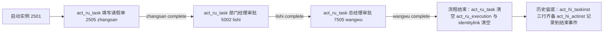

# 把请假流程走完全程：运行时表清空，历史表留底

张三办完「填写请假单」，流程停在「部门经理审批」，负责人换成了李四。要把这条请假流程跑到底，就是让每个节点的负责人各办理一次。走到王五办完最后一个节点，流程实例结束，此刻数据库会出现一次「大扫除」：`act_ru_` 开头的运行时表瞬间清空，所有记录整体搬进 `act_hi_` 开头的历史表。第一次见到运行时表全空的人多半会怀疑数据丢了，其实这正是引擎的设计。

## 先给结论

- 每个用户任务节点各办理一次：李四完成 5002，王五完成 7505，最后一次 complete 触发流程实例结束。
- `singleResult()` 只在结果唯一时可用，命中多条直接抛异常；拿不准结果数就用 `list()`。
- 查询与办理合并成一段代码：查出 `Task` 后直接 `complete(task.getId())`，任务 ID 全程不落地手抄。
- 流程结束的标志是运行时表清空：`act_ru_task` 无记录，`act_ru_execution`、`act_ru_identitylink` 等一并清空。
- 数据没有丢：全部历史在 `act_hi_` 表里，三个任务都有开始与结束时间，`act_hi_actinst` 一路记录到结束事件。

## 一、李四的办理：singleResult 查单条再 complete

李四名下此刻只有一个任务「部门经理审批」，业务上结果唯一，查询可以用 `singleResult()` 直接拿单个对象，连 for 循环都省了：

```java
package com.example.activiti;

import org.activiti.engine.ProcessEngine;
import org.activiti.engine.ProcessEngines;
import org.activiti.engine.TaskService;
import org.activiti.engine.task.Task;

/**
 * 查询当前用户的任务列表
 */
public class ActivitiTaskQuery {

    public static void main(String[] args) {
        //1.得到ProcessEngine对象
        ProcessEngine processEngine = ProcessEngines.getDefaultProcessEngine();
        //2.得到TaskService对象
        TaskService taskService = processEngine.getTaskService();
        //3.根据流程定义的key,负责人assignee来实现当前用户的任务列表查询
        Task task = taskService.createTaskQuery()
                .processDefinitionKey("holiday")
                .taskAssignee("lishi")
                .singleResult();
        //4.任务列表的展示
        System.out.println("流程实例ID:" + task.getProcessInstanceId());
        System.out.println("任务ID:" + task.getId());   //5002
        System.out.println("任务负责人:" + task.getAssignee());
        System.out.println("任务名称:" + task.getName());
    }
}
```

查询本身不推进流程，李四只是「看见」了自己的任务。真正办理仍然是 complete，把查到的 5002 传进去：

```java
//3.处理任务，结合当前用户任务列表的查询操作的话，任务ID:5002
taskService.complete("5002");
```

执行完再看表：`act_ru_task` 里的部门经理审批消失，换成了「总经理审批」，负责人 wangwu，只有开始时间没有结束时间；`act_hi_actinst` 多了一条总经理审批记录，结束时间同样为空；`act_ru_identitylink` 与 `act_hi_identitylink` 各多了一个新参与者 wangwu；`act_hi_taskinst` 里也多出总经理审批的任务历史。`act_ru_execution` 这一次没有变化。原因也交代一句：执行流表记录的是实例与分支的骨架，当前谁来审批属于任务层的细节，任务切换只动 ru_task 与 identitylink，动不了执行流；直到实例结束，执行流整条记录才随大扫除清掉。

## 二、查询与办理合并：王五的最终写法

到王五这一步，把查询和办理合成一段，这也是工程里推荐的形态：

```java
package com.example.activiti;

import org.activiti.engine.ProcessEngine;
import org.activiti.engine.ProcessEngines;
import org.activiti.engine.TaskService;
import org.activiti.engine.task.Task;

/**
 * 处理当前用户的任务
 * 背后操作的表：
 *   act_hi_actinst
 *   act_hi_identitylink
 *   act_hi_taskinst
 *   act_ru_identitylink
 *   act_ru_task
 */
public class ActivitiCompleteTask {

    //查询当前用户wangwu的任务并处理掉
    public static void main(String[] args) {
        //1.得到ProcessEngine对象
        ProcessEngine processEngine = ProcessEngines.getDefaultProcessEngine();
        //2.得到TaskService对象
        TaskService taskService = processEngine.getTaskService();
        //3.查询当前用户的任务
        Task task = taskService.createTaskQuery()
                .processDefinitionKey("holiday")
                .taskAssignee("wangwu")
                .singleResult();
        //4.处理任务,结合当前用户任务列表的查询操作的话,任务ID:task.getId()
        taskService.complete(task.getId());
        //5.输出任务的id
        System.out.println(task.getId());   //7505
    }
}
```

`complete` 的参数不再是手抄的字符串，而是 `task.getId()`。查询结果有几条、任务 ID 具体是多少，代码完全不关心，换环境、换流程实例都能直接跑。王五名下恰好只有一条待办，用 `singleResult()` 没有问题；换成总经理一天批几十条单子的场景，就必须换回 `list()` 循环处理。

## 三、流程结束：运行时表清空，历史表留底

王五的 7505 一执行，总经理审批完成，流程抵达结束事件，整个实例宣告结束。此刻逐表盘点：

| 表 | 结束后的状态 |
|---|---|
| `act_ru_task` | 空，没有当前待办 |
| `act_ru_execution` | 空，实例结束即清 |
| `act_ru_identitylink` | 空 |
| `act_hi_taskinst` | 三条任务记录齐全，填写请假单、部门经理审批、总经理审批都有 `END_TIME_` |
| `act_hi_actinst` | 从开始事件一路记到结束事件 |
| `act_hi_procinst` | 流程实例历史完整，结束时间有值 |

ru 与 hi 的分工一句话说清：ru 是 runtime，流程正在跑的时候才有存在意义，跑完就该让位；hi 是 history，负责把发生过的一切留底。流程结束时引擎做的是「搬运」而不是「销毁」，运行时的信息整体迁入历史表。审批记录查询、耗时统计、流程回溯，将来全部依赖这组历史表。



图上从左到右是同一个流程实例 2501 的一生：三个节点三次办理，运行时表一直是「换行」，结束时整表清空，历史的接力棒交给 hi 组表。这条时间线也解释了为什么三次 complete 的参数各不相同：2505、5002、7505 是三个不同任务的主键，每个节点都得重新查询。

拿到这组历史表，工程里最常见的用法是按实例查审批轨迹：用 HistoryService 构建历史任务查询，加 processInstanceId 条件，list() 出来就是这条请假流程的全部审批记录，按时间排好直接渲染成审批时间线。运行时表清空带来的失落感，到这里就换成了踏实：数据只是换了个地方住，而且住得更久。

## 常见误区

- **对可能多条的结果用 `singleResult()`**：命中两条及以上直接抛异常。它只适合业务上保证唯一的场景，待办列表一律 `list()`。
- **看到运行时表全空以为数据丢失**：清空是引擎设计，历史数据完整地在 `act_hi_` 表里，查历史走 HistoryService。
- **以为每个节点能继续用上一个任务 ID**：2505 办完就没了，下一节点是 5002，再下一节点是 7505，ID 随节点变化，必须重新查询。
- **以为流程中断后要重新部署**：实例状态持久在表里，张三今天办、李四三天后办，流程状态一直保持着，与部署无关。

## 面试可能被问到的问题

1. 面试官追问：「一条有三个审批节点的请假流程，从发起到结束要调几次 complete？」
   答：调三次，每个用户任务节点各一次。最后一次 complete 让流程抵达结束事件，流程实例随之结束。

2. 面试官追问：「流程实例结束的标志是什么？」
   答：运行时表清空，act_ru_task 查不到任何待办，act_ru_execution、act_ru_identitylink 一并清空；历史表数据完整，act_hi_procinst 补上结束时间。

3. 面试官追问：「运行时表清空后，历史数据去了哪里？」
   答：在 act_hi_ 开头的历史表里。流程结束时引擎把运行时信息搬入历史表保存，审批记录、耗时统计都从这里查询。

4. 面试官追问：「singleResult 和 list 怎么选？」
   答：业务能保证结果唯一时用 singleResult 直接拿对象；可能多条时必须用 list。singleResult 命中多条会抛异常，不能当「取第一条」用。

5. 面试官追问：「审批人隔了三天才来办理，流程状态会丢吗？」
   答：不会。实例状态持久化在运行时表里，与内存和会话无关，任何人任何时候查询都能拿到属于自己的待办，这正是流程引擎把状态落在数据库的价值。

## 配套资料

- 查询与办理代码：`materials/code/02/Activiti7-day02-工作流使用/Activiti7-day02-工作流使用/代码/代码/src/main/java/` 下的 `ActivitiTaskQuery.java`、`ActivitiCompleteTask.java`
  （含 lishi、wangwu 的 singleResult 版与查询合并办理版，文中包名已改为 `com.example`）
