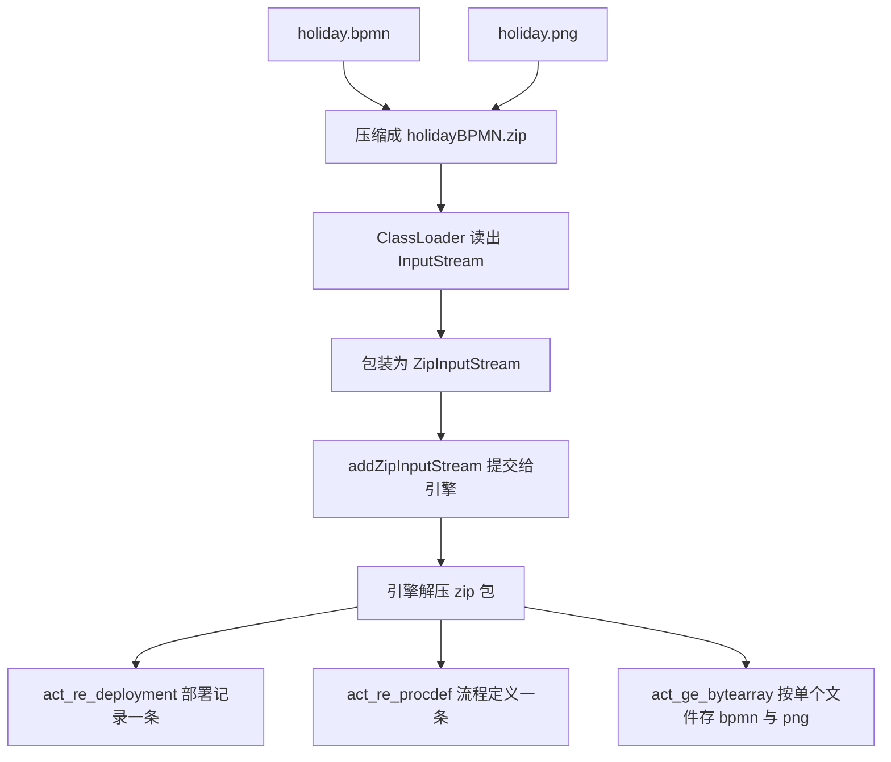
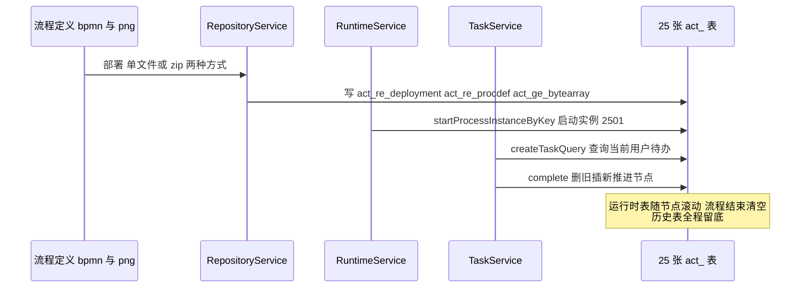
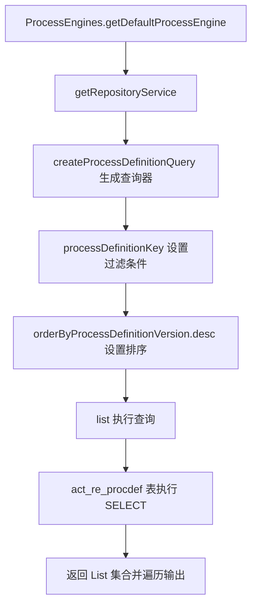
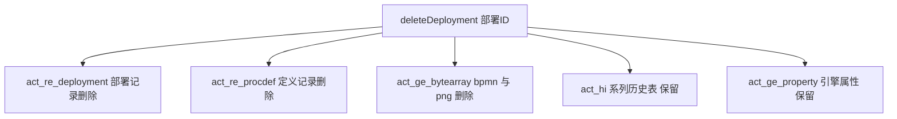
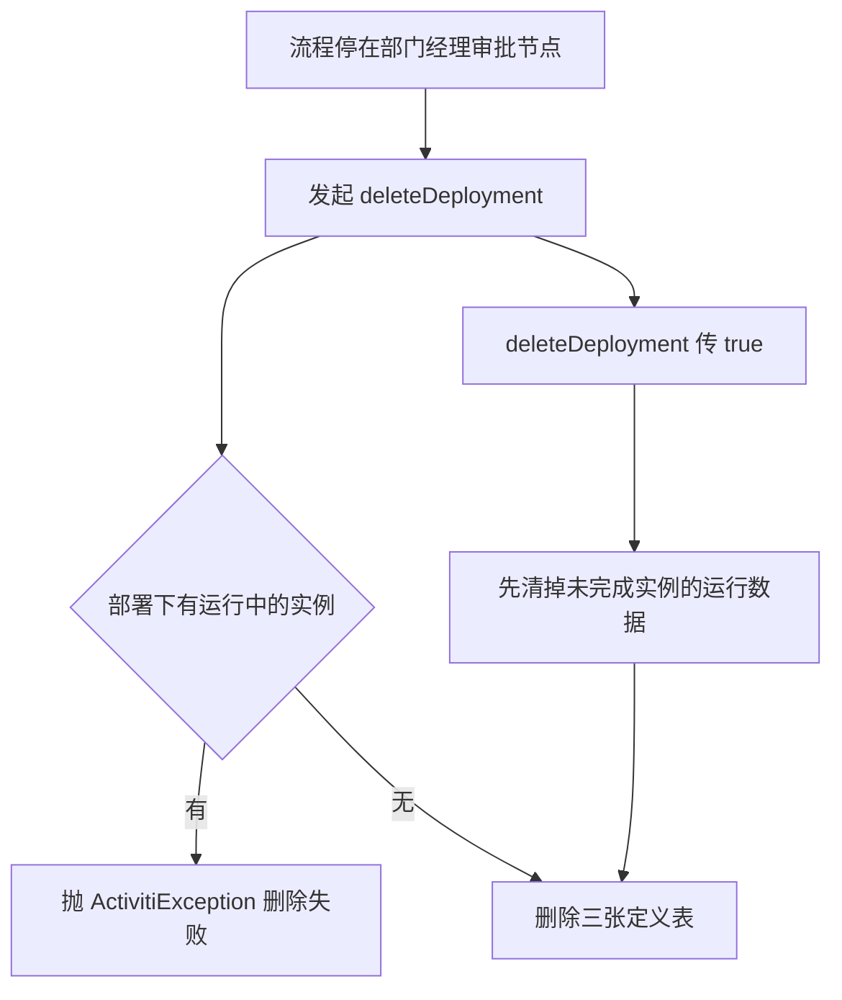

# Activiti 流程定义进阶：zip 部署、定义查询与删除的完整闭环

## 先给结论

- 部署方式的补充：bpmn 与 png 压成一个 zip，`addZipInputStream` 一次提交，引擎自行解压后仍按单文件入库，落库三张表与单文件部署完全一致。
- 基础链路的主线：`ProcessEngineConfiguration` 读 `activiti.cfg.xml` 构建 `ProcessEngine`，引擎产出各个 Service 并生成 25 张表，全链路六步是画图、部署、启动实例、查任务、办任务、查历史。
- Activiti7 已移除 IdentityService 与 FormService，四个核心 Service（RepositoryService、RuntimeService、TaskService、HistoryService）覆盖基础链路，找 API 别按 5、6 版本的旧教程走。
- 定义查询走 `RepositoryService` 的 `ProcessDefinitionQuery`：同一 key 多版本并存，常用版本降序排列；定义 ID 是 key、版本、随机数的三段式，部署 ID 由 `getDeploymentId()` 取得。
- 删除的参数是部署 ID 不是定义 ID：默认非级联，部署下还有运行中实例时抛 `ActivitiException`；级联参数 `true` 会连未完成实例的运行数据一起清。
- 删除的影响面与部署对称，恰好三张表 `act_re_deployment`、`act_re_procdef`、`act_ge_bytearray`，`act_hi_*` 历史表刻意保留，定义没了审批轨迹仍查得到。
- 生产取舍：慎用级联删除，先挂起流程定义挡住新申请，存量实例走完或做业务补偿后再删，删除永远走 API 不手工清表。
- 查询结果不止一条时别用 `singleResult()`，用 `list()` 加排序，或 `latestVersion()` 取最新版，分页与计数在同一查询链上完成。

## 第1部分：Activiti流程部署的zip包方式的补充

流程定义部署此前用的是单文件方式：`addClasspathResource` 加一次 bpmn，再加一次 png。文件一多就麻烦，尤其是流程图由业务人员画好、要从本地上传到服务器的场景，两个文件就是两次上传，还容易漏传一个。压缩包部署把这件事变成一次：打一个 zip，交给 `addZipInputStream`，引擎自己拆包入库。

### 一、准备 zip 包
先把 `holiday.bpmn` 与 `holiday.png` 放进同一个目录，用压缩工具打包，压缩格式明确选 zip（不要拿 rar 或 7z 改后缀），命名如 `holidayBPMN.zip`，放进工程的 `src/main/resources/diagram/` 目录，保证它在 classpath 上。

打包这个动作没有技术含量，却决定后面代码能不能一次通过：zip 里最好只放这两个文件本身，不要把外层文件夹一起压进去，否则解压出来的资源名会带上目录前缀，后续按名称找资源容易对不上。还有一条对应关系要记下：包内每个条目的名字就是将来入库的资源名，打包时不要顺手改文件名，保持 bpmn 与 png 的原名，这样 act_ge_bytearray 里的名字与代码、文档里的引用始终对得上，排查问题时少一个变量。

### 二、部署代码：addZipInputStream
课程工程里 zip 方式的完整写法（包名已按规范改为 `com.example`）：

```java
package com.example.activiti;

import org.activiti.engine.ProcessEngine;
import org.activiti.engine.ProcessEngines;
import org.activiti.engine.RepositoryService;
import org.activiti.engine.repository.Deployment;

import java.io.InputStream;
import java.util.zip.ZipInputStream;

/**
 * 流程定义的部署
 * activiti表有哪些？
 *  act_re_deployment  部署信息
 *  act_re_procdef     流程定义的一些信息
 *  act_ge_bytearray   流程定义的bpmn文件及png文件
 */
public class ActivitiDeployment {

    //流程定义部署  流程制作出来后要上传到服务器 zip文件更便于上传
    public static void main(String[] args) {
        //1.创建ProcessEngine对象
        ProcessEngine processEngine = ProcessEngines.getDefaultProcessEngine();

        //2.得到RepositoryService实例
        RepositoryService repositoryService = processEngine.getRepositoryService();

        //3.转化出ZipInputStream流对象
        InputStream is = ActivitiDeployment.class.getClassLoader().getResourceAsStream("diagram/holidayBPMN.zip");

        //将 inputstream流转化为ZipInputStream流
        ZipInputStream zipInputStream = new ZipInputStream(is);

        //4.进行部署
        Deployment deployment = repositoryService.createDeployment()
                .addZipInputStream(zipInputStream)
                .name("请假申请单流程")
                .deploy();

        //5.输出部署的一些信息
        System.out.println(deployment.getName());
        System.out.println(deployment.getId());
    }
}
```

与单文件方式对照着看，差别只在构建部署链这一段：

```java
//单文件方式，对照用
Deployment deployment = repositoryService.createDeployment()
        .addClasspathResource("diagram/holiday.bpmn")   //添加bpmn资源
        .addClasspathResource("diagram/holiday.png")    //添加png资源
        .name("请假申请单流程")
        .deploy();
```

**第一，资源从「路径」变成了「流」。** 单文件方式直接给 classpath 路径；zip 方式要自己拿到流：`getClass().getClassLoader().getResourceAsStream("diagram/holidayBPMN.zip")` 以 classes 目录为根读出 `InputStream`，再 `new ZipInputStream(is)` 包装成压缩流。用 `ClassLoader` 读资源时路径不以 `/` 开头，这一点与 `Class.getResourceAsStream` 的规则不同。

**第二，部署链上只挂一个 `addZipInputStream`。** 引擎拿到压缩流后会遍历里面的每个条目，逐个当成资源文件处理。zip 已经包含全部文件，就不需要再补 `addClasspathResource`，重复添加只会让同一份文件入库两遍。

流对象本身还有一个特性要留意：InputStream 是一次性资源，第一次 deploy 消费完就到了流的末尾，拿同一个 zipInputStream 再部署第二次只会得到空结果。要重复部署就重新读一份流。这也是把「读流」与「部署」拆成两步写的好处，哪一步出问题一眼就能定位。

### 三、引擎内部：解压与入库
为了看清效果，可以先删库重建（引擎启动时会把 25 张表自动建回来），再执行部署。结果与单文件部署完全一致：`act_re_deployment` 多一条部署记录，`act_re_procdef` 多一条流程定义，`act_ge_bytearray` 里能看到 bpmn 与 png 两个文件各自一条。

值得留意的是最后这处：压缩包在库里已经不见了，看到的是解压后的两个单独文件。压缩、传输、解压、入库，解压这一步是引擎替你做的。压缩的意义因此不在存储，而在传输：流程图这类文件往往由人事或行政人员制作，要经过文件上传环节送到服务器，一个 zip 一次上传搞定，比 bpmn、png 各传一次简单得多，也不容易漏。



图上最关键的一跳是「引擎解压 zip 包」：从这往后 zip 就消失了，入库形态与单文件部署没有任何区别，后续的流程定义查询、实例启动也不感知当初用的是哪种部署方式。想在两种方式之间切换验证，把部署记录清掉再换写法重跑一遍即可，两边产出的表数据完全一样，对照着看能加深对「传输形态与存储形态无关」这句话的理解。
## 第2部分：Activiti流程基础知识的总结

从环境搭建、画流程图，到部署、启动实例、查询任务、办理任务，流程基础到此全部走完。零散的 API 学了一路，是时候把它们收拢成一张图、一条链。检验学没学会的标准也很简单：给一个空的数据库，能不能不看笔记，把从画图到办完这六步的类和方法按顺序写出来。

### 一、架构回顾：两个类与四个 Service
day01 讲体系结构时铺过这张图，现在每个 Service 都亲手用过，再回头看就具体了：

| 组件 | 职责 | 本链路用到的关键方法 |
|---|---|---|
| `ProcessEngineConfiguration` | 加载 `activiti.cfg.xml`，构建引擎 | 内部完成，代码不直接碰 |
| `ProcessEngine` | 引擎本体，产出各 Service，生成工作环境 | `ProcessEngines.getDefaultProcessEngine()` |
| `RepositoryService` | 流程定义的部署 | `createDeployment().deploy()` |
| `RuntimeService` | 启动流程实例 | `startProcessInstanceByKey("holiday")` |
| `TaskService` | 任务的查询与办理 | `createTaskQuery()`、`complete(taskId)` |
| `HistoryService` | 历史数据查询（后续章节展开） | 本课暂未用到 |

`ProcessEngineConfiguration` 加载的配置文件就是工程 resources 下那份 `activiti.cfg.xml`，bean 的 id 固定为 `processEngineConfiguration`，数据源与建表开关都在里面：

```xml
<bean id="processEngineConfiguration" class="org.activiti.engine.impl.cfg.StandaloneProcessEngineConfiguration">
    <!--代表数据源-->
    <property name="dataSource" ref="dataSource"></property>
    <!--代表是否生成表结构-->
    <property name="databaseSchemaUpdate" value="true"/>
</bean>
```

「工作环境」指的就是那 25 张表。引擎对象一创建，表就必须生成到位（`databaseSchemaUpdate` 设为 `true` 时由引擎自动建表），否则部署时节点信息读出来了都没地方存。Service 层的存在意义也在这里：引擎把 25 张表的增删改查封装成领域方法，程序员不用再针对每张表写 domain、DAO 和 Service 三层，这是 Activiti 省掉的最大一块工作量。

版本上要留个心眼：Activiti7 是 2018 年 9 月之后才发布的，不少在用系统还跑在 5、6 上。新版本已经移除了 IdentityService 与 FormService 两个接口，网上翻旧教程时别再把它们当回事。

### 二、全链路六步：每步的类与方法
把整条链摊开，五步操作性工作依次是：

```java
// 1. 部署：RepositoryService（单文件与 zip 两种写法均可）
Deployment deployment = repositoryService.createDeployment()
        .addClasspathResource("diagram/holiday.bpmn")   //添加bpmn资源
        .addClasspathResource("diagram/holiday.png")    //添加png资源
        .name("请假申请流程")
        .deploy();

// 2. 启动流程实例：RuntimeService
ProcessInstance processInstance = runtimeService.startProcessInstanceByKey("holiday");

// 3. 查询当前用户任务：TaskService
Task task = taskService.createTaskQuery()
        .processDefinitionKey("holiday")
        .taskAssignee("zhangsan")
        .singleResult();

// 4. 办理任务：TaskService，三个节点各办一次
taskService.complete(task.getId());

// 5. 查询历史：HistoryService，流程结束后核对数据用，后续章节展开
// historyService.createHistoricTaskInstanceQuery().list();
```

每一步背后动的是哪组表，学到这里的账本应该是清楚的：部署写 `act_re_` 与 `act_ge_` 组，启动实例写 `act_ru_` 与 `act_hi_` 组，办理任务在运行时表删旧插新、历史表滚动更新，流程结束后运行时表清空、历史表留底。启动实例那一步还有个容易忽略的细节：`processInstance.getDeploymentId()` 返回 null，流程定义 ID 形如 `holiday:1:4`，实例 ID 才是 2501 这种主键，三者别混。

流程图本身用 IDE 的 Activiti Designer 插件绘制，start event 到 end event 之间摆上用户任务节点，给每个节点设置 assignee 与流程 key，bpmn 与 png 一起放进 `diagram/` 目录，这是第 0 步的准备工作。

可以顺手给自己列一张自测清单：流程定义的 key 写在 BPMN 的哪个元素上；部署后三张表各多几条记录；按 key 启动与按 ID 启动有什么差别；任务查询的两个必要条件是什么；complete 之后 act_ru_task 里发生了什么变化；流程结束时为什么运行时表会全空。这些问题都能脱口而出，基础部分就算真正收官，进入后面的进阶内容也会顺得多。

### 三、一张时序图收拢全链路


读图的顺序就是代码的调用顺序：部署把定义入库，启动让实例在运行时表里落位，查询与办理在 `act_ru_task` 一张小表上反复进行，直到运行时表清空、历史表接管。所有箭头最终都指向同一组表，这也呼应了架构那一节的判断：Service 是壳，表是核。

三种 Service 在同一段业务里的分工再压缩成一句话：RepositoryService 管「存进去」，RuntimeService 管「跑起来」，TaskService 管「办下去」。历史那条线（HistoryService）在审批记录、耗时统计这类需求里才登台，本课先立住它的位置即可。
## 第3部分：Activiti流程定义信息查询

流程部署成功之后，很快会冒出一串问题：库里现在到底有几套流程？请假的这套迭代过几个版本？部署时写进数据库的 bpmn 与 png 还在不在？这些问题都指向同一个动作，查询流程定义。bpmn 文件里写的 `process id="holiday"`、流程名称、版本号，在部署时被引擎解析进了 `act_re_procdef` 表，把这张表的内容通过 API 读出来，就是这一课要做的全部事情。

### 一、一套流程为什么查出一串记录
公司里通常不止一套流程：请假一套、调岗一套、薪资调整一套、员工培训一套，再加上财务报销之类，几十套很正常。每套流程用一个唯一的 key 标识，`holiday` 就是请假流程的 key。

版本机制是理解查询结果的关键。**第一，每次部署都产生新版本。** 请假流程优化迭代了三次、部署了三次，库里就有 key 等于 `holiday`、版本号 1 到 3 的三条流程定义记录，`list()` 返回的就是这三条。**第二，旧版本不随着新版本发布而消失。** 已经按旧版本启动的流程实例还要继续走，定义必须留在库里供引擎解析，所以查询时看到的常常是「同 key 多版本」的列表。按版本号降序排，一眼就能看到当前最新的是哪一版。

`ProcessDefinition` 对象上常用的读取方法如下：

| 方法 | 含义 | 示例值 |
|---|---|---|
| getId | 流程定义主键，由 key、版本、随机数三段拼接 | `holiday:1:4` |
| getKey | 流程定义 key，即 bpmn 里 process 节点的 id | `holiday` |
| getName | 流程定义名称 | 请假申请单流程 |
| getVersion | 版本号，同一 key 每发布一次递增 1 | `1` |
| getDeploymentId | 所属部署的 ID | `1` |
| getResourceName | bpmn 资源文件名 | `holiday.bpmn` |
| getDiagramResourceName | 流程图 png 资源文件名 | `holiday.png` |

表里最后三行的方法平时不起眼，需要时非常关键：getResourceName 与 getDiagramResourceName 给出了资源在库里的登记名，配合 getDeploymentId，后续「按部署 ID 把 bpmn 或 png 读出来输出到页面」「删除流程部署」这类操作都靠这几个值组合完成。定义查询因此不只是列表页的数据源，还是资源管理与清理工作的入口，把这几个字段记熟，后面两篇的资源读取会顺很多。

### 二、完整代码：五步查出定义列表
课程工程里的查询类如下（包名已改为 `com.example`）：

```java
package com.example.day03.activiti;

import org.activiti.engine.ProcessEngine;
import org.activiti.engine.ProcessEngines;
import org.activiti.engine.RepositoryService;
import org.activiti.engine.repository.ProcessDefinition;
import org.activiti.engine.repository.ProcessDefinitionQuery;

import java.util.List;

/**
 * 查询流程定义信息
 */
public class QueryProcessDefinition {

    public static void main(String[] args) {
        //1.得到ProcessEngine对象
        ProcessEngine processEngine = ProcessEngines.getDefaultProcessEngine();

        //2.创建RepositoryService对象
        RepositoryService repositoryService = processEngine.getRepositoryService();

        //3.得到ProcessDefinitionQuery对象,可以认为它就是一个查询器
        ProcessDefinitionQuery processDefinitionQuery = repositoryService.createProcessDefinitionQuery();

        //4.设置条件，并查询出当前的所有流程定义   查询条件：流程定义的key=holiday
        //orderByProcessDefinitionVersion() 设置排序方式,根据流程定义的版本号进行排序
        List<ProcessDefinition> list = processDefinitionQuery.processDefinitionKey("holiday")
                .orderByProcessDefinitionVersion()
                .desc().list();

        //5.输出流程定义信息
        for (ProcessDefinition processDefinition : list) {
            System.out.println("流程定义ID：" + processDefinition.getId());
            System.out.println("流程定义名称：" + processDefinition.getName());
            System.out.println("流程定义的Key：" + processDefinition.getKey());
            System.out.println("流程定义的版本号：" + processDefinition.getVersion());
            System.out.println("流程部署的ID:" + processDefinition.getDeploymentId());
        }
    }
}
```

`ProcessEngines.getDefaultProcessEngine()` 读 classpath 下 `activiti.cfg.xml` 拉起默认引擎，前面所有课程用的都是这个入口。真正的新东西只有 `createProcessDefinitionQuery()`：**它返回的查询器支持链式调用。** `processDefinitionKey("holiday")` 执行完返回的还是查询器自身，所以能继续 `.orderByProcessDefinitionVersion()`；排序方法之后必须显式接 `.desc()` 或 `.asc()` 定下方向，最后 `list()` 一次性执行。不想排序的话，条件写完直接 `list()` 也可以。

课程为了省去页面开发，把结果直接打到控制台。真实项目里这批数据应该转成 JSON 交给前端渲染成流程定义列表页，控制台输出只是学习阶段的简化。

### 三、这条查询链落到了哪个库


图里最关键的一跳是 `list()`：它把查询链上攒的条件翻译成对 `act_re_procdef` 的一次 SELECT，key 变成 WHERE 条件，版本降序变成 `ORDER BY VERSION_ DESC`。查询器因此省掉的不是功能，而是手写 SQL 的功夫， Activiti 把这张表的常用查询条件全部做成了链式方法，按 key 查、按名称查、按部署 ID 查、只查最新版本（`latestVersion()`）都有对应方法。
## 第4部分：Activiti流程定义信息删除及原理分析

流程定义查询列表里摆着几套流程时，总有一些会过时：公司决定不再使用某套审批流程，它的定义信息就成了一堆没人用的数据。部署的时候引擎把 bpmn、png、定义信息写进了三张表，整套流程不要了，这些表里的数据也得清掉。`deleteDeployment` 一个方法就能删，但参数怎么来的、背后删了哪些表、哪些数据会被留下来，得先弄清楚再动手，否则要么删不掉，要么把不该删的删了。

### 一、参数为什么是部署 ID
一个容易卡住的点：方法名叫「删除流程定义」，参数却是部署 ID。原因在部署的存储结构里，部署的本质是把一套流程的资源与定义信息一起入库：`act_re_deployment` 存部署记录，`act_re_procdef` 存解析出的定义，`act_ge_bytearray` 存 bpmn 与 png 文件本体，三者共用同一个部署 ID 串起来。删除整套定义信息，最自然的定位键就是部署 ID，引擎顺着它把三张表里的关联数据一次清干净。

部署 ID 从哪来？查询的时候就有。在流程定义查询的输出里加上一行：

```java
// 查询流程定义时顺便输出部署 ID
System.out.println("流程部署ID：" + processDefinition.getDeploymentId());
```

跑一次查询，部署 ID 就到手了。查到什么删什么，两个动作也可以合在一起写（示例写法，按本课代码整理）：

```java
// 第一步：按 key 查出最新版本的流程定义
ProcessDefinition pd = repositoryService.createProcessDefinitionQuery()
        .processDefinitionKey("holiday")
        .latestVersion()
        .singleResult();

// 第二步：拿着部署 ID 执行删除
repositoryService.deleteDeployment(pd.getDeploymentId());
```

### 二、删一次，观察三张表
课程里的删除类如下（包名已改为 `com.example`）：

```java
package com.example.day03.activiti;

import org.activiti.engine.ProcessEngine;
import org.activiti.engine.ProcessEngines;
import org.activiti.engine.RepositoryService;

/**
 * 删除已经部署的流程定义
 *
 * 背后影响的表:
 *   act_ge_bytearray
 *   act_re_deployment
 *   act_re_procdef
 */
public class DeleteProcessDefinition {

    public static void main(String[] args) {
        //1.得到ProcessEngine对象
        ProcessEngine processEngine = ProcessEngines.getDefaultProcessEngine();

        //2.创建RepositoryService对象
        RepositoryService repositoryService = processEngine.getRepositoryService();

        //3.执行删除流程定义  参数代表流程部署的id
        repositoryService.deleteDeployment("1");
    }
}
```

为了让删除的效果看得更全，可以先跑一遍完整流程：部署、启动实例、让张三、李四、王五依次完成任务，让历史表里积累出数据，然后再执行删除。删完逐张表去看，结果非常整齐：

| 表 | 删除后的状态 |
|---|---|
| `act_re_deployment` | 部署记录没了 |
| `act_re_procdef` | 流程定义记录没了 |
| `act_ge_bytearray` | bpmn 与 png 两条记录没了 |
| `act_ge_property` | 不受影响，这是 Activiti 引擎自身的属性数据 |
| `act_hi_actinst`、`act_hi_procinst`、`act_hi_taskinst` | 历史记录全在，一条没少 |
| `act_ru_*` 运行时表 | 本来就是空的，流程走完引擎会自动清 |



图上的分界线很清楚：当年部署写进去的三张表，删除时原样清空；历史表与引擎属性表完全不沾边。删除与部署影响的表一模一样，这不是巧合，部署写什么，删除就删什么。

### 三、历史记录为什么刻意留下
定义删了，历史还在，这个设计用档案来类比最贴切：人可以不在了，档案要一直保存。业务上的对应关系是，流程定义下线只说明这套流程今后不再发起，但存量申请当年走到过哪个节点、谁来审批的、耗时多久，这些信息沉淀在 `act_hi_*` 表里，审计、追责、复盘都靠它。

**第一，历史表的数据与定义表是解耦的。** 历史表按活动快照的方式记录每一步，删掉定义不会让这些快照失去意义，曾经经历了哪些步骤依然可查。**第二，删除操作因此是可以放心做的常规动作。** 只要没有运行中的实例，删除只回收存储，不抹掉任何业务痕迹，这也是下一课要展开的注意事项的起点。
## 第5部分：Activiti流程定义信息删除的注意事项

上一课的删除实验里，流程都是先完整走完再删的，删得干脆利落。真实业务没这么配合：请假流程刚走到部门经理审批环节，公司换了制度，高层一声令下，没走完的老流程全部作废、重新按新流程发起，整套旧流程定义要立刻下线。这时直接执行 `deleteDeployment`，数据库会给出一个意料之外的答案，删不掉。

### 一、什么情况下会删除失败
场景还原一下：流程实例启动后，张三填了请假单，流程推进到部门经理审批节点，停在这里。此时执行删除，引擎拒绝操作，抛出异常，提示该流程定义还有运行中的流程实例。

**第一，报错是保护而不是缺陷。** 站在引擎的角度想一想流程是怎么往前走的：张三的填写任务完成，引擎要判断下一个节点是谁，这个答案不在运行数据里，而在流程定义的 bpmn 模型里。部门经理审批完，引擎查定义才知道下一步是总经理审批，再下一步到结束。定义还在，链路畅通；定义被删，走到一半的流程就成了断线的风筝，任何节点完成之后引擎都解析不出后续路径。

**第二，引擎选择在删除入口拦截。** 与其让半路实例在后续某次推进时莫名报错，不如在删除时就明确告知：当前流程没走完，不能删。这也是本课的结论，正在执行的流程没有完全审批结束时，此时删除流程定义信息就会失败。



图上左边那条路径就是默认行为：有实例就拦截；右边那条是本课要讲的强制通道。

### 二、级联删除：强制下线的正确姿势
公司层面确实要强制删除时，`RepositoryService` 提供了带级联参数的重载。课程 PPT 里的对照写法：

```java
public void deleteDeployment() {
    // 流程部署Id
    String deploymentId = "8801";
    // 通过流程引擎获取repositoryService
    RepositoryService repositoryService = processEngine
            .getRepositoryService();
    //删除流程定义，如果该流程定义已有流程实例启动则删除时出错
    repositoryService.deleteDeployment(deploymentId);
    //设置true 级联删除流程定义，即使该流程有流程实例启动也可以删除
    //设置为false 非级联删除方式，与不传参数等价
    //repositoryService.deleteDeployment(deploymentId, true);
}
```

工程里的 `DeleteProcessDefinition` 类注释把这条注意事项写得更直白：参数 `true` 代表级联删除，此时会先删除没有完成的流程节点信息，最后就可以删除流程定义信息；`false` 的值代表不级联。

级联删除做的事，本质是把「有实例在跑」这个障碍先搬掉：引擎对未完成的流程实例做强制终止，运行时表里挂着的节点、任务、参与者数据被清理，实例不存在了，三张定义表的删除自然畅通。传 `false` 与不传参数行为一致，没有多此一举的必要。

### 三、生产上的取舍建议
**第一，级联删除是破坏性操作。** 未走完的请假申请、报销单会随实例一起消失，业务侧的申请人甚至感知不到自己的单子没了。真要级联，先导出历史数据、通知业务方、留下操作记录，再动手。

**第二，优先用非破坏性手段下线流程。** 引擎提供挂起能力，`suspendProcessDefinitionByKey("holiday")` 可以把流程定义挂起，挡住新发起的申请；挂起有只挂定义与连同存量实例一起挂起两种粒度，对应不同重载。存量实例要么走完，要么走业务补偿，全部落地之后再删定义，就不需要级联了。

**第三，删除失败要给出人话提示。** 捕获 `ActivitiException`，转成「该流程仍有未办结的申请，不能删除」之类的业务话术返回给前端，而不是把异常堆栈直接甩给用户。
## 常见误区

- **拿 rar 或 7z 包改后缀当 zip**：引擎按 zip 格式解析条目，格式不对就读不出内容，部署失败或资源缺失。压缩时明确选择 zip 格式。
- **把外层文件夹压进 zip**：资源名会带上目录前缀，与预期名称对不上。zip 内直接放 bpmn 与 png 两个文件本身。
- **`addZipInputStream` 之外又 `addClasspathResource`**：同一份文件入库两份，浪费存储还容易混淆版本。两种方式二选一。
- **zip 内文件名含中文时出现乱码**：`java.util.zip` 默认按 UTF-8 解析条目名，部分 Windows 压缩工具用本地编码写入条目名，必要时用 `new ZipInputStream(is, Charset.forName("GBK"))` 显式指定。
- **按 5、6 版本的教程找 API**：IdentityService、FormService 在 Activiti7 已移除，照旧代码会找不到类。核心四 Service 加 `ProcessEngine` 足够覆盖基础链路。
- **把 25 张表当成死数字背**：不同版本建出的表数会略有出入，记后缀含义（re 定义、ru 运行时、hi 历史、ge 通用）比记数量有用。
- **以为六步要六个独立环境**：一套引擎一个库，各 Service 都从同一个 `ProcessEngine` 取出，示例拆成多个类只为演示清晰。
- **部署完立刻查任务**：没有启动流程实例时 `act_ru_task` 里没有任何记录，查不到待办不是 bug，是链路少了一步启动。
- **拿流程定义 ID 当 key 用**：key 是 bpmn 里的业务标识，ID 是 `holiday:1:4` 这种带版本与随机数的主键。按 key 查能带出所有版本，按 ID 查只命中一条，两者的查询方法分别是 `processDefinitionKey` 与 `processDefinitionId`。
- **以为查询结果只有一条**：同一 key 多版本时 `list()` 返回多条。确定结果唯一时才用 `singleResult()`，结果多于一条它会直接抛异常，而不是返回第一条。
- **只写排序不写方向**：`orderByProcessDefinitionVersion()` 之后要接 `.asc()` 或 `.desc()`，方向和方法是成对出现的，漏掉方向链路就断了。
- **用运行时查询去找定义**：`RuntimeService` 的流程实例查询查的是跑起来的实例，定义信息一律走 `RepositoryService`，两类查询别混。
- **拿流程定义 ID 去调 `deleteDeployment`**：参数必须是部署 ID。手里只有定义 ID 时，先按定义查出 `getDeploymentId()` 再删，传错会找不到对应的部署数据。
- **以为删除会把历史一起清掉**：默认删除不碰 `act_hi_*` 表，历史审批记录保留，这是特性不是副作用。
- **删除前不确认有没有运行中的实例**：部署下还有没走完的流程实例时，默认删除直接失败，先查实例再删是稳妥顺序。
- **把删除当成清洗历史数据的手段**：想清空历史表，删除流程定义做不到，得单独处理历史数据。
- **以为删除失败是代码写错了**：报错恰恰说明引擎在正常工作，检查这个部署下是否有运行中的实例，而不是改代码。
- **为图省事永远传 `true`**：级联会连带清掉未完成实例，误用等于批量作废业务单据。只在明确要强制下线时才用。
- **把 `false` 当成加强参数传**：`false` 就是非级联，与不传参数一样，传它不会让删除变强。
- **删除失败后直接去数据库手工删表**：绕过引擎清三张表会留下半死不活的实例数据，后续查询与推进都会踩雷，删除必须走 API。

## 面试可能被问到的问题

1. 面试官追问：「zip 部署和单文件部署有什么区别？」
   答：只是资源提交方式不同。单文件用 addClasspathResource 逐个添加路径，zip 用 addZipInputStream 提交压缩流由引擎解压。落库后 act_ge_bytearray 里的形态完全一致。

2. 面试官追问：「为什么生产上常用 zip 方式部署？」
   答：流程文件要经历上传服务器的环节，一个 zip 一次上传，避免多文件上传的复杂度与漏传风险；引擎解压后存储形态不变，传输与存储各取所需。

3. 面试官追问：「zip 部署后，数据库里存的是 zip 本身吗？」
   答：不是。引擎解压后按 zip 内的每个文件分别入库，act_ge_bytearray 里是 bpmn 与 png 各自一条记录，见不到 zip 的影子。

4. 面试官追问：「流程定义部署影响哪几张表？」
   答：act_re_deployment 存部署信息，act_re_procdef 存流程定义信息，act_ge_bytearray 存 bpmn 与 png 文件内容。运行时表与历史表在部署阶段都不写。

5. 面试官追问：「用 ClassLoader 读资源和用 Class 读资源，路径写法有何不同？」
   答：getClassLoader().getResourceAsStream 的路径以 classpath 根为起点，不以 / 开头；Class.getResourceAsStream 以类所在包为起点，跨包资源要以 / 开头。读部署资源通常用前者。

6. 面试官追问：「描述一下 Activiti 的核心架构。」
   答：ProcessEngineConfiguration 加载 activiti.cfg.xml 完成配置，构建出 ProcessEngine 流程引擎；引擎产出 RepositoryService、RuntimeService、TaskService、HistoryService 等接口，并生成工作环境即 25 张表。业务代码通过这些 Service 操作表完成流程管理。

7. 面试官追问：「四个核心 Service 分别负责什么？」
   答：RepositoryService 负责流程定义的部署，RuntimeService 负责启动流程实例，TaskService 负责任务的查询与办理，HistoryService 负责历史数据查询。Activiti7 已移除 IdentityService 与 FormService。

8. 面试官追问：「一条请假流程的完整调用链是什么？」
   答：createDeployment 部署流程定义，startProcessInstanceByKey 启动实例，每个节点的负责人用 createTaskQuery 查询待办并 complete 办理，三个节点办完流程结束，运行时表清空，数据留存在历史表。

9. 面试官追问：「为什么说 Service 是对表的封装，好处是什么？」
   答：25 张表全部由引擎维护，Service 把表的增删改查包装成 createTaskQuery、complete 这类领域方法，业务代码不需要为每张表编写 domain、DAO 与 Service 层，开发量大幅减少，也不直接接触表结构。

10. 面试官追问：「Activiti7 与 5、6 相比要注意什么变化？」
   答：Activiti7 发布于 2018 年 9 月，移除了 IdentityService 与 FormService 两个接口。查阅资料和迁移旧系统时必须区分版本，旧教程的代码不能照搬。

11. 面试官追问：「流程定义和流程部署是什么关系？」
   答：部署是一次资源提交动作，一次部署会写入一条 act_re_deployment 记录；部署的 bpmn 被解析后按 key 加版本生成 act_re_procdef 里的流程定义记录，定义通过 DEPLOYMENT_ID_ 关联到部署。一个 zip 里放多个 bpmn 时，一次部署可以对应多条定义。

12. 面试官追问：「同一个 key 有多个版本，启动实例时用哪个？」
   答：`startProcessInstanceByKey` 默认取该 key 的最高版本定义来启动。旧版本定义仍在库里，供在途实例继续解析节点。

13. 面试官追问：「流程定义 ID 的构成是怎样的？」
   答：三段式，key、版本号、一个随机数，用冒号拼接，例如 holiday:1:4，它是 act_re_procdef 的主键，全局唯一，所以按 ID 查永远只命中一条。

14. 面试官追问：「只要某个流程的最新一条定义，怎么查？」
   答：在查询器上加 `latestVersion()` 条件，只返回每个 key 的最高版本；或者按版本降序排后取集合的第一条。

15. 面试官追问：「定义很多时怎么分页和统计总数？」
   答：查询器继承自 Query 接口，提供 `listPage(firstResult, maxResults)` 分页查询和 `count()` 统计，列表页的两类请求都能在同一查询链上完成。

16. 面试官追问：「`deleteDeployment` 的参数是流程定义 ID 还是部署 ID？」
   答：是部署 ID。部署 ID 串起了 act_re_deployment、act_re_procdef、act_ge_bytearray 三张表，引擎按它把关联数据一次清干净。部署 ID 可以通过流程定义的 getDeploymentId 拿到。

17. 面试官追问：「删除流程定义会影响哪些表？」
   答：恰好是部署时写入的三张表：act_re_deployment、act_re_procdef、act_ge_bytearray。act_hi 历史表保留，act_ru 运行时表在流程走完后本来就是空的，act_ge_property 是引擎属性不受影响。

18. 面试官追问：「为什么删除定义不删除历史记录？」
   答：历史表记录的是审批活动的快照，与定义解耦。流程下线只代表今后不再发起，存量申请的审批轨迹属于审计与追溯数据，必须保留，类似档案的逻辑。

19. 面试官追问：「删除之后再按这个 key 启动流程实例会怎样？」
   答：找不到对应的流程定义，启动失败抛出异常。定义是实例推进的依据，库里没有定义，引擎无从解析任何节点。

20. 面试官追问：「怎么避免误删还在用的流程定义？」
   答：删除前先查这个部署下有没有运行中的实例，有就先处理实例；管理端把删除做成低频操作，加权限与二次确认，必要时先挂起流程定义观察一段时间再删。

21. 面试官追问：「`deleteDeployment` 传 `true` 和不传有什么区别？」
   答：不传等价于传 false，是非级联删除，部署下还有运行中的流程实例时会抛异常；传 true 是级联删除，先把未完成实例的运行数据清掉，再删部署与定义相关的三张表。

22. 面试官追问：「为什么有运行中实例时引擎不让删？」
   答：流程实例推进节点时要从流程定义里解析下一步，定义删了，停在半路的实例就无法继续，任何节点完成后都找不到后继。引擎在删除入口直接拦截，避免留下无法推进的僵尸实例。

23. 面试官追问：「级联删除具体删了什么？」
   答：先把未完成流程实例的运行时数据清理掉，实例不再存在，然后像普通删除一样清掉 act_re_deployment、act_re_procdef、act_ge_bytearray 三张定义表里的关联记录。

24. 面试官追问：「生产上要让一套旧流程下线，你会怎么做？」
   答：先挂起流程定义挡住新申请，存量实例等走完或做业务补偿，确认无运行中实例后再删定义；确需强制级联删除时，先备份历史、通知业务方并留审计记录。

25. 面试官追问：「删除失败的异常怎么处理？」
   答：捕获 ActivitiException，识别出仍有运行实例的情形，给用户返回业务化提示，引导先办结或撤销存量申请；日志里保留部署 ID 与异常信息便于排查。

## 配套资料

- zip 部署代码：`materials/code/02/Activiti7-day02-工作流使用/Activiti7-day02-工作流使用/代码/代码/src/main/java/` 下的 `ActivitiDeployment.java`
  （zip 写法为主版本，单文件写法以注释保留在同一个类里，文中包名已改为 `com.example`；`diagram/holidayBPMN.zip` 资料包里未含，需按课程做法把 bpmn 与 png 压缩后放入 resources）
- 全链路代码：`materials/code/02/Activiti7-day02-工作流使用/Activiti7-day02-工作流使用/代码/代码/src/main/java/` 下的 `ActivitiDeployment.java`、`ActivitiStartInstance.java`、`ActivitiTaskQuery.java`、`ActivitiCompleteTask.java`
  （四个类分别对应部署、启动、查询、办理，文中包名已改为 `com.example`）
- 引擎配置：同目录 `src/main/resources/activiti.cfg.xml`（数据源与 `databaseSchemaUpdate` 配置，即 `ProcessEngineConfiguration` 的加载对象）
- 查询代码：`materials/code/02/Activiti7-day03-进阶1/Activiti7-day03-进阶1/代码/更新到第三天/代码/src/main/java/` 下的 `QueryProcessDefinition.java`（文中包名已改为 `com.example`）
- 同目录另有早期副本 `materials/code/02/Activiti7-day03-进阶1/Activiti7-day03-进阶1/代码/activiti01/src/main/java/` 下同名文件可对照
- 字段解读中 `holiday:1:4` 一类的 ID 形态、`latestVersion()` 与分页 API 为按 Activiti 7 官方查询器接口补全的说明，课程以 `holiday` 流程演示为主
- 删除代码：`materials/code/02/Activiti7-day03-进阶1/Activiti7-day03-进阶1/代码/更新到第三天/代码/src/main/java/` 下的 `DeleteProcessDefinition.java`（类注释里就写着背后影响的三张表，文中包名已改为 `com.example`）
- 查询取部署 ID 的代码：同目录下 `QueryProcessDefinition.java`，输出里带 `getDeploymentId()` 一行
- 「查到即删」合并写法为示例代码，按本课查询与删除两个类的写法整理
- 删除代码与注意事项注释：`materials/code/02/Activiti7-day03-进阶1/Activiti7-day03-进阶1/代码/更新到第三天/代码/src/main/java/` 下的 `DeleteProcessDefinition.java`（类注释含级联参数说明，文中包名已改为 `com.example`）
- 挂起能力的具体用法属于本日课程后续小节，此处仅作生产建议提及；`suspendProcessDefinitionByKey` 等重载为按 Activiti 7 官方 API 补充的说明
- PPT 对照写法中的 `deploymentId = "8801"` 为课堂演示值，实际以查询拿到的部署 ID 为准
