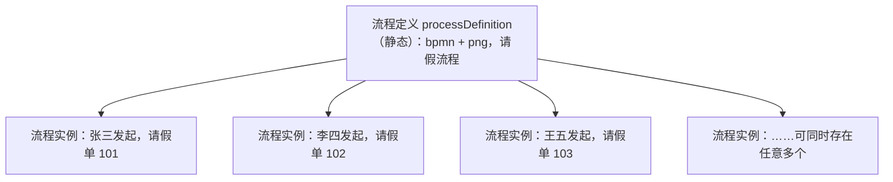
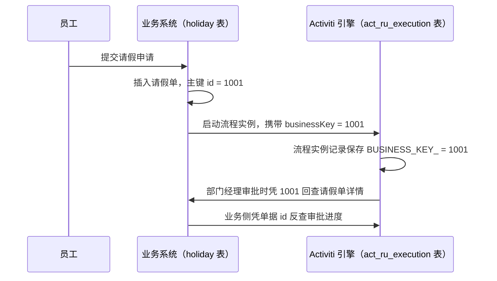

# 引擎管流转，业务表管数据：Activiti 与业务系统整合的原理

审批人到待办列表里领到一个请假审批任务，第一反应是点开看详情：谁请的假、请哪几天、事由是什么。可打开 Activiti 的 25 张表逐个翻，当事人的名字没有，请假起止日期没有，事由更没有。引擎把流程推到了部门经理审批节点，却完全不关心这张单子本身的内容。

这个现象不是缺陷，而是分工。流程引擎只负责「按流程定义把环节一步步推进」，业务数据天然属于业务系统自己的库。两套数据要产生联系，靠的是一个专门的字段：businessKey。整合开发的原理，就是把这个字段的来龙去脉讲清楚。

## 先给结论

- 流程定义是静态的（bpmn 与 png 两种资源），流程实例是动态的，一套定义可以同时支撑成百上千个实例并行，互不干扰。
- Activiti 的 25 张表只为引擎自身运转服务，存的是流程定义、执行轨迹、任务、历史这些引擎数据，业务单据的内容一条都不存。
- 请假单的业务字段（当事人、起止时间、事由、类型、审批状态）必须落在业务系统自己的库里，例如人事系统中的请假表。
- 两套数据的桥梁是 businessKey（业务主键）：启动流程实例时把业务表的主键一并交给引擎，引擎随流程实例存起来。
- 有了 businessKey，引擎每推进一步都知道「是哪张业务单在推进」，业务侧也能凭单据主键反查流程进度，双向可查。

## 一、一套定义，N 个实例

整合之前先把流程模型这两块基石摆正。

**流程定义是静态的。** 用 bpmn 文件（xml 格式）描述请假流程：start event 出发，经过填写请假单、部门经理审核、总经理审核，到 end event 结束，再配一张 png 示意图。部署进引擎后它就是一张「模板」，规定不管谁来请假，都得按这套环节走。

**流程实例是动态的。** 参与者按照流程定义发起一个流程，就得到一个流程实例。公司 100 个员工，张三今天发起，李四明天发起，王五后天发起，同一个模板同时跑出很多条实例，彼此的推进进度互不影响。



图上的关键在于一对多的箭头：定义只有一份，实例可以无限多。启动实例的课程代码也只传了流程定义的 key，还没有任何业务信息（包名已改为 `com.example`）：

```java
package com.example.activiti;

import org.activiti.engine.ProcessEngine;
import org.activiti.engine.ProcessEngines;
import org.activiti.engine.RuntimeService;
import org.activiti.engine.runtime.ProcessInstance;

public class ActivitiStartInstance {
    public static void main(String[] args) {
        //1.得到ProcessEngine对象
        ProcessEngine processEngine = ProcessEngines.getDefaultProcessEngine();

        //2.得到RuntimeService对象
        RuntimeService runtimeService = processEngine.getRuntimeService();

        //3.创建流程实例，流程定义的key为holiday
        ProcessInstance processInstance = runtimeService.startProcessInstanceByKey("holiday");

        //4.输出实例的相关信息
        System.out.println("流程定义ID" + processInstance.getProcessDefinitionId());
        System.out.println("流程实例ID" + processInstance.getId());
    }
}
```

这样的启动只产生了一条引擎内部的运行记录，它和任何一张真实的请假单都没有关系。差距在哪，往下看。

## 二、25 张表装不下业务数据

人事管理系统里流程化的工作非常多：请假、调岗、调薪、面试，每一类背后都有一张业务表。以请假为例，业务本身至少包含这些内容：请假当事人是谁、从哪天开始、到哪天结束、事由是什么、是事假病假还是婚假丧假（请假类型）、审批到什么状态（通过还是驳回）。

这些数据存哪？答案只能是业务系统自己的库。引擎的 25 张表服务于一个目标：让 Activiti 自己能运转起来。它不可能预知将来接入的是请假、调薪还是采购审批，表结构更不可能为每一种业务的字段都留好位置。给业务系统建一张专门的请假表（此处为按本课场景补全的示例表）：

```sql
-- 请假单业务表（示例，随业务系统建库）
CREATE TABLE holiday (
    id          INT PRIMARY KEY AUTO_INCREMENT COMMENT '请假单主键',
    name        VARCHAR(64)  COMMENT '请假当事人',
    begin_time  DATETIME     COMMENT '请假开始时间',
    end_time    DATETIME     COMMENT '请假结束时间',
    reason      VARCHAR(255) COMMENT '请假事由',
    type        VARCHAR(16)  COMMENT '请假类型：事假/病假/婚假/丧假',
    state       VARCHAR(16)  COMMENT '审批状态'
);
```

员工每发起一次请假，业务系统往 `holiday` 表插一条记录。问题随之而来：这条记录和 Activiti 没有任何关系，引擎根本不知道有人发起了请假，自然也谈不上替它推进审批。

## 三、关联方式：businessKey 业务主键

**第一，要让引擎认识这张业务单。** 办法是把请假单的主键在启动流程实例时一并交给引擎。引擎把它存进流程实例对应的记录里，这个值就叫 businessKey，业务标识，通常取业务表的主键。

**第二，存进去之后两条路都通了。** 引擎侧：流程推进到部门经理审批时，拿着记录里的 businessKey 到业务表里一查，就知道是哪位员工的哪张请假单走到了这一步。业务侧：员工凭自己请假单的 id 去引擎里反查，也能知道单子当前批到哪个节点。业务数据与流程数据分库存放，靠主键互查打通。



这张时序图就是整合的全部骨架：业务数据进业务库，引擎数据进引擎库，`businessKey` 是两边各存一份的公共钥匙。前面做过的各类演示，启动实例、查询任务、办理任务，证明的是引擎自己能转；把 businessKey 带上，引擎的转动才真正挂到了具体业务上。至于这个值最终落在引擎哪张表的哪个字段、代码怎么写，后面的表结构与实操两课逐层展开。

## 常见误区

- **以为引擎表里能查到请假单详情**：25 张表里只有流程运行数据，当事人、起止日期、事由这些业务字段要去业务系统自己的表里查，引擎侧只有主键。
- **把业务数据和流程变量混为一谈**：流程变量适合传少量的过程数据，成型的业务单据应落业务表，引擎侧只保留主键引用，否则查询与维护都会失控。
- **businessKey 与流程实例 ID 混为一谈**：businessKey 是业务表主键，由业务侧决定；流程实例 ID 是引擎生成的运行记录编号，两者含义与来源完全不同。
- **以为一套流程定义同一时刻只能跑一个实例**：定义是模板，实例是运行记录，同一模板并行跑几百条实例是常态。

## 面试可能被问到的问题

1. 面试官追问：「Activiti 的 25 张表为什么不直接把业务数据也存了？」
   答：这 25 张表的职责是保证引擎自身运转，存流程定义、执行、任务、历史等引擎数据。业务字段因场景而异，引擎的表结构不可能为每类业务预留，所以业务数据放业务系统的库，两边用业务主键关联。

2. 面试官追问：「流程定义和流程实例是什么关系？」
   答：定义是静态模板，由 bpmn 与 png 资源部署产生；实例是参与者按定义发起的一次运行，是动态的。一对多关系，一套定义可同时支撑大量并行实例，实例之间互不干扰。

3. 面试官追问：「businessKey 是什么？在整合中起什么作用？」
   答：businessKey 是业务标识，通常取业务表的主键，在启动流程实例时传入并存进引擎的实例记录。它是业务数据与流程数据的关联键，引擎凭它回查业务详情，业务侧凭它反查流程进度。

4. 面试官追问：「业务系统接入工作流引擎，数据层应该怎么划分？」
   答：双库分工。业务单据的完整字段存业务库，引擎的运行与历史数据存引擎库，两库之间不做外键约束，靠 businessKey 做逻辑关联，任何一侧的表结构变更都不会牵动另一侧。

5. 面试官追问：「100 个员工同时请假，引擎怎么区分是谁的单子在推进？」
   答：每次发起请假都会生成独立的流程实例，实例记录里带着各自的 businessKey，也就是请假单主键。引擎推进某条实例时按它的 businessKey 就能定位到具体的请假单。

## 配套资料

- 启动流程实例实现类：`materials/code/02/Activiti7-day03-进阶1/Activiti7-day03-进阶1/代码/更新到第三天/代码/src/main/java/` 下的 `ActivitiStartInstance.java`（包名已改为 `com.example`）
- 引擎与数据源配置：同工程 `src/main/resources/activiti.cfg.xml`
- 第二节 `holiday` 建表语句为按本课场景补全的示例，课程源码包内无对应 SQL 文件
